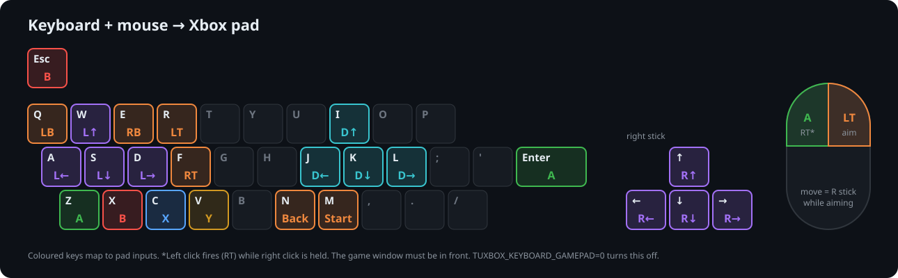

# 6Launch: run Xbox Series games on a Windows PC


**In plain terms:** Xbox Series consoles and Windows PCs share the same kind of processor. Their games differ mainly in the system pieces they call into, like graphics, files, input and sound. 6Launch lets a PC start a game copied from your own Xbox. It swaps those console pieces for Windows versions, so the game runs directly, with no slow emulation of a whole console.

It's an early work in progress: the GTA VI Xbox build starts, renders its intro screens (the GTA stars) and reaches the player-selection prompt (Account Picker / Screen Narration / TuxBox), but test runs reach only 2.4 fps (mostly our own diagnostics) and it isn't playable yet (see [Status](#status) and [Roadmap](#roadmap)). You need your own legally dumped copy of a game. None is included.

**Technical summary:** runs a dumped Xbox Series (Scarlett / GDK) executable on Windows. The game's x64 code runs natively; its console DLLs are replaced by TuxBox Rust providers built from `vendor/tuxbox` (source only, no binaries).

```
6launch --game <dump dir> [--sandbox] [--debug | --cdb <commands file>] [--log <file>]
6launch --game <dump dir> --restore
```

Needs Visual Studio Build Tools (x64 C++), cargo, and the x86_64-pc-windows-msvc target. `--sandbox` needs Sandboxie-Plus. `--debug` needs cdb from the Windows SDK. Run `6launch --help` for every option.

## Controls

Keyboard and mouse drive a virtual Xbox pad (on by default; `TUXBOX_KEYBOARD_GAMEPAD=0` leaves only real XInput pads). The game window must be in front.



## Status

The Xbox Series build of GTA VI (`game_scarlett_master.exe`, from your own dump) gets this far:

- Runs natively on Windows with the console DLLs replaced by Rust providers.
- Passes `xgameruntime` initialisation, maps the console `G:` drive to the executable's folder and mounts every `.rpf` archive.
- Creates a D3D12 device and renders lit frames in its window: the GTA stars intro, then the player-selection prompt. A 5-minute test run had no device removal and no `Close` failures.

Runtime fixes in the vendored TuxBox provider:

- **Rendering fixes:**
  - A stale inline descriptor binds a typed null instead of failing the command list.
  - A failed batch drops only itself, instead of blocking every later submission.
  - A GPU memory wait after rendering commands is skipped, instead of rejecting the list.
  - Placed textures over unmapped pages upload zero-filled, instead of never refreshing.
- **Present barrier:** the end-of-frame barrier that sends the display surface to present used layout 31, which desktop D3D12 rejects, so every frame's `Close` failed. Layouts outside the desktop range are now recorded as COMMON (= PRESENT). This is the fix that made frames appear.
- **Presentation:** the swap chain resizes when the title changes its output size or format.
- **Startup crash fixed:** the title's list slot 131 call is a cache barrier but was routed to the ray-tracing build path, which read garbage memory; it now records a cache barrier. A host list whose `Close` fails is rebuilt instead of failing every later `Reset`.
- **Root views:** root CBV/SRV/UAV binds import up to 64 KiB of committed title memory (they imported 1 byte before); an uncommitted address binds null.
- **Queues and lists:** queue slot 29 (`CopyPageMappingsBatchX`) on the older table, queries and split barriers closed out before `Close`, a copy-list timestamp heap, and extended `Reset` options ignored instead of refused.
- **Shader sampler lookup:** a run-time descriptor table (FNV-1a hash of the shader's sampler words) gives translated shaders host samplers for samplers written into the shader code.
- **Command allocators:** a list reset on an allocator another list is still recording from gets an extra host allocator (Xbox allows this; desktop D3D12 returns E_INVALIDARG).
- **Views D3D12 rejected:**
  - Null UAVs on a depth image's stencil plane drop the plane slice.
  - B5G5R5A1 UAVs are viewed as R16_UINT.
  - R32_UINT render targets are castable to R9G9B9E5.
- **Memory D3D12 can't import:** buffers and placed buffers that span separately mapped title pages use device-local copies.
- **Shader translator (`xshader`):** legacy FMA keeps `c` for 0×inf and 0×NaN; `v_movrelsd_2_b32`, `v_swaprel_b32`, `v_sat_pk_u8_i16` and `image_gather4_l` on 2D images translate.
- **Shader compiler:** the launcher stages the SDK's `dxcompiler.dll` and `dxil.dll` beside the game for rectangle-list pipelines.
- **Diagnostics:** `--debug` dumps registers, stacks, the memory region and code around a fault. The launcher prints a one-line run summary; `--timeout S` stops a run cleanly and `--summary LOG` summarises an old log. `TUXBOX_LIST_RING=1` logs the last list calls when a host `Close` fails, and `TUXBOX_BARRIER_PROBE=1` closes each barrier alone to name a field the host rejects. The present heartbeat logs fps every 10 s, split into record, close, submit, present, pipeline-wait and memory-wait time. `TUXBOX_TRACE_PRESENT=60` samples whether frames are lit. Under `--debug`, title `int 3` asserts are logged and stepped over, and GameInput logs gamepad reads and pressed buttons. Each crash theory has its own `TUXBOX_*` switch, so variants can run from one build.
- **Earlier diagnostics:**
  - A PresentX heartbeat every 300 frames.
  - The log names the view call that removed the device.
  - `--debug` no longer logs the title's illegal-instruction CPU probes.

## Open

- **Frame rate:** a 5-minute run under the debugger reached 2.4 fps with lit frames and no Close failures. Most of the cost was `TUXBOX_LIST_RING` (a stack walk on every recording call, plus a scratch `Close` for every barrier), which is now cheaper, with the probe split out. A clean baseline (no `--debug`, no ring) hasn't been measured yet.
- **Title assert:** a release-build size check at game+0x4ffd879 hits `int 3` and then falls through. The runtime steps over it (ported from upstream TuxBox), and so does the `--debug` script.
- **Input:** keyboard and mouse drive a virtual pad (see [Controls](#controls)). It's not confirmed yet that the title reads it at the player-selection prompt.
- **Later screens:** according to other projects, screens after the start screen need blend state read from the pipeline's render-state block before they draw correctly.
- **Shader translation:** offline `--build-shaders` refused most programs, mainly descriptors without the title's root layout. `xshader` now binds those from the shader's own FSSM binding records and resolves inline samplers from PSV (ported from TuxBox cc752ba); in a 60-shader sample 15 former refusals now translate. Also ported: private samplers for root-less roots, literal sampler matching, raw SRVs behind root descriptors, and compute descriptors the runtime appends from FSSM/PSV records. `--build-shaders` ranks refusals by construct and reason, and dxc retries at `-O0` when `-O1` times out.
- **B5G5R5A1 UAVs:** the shader writes float colour into an R16_UINT view, so the 5551 packing is wrong.
- **Memory layout:** title memory is mapped as separate 64 KiB section views. D3D12 can't open one heap across them, so large buffers fall back to per-submission copies. Backing each pool with one section would remove the copies.
- **Shader prewarm:** a full prewarm (`TUXBOX_PREWARM`, on by default) waits on remaining translator refusals in `xshader`. Use `TUXBOX_PREWARM=0` for quick runs.

## Roadmap

1. **Get past the start screen.** Pick the profile, raise the frame rate, and take blend state from the pipeline's render-state block so later screens draw.
2. **Stay running.** Keep long runs going past the menus (`--debug` records any crash or exit stack).
3. **Correct colour.** Pack 5551 in the shader, or substitute B5G5R5A1 UAV and render-target images with R8G8B8A8.
4. **Speed.** Back each XMem pool with one section and join in-order page runs, so GPU imports span them without copies.
5. **Shaders.** Finish the remaining `xshader` refusals (dynamic `s_load` offsets, mesh shaders), then run a full prewarm and ship the pipeline cache.
6. **Input and audio.** Confirm the title reads the virtual pad at the player-selection prompt, then check audio.
7. **Playable.** Reach the menu, load into the world, profile frame time.

No game files, keys or binaries are in this repository. Bring your own copy of the game. Not affiliated with Rockstar, Take-Two or Microsoft.

## Credits

6Launch stands on other people's work. Thank you to:

- **[TuxBox](https://github.com/brcly/TuxBox)** by brcly: the console-DLL providers, D3D12 runtime and `xshader` translator, vendored under `vendor/tuxbox` (Apache-2.0), plus many later upstream fixes ported in.
- **[VIctory](https://github.com/Marvisak/VIctory)** by Marvisak: typed null descriptors, async pipeline building, argument clamps and per-frame pipeline budgets.
- **[xcl](https://github.com/ivall/xcl)** by ivall: page-split copies and zero-filled placed uploads, triple-buffered presentation, and the resize and memory-wait designs.
- **[Xbox2Windows](https://github.com/R0Y00/Xbox2Windows)** by R0Y00: sampler-heap bounds and shader-translation cross-checks.
- **[xbox-emulator](https://github.com/omonkeyz/xbox-emulator)** by omonkeyz: fence handling on device removal.
- **[OpenScarlett](https://github.com/californiaAlmonds/OpenScarlett)** by californiaAlmonds: rendering fixes.
- ~~**[leonida-anyp5](https://github.com/tibzejoker/leonida-anyp5)** by tibzejoker: lowering lane reads and writes to subgroup shuffles in `xshader`.~~
- **[Leonida](https://github.com/LeonidaReforge/Leonida)** by LeonidaReforge: the retail boot chain that sized the device table.

## Licence

`vendor/tuxbox` is TuxBox, under Apache-2.0 (see `vendor/tuxbox/LICENSE`, and the notices under `vendor/tuxbox/docs/licenses`). This repository's own code is also Apache-2.0 (see `LICENSE`).
