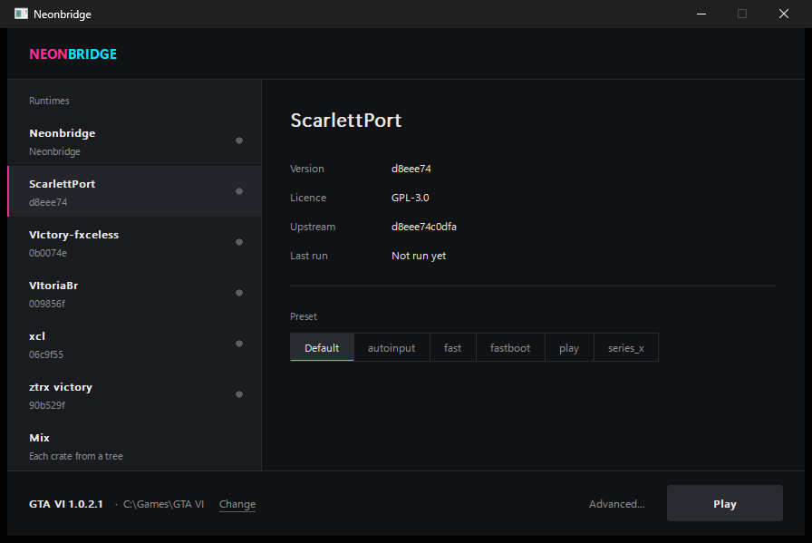
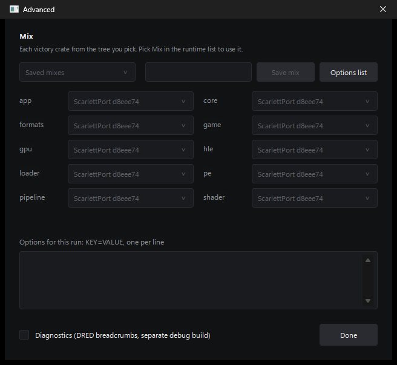
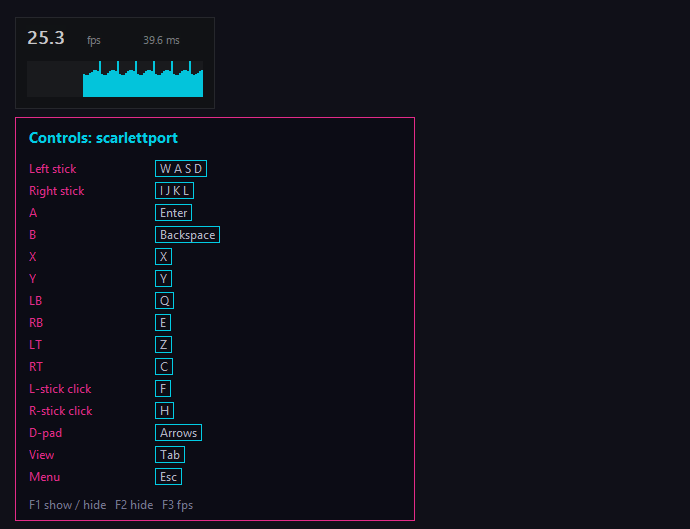
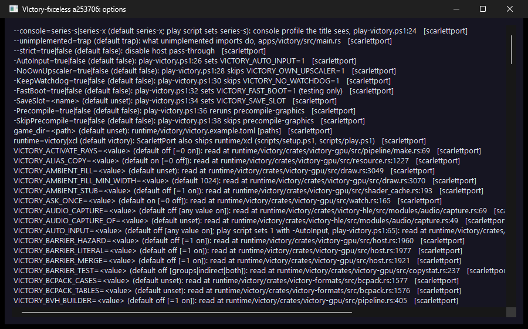

# Neonbridge: one launcher for every GTA VI (GTA 6) Xbox Series runtime on PC


Test them all in one convenient launcher.

**Status: WIP.** Neonbridge is one launcher that runs each leading project's working build, vendored whole and unchanged, against the Xbox Series X|S (Scarlett) build of Grand Theft Auto VI that you dumped from a console you own. Pick a runtime, and Neonbridge builds it when its sources are newer than its exe, sets it up, starts it with that runtime's settings and logs the run. It **isn't playable yet**. No game files are included or linked, and the current release is the v0.2.0-alpha pre-release.

## Status

| Runtime | Builds | Launches via loader | Intro | 3D scene | Playable | Notes |
|---|---|---|---|---|---|---|
| ScarlettPort | ✅ | ✅ | ✅ | ⚠️ | ❌ | Intro 30 fps; 3D scenes 2–3 fps (warm cache, ray tracing off) |
| victory (fxceless) | ✅ | ❌ | ❌ | ❌ | ❌ | Untested |
| VItoriaBr | ✅ | ✅ | ✅ | ⚠️ | ❌ | Device removed in 3D; ray-tracing fix pending |
| ztrx-victory | ✅ | ❌ | ❌ | ❌ | ❌ | Untested |
| xcl | ✅ | ❌ | ❌ | ❌ | ❌ | Untested |
| Neonbridge (own build) | ✅ | ❌ | ❌ | ❌ | ❌ | Untested |
| TuxBox (upstream) | ⚠️ | ❌ | ❌ | ❌ | ❌ | brcly/TuxBox as vendored; upstream says Windows compatibility is in development. Needs Python 3.10+ and the VS x64 C++ tools |
| Five Star Recomp | ❌ | ❌ | ❌ | ❌ | ❌ | Not bundled: needs the .NET 10 SDK |

| Feature | Status | Notes |
|---|---|---|
| Loader | ✅ | |
| FPS overlay | ✅ | F3 shows or hides it |
| Shared saves | ⚠️ | One save folder for the victory family; untested |
| Shared cache | ✅ | One cache folder for the victory family |
| Controls overlay | ✅ | F1 shows or hides it, F2 hides it |
| Mix mode | ⚠️ | Untested |

## Screenshots

| | |
|---|---|
|  |  |
| **Launcher.** Pick a runtime and its preset. The game is found by itself; Change opens the folder dialog. | **Advanced.** Mix mode takes each victory crate from the tree you pick (clashes in vendor/mix-compat.toml are marked), plus the run options. |
|  |  |
| **Loader.** Shows the patch, build, warm and launch steps with progress. | **Controls and fps overlays.** The runtime's key map (F1 shows or hides it, F2 hides it) and fps (F3). |



**Options...** lists every option of the runtime, or of each tree in a mix, with its default and where it is read.

## Quick start

```
cargo build --release                      # target\release\neonbridge.exe
neonbridge                                 # numbered picker: runtime and preset, then the game folder
neonbridge --runtime victory --game <dump dir> [--log run.log] [--timeout S]
```

You need Visual Studio Build Tools with the x64 C++ tools, the Windows SDK and Rust (stable, `x86_64-pc-windows-msvc`). Each runtime's own toolchain is pinned in its tree (`rust-toolchain.toml`), and rustup fetches it.

## Runtimes

Each runtime is a tree under `vendor/<name>`, copied unchanged from its upstream at the hash in its `UPSTREAM` file. Its `NEONBRIDGE.toml` tells the launcher how to build it, which exe and arguments to run, its environment, options, presets and setup steps.

| `--runtime` | What it is | Upstream |
|---|---|---|
| `scarlettport` (default) | ScarlettPort's VIctory-based runtime and launcher scripts | ZigZagBoi1/ScarlettPort |
| `victory` | VIctory-fxceless, the victory emulator fork | fxceless/victory-fork |
| `vitoriabr` | VItoriaBr's VIctory fork | uiliannn/VItoriaBr |
| `ztrx-victory` | ztrx's VIctory fork | Zettrox/ztrx |
| `xcl` | xcl | ivall/xcl |
| `neonbridge-own` | Neonbridge (own build): TuxBox console-library providers staged into the game folder, with Neonbridge's fixes and shader translator (`tuxbox` still works as its name for this release) | brcly/TuxBox |

## Commands

| Command | Does |
|---|---|
| `neonbridge` | In a terminal with no arguments: every runtime and each of its presets as numbered choices (Enter takes the default), then the game-folder picker. `NEONBRIDGE_PICKER=0` skips both. |
| `--runtime <name>` | The runtime to use (or `NEONBRIDGE_RUNTIME`; default `scarlettport`). |
| `--list` | The runtimes. |
| `--list <name>` | That runtime's options, their defaults and the values a run would use, plus its presets and setup steps. |
| `--set NAME=VALUE` | One option for this run: an environment variable, or `--set --flag=VALUE` for the runtime's own arguments. Repeatable. |
| `--preset <name>` | A preset from the runtime's `NEONBRIDGE.toml`, applied before `--set`. |
| `--setup <name>` | The runtime's setup steps. A step that downloads something or needs a file of yours asks first and runs only on a typed `yes`. |
| `--game <dir>`, `--exe <file>` | The dump folder, and another title exe in it. |
| `--log <file>`, `--timeout <s>` | The runtime's stdout and stderr go to the log, with a `heartbeat: completed PresentX #N (F fps)` line after each frame-rate line. The timeout stops the run. |
| `--build-only`, `--prewarm` | Build the runtime only, or run its shader prewarm. |

Settings apply in this order, the later winning: the toml, your environment, the preset, then `--set`. Each runtime's cache is `%LOCALAPPDATA%\6ixpack\<name>\cache`. A runtime that opts in to the D3D12 Agility SDK gets it from `NEONBRIDGE_AGILITY_DIR` (default `%LOCALAPPDATA%\6ixpack\agility-1.614.1`, the DLLs of the official Microsoft.Direct3D.D3D12 1.614.1 NuGet package).

The `neonbridge-own` runtime keeps its own options (`--debug`, `--rev`, `--tuxbox`, `--pipelines`, `neonbridge ctl ...`); `neonbridge --runtime neonbridge-own --help` lists them.

## Requirements

- **Game:** your own dump of the Xbox Series X|S build of GTA VI: the folder with `game_scarlett_master.exe`, `shaders.rpf` and `pack/`, about 210 GB.
- **System:** Windows 10 or 11, x64, with a CPU that has AVX2 (the game's code is run as-is).
- **GPU:** a D3D12 GPU with Shader Model 6.6 and mesh shaders, and an up-to-date driver.
- **Memory:** at least 20 GB of free commit (RAM plus page file). 32 GB of RAM with a system-managed page file is recommended.
- **Disk:** the dump, plus the runtimes' builds and shader caches (up to about 20 GB each).

## FAQ

- **Can I play GTA 6 on PC with this?** Not yet; every runtime here is a work in progress.
- **Is this a download or crack?** No. No game files, keys or binaries, and no protection bypassed. Bring your own dump.
- **Whose work is this?** Mostly the vendored projects'. Neonbridge is the launcher around them, plus its own build (`neonbridge-own`); see [CREDITS.md](CREDITS.md).
- **Does it go online?** Only for what you approve: `--setup` steps that download something ask first. The runtimes themselves don't need the network.

## Credits

Every vendored runtime and every project Neonbridge's own code borrows from is named in [CREDITS.md](CREDITS.md), with its authors, licence and upstream hash.

## Licence

GPL-3.0-or-later ([LICENSE](LICENSE)). Each vendored tree keeps its own licence (`vendor/<name>/LICENSE`): xcl is GPL-2.0-only, the VIctory forks and ScarlettPort are GPL-3.0, and TuxBox is Apache-2.0. Grand Theft Auto, GTA and Rockstar Games are trademarks of Take-Two Interactive; Xbox is a trademark of Microsoft. Neonbridge isn't affiliated with or endorsed by them.

<sub>Keywords: GTA 6 PC, GTA VI PC, GTA 6 launcher, Grand Theft Auto VI Windows, Xbox Series X|S to PC, Scarlett, VIctory, ScarlettPort, xcl, TuxBox.</sub>
