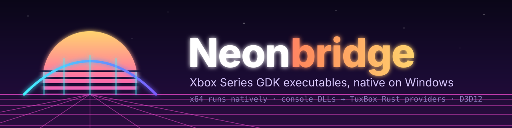

# Neonbridge: launch GTA VI (GTA 6) Xbox Series games on a Windows PC



**Neonbridge is an open-source GTA VI (GTA 6) launcher for Windows PC.** It starts the Xbox Series X|S build of Grand Theft Auto VI, dumped from a console you own, natively on Windows. It isn't a slow whole-console emulator: Xbox Series consoles and Windows PCs use the same x64 processor family, so the game's own code runs directly. Neonbridge only swaps the console system pieces it calls into (graphics, files, input, sound) for Windows versions built on D3D12.

**Where it is today:** GTA VI boots, plays its intro (the GTA stars) and reaches the player-selection prompt, where it takes keyboard input through a virtual Xbox pad. It runs at about 5 fps and **isn't playable yet** (see [Status](#status) and [Roadmap](#roadmap)). You need your own legally dumped copy of the game. No game files are included or linked.

**Technical summary:** runs a dumped Xbox Series (Scarlett / GDK) executable on Windows. The game's x64 code runs natively, and its console DLLs are replaced by TuxBox Rust providers built from `vendor/tuxbox` (source only, no binaries).

## Quick start

```
neonbridge --game <dump dir> [--sandbox] [--debug | --cdb <commands file>] [--log <file>] [--timeout S]
neonbridge --game <dump dir> --restore
neonbridge --summary <log>
```

Needs Visual Studio Build Tools (x64 C++), cargo, and the x86_64-pc-windows-msvc target. Build with `cargo build --release`. `--sandbox` needs Sandboxie-Plus, and `--debug` needs cdb from the Windows SDK. Run `neonbridge --help` for every option. For quick runs, set `TUXBOX_PREWARM=0` to skip the full shader prewarm.

## FAQ

- **Can I play GTA 6 on PC with this?** Not yet. GTA VI reaches its player-selection screen but isn't playable. Watch the [Roadmap](#roadmap).
- **Is this a GTA 6 download or crack?** No. Neonbridge contains no game files, keys or binaries, and it doesn't bypass any protection. It only runs a copy you dumped from your own Xbox Series console.
- **Is it an Xbox Series X|S emulator?** Not a full one. Like Wine, it translates system calls: the game's x64 code runs natively, and Xbox D3D12, memory, file, input and runtime calls go to Windows equivalents.
- **What hardware do I need?** A Windows 10 or 11 x64 PC with a D3D12 GPU. Speed is still far from the console's.
- **Other Xbox Series games?** The launcher works with any dumped GDK executable, but GTA VI is the only title being tested.

## Controls

Keyboard and mouse drive a virtual Xbox pad. It's on by default, and `TUXBOX_KEYBOARD_GAMEPAD=0` leaves only real XInput pads. The game window must be in front.


## Status

What the Xbox Series build of GTA VI (`game_scarlett_master.exe`, from your own dump) does today:

- **Boot:** it runs natively with the console DLLs replaced by Rust providers, passes `xgameruntime` initialisation, maps the console `G:` drive to the executable's folder and mounts every `.rpf` archive.
- **Rendering:** it creates a D3D12 device and draws lit frames in its own window: the GTA stars intro, then the player-selection prompt (Account Picker / Screen Narration / TuxBox). Command lists close cleanly every frame, with no device removal.
- **Input:** the title reads the virtual pad at the player-selection prompt, and an A press (Enter or Z) reaches it.
- **Saves:** game saves and settings are written to `%LOCALAPPDATA%\TuxBox\PersistentLocalStorage\<title id>\GameSave\`, so choices should carry over between launches (new, not yet confirmed in a run).
- **Longest run:** 344 s and 1777 frames at about 4.5 fps, ending on a fail-fast exit (`0xc0000602`) that a `--debug` run is tracing.

### Runtime fixes

These are in the vendored TuxBox provider:

- **Present barrier:** the end-of-frame barrier that sends the display surface to present used layout 31, which desktop D3D12 rejects, so every frame's `Close` failed. Layouts outside the desktop range are now recorded as COMMON (= PRESENT). This is the fix that made frames appear.
- **Enhanced barriers (list slot 146):** texture barriers are fitted to the host resource (subresource range, layouts and accesses, DISCARD, buffer targets), and sync and access pairs are made legal.
- **Startup crash:** the title's list slot 131 call is a cache barrier, but it was routed to the ray-tracing build path, which read garbage memory. It now records a cache barrier. A host list whose `Close` fails is rebuilt instead of failing every later `Reset`.
- **Title asserts:** a release-build size check at game+0x4ffd879 hits `int 3` and then falls through, so the runtime steps over it when its bytes match (ported from upstream TuxBox).
- **Texture layouts:** Xbox layout 0x10a (64 KiB display swizzle, mipped) gets a real size and placement, instead of an invalid one that crashed the title.
- **Copies:** list slot 62 (`CopyMemoryToMemoryX`) records a buffer copy instead of failing fast.
- **Game saves (`xgameruntime`):** XGameSave containers, blobs, updates, quota and the save-files folder are stored on disk instead of returning nothing.
- **Rendering:**
  - A stale inline descriptor binds a typed null instead of failing the command list.
  - A failed batch drops only itself, instead of blocking every later submission.
  - A GPU memory wait after rendering commands is skipped instead of rejecting the list.
  - Placed textures over unmapped pages upload zero-filled.
- **Presentation:** the swap chain resizes when the title changes its output size or format.
- **Root views:** root CBV/SRV/UAV binds import up to 64 KiB of committed title memory, and an uncommitted address binds null.
- **Queues and lists:**
  - Queue slot 29 (`CopyPageMappingsBatchX`) works on the older table.
  - Queries and split barriers are closed out before `Close`.
  - Copy lists get a timestamp heap.
  - Extended `Reset` options are ignored instead of refused.
- **Command allocators:** a list reset on an allocator that another list is still recording from gets an extra host allocator. Xbox allows this, but desktop D3D12 returns E_INVALIDARG.
- **Shader samplers:** a run-time descriptor table gives translated shaders host samplers for sampler words written into the shader code.
- **Views D3D12 rejected:**
  - Null UAVs on a depth image's stencil plane drop the plane slice.
  - B5G5R5A1 UAVs are viewed as R16_UINT.
  - R32_UINT render targets are castable to R9G9B9E5.
- **Memory D3D12 can't import:** buffers and placed buffers that span separately mapped title pages use device-local copies.
- **Shader translator (`xshader`):**
  - Descriptors without the title's root layout are bound from the shader's own FSSM and PSV records.
  - Compute-heap stores, wave width, VCC branch votes across the wave, `bpermute`, and many single instructions translate.
  - Hint and debug SOPPs are no-ops.
  - dxc retries at `-O0` when `-O1` times out.
  - `[WaveSize]` widths the host GPU lacks are compiled out (`TB_NO_WAVESIZE_<n>`), using the wave range the runtime reads from the device.
- **Speed:**
  - Buffer binds keep their imported memory alive, so recording dropped from about 156 ms to under 2 ms per frame.
  - Copies of buffers that span separately mapped pages are merged, and buffers are written back only after the GPU actually wrote them.
- **Launch:** a neon loading screen shows until the game's first frame (`NEONBRIDGE_SPLASH=0` turns it off).

### Diagnostics

- **`--debug`:** runs under cdb and dumps registers, stacks, the memory region and code around a fault. Title `int 3` asserts are logged and stepped over.
- **Run summary:** the launcher prints one line with fps, the per-frame cost split (record, close, submit, present, waits), the most expensive recording calls, lit-frame samples and failure counters. `--timeout S` ends a run cleanly, and `--summary LOG` summarises an old log.
- **Heartbeat:** the present heartbeat logs fps every 10 s, plus GPU latency per frame and each thread's CPU time. An fps overlay shows in the game window, and `TUXBOX_FPS=0` hides it.
- **Diagnostic switches:**
  - `TUXBOX_TRACE_PRESENT=60` samples whether frames are lit.
  - `TUXBOX_LIST_RING=1` logs the last list calls when a host `Close` fails.
  - `TUXBOX_BARRIER_PROBE=1` closes each barrier alone to name a field the host rejects.
  - Each crash theory has its own `TUXBOX_*` switch, so variants can run from one build.
- **Input logs:** GameInput logs when the title reads the pad and which buttons are down.

## Open

- **Frame rate (about 5 fps):** about 117 large buffers sit over separately mapped 64 KiB pages that D3D12 can't open as one heap, so every submission copies roughly 640 MB in and out. Mapping those buffers onto the game's memory as tiles removed the GPU device in testing, so it's off for now (`TUXBOX_TILED_ALIAS=1`). Next: map the game's memory in bigger pieces, or copy only the parts each frame uses.
- **Fail-fast exit:** the 344 s run ended on `0xc0000602` with no stack in the log, so a `--debug` run is catching it.
- **Later screens:** according to other projects, screens after the start screen need blend state read from the pipeline's render-state block before they draw correctly.
- **Shader translation:** offline `--build-shaders` still refuses some programs, mainly dynamic `s_load` offsets and mesh shaders. A full prewarm (`TUXBOX_PREWARM`, on by default) waits on these.
- **B5G5R5A1 UAVs:** the shader writes float colour into an R16_UINT view, so the 5551 packing is wrong.

## Roadmap

1. **Speed.** Back each XMem pool with one section (or copy only what a frame touches) so GPU imports need no per-submission copies.
2. **Get past the start screen.** Fix the fail-fast exit, pick the profile, and take blend state from the pipeline's render-state block so later screens draw.
3. **Correct colour.** Pack 5551 in the shader, or substitute R8G8B8A8 for B5G5R5A1 UAV and render-target images.
4. **Shaders.** Finish the remaining `xshader` refusals, then run a full prewarm and ship the pipeline cache.
5. **Audio.** Check the audio path once the title reaches its menu.
6. **Playable.** Reach the menu, load into the world, and profile frame time.

No game files, keys or binaries are in this repository. Bring your own copy of the game. Grand Theft Auto, GTA and Rockstar Games are trademarks of Take-Two Interactive. Xbox is a trademark of Microsoft. Neonbridge isn't affiliated with or endorsed by Rockstar, Take-Two or Microsoft.

## Credits

Neonbridge stands on other people's work. Thank you to:

- **[TuxBox](https://github.com/brcly/TuxBox)** by brcly: the console-DLL providers, D3D12 runtime and `xshader` translator, vendored under `vendor/tuxbox` (Apache-2.0), plus many later upstream fixes ported in, including the title-assert step-over.
- **[VIctory](https://github.com/Marvisak/VIctory)** by Marvisak: typed null descriptors, async pipeline building, argument clamps and per-frame pipeline budgets.
- **[xcl](https://github.com/ivall/xcl)** by ivall: page-split copies and zero-filled placed uploads, triple-buffered presentation, and the resize and memory-wait designs.
- **[Xbox2Windows](https://github.com/R0Y00/Xbox2Windows)** by R0Y00: sampler-heap bounds and shader-translation cross-checks.
- **[xbox-emulator](https://github.com/omonkeyz/xbox-emulator)** by omonkeyz: fence handling on device removal.
- **[OpenScarlett](https://github.com/californiaAlmonds/OpenScarlett)** by californiaAlmonds: rendering fixes.
- **[rebox](https://github.com/puffnfresh/rebox)** by puffnfresh: stalled GPU memory-wait diagnostics.
- **[palmetto](https://github.com/luizwidmer/palmetto)** by luizwidmer: queue slot 35 as a clock calibration, and per-lane wave tests in `xshader`.
- **[leonida-ce](https://github.com/IAmNotSiob/leonida-ce)** by IAmNotSiob: which extended list options and timestamp writes are safe to ignore or emulate.
- **[KestrelX](https://github.com/Batushn/KestrelX)** by Batushn (MIT): compiling `[WaveSize]` out per wave width so kernels run on the host wave.
- **[GTA6-BootTest](https://github.com/OnlyMoisties/GTA6-BootTest)** by OnlyMoisties: notes on what later screens need, such as blend state from the render-state block.
- **[Leonida](https://github.com/ubiquitarianism/leonida)** by ubiquitarianism: shader-translation ports in `xshader`.
- **[Leonida](https://github.com/LeonidaReforge/Leonida)** by LeonidaReforge: the retail boot chain that sized the device table.
- ~~**[leonida-anyp5](https://github.com/m3ll0wSm0ke/leonida-anyp5)**: lowering lane reads and writes to subgroup shuffles in `xshader`.~~

## Licence

`vendor/tuxbox` is TuxBox, under Apache-2.0 (see `vendor/tuxbox/LICENSE` and the notices under `vendor/tuxbox/docs/licenses`). This repository's own code is also Apache-2.0 (see `LICENSE`).

<sub>Keywords: GTA 6 PC, GTA VI PC, run GTA 6 on PC, GTA 6 launcher, Grand Theft Auto VI Windows, Xbox Series X|S to PC, Xbox GDK on Windows, Scarlett, D3D12 translation layer, TuxBox.</sub>
