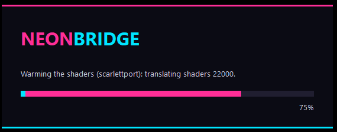

# Neonbridge: one launcher for every GTA VI (GTA 6) Xbox Series runtime on PC


Test them all in one convenient launcher.

Neonbridge is a Windows app that runs every project trying to bring the Xbox Series version of GTA VI to PC, from one window, on a copy of the game you dumped from your own console. **None of them is playable yet.** No game files are included.

## Status

Best first, by how far each project's own authors say it gets. The launcher lists them in this order too.

| # | Runtime | How far it gets (its authors' own results) | Verified here |
|---|---|---|---|
| 1 | [KLBF Lab](https://github.com/PastiiJay/klbf-lab) | 5–9 fps in free roam; new game to the open world in one 77-minute session without a crash (AMD RX 9070 XT). First on the [GTA VI PC race tracker](https://github.com/vuyp/gta6-pc-race) | No (not yet tested on NVIDIA by its author) |
| 2 | [Flamingo](https://github.com/realblastex/flamingo) | 9–14 fps in the first scene (9–10 since its victory-fork merge, cold cache); shadows still dark | Yes: boots through the first-boot settings into the first mission ("Go with the prison guard", player in control) at 5–7 fps; the 3D scene renders black (dark lighting, upstream) and menu text is missing glyphs |
| 3 | [VIctory-fxceless](https://github.com/fxceless/victory-fork) | About 10 fps in the first rooms; 2–4 fps in the world | Yes: intro at 30 fps, then the 3D prison scene in the first mission at about 1 fps (2,681 draws a frame), washed out with grey flicker |
| 4 | [VItoriaBr](https://github.com/uiliannn/VItoriaBr) | Up to 6 fps in the open world | Yes: renders the 3D prison scene in the first mission at 2–3 fps (2,649 draws a frame, diagnostics build); orange flame-like glitches on characters. The best result verified here so far |
| 5 | [xcl](https://github.com/ivall/xcl) | About 5 fps in the 3D world (RTX 5090, NVIDIA branch only); menus at 30 fps | Builds; its first shader preparation runs |
| 6 | [VIctory-Belobug-AMD](https://github.com/Belobug/VIctory-Belobug-AMD) | 3–5 fps in a lit world with vehicles (AMD cards) | No |
| 7 | [ScarlettPort](https://github.com/ZigZagBoi1/ScarlettPort) | About 4 fps in the prologue; gameplay starts | Yes: intro at 30 fps, 3D scenes at 2–3 fps |

ztrx-victory (Zettrox/ztrx, upstream now gone) is archived: `git checkout 2210a25024c0ffedc232661f7b312c06e88c86f2 -- vendor/ztrx-victory` brings it back.

## Get started

1. Download the **v0.3.0-alpha** zip from [Releases](../../releases).
2. Unzip it anywhere, for example `C:\Games\Neonbridge`.
3. Run `neonbridge.exe`.
4. If it doesn't find your game folder by itself, click **Change** and choose it. Then pick a runtime and press **Play**.

The first start of a runtime takes a while: it builds the runtime and prepares the game's shaders. The loading screen shows real counts for each step (for example "translating shaders: 1,000 / 26,503"), and a moving pulse where a runtime gives no count. Later starts are quicker: a runtime that hasn't changed isn't built again.

## What you need

- **Your own copy of the game:** the Xbox Series X|S version of GTA VI, dumped from a console you own. It's the folder with `game_scarlett_master.exe` in it, about 210 GB.
- **Windows 10 or 11**, 64-bit, with a processor that supports AVX2.
- **A graphics card** that supports DirectX 12 with mesh shaders (Shader Model 6.6), with an up-to-date driver.
- **Memory:** 32 GB of RAM is recommended.
- **Disk space:** the game, plus up to about 20 GB per runtime for its files and shaders.


## Screenshots

| | |
|---|---|
|  |  |
| **The launcher.** Pick a runtime and a preset, then press Play. | **Advanced.** Mix parts of different runtimes, or set options for a run. |
|  |  |
| **The loader.** Shows what's happening before the game starts. | **On-screen keys and frame rate.** |

## Mix and match (help wanted)

**Advanced** in the launcher builds one runtime from parts of several (VIctory-fxceless, VItoriaBr, ScarlettPort, Flamingo, KLBF Lab, Belobug). These mixes **compiled** in our own build check (made against older copies of each runtime). **None has been run in the game yet**, by us or by the runtimes' authors, so please try them and open an issue with what you see.

| Main program | Part swapped in | From |
|---|---|---|
| VIctory-fxceless | shader translator (`victory-shader`) | VItoriaBr |
| VIctory-fxceless | console system layer (`victory-hle`) | VItoriaBr |
| VIctory-fxceless | game file loader (`victory-loader`) | VItoriaBr or ScarlettPort |
| VIctory-fxceless | program loader (`victory-pe`) | VItoriaBr |
| VIctory-fxceless | `victory-core`, `victory-game` or `victory-formats` | ScarlettPort |

Mixes with parts from Flamingo, KLBF Lab or Belobug haven't been checked yet (Flamingo on its own is tested: see Status). A mix that fails to compile is remembered and refused next time.

## Watch on your phone (Tailscale)

Hand this to your AI agent (Claude Code, Codex and the like), or run it yourself in a terminal in the Neonbridge folder:

```powershell
.
eonbridge.exe --feed-only
```

1. It prints `Tailscale sign-in needed: open <link>`. Open that link, sign in to your own free Tailscale account and approve the PC (once; nothing to install).
2. It prints `live at https://neonbridge.<your-tailnet>.ts.net`. Open `http://127.0.0.1:8788` on this PC first and set the stream password.
3. Install the Tailscale app on your phone, sign in to the same account, then open the `ts.net` address.
4. Leave that window open and start games with `NEONBRIDGE_FEED=1` set (or skip `--feed-only` and launch with it set: the stream starts with the game). `NEONBRIDGE_FEED_SCREEN=1` streams your whole left monitor instead of the game window.

## Keys

| Key | Does |
|---|---|
| **F1** | Shows or hides the controls |
| **F2** | Hides the controls |
| **F3** | Shows or hides the frame rate |

Each runtime has its own keyboard and mouse layout. F1 shows it in game.

## Where things are

Everything Neonbridge keeps is in `%LOCALAPPDATA%\6ixpack`. Paste that into the Explorer address bar to open it.

| What | Folder |
|---|---|
| Saves | `6ixpack\save` |
| Shaders and other caches | `6ixpack\cache`, and `6ixpack\<runtime>\cache` |
| Logs | `6ixpack\logs` |

## Troubleshooting

- **The game crashed or closed.** Every run is logged, so there is always a log to send. Neonbridge shows its location. Send that file from `%LOCALAPPDATA%\6ixpack\logs` (the newest one) when you report the problem.
- **A runtime is greyed out.** It needs something that isn't installed yet. Select it to see what, then click **Install...**.
- **The first start is slow.** That's the shader preparation. It's only slow the first time.
- **It says no game was found.** Click **Change** and choose the folder that holds `game_scarlett_master.exe`.

## FAQ

- **Can I play GTA 6 on PC with this?** Not yet. Every runtime here is still a work in progress.
- **Is this a download or a crack?** No. There are no game files, keys or protection bypasses. You need your own dump.
- **Whose work is this?** Mostly the authors of the projects it runs. Neonbridge is the launcher around them. See [CREDITS.md](CREDITS.md).
- **Does it go online?** Only when you say yes, for example to an **Install...** download.

<details>
<summary><b>For developers</b></summary>

Building from source, the command line, runtime settings, patches and environment variables are in [DEVELOPERS.md](DEVELOPERS.md).

</details>

## Credits

Every runtime and every project Neonbridge borrows from is named in [CREDITS.md](CREDITS.md), with its authors, licence and version. Thanks especially to [realblastex](https://github.com/realblastex) for [Flamingo](https://github.com/realblastex/flamingo) and to [Belobug](https://github.com/Belobug) for [VIctory-Belobug-AMD](https://github.com/Belobug/VIctory-Belobug-AMD).

## Licence

GPL-3.0-or-later ([LICENSE](LICENSE)). Each runtime keeps its own licence (`vendor/<name>/LICENSE`): xcl is GPL-2.0-only, the VIctory forks (Flamingo and VIctory-Belobug-AMD among them) and ScarlettPort are GPL-3.0, and Neonbridge's own TuxBox-based code is Apache-2.0. Grand Theft Auto, GTA and Rockstar Games are trademarks of Take-Two Interactive; Xbox is a trademark of Microsoft. Neonbridge isn't affiliated with or endorsed by them.

<sub>Keywords: GTA 6 PC, GTA VI PC, GTA 6 launcher, Grand Theft Auto VI Windows, Xbox Series X|S to PC, Scarlett, VIctory, Flamingo, Belobug, ScarlettPort, xcl, ztrx.</sub>
