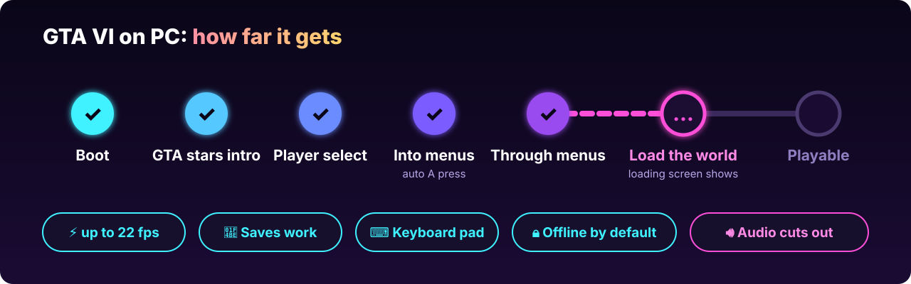
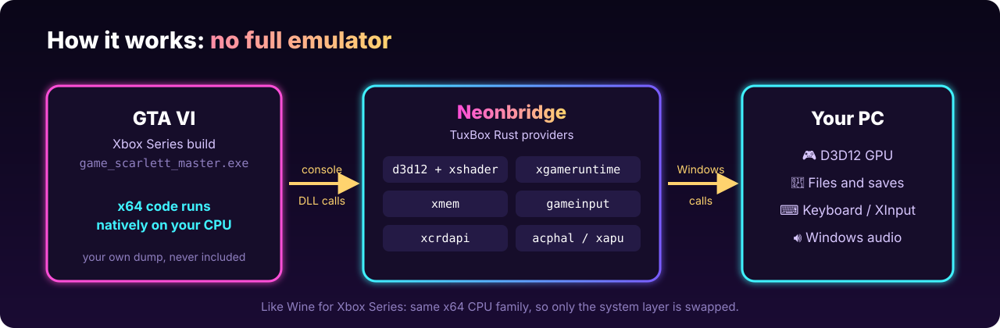

# Neonbridge: launch GTA VI (GTA 6) Xbox Series games on a Windows PC


**Neonbridge is an open-source GTA VI (GTA 6) launcher for Windows PC.** It runs the Xbox Series X|S build of Grand Theft Auto VI, dumped from a console you own, natively on Windows. It **isn't playable yet**. No game files are included or linked.





## Quick start

```
neonbridge --game <dump dir> [--debug] [--log <file>] [--timeout S]
neonbridge ctl status | screenshot shot.bmp | press A | stop
```

Build with `cargo build --release` (needs Visual Studio Build Tools x64 C++ and the x86_64-pc-windows-msvc target). `--debug` needs cdb from the Windows SDK. Without `--game` it opens a picker. `neonbridge ctl` controls a running game from another terminal. Run `neonbridge --help` for every option, and see [docs/DETAILS.md](docs/DETAILS.md) for every fix and switch.

## Controls


Alt+Enter or F11 switches to borderless fullscreen (`TUXBOX_FULLSCREEN=1` starts there). The game window must be in front. `TUXBOX_KEYBOARD_GAMEPAD=0` leaves only real pads, and `TUXBOX_AUTO_START=0` stops the automatic A press at the player-selection prompt.

## FAQ

- **Can I play GTA 6 on PC with this?** Not yet. It gets through the menus, plays the intro videos cleanly and shows the story loading screen while it streams the world. It runs for minutes at 15-40 fps, but it still stalls waiting on shaders that take too long to compile, and some runs lose the GPU device.
- **Is this a download or crack?** No. No game files, keys or binaries, and no protection bypassed. Bring your own dump.
- **Is it an emulator?** Not a full one. Like Wine, it swaps only the system layer; the game's x64 code runs natively.
- **What do I need?** Windows 10 or 11 x64, a D3D12 GPU, and about 20 GB of free commit (RAM plus page file).
- **Can I watch it from my phone?** Yes. With `NEONBRIDGE_FEED=1` the launcher streams the game's picture to a password-protected page on this PC (port 8788) and on your Tailscale network. The first run prints a Tailscale sign-in link to approve the PC once. `neonbridge --feed-only` keeps the page up between games, showing a waiting screen until one starts.
- **Does it go online?** No. The game's crash handler would upload details of your PC, so it's blocked (`TUXBOX_NETWORK=1` lifts it).

## Roadmap

1. **Show the world:** the first mission drawn in full, with shaders compiled fast enough that the game never waits on them.
2. **Memory:** keep the game's ~8 GB of textures within the GPU's video-memory budget.
3. **Speed:** hold 30 fps; it peaks at about 32 today and sinks to 15 once video memory overflows.
4. **Correct pictures:** the remaining BCPack texture modes and 5551 colour.
5. **Playable:** control the first mission.

## Credits

GPL-3.0 code from these projects is used with credit; GPL-2.0-only projects (xcl, rebox) are re-implemented, except xcl's placed-texture page pool, copied with credit in `placement/pages.rs`. Details of each contribution are in [docs/DETAILS.md](docs/DETAILS.md#credits).

[TuxBox](https://github.com/brcly/TuxBox) (brcly, vendored under `vendor/tuxbox`) · [VIctory](https://github.com/Marvisak/VIctory) (Marvisak) · [xcl](https://github.com/ivall/xcl) (ivall) · [Xbox2Windows](https://github.com/R0Y00/Xbox2Windows) (R0Y00) · [xbox-emulator](https://github.com/omonkeyz/xbox-emulator) (omonkeyz) · [OpenScarlett](https://github.com/californiaAlmonds/OpenScarlett) (californiaAlmonds) · [rebox](https://github.com/puffnfresh/rebox) (puffnfresh) · [palmetto](https://github.com/luizwidmer/palmetto) (luizwidmer) · [leonida-ce](https://github.com/IAmNotSiob/leonida-ce) (IAmNotSiob) · [five-star-recomp](https://github.com/ThatRecompDev/five-star-recomp) (ThatRecompDev; the DXIL writer in xshader is ported from theirs) · [KestrelX](https://github.com/Batushn/KestrelX) (Batushn) · [GTA6-BootTest](https://github.com/OnlyMoisties/GTA6-BootTest) (OnlyMoisties) · [Leonida](https://github.com/ubiquitarianism/leonida) (ubiquitarianism) · [Leonida](https://github.com/LeonidaReforge/Leonida) (LeonidaReforge) · Microsoft (GDK headers, dxc)

## Licence

GPL-3.0-or-later ([LICENSE](LICENSE)). The vendored TuxBox stays Apache-2.0 (`vendor/tuxbox/LICENSE`); Neonbridge's changes to it are distributed under GPL-3.0 as part of the whole. Grand Theft Auto, GTA and Rockstar Games are trademarks of Take-Two Interactive; Xbox is a trademark of Microsoft. Neonbridge isn't affiliated with or endorsed by them.

<sub>Keywords: GTA 6 PC, GTA VI PC, run GTA 6 on PC, GTA 6 launcher, Grand Theft Auto VI Windows, Xbox Series X|S to PC, Xbox GDK on Windows, Scarlett, D3D12 translation layer, TuxBox.</sub>
