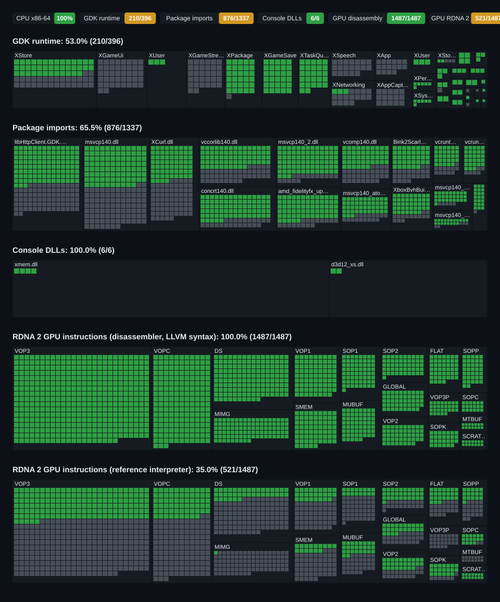
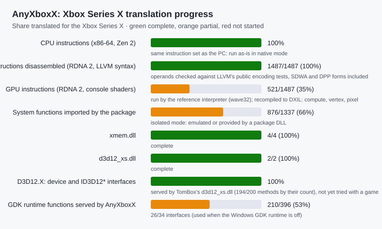
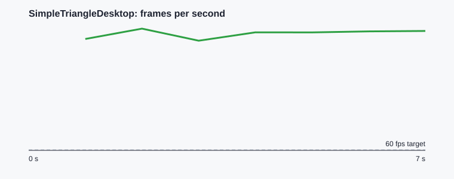
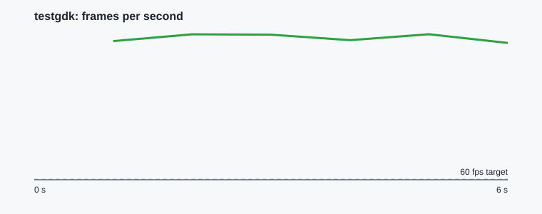
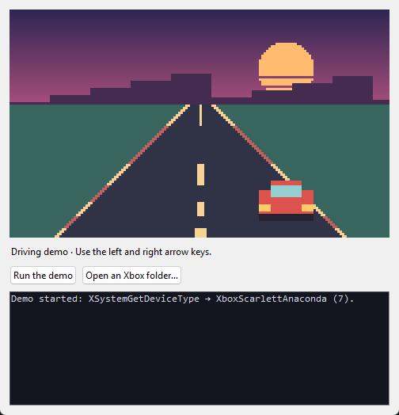
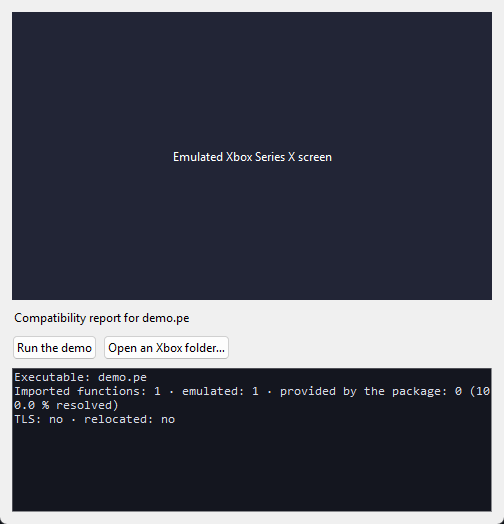
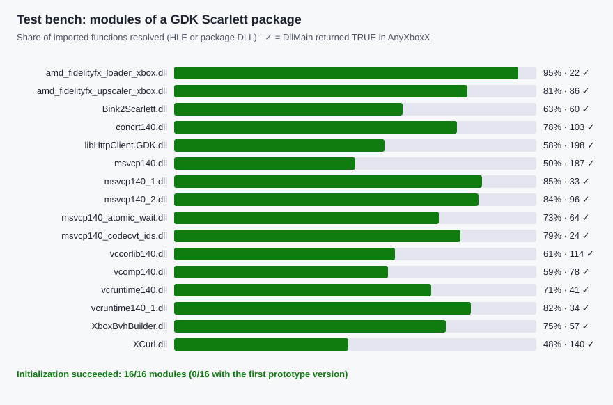
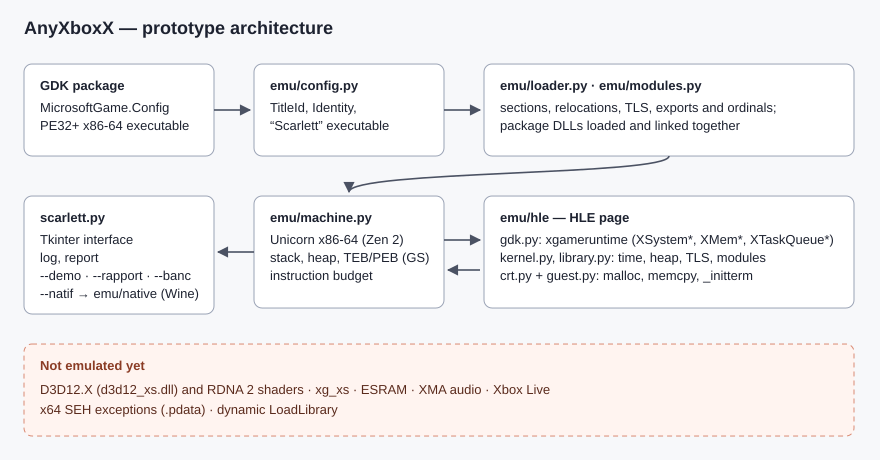

# AnyXboxX — Xbox-Series-X-Emulator (Prototyp)

[](https://discord.gg/TcX42vRyPU)

[English](../../README.md) · [Français](README.fr.md) · [Español](README.es.md) · **Deutsch** · [Italiano](README.it.md) · [Português](README.pt-BR.md) · [日本語](README.ja.md) · [中文](README.zh-CN.md) · [Русский](README.ru.md)

> [!NOTE]
> **Wo wir stehen (25.11.2026)**
>
> Gemessen auf einem i7-13700KF + RTX 4070 SUPER, Windows 11, mit dem VIctory-Fork `LooperSalty/victory` im Commit `80d58f8` (branch `anyxboxx/fork-7b0-lot9-murs`) (`third_party/victory`), gestartet mit `tools/lancer_victory.ps1 -GameDir <Spielordner>`:
>
> - 🆕 **~12 fps in der Welt (Series X, RTX 4070 SUPER), gemessen am 2026-11-25**: `third_party/victory` steht jetzt auf Neptune (VIctory Edit.) 2026-11-25c (Median etwa 12,5 fps, etwa 15 fps in der letzten Minute, Spitzen bei 30, etwa 7.500 Draws pro Frame, kein Absturz; vom Maintainer gemessen nach `tools/lancer_victory.ps1 -GameDir <game folder> -Warm`). Die Zahlen unten wurden mit der vorherigen Basis `80d58f8` gemessen.
> - ✅ Der Xbox-Series-Build 1.0.2.1 von GTA VI **startet** auf dem PC: Boot, Profilbildschirm, Einstellungen beim ersten Start, rechtliche Bildschirme, Ladevorgang, Pausenmenü. Die Menüs laufen mit 30 fps.
> - ✅ Es erreicht **die Welt und zeigt sie an**: Die Figur bewegt sich unter Kontrolle des Spielers und das 3D-Bild wird angezeigt, mit 4,8 bis 5,4 Bildern pro Sekunde bei etwa 6.550 Draws pro Bild (vom Maintainer gemessen, Windows 11, RTX 4070 Super, VIctory-Log, etwa 4 Min 20). Die Startanimation flackert nicht (beobachtet). Der Irradianz-Cache, bisher nie beleuchtet (0 Dispatches in einer PIX-Aufnahme eines Zwischensequenz-Bildes), hat jetzt seine beiden Shading-Shader übersetzt, mit im Spiel erzeugten und gebundenen Pipelines (beobachtet).
> - ✅ **Alle Zwischensequenzen laufen vollständig** (vom Maintainer am 25. November mit den Einstellungen des Starters und dem fixierten Commit `80d58f8` beobachtet), an manchen Stellen fehlt noch etwas Grafik (der Builder der Raytracing-Strukturen ist abgeschaltet). Der Maintainer beobachtete Spitzen von 9 fps und konstant 7 bis 8 fps in den Zwischensequenzen (Fenstertitel, 25. November); in einem skriptgesteuerten Lauf lagen die im Log gemessenen Mediane niedriger, je nach Szene bei 2 bis 3 fps.
> - ✅ **Die ersten beiden Missionen wurden durchgespielt**: Ein Mitwirkender des Projekts hat etwa 45 Minuten mit etwa 2 fps gespielt und die ersten beiden Missionen abgeschlossen (am 25. November dem Maintainer berichtet; nicht aus unseren Logs gemessen).
> - ✅ **Unter Linux über den Prolog hinaus bis in Kapitel 1** (Jason auf dem Boot): am 25. November unter Proton (GE-Proton11-12 mit einem Community-Patch des Wineservers) und einer AMD RX 9070 XT mit dem Commit `890a83a` gespielt, ein 23-minütiger Lauf ohne Absturz, durchgehend etwa 3 bis 5 fps (VIctory-Protokoll: Median 3,7 fps, 80 % der Zeit zwischen 2,2 und 4,5). Schatten und Innenräume bleiben schwarz (kein Raytracing).
> - ⛔ Aktuelle Grenzen: 6 Shader sind weiterhin nicht übersetzt (vorher 9), 16 Pipelines werden vom Treiber abgelehnt (das Issue #75 des Forks meldet etwa 80 weitere auf einer RTX 3070, auf der 4070 Super nicht beobachtet), Raytracing-Beleuchtung fehlt (der BVH-Builder bleibt aus, etwa 350 verworfene Dispatches pro Bild), mit der Einstellung `VICTORY_LATE_WAIT` können einige Wände des ersten Raums durchsichtig sein (Fork-Issue #168, Korrekturen in Arbeit: #191, #206), und die Langzeitstabilität ist nur über etwa 4 Min 20 ohne Geräteverlust gemessen. `VICTORY_RELAY` ist standardmäßig aus: Das Issue #89 des Forks berichtet, dass es die Haut der Figuren verschwinden lässt und Untertitel überlagert.
> - 👁 Verlauf des 24. November (vom Maintainer gemessen oder beobachtet, VIctory-Logs): `d279e69` etwa 4 fps, 13 Min im Gefängnis, dann Geräteverlust → `7b0f736` + `VICTORY_RELAY=2` etwa 4,5 fps → Launcher-Einstellungen von PR #172 ohne DRED etwa 5,5 fps → Paket 4 (3 Pull Requests) etwa 6,6 fps mit `VICTORY_RELAY=2`, Startflackern behoben → dieses Paket (7 Pull Requests, ohne `VICTORY_RELAY`) etwa 5,4 fps, aber 6.449 Draws pro Bild und das beste Bild bisher → Paket 8 (Paket 5 plus ein Pull Request, #11) etwa 4,8 bis 5,4 fps, etwa 6.550 Draws pro Bild, Shader des Irradianz-Caches jetzt übersetzt.
> - 🆕 VIctory liegt jetzt als Kopie in diesem Repository (`third_party/victory`, kein Submodul mehr) als eigener Code, nichts wird synchronisiert oder gepinnt: `80d58f8` plus 57 Commits für Proton (Wine) und AMD-Karten, aus dem Fork `fxceless/victory-fork`, aus VIctory, klbf-lab, den `victory-amd`-Forks von JoshuuDev und myokex sowie eigene (Autoren in THIRD_PARTY.md). Nur unter Linux gemessen (Fedora 44, RX 9070 XT, RADV, GE-Proton11-12 mit einem Community-Patch für den wineserver, VIctory-Log eines Laufs von etwa 23 min): etwa 3,7 fps (Median-Weltbild 266 ms), kein Absturz und kein Geräteverlust; Gesichter, Haut und Geometrie vollständig (beobachtet); Innenräume und schattige Bereiche schwarz, Raytracing läuft nicht. Unter Windows noch nicht gemessen; die Einstellungen des Startskripts bleiben gleich. Ein bestehender Klon muss vor dem Pull `git submodule deinit -f third_party/victory` ausführen und `third_party/victory` sowie `.git/modules/third_party/victory` löschen (siehe Anleitung).
> - 📌 Fixiert seit dem Commit `80d58f8` des Branches `anyxboxx/fork-7b0-lot9-murs`: Batch 8 plus drei eigene `xg:`-Commits (die Anordnung von `xg_xs.dll` wird jetzt genau wie von Microsofts Bibliothek beantwortet: Schwanz-Mips im Parent-Modus mit Position, 64-KiB-Tiling nach Subressource indiziert; ein Test vergleicht 54 Beschreibungen mit der echten DLL, und der Maintainer hat im Spiel 0 Abweichungen gemessen, `-XgDll` ist also nur noch ein Orakel), die Offline-Vorkompilierung von Shadern und Pipelines (Portierung der Pull Request #282 des Forks `fxceless/victory-fork`, t4l03): `victory translate --cache --pipelines`, Schalter `-Precompile` des Launchers (gemessen: 25.689 Shader in etwa 4,5 min übersetzt, 296 abgelehnt, 13 GB Cache) und sieben weitere Pull Requests dieses Forks (#349, #355, #396, #386, #358, #353, #374). Vom Maintainer gemessen (VIctory-Logs, Nacht vom 24. auf den 25. November): 4,8 bis 5,1 fps und etwa 12,7 % der Draws pro Bild verworfen (vorher 11 bis 14 %); die Zwischensequenz wird als besser beurteilt (beobachtet). Dazu zwei Commits von Yorivel aus dem Fork (`e49864a`, `bf870de`): DirectStorage-Schreibvorgänge in physische Seiten werden jetzt an die GPU-Seite gemeldet (`VICTORY_DSTORAGE_NOTIFY=1`, vom Starter gesetzt), die keine veralteten Kopien der Wände des ersten Raums mehr behält. Vom Maintainer gemessen (VIctory-Log, 25. November, etwa 02:41 bis 02:50): von einem neuen Spielstand bis in die Welt in etwa 9 Minuten, 5,3 bis 6,9 fps, 4.200 bis 6.300 Draws pro Bild, kein Geräteverlust; vollständige Zwischensequenzen, als „unglaublich“ beurteilt (beobachtet); an manchen Stellen fehlt noch Grafik. Die meisten verworfenen Draws stammen vom abgeschalteten Builder der Raytracing-Strukturen (14.943 von 15.444 in einem Log), nicht von den 15 wave64-Compute-Pipelines, die NVIDIA ablehnt (etwa 300 Draws).
> - 📌 Fixiert seit dem Commit `19feca8` des Branches `anyxboxx/fork-7b0-lot8-xg`: Batch 8 plus ein eigener Commit, der die Anordnung der Texturen Microsofts eigener Bibliothek überlässt: `tools/lancer_victory.ps1 -GameDir <Spielordner> -XgDll <Pfad zu xg_xs.dll>`, wobei `xg_xs.dll` die Offline-PC-Version aus Ihrer eigenen Kopie des GDK ist (nie in diesem Repository). Ohne `-XgDll` ändert sich nichts. Vom Maintainer gemessen (VIctory-Logs, 25. November): Die Antworten der Bibliothek weichen bei 84 Texturbeschreibungen von denen von VIctory ab (Tail-Mips von 64-KiB-Texturen, 64-KiB-Kachelung von Textur-Arrays; Größen und Offsets stimmen überein); mit ihr läuft die Welt mit 5,4 bis 7,1 fps (ohne 5,1 bis 5,6), und der Lauf wurde als der bisher beste beurteilt (beobachtet). `-XgMode compare` behält die Anordnung von VIctory und protokolliert jede Abweichung.
> - 📌 Festgelegt seit dem Commit `d138351` des Branches `anyxboxx/fork-7b0-lot8` unseres VIctory-Forks `LooperSalty/victory`: Paket 5 (der Fork `fxceless/victory-fork` bei `7b0f736` plus sieben seiner Pull Requests, siehe Anleitung) plus ein mit `cherry-pick -x` übernommener Pull Request: #11 (cxchhh, geparkte Lane-Masken-Paare wenige Anweisungen auseinander werden wiederhergestellt, relative VGPR-Lesezugriffe behalten geparkte Lanes; die beiden Shading-Shader des Irradianz-Caches werden jetzt übersetzt). Vom Maintainer gemessen (VIctory-Log, PIX-Aufnahme, Launcher-Einstellungen von `main`): 4,8 bis 5,4 fps und etwa 6.550 Draws pro Bild, 6 nicht übersetzte Shader (9 in Paket 5), 16 vom Treiber abgelehnte Pipelines (wie in Paket 5), kein Geräteverlust in etwa 4 Min 20. Eine bestehende Kopie muss `git submodule sync third_party/victory` und dann `git submodule update --init third_party/victory` ausführen: Die URL des Submoduls hat sich mit PR #178 geändert.
> - Voraussetzungen: eine eigene Kopie des Spiels, eine NVIDIA- oder AMD-GPU mit SM 6.6 und Mesh Shaders, Rust. Keine Spieldateien in diesem Repository.
> - So startest du es: [docs/running-gta6.md](../running-gta6.md).

AnyXboxX lädt Xbox-GDK-Programmdateien (Format PE32+ x86-64) und führt deren Code mit Unicorn aus. Die Systemfunktionen der Konsole werden im nativen Modus durch eine C++-Runtime und in der isolierten Maschine durch Python-Code ersetzt (High-Level-Emulation, wie bei WinDurango oder Wine). Das Programm gibt sich als Xbox Series X aus: `XSystemGetDeviceType` liefert `XboxScarlettAnaconda` zurück.

## Ziel und Stand

AnyXboxX ist auf einen einzigen Build spezialisiert: **Grand Theft Auto VI für Xbox Series, Version 1.0.2.1**. Übersetzt wird nur, was dieses Spiel braucht (die importierten Systemfunktionen, die verwendeten Shader und Direct3D-12.x-Methoden). Andere Spiele werden erprobt, sobald diese Übersetzung vollständig ist. Das Projekt baut auf [VIctory](https://github.com/Marvisak/VIctory) (Marvisak, GPL-3.0 oder neuer) auf, das denselben Build anvisiert: es liegt als Kopie in `third_party/victory`, ausgehend vom Fork `fxceless/victory-fork` (GPL-3.0) im Commit `7b0f736`. Dank an Marvisak und an die Autoren dieser Pull Requests, einzeln aufgeführt in [THIRD_PARTY.md](../../THIRD_PARTY.md).

> [!IMPORTANT]
> **Das Spiel ist nicht spielbar.** Den aktuellen Stand zeigt der Kasten oben auf dieser Seite. Dieses Repository enthält keine Spieldateien, Schlüssel oder ausführbaren Dateien und erklärt nicht, wie man sie erhält.

Statusseite online, mit dem benötigten Speicherplatz: **[loopersalty.github.io/AnyXboxX](https://loopersalty.github.io/AnyXboxX/)**.

## Fortschritt der Übersetzung



Neu erzeugen: `scarlett.py --carte <Paketordner> docs/images/carte-avancee.svg`.



- **Prozessorbefehle: 100 %.** Die Series X nutzt einen AMD Zen 2 in x86-64, denselben Befehlssatz wie ein PC: Im nativen Modus läuft der Code des Spiels unverändert, ohne Übersetzung.
- **GPU-Befehle: 81 %.** Die Shader eines Konsolenspiels sind für die RDNA-2-GPU der Series X kompiliert. 1.208 der 1.490 RDNA-2-Kodierungen laufen im Referenzinterpreter, und der Rekompilierer RDNA 2 → DXIL zeichnet bereits einen ersten Vertex- und Pixel-Shader mit D3D12.
- **Systemfunktionen: 66 %** der 1 337 Funktionen, die von den DLLs des Testpakets importiert werden, sind im isolierten Modus aufgelöst.
- **Konsolenspezifische DLLs**: `xmem.dll` (4/4) und `d3d12_xs.dll` (2/2) sind für die vom Paket genutzten Funktionen übersetzt. D3D12.X (Gerät und `ID3D12*`-Schnittstellen) wird von TomBox' `d3d12_xs.dll` bereitgestellt, noch nicht mit einem Spiel getestet.
- **GDK-Runtime: 210 der 396 Funktionen** sind in AnyXboxX in C++ geschrieben: die Aufgabenwarteschlange (`XTaskQueue`, `XAsync`, `XThread`), der Benutzer (`XUser`, ein lokales Offline-Profil), die Identität der Xbox Series X (`XSystem`, Title ID, Analytics, Funktionen der Runtime), die Speicherstände (`XGameSave`, `XGameSaveFiles`, `XPersistentLocalStorage`) das Spielpaket (`XPackage`), der Offline-Store (`XStore`) sowie Einladungen, Aktivierungen und Fehlerberichte offline (`XGameInvite`, `XGameActivation`, `XGameProtocol`, `XError`) sowie der echte HDR-Zustand und die Netzwerkverbindung des PCs (`XDisplayTryEnableHdrMode`, `XNetworkingGetConnectivityHint`). Sie kommen zum Einsatz, wenn AnyXboxX die Runtime allein verwaltet: ohne Gaming Services oder mit `ANYXBOXX_SYSTEM_RUNTIME=0`. Ist die GDK-Runtime von Windows vorhanden, bedient sie alle Schnittstellen, auch die Aufgabenwarteschlange, da ihre APIs nur ihre eigenen Warteschlangen akzeptieren. Die Ablaufverfolgung (`ANYXBOXX_TRACE=1`) nennt jede angeforderte Schnittstelle.

Die Grafik wird mit `scarlett.py --traduction <Paketordner> docs/images/traduction.svg` neu erzeugt.

## Leistung (Ziel: konstant 60 Bilder pro Sekunde)

```powershell
.\.venv\Scripts\python.exe .\PrototypeScarlett\scarlett.py --banc-perf <jeu.exe> [secondes] [courbe.svg]
.\.venv\Scripts\python.exe .\PrototypeScarlett\scarlett.py --natif <jeu.exe> --fps
```

Die C++-Runtime misst die Dauer jedes `Present` der DXGI-Swap-Chain des Spiels, auch wenn DXGI von einer DLL des Spiels dynamisch geladen wird (SDL3). Daraus ergeben sich die Bilder pro Sekunde, die durchschnittliche Bildzeit und der „1-%-Tiefstwert“ (die Rate der langsamsten 1 % der Bilder, der Ruckler sichtbar macht). `--fps` zeigt diese Werte im Fenstertitel an. `--banc-perf` misst N Sekunden lang, ohne die erste (Laden), und gibt das Urteil „konstant 60 Bilder/s“ aus (Rückgabecode 2, wenn das Ziel verfehlt wird). Ohne diese Optionen wird nichts abgefangen.





Beide Testspiele laufen ohne vertikale Synchronisation: etwa 11.700 Bilder/s für SimpleTriangle und 12.600 Bilder/s für testgdk, im nativen Modus.

## Projektfortschritt

| Schritt | Status |
|---|---|
| `MicrosoftGame.Config` einlesen (TitleId, Identität, Scarlett-Programmdatei) | ✅ erledigt |
| PE32+-Laden: Sektionen und Schutzattribute, Relokationen, Importe, Exporte | ✅ erledigt |
| TLS: Kopie der Vorlage, Index, Callbacks | ✅ erledigt |
| TEB und PEB über das GS-Register erreichbar | ✅ erledigt |
| HLE-Seite: 158 emulierte Funktionsnamen aus GDK, Kernel, CRT und Mathematik | ✅ erledigt |
| Unbekannte Funktionen: `E_NOTIMPL` und Protokolleintrag statt Ablehnung | ✅ erledigt |
| Globale C++-Konstruktoren (`_initterm`) als Gast-Code | ✅ erledigt |
| Kompatibilitätsbericht (`--rapport`) und Prüfstand (`--banc`) | ✅ erledigt |
| Mehrere verknüpfte Module in derselben Maschine: DLLs des Pakets, Ordinale, Weiterleitungen, Relokation bei Konflikten | ✅ erledigt |
| `GetModuleHandle`, `GetProcAddress`, `LoadLibrary`, `RtlPcToFileHeader` | ✅ erledigt |
| 16/16 DLLs eines Scarlett-Pakets samt Abhängigkeiten initialisiert, 0 nicht emulierte Aufrufe | ✅ erledigt |
| Freies Testspiel `SimpleTriangle` kompiliert: C-Start und GDK-Initialisierung laufen in AnyXboxX | ✅ erledigt |
| Native Ausführung nach Wine-Art (`--natif`): **SimpleTriangle wird angezeigt**, GDK-Runtime von AnyXboxX bereitgestellt | ✅ erledigt |
| Zweites freies Testspiel, `testgdk` aus SDL3: **läuft im nativen Modus** (Fenster, Sprites, Ton) | ✅ erledigt |
| Isolierter Start eines Pakets oder einer exe (`--lancer`) mit der Liste der zu emulierenden Aufrufe | ✅ erledigt |
| C++-Runtime (`runtime/`): `xgameruntime.dll`, `xmem.dll`, `d3d12_xs.dll` im nativen Modus vorgeladen und allen DLLs des Spiels bereitgestellt | ✅ erledigt |
| `xmem.dll`: `XMemAlloc`, `XMemFree` mit dekodierten `XALLOC_ATTRIBUTES` (ERA-Layout: Heap- und Grafikspeicher, Ausrichtung), Hooks, `XMemVirtualQuery` (Grafikspeicher-Flag) | ✅ erledigt |
| `d3d12_xs.dll`: Serialisierung der Root-Signaturen, umgeleitet auf das D3D12 des PCs | ✅ erledigt |
| Tabelle der 396 GDK-Funktionen: Schnittstelle und Methodennummer, aus `xgameruntime.lib` extrahiert (`tools/gdk_interfaces.py`) | ✅ erledigt |
| `XTaskQueue`, `XAsync`, `XThread` von AnyXboxX bereitgestellt: testgdk läuft ohne die Runtime von Windows | ✅ erledigt |
| Übrige GDK-Schnittstellen: an die GDK-Runtime von Windows delegiert, von der Ablaufverfolgung benannt | 🟡 in Arbeit |
| 1400+ automatisierte Tests | ✅ erledigt |
| D3D12.X: `D3D12XboxCreateDevice`, `ID3D12*`-Schnittstellen der Konsole und `DXGIXPresentArray`, bereitgestellt von TomBox' Rust-`d3d12_xs.dll` (MIT, 48 implementierte Exporte, gebaut mit `tools/build_tombox.py d3d12_xs`, geladen mit `ANYXBOXX_D3D12_XS=<Pfad>`); ohne Konsolen-Executable hier nicht testbar | 🟡 in Arbeit |
| Konsolenbibliotheken von TomBox (Rust, GPL-3.0) für das, was AnyXboxX fehlt: `xg_xs` (Texturlayouts, 23 Exporte) und vollständiges `xmem` (38 Exporte), mit `ANYXBOXX_TOMBOX_DIR=<Ordner>`; gebaut mit `tools/build_tombox.py xg_xs xmem` | 🟡 in Arbeit |
| `XUser` offline: immer angemeldetes lokales Profil, einstellbarer Gamertag (`ANYXBOXX_GAMERTAG`), Anmeldung von testgdk erfolgreich | ✅ erledigt |
| Identität der Xbox Series X: Konsolentyp (simulierter Registrierungswert `ConsoleMode`, auch in den DLLs des Spiels), `XSystem`, Title ID aus `MicrosoftGame.config`, Analytics „Xbox Series X“ | ✅ erledigt |
| Fortschrittskarte: ein Feld pro Funktion (`--carte`) | ✅ erledigt |
| Controller (`GameInput`) und Audio (`XAudio2`): dieselbe API auf Konsole und PC, im nativen Modus an die Windows-DLLs gebunden | ✅ erledigt |
| Markdown-Bericht der fehlenden Importe pro DLL und der nicht emulierten Aufrufe (`--lancer … --md rapport.md`) | ✅ erledigt |
| Erststart-Werkzeug für eine Konsolen-Executable: Inventar, Anbieter jedes Imports (Paket, AnyXboxX, TomBox, Windows, fehlend), isolierte Läufe, optionaler nativer Lauf; Bericht außerhalb des Repositorys: `python tools/jour_j.py <Paket> [--natif]` ([Anleitung](../day-one.md), auf Französisch) | ✅ erledigt |
| Bildzähler (`--fps`) und Leistungs-Benchmark mit dem Urteil „konstant 60 Bilder/s“ und einer Kurve (`--banc-perf`) | ✅ erledigt |
| Speicherstände `XGameSave` (Container, Blobs, Kontingent, asynchrones Lesen) und lokaler dauerhafter Speicher, auf der Festplatte des PCs (`%LOCALAPPDATA%\AnyXboxX\<TitleId>` oder `ANYXBOXX_SAVE_DIR`) | ✅ erledigt |
| `XPackage`: lokal installiertes Paket (Kennung, Sprache, fertige Blöcke, Einbindung in den Spielordner) | ✅ erledigt |
| `kernelx.dll` (Konsolenkernel): 2.661 Funktionen an `kernel32`/`kernelbase` von Windows weitergeleitet | ✅ erledigt |
| Implizites TLS (`thread_local`) für Spiele im nativen Modus: Träger-DLL `anyxboxx_tls.dll`, jeder Thread erhält seine Kopie (bis 256 KiB) | ✅ erledigt |
| Nativer C++-Launcher ohne Python (`runtime/build/bin/anyxboxx.exe <spiel.exe \| ordner> [--fps]`): SimpleTriangle und testgdk mit ~12.000 B/s | ✅ erledigt |
| RDNA-2-GPU-Disassembler: 1.490 Mnemonics und Operanden in LLVM-Syntax (skalar, VOP1/VOP2/VOPC/VOP3/VOP3P/SDWA/DPP/SMEM/DS/EXP/MUBUF/MTBUF/MIMG/FLAT mit Modifikatoren), geprüft an 38.999 öffentlichen LLVM-Kodierungen: `scarlett.py --rdna2 <shader.bin> [--liste]` | 🟡 in Arbeit |
| Operanden des RDNA-2-Disassemblers identisch mit dem Text von LLVM: skalar und VOP1/VOPC 100 %, DS 100 %, EXP 100 %, SMEM 96,5 % (das Maximum: LLVM schreibt die übrigen Kodierungen auf zwei Arten) | ✅ erledigt |
| Erste RDNA-2-Vertex- und Pixel-Shader mit D3D12 gezeichnet (`anyxboxx_gpu_run.exe --draw`): jeder Vertex und jedes Pixel identisch mit dem Referenzinterpreter, auf der GPU und mit WARP | ✅ erledigt |
| Texturen in rekompilierten RDNA-2-Shadern: T#/S#-Deskriptoren und `image_sample` (2D, nächstes Texel, Wrap oder Clamp-to-Edge, 8_8_8_8_UNORM und 32_32_32_32_FLOAT), identisch mit dem Referenzinterpreter auf der GPU und mit WARP, einschließlich eines texturierten Pixel-Shaders; Deskriptor-Layout von Leonida und Mesa | ✅ erledigt |
| Zweiter Übersetzer RDNA 2 → SPIR-V (Vulkan): der von Leonida (GPL-3.0), unverändert in `third_party/leonida/` kopiert und vom eigenen Disassembler von AnyXboxX gespeist, ohne `llvm-mc`; Vertex-, Pixel- und Compute-Shader; 51 der 52 Konsolen-Shader aus `XboxBvhBuilder.dll` des Pakets werden übersetzt, lokal gemessen mit `tools/fssm_mesure.py` (`scarlett.py --rdna2 <shader.bin> --spirv ps`) | 🟡 in Arbeit |
| TomBox auf den neuesten Stand gebracht (D3D12.X: nach ihrer Zählung 194 von 200 Methoden) und 4 weitere Konsolenbibliotheken gebaut und aus `ANYXBOXX_TOMBOX_DIR` bereitgestellt: `d3d12_x` (ESRAM), `XAudio2_9` (XMA-Stimmen), `xapu`, `xgs12`; `tools/build_tombox.py d3d12_xs xg_xs xmem d3d12_x xaudio2_9 xapu xgs12` | 🟡 in Arbeit |
| Umwandlung von Konsolen-DXIL in PC-DXIL (`dxil-ms-xb2` → `dxil-ms-dx`, ohne Umweg über HLSL): das Werkzeug von Xbox2Windows (MIT), unverändert mit seinem Test in `third_party/xbox2windows/` kopiert; `python third_party/xbox2windows/tools/dxil_retarget.py <ein> <aus>` oder `--pe <spiel.exe>` | ✅ erledigt |
| Prüfungen bei Pull Requests: Lint und Abgleich der 9 READMEs (Zeilen, Bilder, Testanzahl) bei jedem Pull Request | ✅ erledigt |
| Konsolentexturen in Rust: BC7-Dekodierung und GFX10-`SW_4K_S`-Entkachelung aus Xbox2Windows portiert (MIT), Referenz-Prüfsummen reproduziert; `anyxboxx_texture bc7 <blocks.bin> <b> <h> <out.png> [--4k-s]` | 🟡 in Arbeit |
| Übrige von AnyXboxX geschriebene GDK-Schnittstellen (`XGameUi`, `XNetworking`…) | ⏳ offen |
| Shader-Rekompilierer RDNA 2 → DXIL: erste Programme nach HLSL übersetzt, zu DXIL kompiliert und mit D3D12 auf der GPU des PCs ausgeführt (`--hlsl`, `anyxboxx_gpu_run.exe`, WARP ohne GPU), Speicher identisch mit einem wave32-Referenzinterpreter, der 1.208 von 1.490 Kodierungen ausführt (skalar, VOP1/VOP2/VOPC/VOP3/VOP3P, Speicher: SMEM, LDS, GLOBAL, MUBUF/MTBUF mit V#-Grenzen und typisierten Formaten, Atomics, Sprünge, `exec`-Divergenz); ein erster Vertex- und Pixel-Shader (EXP-Exporte, VINTRP-Interpolation) mit D3D12 gezeichnet, Vertex für Vertex und Pixel für Pixel identisch: `scarlett.py --rdna2 <shader.bin> --executer` | 🟡 in Arbeit |
| Wave64-Compute-Programme auf GPUs mit 32-Lane-Waves (#70): jede 64-Lane-Wave läuft als eine Gruppe von 64 Threads (Lane-Masken und Lane-Lesezugriffe über groupshared-Speicher, ohne `WaveSize`), Speicher identisch mit dem Referenzinterpreter in wave64 auf einer RTX (32-Lane-Waves) und mit WARP; DPP und SDWA-Vergleiche werden weiterhin mit Namen abgelehnt | 🟡 in Arbeit |
| Shader-Cache: übersetzte Shader einmal zu DXIL kompiliert, danach von der Festplatte (1,4 ms) oder aus dem Speicher (0,8 ms) statt mit dxc (22 ms); `%LOCALAPPDATA%\AnyXboxX\shader-cache` oder `ANYXBOXX_SHADER_CACHE`, Größe begrenzt | 🟡 in Arbeit |
| Der Xbox-Series-Build 1.0.2.1 des Titels über VIctory (`third_party/victory`, unser eigener Code, auf der Basis Neptune (VIctory Edit.) 2026-11-25c): ~12 fps in der Welt (Series X, RTX 4070 SUPER), gemessen am 2026-11-25 (Median etwa 12,5 fps, etwa 7.500 Draws pro Frame, kein Absturz; vom Maintainer gemessen); keine raytracing-Beleuchtung (in Innenräumen ersetzt ein gleichmäßiges Umgebungslicht sie), keine Gesichtsanimation, Objekte kurz schwarz, während ihre Texturen getauscht werden | 🟡 in Arbeit |
| x64-SEH-Ausnahmen (`.pdata`), mehrere Threads | ⏳ offen |
| Dynamisches Laden einer DLL zur Laufzeit (`LoadLibrary` + `DllMain`) | ⏳ offen |
| D3D12.X-Grafik nach Direct3D 12 / Vulkan | ⏳ offen |
| XMA2-Konsolenaudio: von TomBox' Rust-Portierung des FFmpeg-Decoders in WAV dekodiert (LGPL, 1 LSB Abstand zu FFmpeg beim öffentlichen FATE-Beispiel); `anyxboxx_xma <ein.xma> <aus.wav>`, Dateien mit einem Stream | 🟡 in Arbeit |

<table>
<tr>
<td></td>
<td></td>
</tr>
<tr>
<td align="center">Die Demo reagiert auf die Pfeiltasten der Tastatur.</td>
<td align="center">Das Protokoll zeigt den Kompatibilitätsbericht an.</td>
</tr>
</table>

## Die Demo ausprobieren

Installiere unter Windows 64-Bit-Python 3.12 mit Tcl/Tk und öffne dann PowerShell im Stammverzeichnis des Repositorys.

```powershell
py -3.12 -m venv .venv
.\.venv\Scripts\python.exe -m pip install -r requirements.txt
.\.venv\Scripts\python.exe .\PrototypeScarlett\scarlett.py --demo
```

Der native Modus braucht die C++-Runtime. Sie wird mit Visual Studio 2022 oder 2026 (C++-Workload) und CMake kompiliert:

```powershell
cmake -S runtime -B runtime/build -A x64
cmake --build runtime/build --config Release
```

Die Aufgabenwarteschlange übernimmt das Modul `Task` von [libHttpClient](https://github.com/microsoft/libHttpClient) (MIT-Lizenz, `runtime/third_party/libhttpclient-task`). Die DLLs landen in `runtime/build/bin` oder in dem Ordner, den `ANYXBOXX_RUNTIME` angibt. `ANYXBOXX_SYSTEM_RUNTIME=0` schaltet die Delegation an die GDK-Runtime von Windows ab.

Das kompilierte Demoprogramm ist `PrototypeScarlett/demo.pe`; sein Quellcode ist `PrototypeScarlett/demo.c`.

## Ein Spiel im nativen Modus starten

```powershell
.\.venv\Scripts\python.exe .\PrototypeScarlett\scarlett.py --natif <dossier ou fichier .exe> [dossiers de DLL…]
```


AnyXboxX lädt die Programmdatei selbst und führt sie direkt auf dem Prozessor aus, wie Wine. Die Xbox-Runtime (`xgameruntime.dll`) wird von AnyXboxX bereitgestellt; das Fenster und DirectX 12 stammen vom PC. **Achtung: Im nativen Modus ist das Programm nicht isoliert.** Verwende diesen Modus nur für vertrauenswürdige Programme; `--rapport` und `--banc` bleiben in Unicorn isoliert. `ANYXBOXX_TRACE=1` zeigt die abgefangenen Aufrufe an. Details: [docs/test-game.md](../test-game.md).

## Ein Paket im isolierten Modus starten

```powershell
.\.venv\Scripts\python.exe .\PrototypeScarlett\scarlett.py --lancer <dossier du paquet ou fichier .exe> [dossiers de DLL…]
```

Bei einem Ordner liest AnyXboxX `MicrosoftGame.Config`, nimmt die für `Scarlett` deklarierte ausführbare Datei und startet sie in der isolierten Maschine (Unicorn): Das Programm berührt den PC nicht. Der Bericht nennt zuerst die nicht aufgelösten Importe, dann die nicht emulierten Aufrufe, vom häufigsten zum seltensten: Das ist die Arbeitsliste zur Vervollständigung des Emulators. Fehlt die ausführbare Datei, nennt die Meldung sie beim Namen. Mit `--md rapport.md` wird derselbe Bericht als Markdown geschrieben, die fehlenden Importe nach DLL gruppiert.

## Ein Programm analysieren

```powershell
.\.venv\Scripts\python.exe .\PrototypeScarlett\scarlett.py --rapport <dossier ou fichier .exe>
```

Der Prüfstand lädt alle PE-Module eines Ordners und führt deren Initialisierung aus:

```powershell
.\.venv\Scripts\python.exe .\PrototypeScarlett\scarlett.py --banc <dossier>
```



Detaillierte Ergebnisse: [docs/progress.md](../progress.md). Freies Testspiel im Vergleich zu seiner nativen Ausführung: [docs/test-game.md](../test-game.md). Ein zusätzlicher DLL-Ordner (zum Beispiel die Visual-C++-DLLs) kann auf das Ziel folgen: `--rapport <cible> <dossier>`.

Der Bericht listet die importierten Funktionen, den bereits emulierten Anteil in Prozent und die fehlenden Funktionen auf. In der Oberfläche liest die Schaltfläche **Open an Xbox folder…** (Xbox-Ordner öffnen) die Datei `MicrosoftGame.Config`, zeigt diesen Bericht an und startet dann das Programm; jeder nicht emulierte Aufruf erscheint im Protokoll.

## Architektur



| Modul | Aufgabe |
|---|---|
| `emu/config.py` | liest das Manifest des GDK-Pakets |
| `emu/loader.py` | lädt das PE-Image und bereitet Importe, Exporte und TLS vor |
| `emu/machine.py` | Unicorn-Prozessor, Stack, Heap, TEB/PEB, Verteilung der Aufrufe |
| `emu/hle/` | emulierte Funktionen: `gdk.py`, `kernel.py`, `crt.py`, `libm.py`, `guest.py` |
| `emu/report.py` | Kompatibilitätsbericht |
| `emu/modules.py` | lädt die DLLs des Pakets, bindet die Importe und ordnet die Initialisierungen |
| `emu/bench.py` | Prüfstand für einen Ordner mit Modulen |
| `emu/native/` | native Ausführung nach Wine-Art: Loader, echte Importe, GDK-Runtime von AnyXboxX |
| `scarlett.py` | Tkinter-Oberfläche und Kommandozeile |

Um eine Funktion hinzuzufügen, dekoriere einen Handler in `emu/hle/`:

```python
@hle("gdk")
def XSystemGetDeviceType(c):
    return XBOX_SERIES_X
```

## Recherche

- [Hardware-Architektur der Xbox Series X](../research/xbox-series-x-architecture.md): Zen-2-CPU, RDNA-2-GPU, Speicher, Velocity Architecture, Sicherheit.
- [Bestehende Emulatoren und Kompatibilitätsschichten](../research/state-of-the-art.md): WinDurango, XWine1, Xenia, XVD-Werkzeuge.
- [Reverse-Engineering-Notizen zum untersuchten Scarlett-Paket](../research/package/README.md) (von Codex verfasst): RDS5/ETPF-Tabellen, RPF-Header, Paketaufbau.
- [TomBox und seine Fortsetzung](../research/tombox.md): Konsolen-DLLs in Rust, Direct3D 12.x, RDNA-2-Shader-Übersetzer, was AnyXboxX übernimmt (MIT, zitiert).
- [Xbox2Windows](../research/xbox2windows.md): Forschung zur statischen Rekompilierung; BC7 und GFX10-Kachelung von AnyXboxX übernommen (MIT, zitiert).
- [Erster Start der Ausführungsdatei 1.0.2.1](../research/first-boot-1021.md): unter `gta6rt` von Leonida gemessene Haltepunkte der Reihe nach, die Pull Requests von Leonida dazu, Arbeitsliste für AnyXboxX.

## Tests

```powershell
.\.venv\Scripts\python.exe -m pip install -r requirements-dev.txt
.\.venv\Scripts\python.exe -m pytest
```

## Mitwirken

Der Branch `main` ist geschützt: Jeder Beitrag läuft über einen geprüften Pull Request, und die Tests müssen bestehen. Fehler und zu emulierende Funktionen werden in den Issues gemeldet. Die vollständigen Regeln stehen in [CONTRIBUTING.md](../../CONTRIBUTING.md).

Diskussion, Hilfe und Testberichte: [Discord](https://discord.gg/TcX42vRyPU)

## Lizenz

AnyXboxX steht unter der [GNU GPL 3.0 oder neuer](../../LICENSE). Fremdbestandteile behalten ihre eigene Lizenz: das `Task`-Modul von libHttpClient (MIT, `runtime/third_party/libhttpclient-task`) und die aus den öffentlichen Kodierungstests von LLVM erzeugten RDNA-2-Tabellen (Apache 2.0 mit LLVM-Ausnahme, `PrototypeScarlett/emu/rdna2_ops.py` und `rdna2_shapes.py`).

Fremdkomponenten und Danksagungen: [THIRD_PARTY.md](../../THIRD_PARTY.md).
