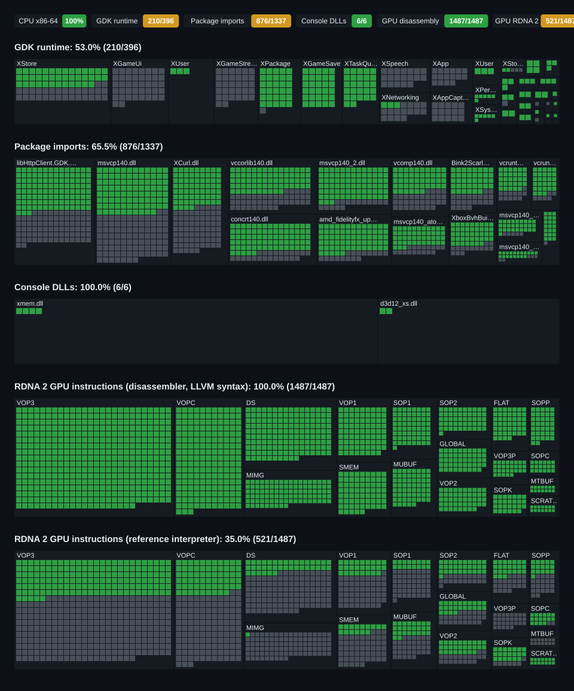
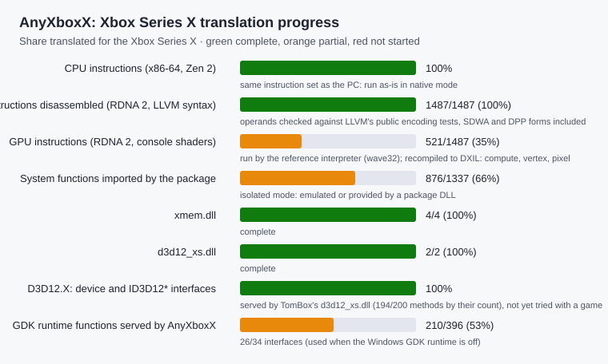
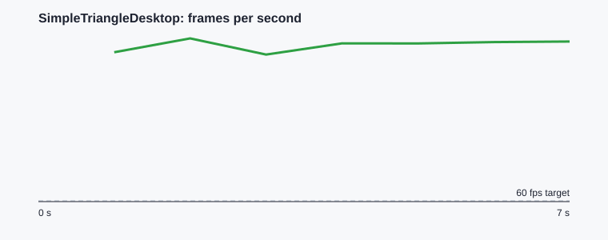
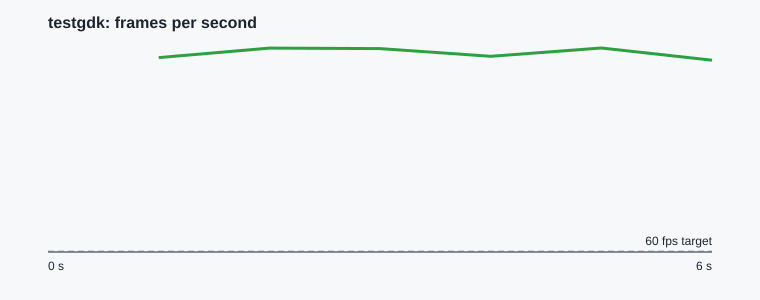
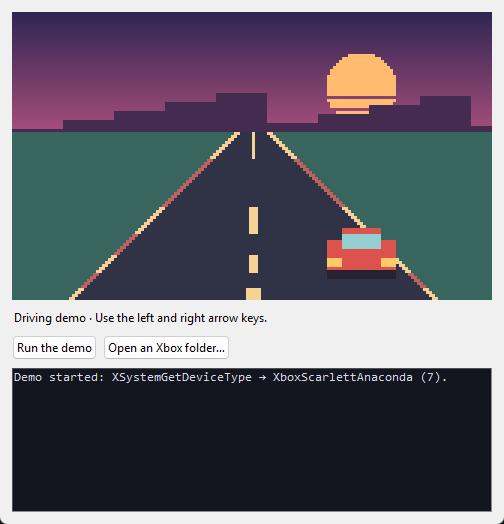
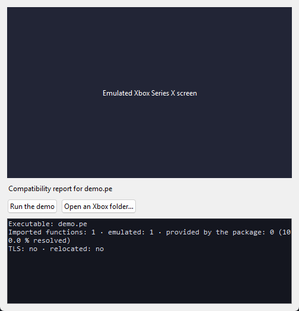
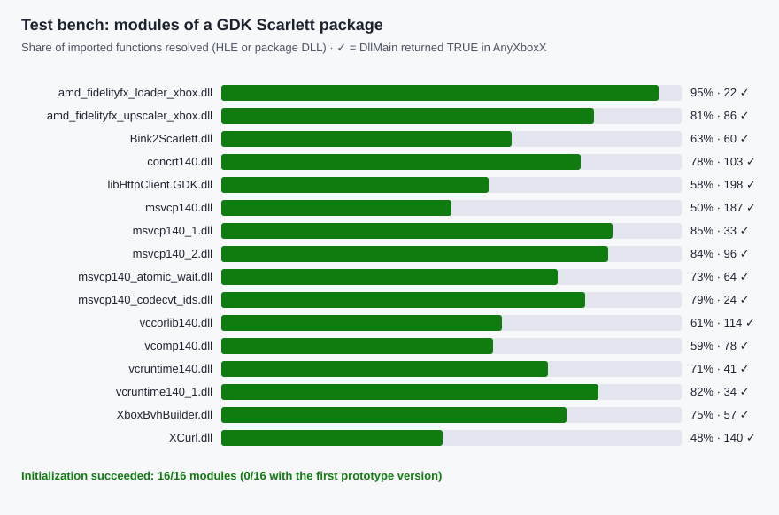
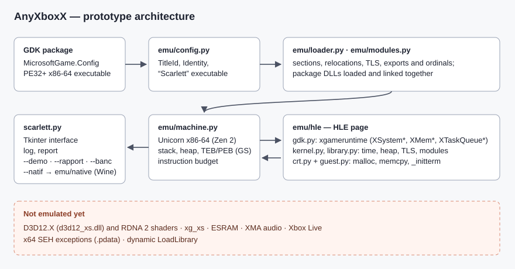

# AnyXboxX — émulateur Xbox Series X (prototype)

[](https://discord.gg/TcX42vRyPU)

[English](../../README.md) · **Français** · [Español](README.es.md) · [Deutsch](README.de.md) · [Italiano](README.it.md) · [Português](README.pt-BR.md) · [日本語](README.ja.md) · [中文](README.zh-CN.md) · [Русский](README.ru.md)

> [!NOTE]
> **Où on en est (25/11/2026)**
>
> Mesuré sur i7-13700KF + RTX 4070 SUPER, Windows 11, avec le fork de VIctory `LooperSalty/victory` au commit `80d58f8` (branch `anyxboxx/fork-7b0-lot9-murs`) (`third_party/victory`) lancé par `tools/lancer_victory.ps1 -GameDir <dossier du jeu>` :
>
> - 🆕 **~12 fps dans le monde (Series X, RTX 4070 SUPER), mesuré le 2026-11-25** : `third_party/victory` repose désormais sur Neptune (VIctory Edit.) 2026-11-25c (médiane d'environ 12,5 fps, environ 15 fps sur la dernière minute, pointes à 30, environ 7 500 draws par image, sans plantage ; mesuré par le mainteneur après `tools/lancer_victory.ps1 -GameDir <game folder> -Warm`). Les chiffres ci-dessous ont été mesurés avec la base précédente `80d58f8`.
> - ✅ Le build Xbox Series 1.0.2.1 de GTA VI **se lance** sur PC : démarrage, écran de profil, réglages du premier lancement, écrans légaux, chargement, menu pause. Les menus tournent à 30 i/s.
> - ✅ Il atteint **le monde et l'affiche** : le personnage bouge sous le contrôle du joueur et l'image 3D s'affiche, à 4,8 à 5,4 images par seconde avec environ 6 550 draws par image (mesuré par le mainteneur, Windows 11, RTX 4070 Super, journal VIctory, environ 4 min 20). L'animation de démarrage ne clignote pas (observé). Le cache d'irradiance, jamais éclairé jusque-là (0 dispatch sur une capture PIX d'une image de cinématique), a maintenant ses deux shaders d'ombrage traduits, avec leurs pipelines créés et liés en jeu (observé).
> - ✅ **Toutes les cinématiques se jouent en entier** (observé par le mainteneur le 25 novembre avec les réglages du lanceur et le commit épinglé `80d58f8`), avec encore quelques graphismes manquants par endroits (le constructeur des structures de ray tracing est coupé). Le mainteneur a observé des pics à 9 fps et 7 à 8 fps constants pendant les cinématiques (compteur de la fenêtre, 25 novembre) ; dans un essai scripté, les médianes mesurées dans le journal étaient plus basses, 2 à 3 fps, selon la scène.
> - ✅ **Les deux premières missions ont été jouées jusqu'au bout** : un contributeur du projet a joué environ 45 minutes à environ 2 fps et terminé les deux premières missions (retour transmis au mainteneur le 25 novembre ; non mesuré dans nos journaux).
> - ✅ **Au-delà du prologue, jusqu'au chapitre 1, sous Linux** (Jason sur le bateau) : joué le 25 novembre sous Proton (GE-Proton11-12 avec un correctif communautaire du wineserver) et une AMD RX 9070 XT avec le commit `890a83a`, un lancement de 23 minutes sans plantage, entre 3 et 5 i/s tout du long (journal VIctory : médiane 3,7 i/s, 80 % du temps entre 2,2 et 4,5). Les zones d'ombre et les intérieurs restent noirs (pas de ray tracing).
> - ⛔ Limites actuelles : 6 shaders ne sont toujours pas traduits (9 avant), 16 pipelines sont refusés par le pilote (l'issue n°75 du fork en signale environ 80 de plus sur une RTX 3070, non observés sur la 4070 Super), l'éclairage par ray tracing est absent (le constructeur BVH reste coupé, environ 350 dispatches jetés par image), avec le réglage `VICTORY_LATE_WAIT` certains murs de la première salle peuvent être transparents (issue n°168 du fork, correctifs en cours : n°191, n°206), et la tenue longue n'est mesurée que sur environ 4 min 20 sans perte du périphérique. `VICTORY_RELAY` est coupé par défaut : l'issue n°89 du fork rapporte qu'il fait disparaître la peau des personnages et superpose les sous-titres.
> - 👁 Historique du 24 novembre (mesuré ou observé par le mainteneur, journaux VIctory) : `d279e69` environ 4 i/s, 13 min dans la prison puis périphérique perdu → `7b0f736` + `VICTORY_RELAY=2` environ 4,5 i/s → réglages du lanceur de la PR n°172 sans DRED environ 5,5 i/s → lot 4 (3 pull requests) environ 6,6 i/s avec `VICTORY_RELAY=2`, clignotement du démarrage corrigé → ce lot (7 pull requests, sans `VICTORY_RELAY`) environ 5,4 i/s mais 6 449 draws par image et la meilleure image à ce jour → lot 8 (lot 5 plus une pull request, n°11) environ 4,8 à 5,4 i/s, environ 6 550 draws par image, shaders du cache d'irradiance maintenant traduits.
> - 🆕 VIctory est maintenant copié dans ce dépôt (`third_party/victory`, plus un sous-module) comme notre code, sans rien synchroniser ni épingler : `80d58f8` plus 57 commits pour Proton (Wine) et les cartes AMD, venus du fork `fxceless/victory-fork`, de VIctory, de klbf-lab, des `victory-amd` de JoshuuDev et de myokex, et de nous (auteurs dans THIRD_PARTY.md). Mesuré sous Linux seulement (Fedora 44, RX 9070 XT, RADV, GE-Proton11-12 avec un correctif communautaire du wineserver, journal VIctory d'un lancement d'environ 23 min) : environ 3,7 i/s (image médiane du monde de 266 ms), ni plantage ni perte du périphérique ; visages, peau et géométrie complets (observé) ; intérieurs et zones à l'ombre noirs, le ray tracing ne tourne pas. Pas encore mesuré sous Windows ; les réglages du lanceur ne changent pas. Une copie existante doit lancer `git submodule deinit -f third_party/victory` et supprimer `third_party/victory` et `.git/modules/third_party/victory` avant le pull (voir le guide).
> - 📌 Épinglé depuis le commit `80d58f8` de la branche `anyxboxx/fork-7b0-lot9-murs` : le lot 8 plus trois commits `xg:` à nous (la disposition de `xg_xs.dll` est maintenant servie exactement comme la bibliothèque de Microsoft : mips de queue en mode parent avec position, tuilage 64 Kio indexé par sous-ressource ; un test compare 54 descriptions avec la vraie DLL et le mainteneur a mesuré 0 écart en jeu, donc `-XgDll` n'est plus qu'un oracle), la précompilation hors ligne des shaders et des pipelines (portage de la pull request #282 du fork `fxceless/victory-fork`, t4l03) : `victory translate --cache --pipelines`, option `-Precompile` du lanceur (mesuré : 25 689 shaders traduits en environ 4,5 min, 296 refusés, 13 Go de cache), et sept autres pull requests de ce fork (#349, #355, #396, #386, #358, #353, #374). Mesuré par le mainteneur (journaux VIctory, nuit du 24 au 25 novembre) : 4,8 à 5,1 fps et environ 12,7 % des draws abandonnés par image (11 à 14 % avant) ; la cinématique est jugée meilleure (observé). Plus deux commits de Yorivel venus du fork (`e49864a`, `bf870de`) : les écritures DirectStorage dans des pages physiques sont maintenant signalées au côté GPU (`VICTORY_DSTORAGE_NOTIFY=1`, posé par le lanceur), qui ne garde plus de copies périmées des murs de la première pièce. Mesuré par le mainteneur (journal VIctory, 25 novembre, vers 02:41 à 02:50) : d'une sauvegarde neuve jusque dans le monde en environ 9 minutes, 5,3 à 6,9 fps, 4 200 à 6 300 draws par image, pas de perte du périphérique ; cinématiques entières, jugé « incroyable » (observé) ; des graphismes manquent encore par endroits. La plupart des draws abandonnés viennent du constructeur des structures de ray tracing, coupé (14 943 sur 15 444 dans un journal), et non des 15 pipelines compute wave64 refusés par NVIDIA (environ 300 draws).
> - 📌 Épinglé depuis le commit `19feca8` de la branche `anyxboxx/fork-7b0-lot8-xg` : le lot 8 plus un commit à nous qui confie la disposition des textures à la bibliothèque de Microsoft : `tools/lancer_victory.ps1 -GameDir <dossier du jeu> -XgDll <chemin de xg_xs.dll>`, où `xg_xs.dll` est la version PC hors ligne de votre propre copie du GDK (jamais dans ce dépôt). Sans `-XgDll`, rien ne change. Mesuré par le mainteneur (journaux VIctory, 25 novembre) : ses réponses diffèrent de celles de VIctory pour 84 descriptions de textures (mips de queue des textures 64 Kio, tuilage 64 Kio des tableaux de textures ; tailles et offsets identiques) ; servi par elle, le monde tourne à 5,4–7,1 fps (5,1–5,6 sans) et l'essai a été jugé le meilleur à ce jour (observé). `-XgMode compare` garde les dispositions de VIctory et journalise chaque écart.
> - 📌 Épinglé depuis le commit `d138351` de la branche `anyxboxx/fork-7b0-lot8` de notre fork de VIctory `LooperSalty/victory` : le lot 5 (le fork `fxceless/victory-fork` au commit `7b0f736` plus sept de ses pull requests, voir le guide) plus une pull request reprise avec `cherry-pick -x` : n°11 (cxchhh, paires de masques de lanes parqués à quelques instructions d'écart restaurées, lectures VGPR relatives qui gardent les lanes parqués ; les deux shaders d'ombrage du cache d'irradiance se traduisent maintenant). Mesuré par le mainteneur (journal VIctory, capture PIX, réglages du lanceur de `main`) : 4,8 à 5,4 i/s et environ 6 550 draws par image, 6 shaders non traduits (9 au lot 5), 16 pipelines refusés par le pilote (comme au lot 5), aucune perte du périphérique en environ 4 min 20. Une copie existante doit lancer `git submodule sync third_party/victory` puis `git submodule update --init third_party/victory` : l'URL du sous-module a changé avec la PR n°178.
> - Prérequis : votre propre copie du jeu, un GPU NVIDIA ou AMD avec SM 6.6 et mesh shaders, Rust. Aucun fichier du jeu dans ce dépôt.
> - Comment le lancer : [docs/fr/lancer-gta6.md](../fr/lancer-gta6.md).

AnyXboxX charge des exécutables Xbox GDK (format PE32+ x86-64) et exécute leur code avec Unicorn. Les fonctions système de la console sont remplacées par un runtime C++ en mode natif, et par du code Python dans la machine isolée (émulation de haut niveau, comme WinDurango ou Wine). Le programme se présente comme une Xbox Series X : `XSystemGetDeviceType` renvoie `XboxScarlettAnaconda`.

Pour poursuivre l'analyse du paquet Scarlett étudié, voir le [plan de compatibilité et ses limites](../research/package-compatibility-plan.md).

## Cible et état

AnyXboxX est spécialisé sur un seul build : **Grand Theft Auto VI pour Xbox Series, version 1.0.2.1**. Seul ce dont ce jeu a besoin est traduit (les fonctions système qu'il importe, les shaders et les méthodes Direct3D 12.x qu'il utilise). D'autres jeux seront essayés quand cette traduction sera complète. Le projet s'appuie sur [VIctory](https://github.com/Marvisak/VIctory) (Marvisak, GPL-3.0 ou ultérieure), qui vise le même build : il est copié dans `third_party/victory`, à partir du fork `fxceless/victory-fork` (GPL-3.0) au commit `7b0f736`. Merci à Marvisak et aux auteurs de ces pull requests, crédités un par un dans [THIRD_PARTY.md](../../THIRD_PARTY.md).

> [!IMPORTANT]
> **Le jeu n'est pas jouable.** Voir l'encadré en haut de cette page pour l'état d'avancement. Ce dépôt ne contient ni fichier du jeu, ni clé, ni exécutable, et n'explique pas comment les obtenir.

Page d'état en ligne, avec l'espace disque à prévoir : **[loopersalty.github.io/AnyXboxX](https://loopersalty.github.io/AnyXboxX/)**.

## Avancée de la traduction



Régénérer : `scarlett.py --carte <dossier du paquet> docs/images/carte-avancee.svg`.



- **Instructions processeur : 100 %.** La Series X utilise un AMD Zen 2 en x86-64, le même jeu d'instructions qu'un PC : en mode natif, le code du jeu s'exécute tel quel, sans traduction.
- **Instructions GPU : 81 %.** Les shaders d'un jeu console sont compilés pour le GPU RDNA 2 de la Series X. 1.208 des 1 490 encodages RDNA 2 tournent dans l'interpréteur de référence, et le recompilateur RDNA 2 → DXIL dessine déjà un premier vertex shader et pixel shader avec D3D12.
- **Fonctions système : 66 %** des 1 337 fonctions importées par les DLL du paquet de test sont résolues en mode isolé.
- **DLL propres à la console** : `xmem.dll` (4/4) et `d3d12_xs.dll` (2/2) sont traduites pour les fonctions que le paquet utilise. D3D12.X (périphérique et interfaces `ID3D12*`) est servi par la `d3d12_xs.dll` de TomBox, pas encore essayé avec un jeu.
- **Runtime GDK : 210 des 396 fonctions** sont écrites dans AnyXboxX, en C++ : la file de tâches (`XTaskQueue`, `XAsync`, `XThread`), l'utilisateur (`XUser`, un profil local hors ligne) l'identité Xbox Series X (`XSystem`, Title ID, analytique, fonctionnalités du runtime) les sauvegardes (`XGameSave`, `XGameSaveFiles`, `XPersistentLocalStorage`) le paquet du jeu (`XPackage`), le Store hors ligne (`XStore`) et, hors ligne, les invitations, activations et rapports d'erreur (`XGameInvite`, `XGameActivation`, `XGameProtocol`, `XError`), ainsi que l'état HDR réel et la connectivité réseau du PC (`XDisplayTryEnableHdrMode`, `XNetworkingGetConnectivityHint`). Elles servent quand AnyXboxX gère seul le runtime : sans Gaming Services, ou avec `ANYXBOXX_SYSTEM_RUNTIME=0`. Si le runtime GDK de Windows est présent, il sert toutes les interfaces, file de tâches comprise, car ses API n'acceptent que ses propres files. La trace (`ANYXBOXX_TRACE=1`) nomme chaque interface demandée.

Le graphique est régénéré par `scarlett.py --traduction <dossier du paquet> docs/images/traduction.svg`.

## Performance (objectif : 60 images par seconde constantes)

```powershell
.\.venv\Scripts\python.exe .\PrototypeScarlett\scarlett.py --banc-perf <jeu.exe> [secondes] [courbe.svg]
.\.venv\Scripts\python.exe .\PrototypeScarlett\scarlett.py --natif <jeu.exe> --fps
```

Le runtime C++ chronomètre chaque `Present` de la swap chain DXGI du jeu, y compris quand DXGI est chargé dynamiquement par une DLL du jeu (SDL3). Il en tire les images par seconde, le temps moyen d'une image et le « 1 % bas » (cadence des 1 % d'images les plus lentes, qui révèle les saccades). `--fps` affiche ces valeurs dans le titre de la fenêtre. `--banc-perf` mesure pendant N secondes, sans compter la première (chargement), et rend un verdict « 60 i/s constants » (code de retour 2 si l'objectif est manqué). Sans ces options, rien n'est intercepté.





Les deux jeux de test tournent sans synchronisation verticale : environ 11 700 i/s pour SimpleTriangle et 12 600 i/s pour testgdk, en mode natif.

## Avancée du projet

| Étape | État |
|---|---|
| Lecture de `MicrosoftGame.Config` (TitleId, identité, exécutable Scarlett) | ✅ fait |
| Chargement PE32+ : sections et protections, relocations, imports, exports | ✅ fait |
| TLS : copie du modèle, index, callbacks | ✅ fait |
| TEB et PEB accessibles par le registre GS | ✅ fait |
| Page HLE : 158 noms de fonctions GDK, kernel, CRT et maths émulés | ✅ fait |
| Fonctions inconnues : `E_NOTIMPL` et journal au lieu d'un refus | ✅ fait |
| Constructeurs C++ globaux (`_initterm`) en code invité | ✅ fait |
| Rapport de compatibilité (`--rapport`) et banc d'essai (`--banc`) | ✅ fait |
| Plusieurs modules liés dans une même machine : DLL du paquet, ordinaux, redirections, relocation en cas de conflit | ✅ fait |
| `GetModuleHandle`, `GetProcAddress`, `LoadLibrary`, `RtlPcToFileHeader` | ✅ fait |
| 16/16 DLL d'un paquet Scarlett initialisées avec leurs dépendances, 0 appel non émulé | ✅ fait |
| Jeu de test libre `SimpleTriangle` compilé : démarrage C et initialisation GDK passent dans AnyXboxX | ✅ fait |
| Exécution native façon Wine (`--natif`) : **SimpleTriangle s'affiche**, runtime GDK servi par AnyXboxX | ✅ fait |
| Deuxième jeu de test libre, `testgdk` de SDL3 : **tourne en mode natif** (fenêtre, sprites, son) | ✅ fait |
| Lancement isolé d'un paquet ou d'un exe (`--lancer`) avec la liste des appels à émuler | ✅ fait |
| Runtime C++ (`runtime/`) : `xgameruntime.dll`, `xmem.dll`, `d3d12_xs.dll` préchargées en mode natif, servies à toutes les DLL du jeu | ✅ fait |
| `xmem.dll` : `XMemAlloc`, `XMemFree` avec `XALLOC_ATTRIBUTES` décodés (disposition ERA : mémoire tas et graphique, alignement), crochets, `XMemVirtualQuery` (drapeau de mémoire graphique) | ✅ fait |
| `d3d12_xs.dll` : sérialisation des signatures racine, redirigée vers le D3D12 du PC | ✅ fait |
| Table des 396 fonctions GDK : interface et n° de méthode, extraits de `xgameruntime.lib` (`tools/gdk_interfaces.py`) | ✅ fait |
| `XTaskQueue`, `XAsync`, `XThread` servies par AnyXboxX : testgdk tourne sans le runtime de Windows | ✅ fait |
| Autres interfaces GDK : déléguées au runtime GDK de Windows, nommées par la trace | 🟡 en cours |
| 1400+ tests automatisés | ✅ fait |
| D3D12.X : `D3D12XboxCreateDevice`, interfaces `ID3D12*` de la console et `DXGIXPresentArray`, servis par la `d3d12_xs.dll` en Rust de TomBox (MIT, 48 exports implémentés, compilée par `tools/build_tombox.py d3d12_xs`, chargée avec `ANYXBOXX_D3D12_XS=<chemin>`) ; pas testable ici sans exécutable console | 🟡 en cours |
| Bibliothèques console de TomBox (Rust, GPL-3.0) pour ce qui manque à AnyXboxX : `xg_xs` (agencement des textures, 23 exports) et `xmem` complet (38 exports), avec `ANYXBOXX_TOMBOX_DIR=<dossier>` ; compilées par `tools/build_tombox.py xg_xs xmem` | 🟡 en cours |
| `XUser` hors ligne : profil local toujours connecté, gamertag réglable (`ANYXBOXX_GAMERTAG`), connexion de testgdk réussie | ✅ fait |
| Identité Xbox Series X : type de console (registre `ConsoleMode` simulé, y compris dans les DLL du jeu), `XSystem`, Title ID lu dans `MicrosoftGame.config`, analytique « Xbox Series X » | ✅ fait |
| Carte d'avancée : une case par fonction (`--carte`) | ✅ fait |
| Manette (`GameInput`) et audio (`XAudio2`) : même API sur console et sur PC, liés aux DLL de Windows en mode natif | ✅ fait |
| Rapport Markdown des imports manquants par DLL et des appels non émulés (`--lancer … --md rapport.md`) | ✅ fait |
| Outil de premier lancement d'un exécutable console : inventaire, fournisseur de chaque import (paquet, AnyXboxX, TomBox, Windows, manquant), lancements isolés, lancement natif facultatif ; rapport gardé hors du dépôt : `python tools/jour_j.py <paquet> [--natif]` ([guide](../day-one.md)) | ✅ fait |
| Compteur d'images (`--fps`) et banc de performance avec verdict « 60 i/s constants » et courbe (`--banc-perf`) | ✅ fait |
| Sauvegardes `XGameSave` (conteneurs, blobs, quota, lecture asynchrone) et stockage local persistant, sur le disque du PC (`%LOCALAPPDATA%\AnyXboxX\<TitleId>`, ou `ANYXBOXX_SAVE_DIR`) | ✅ fait |
| `XPackage` : paquet installé en local (identifiant, langue, morceaux prêts, montage sur le dossier du jeu) | ✅ fait |
| `kernelx.dll` (noyau console) : 2 661 fonctions redirigées vers `kernel32`/`kernelbase` de Windows | ✅ fait |
| TLS implicite (`thread_local`) des jeux en mode natif : DLL porteuse `anyxboxx_tls.dll`, chaque thread reçoit sa copie (256 Kio au plus) | ✅ fait |
| Lanceur natif en C++ sans Python (`runtime/build/bin/anyxboxx.exe <jeu.exe \| dossier> [--fps]`) : SimpleTriangle et testgdk à ~12 000 i/s | ✅ fait |
| Désassembleur GPU RDNA 2 : 1 490 mnémoniques et opérandes au format LLVM (scalaires, VOP1/VOP2/VOPC/VOP3/VOP3P/SDWA/DPP/SMEM/DS/EXP/MUBUF/MTBUF/MIMG/FLAT avec modificateurs), vérifié sur 38 999 encodages publics de LLVM : `scarlett.py --rdna2 <shader.bin> [--liste]` | 🟡 en cours |
| Opérandes du désassembleur RDNA 2 identiques au texte de LLVM : scalaires et VOP1/VOPC 100 %, DS 100 %, EXP 100 %, SMEM 96,5 % (le maximum : LLVM écrit les autres encodages de deux façons) | ✅ fait |
| Premiers vertex et pixel shaders RDNA 2 dessinés avec D3D12 (`anyxboxx_gpu_run.exe --draw`) : chaque sommet et chaque pixel identiques à l'interpréteur de référence, sur le GPU et avec WARP | ✅ fait |
| Textures dans les shaders RDNA 2 recompilés : descripteurs T#/S# et `image_sample` (2D, texel le plus proche, wrap ou clamp-to-edge, 8_8_8_8_UNORM et 32_32_32_32_FLOAT), identiques à l'interpréteur de référence sur le GPU et avec WARP, pixel shader texturé compris ; disposition des descripteurs reprise de Leonida et de Mesa | ✅ fait |
| Second traducteur RDNA 2 → SPIR-V (Vulkan) : celui de Leonida (GPL-3.0), copié sans modification dans `third_party/leonida/` et alimenté par le désassembleur d'AnyXboxX, sans `llvm-mc` ; vertex, pixel et compute shaders ; 51 des 52 shaders console livrés dans `XboxBvhBuilder.dll` du paquet sont traduits, mesure locale avec `tools/fssm_mesure.py` (`scarlett.py --rdna2 <shader.bin> --spirv ps`) | 🟡 en cours |
| TomBox mis à jour (D3D12.X : 194 méthodes sur 200 d'après leur décompte) et 4 bibliothèques console de plus compilées et servies depuis `ANYXBOXX_TOMBOX_DIR` : `d3d12_x` (ESRAM), `XAudio2_9` (voix XMA), `xapu`, `xgs12` ; `tools/build_tombox.py d3d12_xs xg_xs xmem d3d12_x xaudio2_9 xapu xgs12` | 🟡 en cours |
| Conversion du DXIL console en DXIL du PC (`dxil-ms-xb2` → `dxil-ms-dx`, sans repasser par HLSL) : l'outil de Xbox2Windows (MIT), copié sans modification avec son test dans `third_party/xbox2windows/` ; `python third_party/xbox2windows/tools/dxil_retarget.py <entrée> <sortie>` ou `--pe <jeu.exe>` | ✅ fait |
| Vérifications des pull requests : lint et synchronisation des 9 README (lignes, images, nombre de tests) à chaque pull request | ✅ fait |
| Textures console en Rust : décodage BC7 et désentrelacement GFX10 `SW_4K_S` portés de Xbox2Windows (MIT), empreintes de référence reproduites ; `anyxboxx_texture bc7 <blocs.bin> <l> <h> <sortie.png> [--4k-s]` | 🟡 en cours |
| Autres interfaces GDK écrites par AnyXboxX (`XGameUi`, `XNetworking`…) | ⏳ à faire |
| Recompilateur de shaders RDNA 2 → DXIL : premiers programmes traduits en HLSL, compilés en DXIL et exécutés sur le GPU du PC avec D3D12 (`--hlsl`, `anyxboxx_gpu_run.exe`, WARP sans GPU), mémoire identique à un interpréteur de référence wave32 qui exécute 1.208 encodages sur 1 490 (scalaires, VOP1/VOP2/VOPC/VOP3/VOP3P, mémoire : SMEM, LDS, GLOBAL, MUBUF/MTBUF avec bornes V# et formats typés, atomiques, branchements, divergence par `exec`) ; un premier vertex shader et pixel shader (exports EXP, interpolation VINTRP) dessinés avec D3D12, identiques sommet par sommet et pixel par pixel : `scarlett.py --rdna2 <shader.bin> --executer` | 🟡 en cours |
| Programmes de calcul wave64 sur des GPU à waves de 32 lignes (#70) : chaque wave de 64 lignes tourne comme un groupe de 64 threads (masques et lectures de ligne par la mémoire groupshared, sans `WaveSize`), mémoire identique à l'interpréteur de référence en wave64 sur une RTX (waves de 32 lignes) et avec WARP ; DPP et comparaisons SDWA encore refusés en les nommant | 🟡 en cours |
| Cache de shaders : shaders traduits compilés une seule fois en DXIL, puis repris du disque (1,4 ms) ou de la mémoire (0,8 ms) au lieu de dxc (22 ms) ; `%LOCALAPPDATA%\AnyXboxX\shader-cache` ou `ANYXBOXX_SHADER_CACHE`, taille plafonnée | 🟡 en cours |
| La build Xbox Series 1.0.2.1 du titre via VIctory (`third_party/victory`, notre propre code, sur la base Neptune (VIctory Edit.) 2026-11-25c) : ~12 fps dans le monde (Series X, RTX 4070 SUPER), mesuré le 2026-11-25 (médiane d'environ 12,5 fps, environ 7 500 draws par image, sans plantage ; mesuré par le mainteneur) ; pas d'éclairage en lancer de rayons (une lumière ambiante uniforme le remplace en intérieur), pas d'animation faciale, objets noirs un instant pendant le remplacement de leurs textures | 🟡 en cours |
| Exceptions SEH x64 (`.pdata`), threads multiples | ⏳ à faire |
| Chargement dynamique d'une DLL pendant l'exécution (`LoadLibrary` + `DllMain`) | ⏳ à faire |
| Graphismes D3D12.X vers Direct3D 12 / Vulkan | ⏳ à faire |
| Son XMA2 de la console : décodé en WAV par le portage Rust du décodeur de FFmpeg fait par TomBox (LGPL, à 1 près de FFmpeg sur l'échantillon public FATE) ; `anyxboxx_xma <entrée.xma> <sortie.wav>`, fichiers à un flux | 🟡 en cours |

<table>
<tr>
<td></td>
<td></td>
</tr>
<tr>
<td align="center">La démo répond aux flèches du clavier.</td>
<td align="center">Le journal affiche le rapport de compatibilité.</td>
</tr>
</table>

## Essayer la démo

Sous Windows, installe Python 3.12 64 bits avec Tcl/Tk, puis ouvre PowerShell à la racine du dépôt.

```powershell
py -3.12 -m venv .venv
.\.venv\Scripts\python.exe -m pip install -r requirements.txt
.\.venv\Scripts\python.exe .\PrototypeScarlett\scarlett.py --demo
```

Le mode natif a besoin du runtime C++. Il se compile avec Visual Studio 2022 ou 2026 (charge C++) et CMake :

```powershell
cmake -S runtime -B runtime/build -A x64
cmake --build runtime/build --config Release
```

La file de tâches reprend le module `Task` de [libHttpClient](https://github.com/microsoft/libHttpClient) (licence MIT, `runtime/third_party/libhttpclient-task`). Les DLL arrivent dans `runtime/build/bin`, ou dans le dossier indiqué par `ANYXBOXX_RUNTIME`. `ANYXBOXX_SYSTEM_RUNTIME=0` coupe la délégation au runtime GDK de Windows.

Le programme de démonstration compilé est `PrototypeScarlett/demo.pe` ; son code source est `PrototypeScarlett/demo.c`.

## Lancer un jeu en mode natif

```powershell
.\.venv\Scripts\python.exe .\PrototypeScarlett\scarlett.py --natif <dossier ou fichier .exe> [dossiers de DLL…]
```


AnyXboxX charge l'exécutable lui-même et l'exécute directement sur le processeur, comme Wine. Le runtime Xbox (`xgameruntime.dll`) est fourni par AnyXboxX ; la fenêtre et DirectX 12 sont ceux du PC. **Attention : en mode natif, le programme n'est pas isolé.** Réservez ce mode aux programmes de confiance ; `--rapport` et `--banc` restent isolés dans Unicorn. `ANYXBOXX_TRACE=1` affiche les appels interceptés. Détails : [docs/test-game.md](../test-game.md).

## Lancer un paquet en mode isolé

```powershell
.\.venv\Scripts\python.exe .\PrototypeScarlett\scarlett.py --lancer <dossier du paquet ou fichier .exe> [dossiers de DLL…]
```

Avec un dossier, AnyXboxX lit `MicrosoftGame.Config`, prend l'exécutable déclaré pour `Scarlett` et le lance dans la machine isolée (Unicorn) : le programme ne touche pas le PC. Le compte rendu donne les imports non résolus puis les appels non émulés, du plus fréquent au plus rare : c'est la liste de travail pour compléter l'émulateur. Si l'exécutable manque, le message le nomme. Avec `--md rapport.md`, le même compte rendu est écrit en Markdown, avec les imports manquants groupés par DLL.

## Analyser un programme

```powershell
.\.venv\Scripts\python.exe .\PrototypeScarlett\scarlett.py --rapport <dossier ou fichier .exe>
```

Le banc d'essai charge tous les modules PE d'un dossier et lance leur initialisation :

```powershell
.\.venv\Scripts\python.exe .\PrototypeScarlett\scarlett.py --banc <dossier>
```



Résultats détaillés : [docs/progress.md](../progress.md). Jeu de test libre comparé à son exécution native : [docs/test-game.md](../test-game.md). Un dossier de DLL supplémentaire (par exemple les DLL Visual C++) peut suivre la cible : `--rapport <cible> <dossier>`.

Le rapport liste les fonctions importées, le pourcentage déjà émulé et les fonctions manquantes. Dans l'interface, le bouton **Open an Xbox folder…** (ouvrir un dossier Xbox) lit `MicrosoftGame.Config`, affiche ce rapport puis lance le programme ; chaque appel non émulé apparaît dans le journal.

## Architecture



| Module | Rôle |
|---|---|
| `emu/config.py` | lit le manifeste du paquet GDK |
| `emu/loader.py` | charge l'image PE et prépare imports, exports et TLS |
| `emu/machine.py` | processeur Unicorn, pile, tas, TEB/PEB, répartition des appels |
| `emu/hle/` | fonctions émulées : `gdk.py`, `kernel.py`, `crt.py`, `libm.py`, `guest.py` |
| `emu/report.py` | rapport de compatibilité |
| `emu/modules.py` | charge les DLL du paquet, lie les imports, ordonne les initialisations |
| `emu/bench.py` | banc d'essai sur un dossier de modules |
| `emu/native/` | exécution native façon Wine : chargeur, imports réels, runtime GDK d'AnyXboxX |
| `scarlett.py` | interface Tkinter et ligne de commande |

Pour ajouter une fonction, décore un gestionnaire dans `emu/hle/` :

```python
@hle("gdk")
def XSystemGetDeviceType(c):
    return XBOX_SERIES_X
```

## Recherche

- [Architecture matérielle de la Xbox Series X](../research/xbox-series-x-architecture.md) : CPU Zen 2, GPU RDNA 2, mémoire, Velocity Architecture, sécurité.
- [Émulateurs et couches de compatibilité existants](../research/state-of-the-art.md) : WinDurango, XWine1, Xenia, outils XVD.
- [Notes de rétro-ingénierie du paquet Scarlett étudié](../research/package/README.md) (rédigées par Codex) : tables RDS5/ETPF, en-têtes RPF, organisation du paquet.
- [TomBox et sa suite](../research/tombox.md) : DLL console en Rust, Direct3D 12.x, traducteur de shaders RDNA 2, ce qu'AnyXboxX reprend (MIT, cité).
- [Xbox2Windows](../research/xbox2windows.md) : recherche sur la recompilation statique ; BC7 et agencement GFX10 repris par AnyXboxX (MIT, cité).
- [Premier démarrage de l'exécutable 1.0.2.1](../research/first-boot-1021.md) : arrêts mesurés sous `gta6rt` de Leonida dans l'ordre, pull requests de Leonida qui les traitent, liste de travaux pour AnyXboxX.

## Tests

```powershell
.\.venv\Scripts\python.exe -m pip install -r requirements-dev.txt
.\.venv\Scripts\python.exe -m pytest
```

## Contribuer

La branche `main` est protégée : toute contribution passe par une pull request relue, et les tests doivent passer. Les bogues et les fonctions à émuler se signalent dans les issues. Les règles complètes sont dans [CONTRIBUTING.md](../../CONTRIBUTING.md).

Discussion, aide et rapports de test : [Discord](https://discord.gg/TcX42vRyPU)

## Licence

AnyXboxX est distribué sous [GNU GPL 3.0 ou ultérieure](../../LICENSE). Les parties tierces gardent leur licence : le module `Task` de libHttpClient (MIT, `runtime/third_party/libhttpclient-task`) et les tables RDNA 2 générées depuis les tests d'encodage publics de LLVM (Apache 2.0 avec exception LLVM, `PrototypeScarlett/emu/rdna2_ops.py` et `rdna2_shapes.py`).

Composants tiers et crédits : [THIRD_PARTY.md](../../THIRD_PARTY.md).
