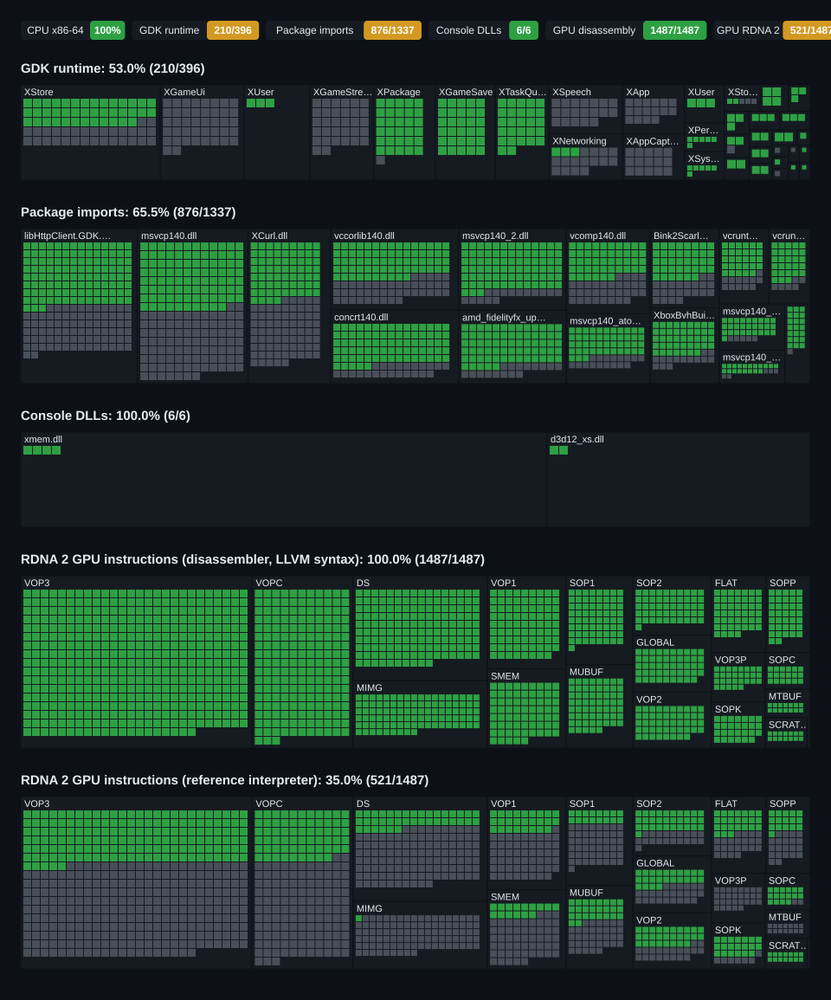
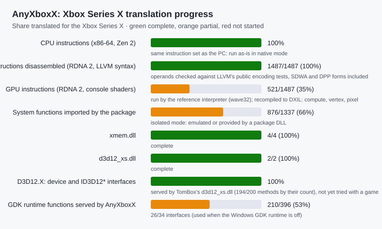
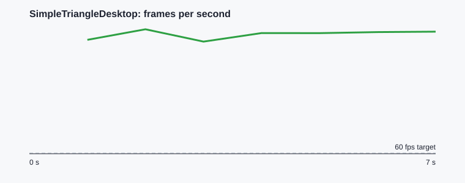
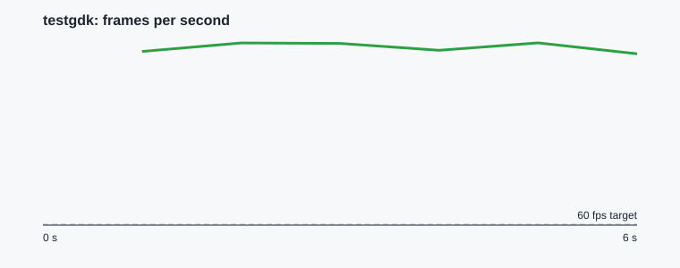
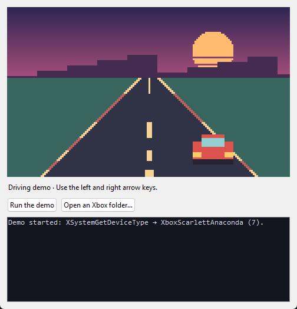
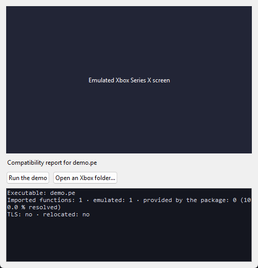
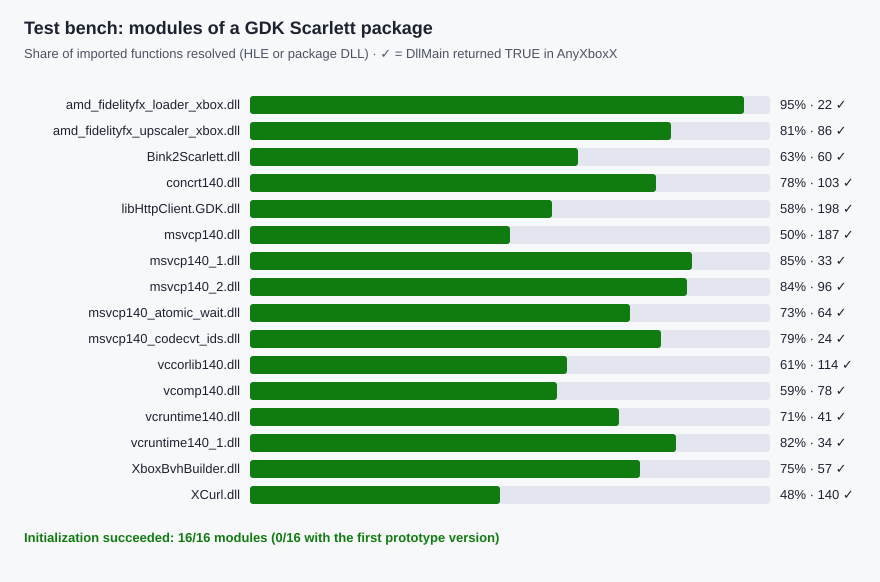
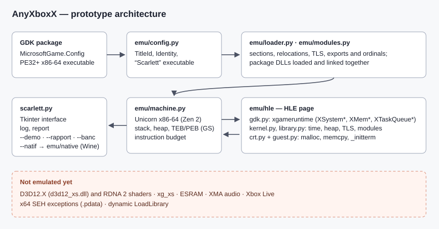

# AnyXboxX — emulatore Xbox Series X (prototipo)

[](https://discord.gg/TcX42vRyPU)

[English](../../README.md) · [Français](README.fr.md) · [Español](README.es.md) · [Deutsch](README.de.md) · **Italiano** · [Português](README.pt-BR.md) · [日本語](README.ja.md) · [中文](README.zh-CN.md) · [Русский](README.ru.md)

> [!NOTE]
> **A che punto siamo (25/11/2026)**
>
> Misurato su i7-13700KF + RTX 4070 SUPER, Windows 11, con il fork di VIctory `LooperSalty/victory` al commit `80d58f8` (branch `anyxboxx/fork-7b0-lot9-murs`) (`third_party/victory`) avviato con `tools/lancer_victory.ps1 -GameDir <cartella del gioco>`:
>
> - 🆕 **~12 fps nel mondo (Series X, RTX 4070 SUPER), misurato il 2026-11-25**: `third_party/victory` ora poggia su Neptune (VIctory Edit.) 2026-11-25c (mediana di circa 12,5 fps, circa 15 fps nell'ultimo minuto, picchi a 30, circa 7.500 draw per fotogramma, nessun crash; misurato dal maintainer dopo `tools/lancer_victory.ps1 -GameDir <game folder> -Warm`). Le cifre qui sotto sono state misurate con la base precedente `80d58f8`.
> - ✅ La build 1.0.2.1 per Xbox Series di GTA VI **si avvia** su PC: boot, schermata del profilo, impostazioni del primo avvio, schermate legali, caricamento, menu di pausa. I menu girano a 30 fps.
> - ✅ Raggiunge **il mondo e lo mostra**: il personaggio si muove sotto il controllo del giocatore e l'immagine 3D viene mostrata, a 4,8-5,4 fotogrammi al secondo con circa 6.550 draw per immagine (misurato dal manutentore, Windows 11, RTX 4070 Super, log di VIctory, circa 4 min 20). L'animazione di avvio non sfarfalla (osservato). La irradiance cache, mai illuminata finora (0 dispatch in una cattura PIX di un fotogramma di cinematica), ha ora tradotti i suoi due shader di shading, con le pipeline create e collegate in gioco (osservato).
> - ✅ **Tutti i filmati vengono riprodotti per intero** (osservato dal maintainer il 25 novembre con le impostazioni del launcher e il commit fissato `80d58f8`), con ancora un po' di grafica mancante in alcuni punti (il builder delle strutture di ray tracing è disattivato). Il maintainer ha osservato picchi di 9 fps e 7-8 fps costanti durante i filmati (titolo della finestra, 25 novembre); in una prova automatizzata le mediane misurate dal log erano più basse, 2-3 fps, a seconda della scena.
> - ✅ **Le prime due missioni sono state giocate fino in fondo**: un collaboratore del progetto ha giocato per circa 45 minuti a circa 2 fps e ha completato le prime due missioni (riferito al maintainer il 25 novembre; non misurato dai nostri log).
> - ✅ **Oltre il prologo, fino al capitolo 1, su Linux** (Jason sulla barca): giocato il 25 novembre su Proton (GE-Proton11-12 con una patch della comunità per il wineserver) e una AMD RX 9070 XT con il commit `890a83a`, una sessione di 23 minuti senza crash, circa 3-5 fps per tutto il tempo (log di VIctory: mediana 3,7 fps, l'80 % del tempo tra 2,2 e 4,5). Le zone in ombra e gli interni restano neri (niente ray tracing).
> - ⛔ Limiti attuali: 6 shader non sono ancora tradotti (9 prima), il driver rifiuta 16 pipeline (l'issue #75 del fork ne segnala circa 80 in più su una RTX 3070, non osservate sulla 4070 Super), l'illuminazione con ray tracing è assente (il costruttore BVH resta disattivato, circa 350 dispatch scartati per immagine), con l'impostazione `VICTORY_LATE_WAIT` alcune pareti della prima stanza possono essere trasparenti (issue #168 del fork, correzioni in corso: #191, #206), e la stabilità a lungo termine è misurata solo su circa 4 min 20 senza perdita del dispositivo. `VICTORY_RELAY` è disattivato per impostazione predefinita: l'issue #89 del fork segnala che fa sparire la pelle dei personaggi e sovrappone i sottotitoli.
> - 👁 Storico del 24 novembre (misurato o osservato dal manutentore, log di VIctory): `d279e69` circa 4 fps, 13 min nella prigione poi dispositivo perso → `7b0f736` + `VICTORY_RELAY=2` circa 4,5 fps → impostazioni del launcher della PR #172 senza DRED circa 5,5 fps → lotto 4 (3 pull request) circa 6,6 fps con `VICTORY_RELAY=2`, sfarfallio all'avvio corretto → questo lotto (7 pull request, senza `VICTORY_RELAY`) circa 5,4 fps ma 6.449 draw per immagine e la migliore immagine finora → lotto 8 (lotto 5 più una pull request, #11) circa 4,8-5,4 fps, circa 6.550 draw per immagine, shader della irradiance cache ora tradotti.
> - 🆕 VIctory ora è copiato in questo repository (`third_party/victory`, non più un sottomodulo) come codice nostro, senza nulla di sincronizzato o fissato: `80d58f8` più 57 commit per Proton (Wine) e schede AMD, dal fork `fxceless/victory-fork`, da VIctory, da klbf-lab, dai `victory-amd` di JoshuuDev e di myokex, e nostri (autori in THIRD_PARTY.md). Misurato solo su Linux (Fedora 44, RX 9070 XT, RADV, GE-Proton11-12 con una patch della comunità per il wineserver, log di VIctory di un'esecuzione di circa 23 min): circa 3,7 fps (immagine mediana del mondo di 266 ms), nessun crash né perdita del dispositivo; volti, pelle e geometria completi (osservato); interni e zone in ombra neri, il ray tracing non gira. Non ancora misurato su Windows; le impostazioni del launcher non cambiano. Un clone esistente deve eseguire `git submodule deinit -f third_party/victory` e cancellare `third_party/victory` e `.git/modules/third_party/victory` prima del pull (vedi la guida).
> - 📌 Fissato dal commit `80d58f8` del branch `anyxboxx/fork-7b0-lot9-murs`: il lotto 8 più tre nostri commit `xg:` (la disposizione di `xg_xs.dll` ora è servita esattamente come dalla libreria di Microsoft: mip di coda in modalità parent con posizione, tiling da 64 KiB indicizzato per sottorisorsa; un test confronta 54 descrizioni con la DLL vera e il manutentore ha misurato 0 differenze in gioco, quindi `-XgDll` è ormai solo un oracolo), la precompilazione offline di shader e pipeline (port della pull request #282 del fork `fxceless/victory-fork`, t4l03): `victory translate --cache --pipelines`, opzione `-Precompile` del launcher (misurato: 25.689 shader tradotti in circa 4,5 min, 296 rifiutati, 13 GB di cache) e altre sette pull request di quel fork (#349, #355, #396, #386, #358, #353, #374). Misurato dal manutentore (log di VIctory, notte tra il 24 e il 25 novembre): da 4,8 a 5,1 fps e circa il 12,7 % dei draw scartati per immagine (11-14 % prima); la cinematica è giudicata migliore (osservato). Più due commit di Yorivel provenienti dal fork (`e49864a`, `bf870de`): le scritture DirectStorage nelle pagine fisiche ora vengono segnalate al lato GPU (`VICTORY_DSTORAGE_NOTIFY=1`, impostata dal launcher), che non conserva più copie obsolete dei muri della prima stanza. Misurato dal maintainer (log di VIctory, 25 novembre, verso le 02:41-02:50): da un nuovo salvataggio fino al mondo in circa 9 minuti, 5,3-6,9 fps, 4.200-6.300 draw per immagine, nessuna perdita del dispositivo; filmati completi, giudicato «incredibile» (osservato); in alcuni punti manca ancora della grafica. La maggior parte dei draw scartati viene dal builder delle strutture di ray tracing, disattivato (14.943 su 15.444 in un log), non dalle 15 pipeline compute wave64 rifiutate da NVIDIA (circa 300 draw).
> - 📌 Fissato dal commit `19feca8` del branch `anyxboxx/fork-7b0-lot8-xg`: il lotto 8 più un nostro commit che affida la disposizione delle texture alla libreria di Microsoft: `tools/lancer_victory.ps1 -GameDir <cartella del gioco> -XgDll <percorso di xg_xs.dll>`, dove `xg_xs.dll` è la versione PC offline della tua copia del GDK (mai in questo repository). Senza `-XgDll` non cambia nulla. Misurato dal maintainer (log di VIctory, 25 novembre): le sue risposte differiscono da quelle di VIctory per 84 descrizioni di texture (mip di coda delle texture da 64 KiB, tiling da 64 KiB degli array di texture; dimensioni e offset coincidono); con essa il mondo gira a 5,4–7,1 fps (5,1–5,6 senza) e la prova è stata giudicata la migliore finora (osservato). `-XgMode compare` mantiene le disposizioni di VIctory e registra ogni differenza.
> - 📌 Fissato dal commit `d138351` del branch `anyxboxx/fork-7b0-lot8` del nostro fork di VIctory `LooperSalty/victory`: il lotto 5 (il fork `fxceless/victory-fork` a `7b0f736` più sette delle sue pull request, vedi la guida) più una pull request ripresa con `cherry-pick -x`: #11 (cxchhh, le coppie di maschere di lane parcheggiate a poche istruzioni di distanza vengono ripristinate, le letture VGPR relative mantengono le lane parcheggiate; i due shader di shading della irradiance cache ora si traducono). Misurato dal manutentore (log di VIctory, cattura PIX, impostazioni del launcher di `main`): 4,8-5,4 fps e circa 6.550 draw per immagine, 6 shader non tradotti (9 nel lotto 5), 16 pipeline rifiutate dal driver (come nel lotto 5), nessuna perdita del dispositivo in circa 4 min 20. Una copia esistente deve eseguire `git submodule sync third_party/victory` poi `git submodule update --init third_party/victory`: l'URL del sottomodulo è cambiato con la PR #178.
> - Requisiti: la tua copia del gioco, una GPU NVIDIA o AMD con SM 6.6 e mesh shader, Rust. Nessun file del gioco in questo repository.
> - Come avviarlo: [docs/running-gta6.md](../running-gta6.md).

AnyXboxX carica eseguibili Xbox GDK (formato PE32+ x86-64) ed esegue il loro codice con Unicorn. Le funzioni di sistema della console sono sostituite da un runtime C++ in modalità nativa e da codice Python nella macchina isolata (emulazione ad alto livello, come WinDurango o Wine). Il programma si presenta come una Xbox Series X: `XSystemGetDeviceType` restituisce `XboxScarlettAnaconda`.

## Obiettivo e stato

AnyXboxX è specializzato in una sola build: **Grand Theft Auto VI per Xbox Series, versione 1.0.2.1**. Viene tradotto solo ciò che serve a questo gioco (le funzioni di sistema che importa, gli shader e i metodi Direct3D 12.x che usa). Altri giochi saranno provati quando questa traduzione sarà completa. Il progetto si appoggia a [VIctory](https://github.com/Marvisak/VIctory) (Marvisak, GPL-3.0 o successiva), che punta alla stessa build: è copiato in `third_party/victory`, a partire dal fork `fxceless/victory-fork` (GPL-3.0) al commit `7b0f736`. Grazie a Marvisak e agli autori di quelle pull request, citati uno per uno in [THIRD_PARTY.md](../../THIRD_PARTY.md).

> [!IMPORTANT]
> **Il gioco non è giocabile.** Lo stato attuale è nel riquadro in cima a questa pagina. Questo repository non contiene file del gioco, chiavi o eseguibili e non spiega come ottenerli.

Pagina di stato online, con lo spazio su disco da prevedere: **[loopersalty.github.io/AnyXboxX](https://loopersalty.github.io/AnyXboxX/)**.

## Avanzamento della traduzione



Rigenerare: `scarlett.py --carte <cartella del pacchetto> docs/images/carte-avancee.svg`.



- **Istruzioni del processore: 100%.** La Series X usa un AMD Zen 2 in x86-64, lo stesso set di istruzioni di un PC: in modalità nativa il codice del gioco viene eseguito così com'è, senza traduzione.
- **Istruzioni della GPU: 81%.** Gli shader di un gioco per console sono compilati per la GPU RDNA 2 della Series X. 1.208 delle 1.490 codifiche RDNA 2 girano nell'interprete di riferimento, e il ricompilatore RDNA 2 → DXIL disegna già un primo vertex shader e pixel shader con D3D12.
- **Funzioni di sistema: 66%** delle 1 337 funzioni importate dalle DLL del pacchetto di prova sono risolte in modalità isolata.
- **DLL proprie della console**: `xmem.dll` (4/4) e `d3d12_xs.dll` (2/2) sono tradotte per le funzioni che il pacchetto usa. D3D12.X (dispositivo e interfacce `ID3D12*`) è servito dalla `d3d12_xs.dll` di TomBox, non ancora provato con un gioco.
- **Runtime GDK: 210 delle 396 funzioni** sono scritte in AnyXboxX, in C++: la coda di attività (`XTaskQueue`, `XAsync`, `XThread`), l'utente (`XUser`, un profilo locale offline), l'identità Xbox Series X (`XSystem`, Title ID, analisi, funzionalità del runtime), i salvataggi (`XGameSave`, `XGameSaveFiles`, `XPersistentLocalStorage`) il pacchetto del gioco (`XPackage`), lo Store offline (`XStore`) e, offline, inviti, attivazioni e segnalazioni di errore (`XGameInvite`, `XGameActivation`, `XGameProtocol`, `XError`), oltre allo stato HDR reale e alla connettività di rete del PC (`XDisplayTryEnableHdrMode`, `XNetworkingGetConnectivityHint`). Entrano in gioco quando AnyXboxX gestisce il runtime da solo: senza Gaming Services, oppure con `ANYXBOXX_SYSTEM_RUNTIME=0`. Se il runtime GDK di Windows è presente, serve tutte le interfacce, coda di attività compresa, perché le sue API accettano solo le proprie code. La traccia (`ANYXBOXX_TRACE=1`) nomina ogni interfaccia richiesta.

Il grafico viene rigenerato con `scarlett.py --traduction <cartella del pacchetto> docs/images/traduction.svg`.

## Prestazioni (obiettivo: 60 fotogrammi al secondo costanti)

```powershell
.\.venv\Scripts\python.exe .\PrototypeScarlett\scarlett.py --banc-perf <jeu.exe> [secondes] [courbe.svg]
.\.venv\Scripts\python.exe .\PrototypeScarlett\scarlett.py --natif <jeu.exe> --fps
```

Il runtime C++ cronometra ogni `Present` della swap chain DXGI del gioco, anche quando DXGI è caricata dinamicamente da una DLL del gioco (SDL3). Ne ricava i fotogrammi al secondo, il tempo medio di un fotogramma e l'«1% basso» (la cadenza dell'1% di fotogrammi più lenti, che rivela gli scatti). `--fps` mostra questi valori nel titolo della finestra. `--banc-perf` misura per N secondi, senza contare il primo (caricamento), ed emette un verdetto «60 f/s costanti» (codice di uscita 2 se l'obiettivo non viene raggiunto). Senza queste opzioni, non viene intercettato nulla.





I due giochi di prova girano senza sincronizzazione verticale: circa 11 700 f/s per SimpleTriangle e 12 600 f/s per testgdk, in modalità nativa.

## Avanzamento del progetto

| Fase | Stato |
|---|---|
| Lettura di `MicrosoftGame.Config` (TitleId, identità, eseguibile Scarlett) | ✅ fatto |
| Caricamento PE32+: sezioni e protezioni, rilocazioni, importazioni, esportazioni | ✅ fatto |
| TLS: copia del modello, indice, callback | ✅ fatto |
| TEB e PEB accessibili tramite il registro GS | ✅ fatto |
| Pagina HLE: 158 nomi di funzioni GDK, kernel, CRT e matematiche emulati | ✅ fatto |
| Funzioni sconosciute: `E_NOTIMPL` e voce nel registro invece di un rifiuto | ✅ fatto |
| Costruttori C++ globali (`_initterm`) eseguiti come codice guest | ✅ fatto |
| Rapporto di compatibilità (`--rapport`) e banco di prova (`--banc`) | ✅ fatto |
| Più moduli collegati nella stessa macchina: DLL del pacchetto, ordinali, reindirizzamenti, rilocazione in caso di conflitto | ✅ fatto |
| `GetModuleHandle`, `GetProcAddress`, `LoadLibrary`, `RtlPcToFileHeader` | ✅ fatto |
| 16/16 DLL di un pacchetto Scarlett inizializzate con le loro dipendenze, 0 chiamate non emulate | ✅ fatto |
| Gioco di test libero `SimpleTriangle` compilato: l'avvio C e l'inizializzazione GDK funzionano in AnyXboxX | ✅ fatto |
| Esecuzione nativa in stile Wine (`--natif`): **SimpleTriangle viene mostrato**, runtime GDK fornito da AnyXboxX | ✅ fatto |
| Secondo gioco di prova libero, `testgdk` di SDL3: **funziona in modalità nativa** (finestra, sprite, audio) | ✅ fatto |
| Avvio isolato di un pacchetto o di un exe (`--lancer`) con l'elenco delle chiamate da emulare | ✅ fatto |
| Runtime C++ (`runtime/`): `xgameruntime.dll`, `xmem.dll`, `d3d12_xs.dll` precaricate in modalità nativa e servite a tutte le DLL del gioco | ✅ fatto |
| `xmem.dll`: `XMemAlloc`, `XMemFree` con `XALLOC_ATTRIBUTES` decodificati (layout ERA: memoria heap e grafica, allineamento), hook, `XMemVirtualQuery` (flag della memoria grafica) | ✅ fatto |
| `d3d12_xs.dll`: serializzazione delle root signature, reindirizzata al D3D12 del PC | ✅ fatto |
| Tabella delle 396 funzioni GDK: interfaccia e numero di metodo, estratti da `xgameruntime.lib` (`tools/gdk_interfaces.py`) | ✅ fatto |
| `XTaskQueue`, `XAsync`, `XThread` servite da AnyXboxX: testgdk funziona senza il runtime di Windows | ✅ fatto |
| Altre interfacce GDK: delegate al runtime GDK di Windows, nominate dalla traccia | 🟡 in corso |
| 1400+ test automatizzati | ✅ fatto |
| D3D12.X: `D3D12XboxCreateDevice`, interfacce `ID3D12*` della console e `DXGIXPresentArray`, forniti dalla `d3d12_xs.dll` in Rust di TomBox (MIT, 48 export implementati, compilata con `tools/build_tombox.py d3d12_xs`, caricata con `ANYXBOXX_D3D12_XS=<percorso>`); non testabile qui senza un eseguibile console | 🟡 in corso |
| Librerie console di TomBox (Rust, GPL-3.0) per ciò che manca ad AnyXboxX: `xg_xs` (layout delle texture, 23 export) e `xmem` completo (38 export), con `ANYXBOXX_TOMBOX_DIR=<cartella>`; compilate con `tools/build_tombox.py xg_xs xmem` | 🟡 in corso |
| `XUser` offline: profilo locale sempre connesso, gamertag configurabile (`ANYXBOXX_GAMERTAG`), accesso di testgdk riuscito | ✅ fatto |
| Identità Xbox Series X: tipo di console (valore di registro `ConsoleMode` simulato, anche nelle DLL del gioco), `XSystem`, Title ID letto da `MicrosoftGame.config`, analisi «Xbox Series X» | ✅ fatto |
| Mappa dell'avanzamento: una casella per funzione (`--carte`) | ✅ fatto |
| Controller (`GameInput`) e audio (`XAudio2`): stessa API su console e su PC, collegati alle DLL di Windows in modalità nativa | ✅ fatto |
| Resoconto Markdown degli import mancanti per DLL e delle chiamate non emulate (`--lancer … --md rapport.md`) | ✅ fatto |
| Strumento di primo avvio di un eseguibile console: inventario, fornitore di ogni import (pacchetto, AnyXboxX, TomBox, Windows, mancante), esecuzioni isolate, esecuzione nativa facoltativa; rapporto fuori dal repository: `python tools/jour_j.py <pacchetto> [--natif]` ([guida](../day-one.md), in francese) | ✅ fatto |
| Contatore di fotogrammi (`--fps`) e banco di prova delle prestazioni con verdetto «60 f/s costanti» e curva (`--banc-perf`) | ✅ fatto |
| Salvataggi `XGameSave` (contenitori, blob, quota, lettura asincrona) e archiviazione locale persistente, sul disco del PC (`%LOCALAPPDATA%\AnyXboxX\<TitleId>`, oppure `ANYXBOXX_SAVE_DIR`) | ✅ fatto |
| `XPackage`: pacchetto installato in locale (identificativo, lingua, blocchi pronti, montaggio sulla cartella del gioco) | ✅ fatto |
| `kernelx.dll` (kernel della console): 2 661 funzioni reindirizzate a `kernel32`/`kernelbase` di Windows | ✅ fatto |
| TLS implicito (`thread_local`) dei giochi in modalità nativa: DLL portante `anyxboxx_tls.dll`, ogni thread riceve la sua copia (fino a 256 KiB) | ✅ fatto |
| Launcher nativo in C++ senza Python (`runtime/build/bin/anyxboxx.exe <gioco.exe \| cartella> [--fps]`): SimpleTriangle e testgdk a ~12 000 fps | ✅ fatto |
| Disassembler GPU RDNA 2: 1.490 mnemonici e operandi in sintassi LLVM (scalari, VOP1/VOP2/VOPC/VOP3/VOP3P/SDWA/DPP/SMEM/DS/EXP/MUBUF/MTBUF/MIMG/FLAT con modificatori), verificato su 38.999 codifiche pubbliche di LLVM: `scarlett.py --rdna2 <shader.bin> [--liste]` | 🟡 in corso |
| Operandi del disassembler RDNA 2 identici al testo di LLVM: scalari e VOP1/VOPC 100%, DS 100%, EXP 100%, SMEM 96,5% (il massimo: LLVM scrive le altre codifiche in due modi) | ✅ fatto |
| Primi vertex e pixel shader RDNA 2 disegnati con D3D12 (`anyxboxx_gpu_run.exe --draw`): ogni vertice e ogni pixel identici all'interprete di riferimento, sulla GPU e con WARP | ✅ fatto |
| Texture negli shader RDNA 2 ricompilati: descrittori T#/S# e `image_sample` (2D, texel più vicino, wrap o clamp-to-edge, 8_8_8_8_UNORM e 32_32_32_32_FLOAT), identici all'interprete di riferimento sulla GPU e con WARP, compreso un pixel shader con texture; layout dei descrittori da Leonida e Mesa | ✅ fatto |
| Secondo traduttore RDNA 2 → SPIR-V (Vulkan): quello di Leonida (GPL-3.0), copiato senza modifiche in `third_party/leonida/` e alimentato dal disassembler di AnyXboxX, senza `llvm-mc`; vertex, pixel e compute shader; 51 dei 52 shader della console contenuti in `XboxBvhBuilder.dll` del pacchetto vengono tradotti, misura locale con `tools/fssm_mesure.py` (`scarlett.py --rdna2 <shader.bin> --spirv ps`) | 🟡 in corso |
| TomBox aggiornato all'ultima versione (D3D12.X: 194 metodi su 200 secondo il loro conteggio) e 4 altre librerie della console compilate e servite da `ANYXBOXX_TOMBOX_DIR`: `d3d12_x` (ESRAM), `XAudio2_9` (voci XMA), `xapu`, `xgs12`; `tools/build_tombox.py d3d12_xs xg_xs xmem d3d12_x xaudio2_9 xapu xgs12` | 🟡 in corso |
| Conversione del DXIL della console in DXIL del PC (`dxil-ms-xb2` → `dxil-ms-dx`, senza passare per HLSL): lo strumento di Xbox2Windows (MIT), copiato senza modifiche con il suo test in `third_party/xbox2windows/`; `python third_party/xbox2windows/tools/dxil_retarget.py <ingresso> <uscita>` o `--pe <gioco.exe>` | ✅ fatto |
| Controlli delle pull request: lint e allineamento degli 9 README (righe, immagini, numero di test) a ogni pull request | ✅ fatto |
| Texture console in Rust: decodifica BC7 e de-tiling GFX10 `SW_4K_S` portati da Xbox2Windows (MIT), digest di riferimento riprodotti; `anyxboxx_texture bc7 <blocchi.bin> <l> <a> <uscita.png> [--4k-s]` | 🟡 in corso |
| Altre interfacce GDK scritte da AnyXboxX (`XGameUi`, `XNetworking`…) | ⏳ da fare |
| Ricompilatore di shader RDNA 2 → DXIL: primi programmi tradotti in HLSL, compilati in DXIL ed eseguiti sulla GPU del PC con D3D12 (`--hlsl`, `anyxboxx_gpu_run.exe`, WARP senza GPU), memoria identica a un interprete di riferimento wave32 che esegue 1.208 codifiche su 1.490 (scalari, VOP1/VOP2/VOPC/VOP3/VOP3P, memoria: SMEM, LDS, GLOBAL, MUBUF/MTBUF con limiti V# e formati tipizzati, atomiche, salti, divergenza con `exec`); un primo vertex shader e pixel shader (export EXP, interpolazione VINTRP) disegnati con D3D12, identici vertice per vertice e pixel per pixel: `scarlett.py --rdna2 <shader.bin> --executer` | 🟡 in corso |
| Programmi di calcolo wave64 su GPU con wave da 32 lane (#70): ogni wave da 64 lane gira come un gruppo di 64 thread (maschere e letture di lane tramite memoria groupshared, senza `WaveSize`), memoria identica all'interprete di riferimento in wave64 su una RTX (wave da 32 lane) e con WARP; DPP e confronti SDWA ancora rifiutati per nome | 🟡 in corso |
| Cache degli shader: shader tradotti compilati una sola volta in DXIL, poi ripresi dal disco (1,4 ms) o dalla memoria (0,8 ms) invece di dxc (22 ms); `%LOCALAPPDATA%\AnyXboxX\shader-cache` o `ANYXBOXX_SHADER_CACHE`, dimensione limitata | 🟡 in corso |
| La build Xbox Series 1.0.2.1 del titolo tramite VIctory (`third_party/victory`, codice nostro, sulla base Neptune (VIctory Edit.) 2026-11-25c): ~12 fps nel mondo (Series X, RTX 4070 SUPER), misurato il 2026-11-25 (mediana di circa 12,5 fps, circa 7.500 draw per fotogramma, nessun crash; misurato dal maintainer); niente illuminazione in ray tracing (al chiuso la sostituisce una luce ambientale uniforme), niente animazione facciale, oggetti neri per un attimo mentre le loro texture vengono sostituite | 🟡 in corso |
| Eccezioni SEH x64 (`.pdata`), thread multipli | ⏳ da fare |
| Caricamento dinamico di una DLL durante l'esecuzione (`LoadLibrary` + `DllMain`) | ⏳ da fare |
| Grafica D3D12.X verso Direct3D 12 / Vulkan | ⏳ da fare |
| Audio XMA2 della console: decodificato in WAV dal port Rust del decoder di FFmpeg fatto da TomBox (LGPL, entro 1 LSB da FFmpeg sul campione pubblico FATE); `anyxboxx_xma <ingresso.xma> <uscita.wav>`, file a un flusso | 🟡 in corso |

<table>
<tr>
<td></td>
<td></td>
</tr>
<tr>
<td align="center">La demo risponde alle frecce della tastiera.</td>
<td align="center">Il registro mostra il rapporto di compatibilità.</td>
</tr>
</table>

## Provare la demo

Su Windows, installa Python 3.12 a 64 bit con Tcl/Tk, poi apri PowerShell nella radice del repository.

```powershell
py -3.12 -m venv .venv
.\.venv\Scripts\python.exe -m pip install -r requirements.txt
.\.venv\Scripts\python.exe .\PrototypeScarlett\scarlett.py --demo
```

La modalità nativa ha bisogno del runtime C++. Si compila con Visual Studio 2022 o 2026 (carico di lavoro C++) e CMake:

```powershell
cmake -S runtime -B runtime/build -A x64
cmake --build runtime/build --config Release
```

La coda di attività riprende il modulo `Task` di [libHttpClient](https://github.com/microsoft/libHttpClient) (licenza MIT, `runtime/third_party/libhttpclient-task`). Le DLL finiscono in `runtime/build/bin`, o nella cartella indicata da `ANYXBOXX_RUNTIME`. `ANYXBOXX_SYSTEM_RUNTIME=0` disattiva la delega al runtime GDK di Windows.

Il programma dimostrativo compilato è `PrototypeScarlett/demo.pe`; il suo codice sorgente è `PrototypeScarlett/demo.c`.

## Avviare un gioco in modalità nativa

```powershell
.\.venv\Scripts\python.exe .\PrototypeScarlett\scarlett.py --natif <dossier ou fichier .exe> [dossiers de DLL…]
```


AnyXboxX carica l'eseguibile stesso e lo esegue direttamente sul processore, come Wine. Il runtime Xbox (`xgameruntime.dll`) è fornito da AnyXboxX; la finestra e DirectX 12 sono quelli del PC. **Attenzione: in modalità nativa il programma non è isolato.** Riserva questa modalità ai programmi di fiducia; `--rapport` e `--banc` restano isolati in Unicorn. `ANYXBOXX_TRACE=1` mostra le chiamate intercettate. Dettagli: [docs/test-game.md](../test-game.md).

## Avviare un pacchetto in modalità isolata

```powershell
.\.venv\Scripts\python.exe .\PrototypeScarlett\scarlett.py --lancer <dossier du paquet ou fichier .exe> [dossiers de DLL…]
```

Con una cartella, AnyXboxX legge `MicrosoftGame.Config`, prende l'eseguibile dichiarato per `Scarlett` e lo avvia nella macchina isolata (Unicorn): il programma non tocca il PC. Il resoconto indica prima gli import non risolti, poi le chiamate non emulate, dalla più frequente alla più rara: è l'elenco di lavoro per completare l'emulatore. Se l'eseguibile manca, il messaggio lo nomina. Con `--md rapport.md`, lo stesso resoconto viene scritto in Markdown, con gli import mancanti raggruppati per DLL.

## Analizzare un programma

```powershell
.\.venv\Scripts\python.exe .\PrototypeScarlett\scarlett.py --rapport <dossier ou fichier .exe>
```

Il banco di prova carica tutti i moduli PE di una cartella e avvia la loro inizializzazione:

```powershell
.\.venv\Scripts\python.exe .\PrototypeScarlett\scarlett.py --banc <dossier>
```



Risultati dettagliati: [docs/progress.md](../progress.md). Gioco di test libero confrontato con la sua esecuzione nativa: [docs/test-game.md](../test-game.md). Una cartella di DLL aggiuntiva (per esempio le DLL di Visual C++) può seguire il bersaglio: `--rapport <cible> <dossier>`.

Il rapporto elenca le funzioni importate, la percentuale già emulata e le funzioni mancanti. Nell'interfaccia, il pulsante **Open an Xbox folder…** (Apri una cartella Xbox) legge `MicrosoftGame.Config`, mostra questo rapporto e poi avvia il programma; ogni chiamata non emulata compare nel registro.

## Architettura



| Modulo | Ruolo |
|---|---|
| `emu/config.py` | legge il manifesto del pacchetto GDK |
| `emu/loader.py` | carica l'immagine PE e prepara importazioni, esportazioni e TLS |
| `emu/machine.py` | processore Unicorn, stack, heap, TEB/PEB, smistamento delle chiamate |
| `emu/hle/` | funzioni emulate: `gdk.py`, `kernel.py`, `crt.py`, `libm.py`, `guest.py` |
| `emu/report.py` | rapporto di compatibilità |
| `emu/modules.py` | carica le DLL del pacchetto, collega le importazioni, ordina le inizializzazioni |
| `emu/bench.py` | banco di prova su una cartella di moduli |
| `emu/native/` | esecuzione nativa in stile Wine: caricatore, importazioni reali, runtime GDK di AnyXboxX |
| `scarlett.py` | interfaccia Tkinter e riga di comando |

Per aggiungere una funzione, decora un gestore in `emu/hle/`:

```python
@hle("gdk")
def XSystemGetDeviceType(c):
    return XBOX_SERIES_X
```

## Ricerca

- [Architettura hardware della Xbox Series X](../research/xbox-series-x-architecture.md): CPU Zen 2, GPU RDNA 2, memoria, Velocity Architecture, sicurezza.
- [Emulatori e livelli di compatibilità esistenti](../research/state-of-the-art.md): WinDurango, XWine1, Xenia, strumenti XVD.
- [Note di reverse engineering sul pacchetto Scarlett studiato](../research/package/README.md) (scritte da Codex): tabelle RDS5/ETPF, intestazioni RPF, organizzazione del pacchetto.
- [TomBox e la sua prosecuzione](../research/tombox.md): DLL console in Rust, Direct3D 12.x, traduttore di shader RDNA 2, ciò che AnyXboxX riprende (MIT, citato).
- [Xbox2Windows](../research/xbox2windows.md): ricerca sulla ricompilazione statica; BC7 e tiling GFX10 ripresi da AnyXboxX (MIT, citato).
- [Primo avvio dell'eseguibile 1.0.2.1](../research/first-boot-1021.md): arresti misurati con `gta6rt` di Leonida in ordine, le pull request di Leonida che li trattano, elenco dei lavori per AnyXboxX.

## Test

```powershell
.\.venv\Scripts\python.exe -m pip install -r requirements-dev.txt
.\.venv\Scripts\python.exe -m pytest
```

## Contribuire

Il ramo `main` è protetto: ogni contributo passa da una pull request revisionata e i test devono passare. I bug e le funzioni da emulare si segnalano nelle issue. Le regole complete sono in [CONTRIBUTING.md](../../CONTRIBUTING.md).

Discussione, aiuto e report di test: [Discord](https://discord.gg/TcX42vRyPU)

## Licenza

AnyXboxX è distribuito con licenza [GNU GPL 3.0 o successiva](../../LICENSE). Le parti di terzi mantengono la propria licenza: il modulo `Task` di libHttpClient (MIT, `runtime/third_party/libhttpclient-task`) e le tabelle RDNA 2 generate dai test di codifica pubblici di LLVM (Apache 2.0 con eccezione LLVM, `PrototypeScarlett/emu/rdna2_ops.py` e `rdna2_shapes.py`).

Componenti di terzi e crediti: [THIRD_PARTY.md](../../THIRD_PARTY.md).
