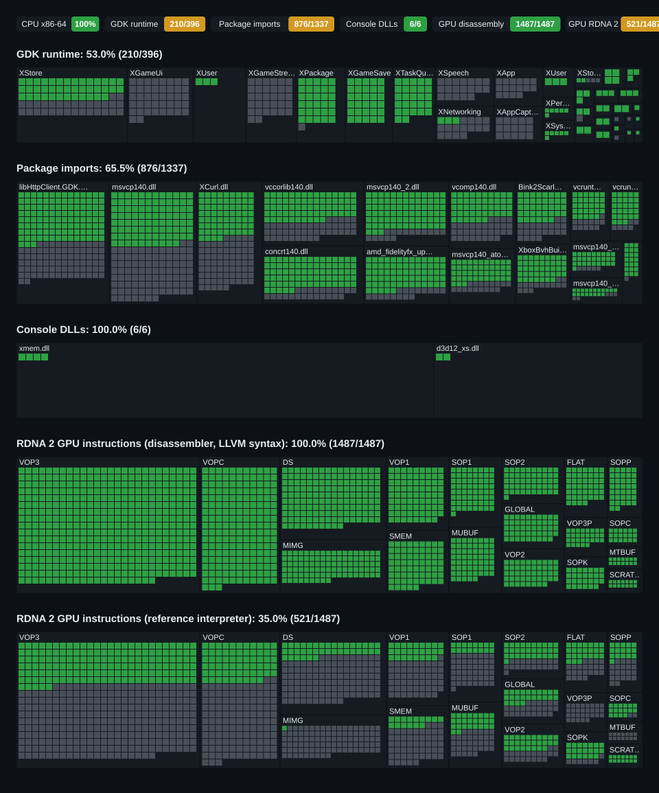
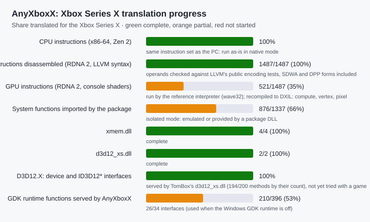
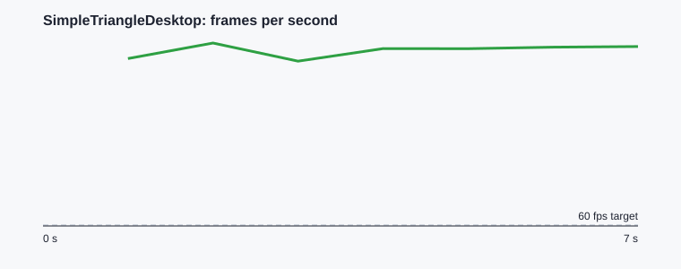
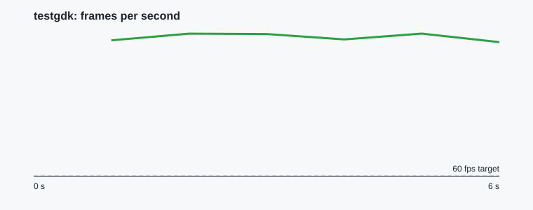
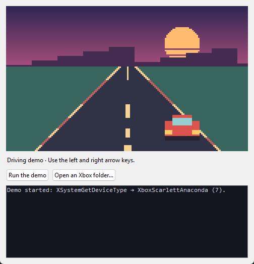
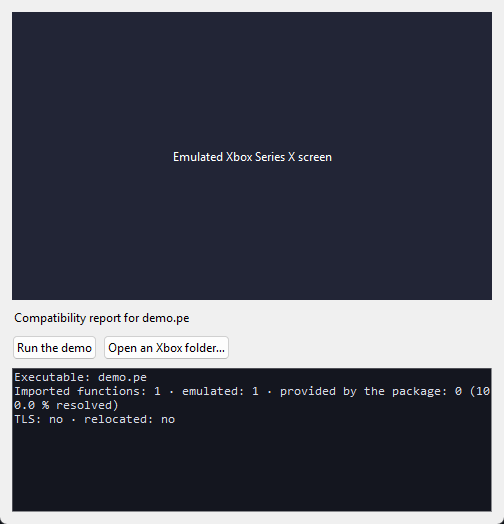
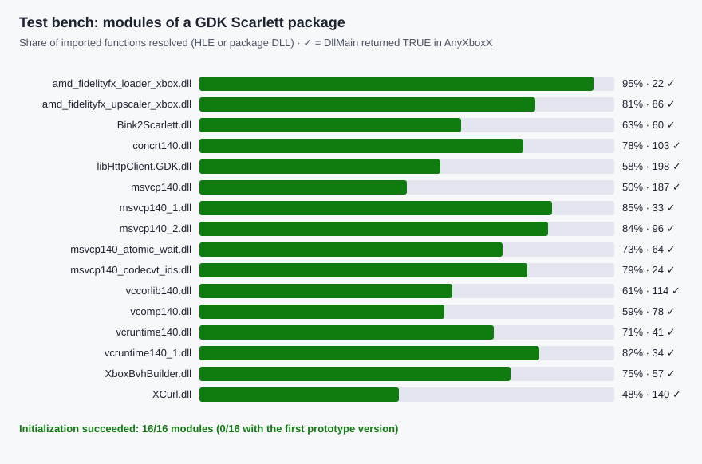
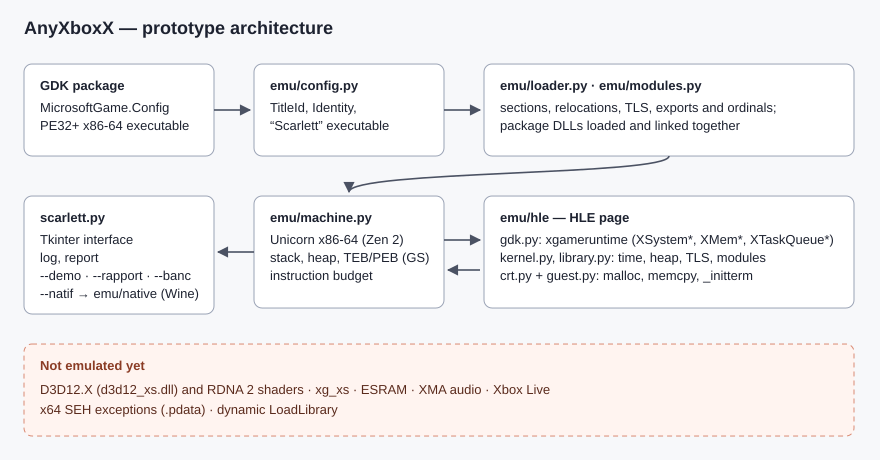

# AnyXboxX — Xbox Series X エミュレーター（プロトタイプ）

[](https://discord.gg/TcX42vRyPU)

[English](../../README.md) · [Français](README.fr.md) · [Español](README.es.md) · [Deutsch](README.de.md) · [Italiano](README.it.md) · [Português](README.pt-BR.md) · **日本語** · [中文](README.zh-CN.md) · [Русский](README.ru.md)

> [!NOTE]
> **現在地（2026-11-25）**
>
> i7-13700KF + RTX 4070 SUPER、Windows 11 で計測。VIctory のフォーク `LooperSalty/victory` のコミット `80d58f8` (branch `anyxboxx/fork-7b0-lot9-murs`)（`third_party/victory`）を `tools/lancer_victory.ps1 -GameDir <ゲームのフォルダー>` で起動しています。
>
> - 🆕 **ワールドで約 12 fps（Series X、RTX 4070 SUPER、2026-11-25 計測）**：`third_party/victory` は Neptune (VIctory Edit.) 2026-11-25c をベースにしました（中央値約 12.5 fps、最後の 1 分間は約 15 fps、ピーク 30、1 フレームあたり約 7,500 ドロー、クラッシュなし。`tools/lancer_victory.ps1 -GameDir <game folder> -Warm` の後にメンテナーが計測）。以下の数値は以前のベース `80d58f8` で計測したものです。
> - ✅ GTA VI の Xbox Series 1.0.2.1 ビルドは PC で**起動します**。起動、プロフィール画面、初回設定、法的画面、ロード、ポーズメニューまで動作し、メニューは 30 fps です。
> - ✅ **ワールドに到達して表示します**：キャラクターはプレイヤーの操作で動き、3D 画像が表示されます。約 4 分 20 秒の計測で 4.8〜5.4 フレーム/秒、1 フレームあたり約 6,550 ドロー（メンテナーが計測、Windows 11、RTX 4070 Super、VIctory ログ）。起動アニメーションはちらつきません（観察）。これまで一度も点灯していなかったイラディアンスキャッシュ（ムービーの 1 フレームの PIX キャプチャでディスパッチ 0 回）は、2 つのシェーディング用シェーダーが変換され、パイプラインがゲーム内で作成・バインドされるようになりました（観察）。
> - ✅ **すべてのカットシーンが最後まで再生されます**（11 月 25 日、ランチャーの設定と固定コミット `80d58f8` でメンテナーが観察）。ただし一部の場所でまだグラフィックが欠けています（レイトレーシング構造ビルダーは無効）。メンテナーはカットシーン中に最大 9 fps、安定して 7〜8 fps を観察しました（ウィンドウのタイトル、11 月 25 日）。スクリプトによる実行では、ログから計測した中央値はシーンにより 2〜3 fps と低めでした。
> - ✅ **最初の 2 つのミッションを最後までプレイ**：プロジェクトの協力者が約 2 fps で約 45 分間プレイし、最初の 2 つのミッションをクリアしました（11 月 25 日にメンテナーへ報告。私たちのログでの計測ではありません）。
> - ✅ **Linux でプロローグを越えてチャプター 1 へ**（ボートの上のジェイソン）：11 月 25 日、Proton（GE-Proton11-12、wineserver のコミュニティ製パッチ適用）と AMD RX 9070 XT、コミット `890a83a` でプレイ。23 分間の起動でクラッシュなし、終始約 3〜5 fps（VIctory のログ：中央値 3.7 fps、80 % の時間が 2.2〜4.5）。影の部分と屋内は黒いまま（レイトレーシングなし）。
> - ⛔ 現在の制限：変換できないシェーダーが 6 個残っています（以前は 9 個）。ドライバーに拒否されるパイプラインは 16 個です（フォークの issue #75 は RTX 3070 でさらに約 80 個と報告していますが、4070 Super では未確認）。レイトレーシングによる照明はありません（BVH ビルダーは無効のまま、1 フレームあたり約 350 ディスパッチを破棄）。`VICTORY_LATE_WAIT` 設定では最初の部屋の壁が透明になることがあります（フォークの issue #168、修正中：#191、#206）。長時間の安定性は約 4 分 20 秒の間、デバイス損失なしを計測したのみです。`VICTORY_RELAY` は既定でオフです。フォークの issue #89 によると、キャラクターの肌が消え、字幕が重なります。
> - 👁 11 月 24 日の経過（メンテナーが計測または観察、VIctory ログ）：`d279e69` 約 4 fps、刑務所で 13 分後にデバイス喪失 → `7b0f736` + `VICTORY_RELAY=2` 約 4.5 fps → PR #172 のランチャー設定（DRED なし）約 5.5 fps → バッチ 4（pull request 3 件）`VICTORY_RELAY=2` で約 6.6 fps、起動時のちらつきを修正 → 今回のバッチ（pull request 7 件、`VICTORY_RELAY` なし）約 5.4 fps だが 1 フレーム 6,449 ドローで、これまでで最良の画像 → バッチ 8（バッチ 5 にプルリクエスト 1 件、#11 を追加）約 4.8〜5.4 fps、1 フレームあたり約 6,550 ドロー、イラディアンスキャッシュのシェーダーが変換可能に。
> - 🆕 VIctory はこのリポジトリ内にコピーされた（`third_party/victory`、サブモジュールではなくなった）。独自のコードとして扱い、同期や固定はしない：`80d58f8` に、Proton（Wine）と AMD カード向けの 57 コミットを追加（フォーク `fxceless/victory-fork`、VIctory、klbf-lab、JoshuuDev と myokex の `victory-amd`、および独自のもの。作者は THIRD_PARTY.md）。Linux のみで計測（Fedora 44、RX 9070 XT、RADV、コミュニティ製 wineserver パッチ入りの GE-Proton11-12、約 23 分の 1 回の実行の VIctory ログ）：約 3.7 fps（ワールドのフレーム中央値 266 ms）、クラッシュやデバイス消失なし。顔、肌、ジオメトリは完全（観察）。屋内と影の部分は黒く、レイトレーシングは動いていない。Windows ではまだ計測していない。起動スクリプトの設定は変わらない。既存のクローンでは pull の前に `git submodule deinit -f third_party/victory` を実行し、`third_party/victory` と `.git/modules/third_party/victory` を削除すること（ガイド参照）。
> - 📌 ブランチ `anyxboxx/fork-7b0-lot9-murs` のコミット `80d58f8` に固定：バッチ 8 に、独自の `xg:` コミット 3 件（`xg_xs.dll` の配置を Microsoft のライブラリとまったく同じように返す：親モードの末尾ミップと位置、サブリソースごとの 64 KiB タイリング。テストが本物の DLL と 54 件の記述を比較し、メンテナーはゲーム内で差 0 を計測したため、`-XgDll` は今や検証用の基準にすぎない）、シェーダーとパイプラインのオフライン事前コンパイル（フォーク `fxceless/victory-fork` のプルリクエスト #282、t4l03 の移植）：`victory translate --cache --pipelines`、ランチャーのスイッチ `-Precompile`（計測：25,689 個のシェーダーを約 4.5 分で変換、296 個は拒否、キャッシュ 13 GB）、そのフォークの他のプルリクエスト 7 件（#349、#355、#396、#386、#358、#353、#374）を加えたもの。メンテナーが計測（VIctory ログ、11 月 24 日から 25 日の夜）：4.8〜5.1 fps、1 フレームあたり約 12.7 % の draw が破棄（以前は 11〜14 %）。カットシーンはより良いと判断（観察）。さらにフォークの Yorivel による 2 件のコミット（`e49864a`、`bf870de`）：物理ページへの DirectStorage の書き込みが GPU 側に通知されるようになり（`VICTORY_DSTORAGE_NOTIFY=1`、ランチャーが設定）、最初の部屋の壁の古いコピーを保持しなくなりました。メンテナーが計測（VIctory ログ、11 月 25 日、02:41〜02:50 頃）：新しいセーブからワールドまで約 9 分、5.3〜6.9 fps、1 フレームあたり 4,200〜6,300 ドロー、デバイス損失なし。カットシーンは最後まで再生され、「信じられない」と評価（観察）。ただし一部の場所でまだグラフィックが欠けています。破棄されたドローの大半は無効化されたレイトレーシング構造ビルダーによるもので（あるログでは 15,444 件中 14,943 件）、NVIDIA が拒否する 15 個の wave64 コンピュートパイプライン（約 300 ドロー）ではありません。
> - 📌 ブランチ `anyxboxx/fork-7b0-lot8-xg` のコミット `19feca8` に固定：バッチ 8 に、テクスチャの配置を Microsoft 自身のライブラリに任せる独自のコミットを 1 件追加：`tools/lancer_victory.ps1 -GameDir <ゲームのフォルダー> -XgDll <xg_xs.dll のパス>`。`xg_xs.dll` はご自身の GDK に含まれるオフライン PC 版です（このリポジトリには決して含めません）。`-XgDll` がなければ何も変わりません。メンテナーが計測（VIctory ログ、11 月 25 日）：84 件のテクスチャ記述でライブラリの応答が VIctory と異なります（64 KiB テクスチャのテール mip、テクスチャ配列の 64 KiB タイリング。サイズとオフセットは一致）。ライブラリを使うとワールドは 5.4〜7.1 fps（使わない場合 5.1〜5.6）で、これまでで最良の実行と判断されました（観察）。`-XgMode compare` は VIctory の配置を保ったまま、差異をすべてログに記録します。
> - 📌 私たちの VIctory フォーク `LooperSalty/victory` のブランチ `anyxboxx/fork-7b0-lot8` のコミット `d138351` に固定：バッチ 5（フォーク `fxceless/victory-fork` の `7b0f736` に 7 件のプルリクエストを加えたもの、ガイド参照）に、`cherry-pick -x` で取り込んだプルリクエスト 1 件を追加：#11（cxchhh、数命令離れた退避中のレーンマスクのペアを復元し、相対 VGPR 読み出しで退避中のレーンを保持。イラディアンスキャッシュの 2 つのシェーディング用シェーダーが変換可能に）。メンテナーが計測（VIctory ログ、PIX キャプチャ、`main` のランチャー設定）：4.8〜5.4 fps、1 フレームあたり約 6,550 ドロー、変換できないシェーダー 6 個（バッチ 5 では 9 個）、ドライバーに拒否されるパイプライン 16 個（バッチ 5 と同じ）、約 4 分 20 秒デバイス損失なし。既存のコピーは `git submodule sync third_party/victory` に続けて `git submodule update --init third_party/victory` を実行してください。サブモジュールの URL が PR #178 で変わりました。
> - 必要なもの: ご自身のゲームのコピー、SM 6.6 とメッシュシェーダー対応の NVIDIA または AMD の GPU、Rust。このリポジトリにゲームファイルは含まれません。
> - 起動方法: [docs/running-gta6.md](../running-gta6.md)。

AnyXboxX は Xbox GDK の実行ファイル（PE32+ x86-64 形式）を読み込み、そのコードを Unicorn で実行します。コンソールのシステム関数は、ネイティブモードでは C++ ランタイムに、隔離されたマシンでは Python のコードに置き換えられます（WinDurango や Wine と同じ高レベルエミュレーション）。このプログラムは Xbox Series X として振る舞い、`XSystemGetDeviceType` は `XboxScarlettAnaconda` を返します。

## 対象と現状

AnyXboxX は 1 つのビルドに特化しています: **Xbox Series 版 Grand Theft Auto VI、バージョン 1.0.2.1**。このゲームが必要とするもの（インポートするシステム関数、使用するシェーダーと Direct3D 12.x メソッド）だけを変換します。ほかのゲームは、この変換が完了してから試します。本プロジェクトは同じビルドを対象とする [VIctory](https://github.com/Marvisak/VIctory)（Marvisak、GPL-3.0 以降）を土台にしています。VIctory は `third_party/victory` にコピーされており、フォーク `fxceless/victory-fork`（GPL-3.0）のコミット `7b0f736` を出発点としています。Marvisak と各プルリクエストの作者に感謝します。個別のクレジットは [THIRD_PARTY.md](../../THIRD_PARTY.md) にあります。

> [!IMPORTANT]
> **ゲームはプレイできません。** 現在地はこのページ上部のボックスを参照してください。このリポジトリにはゲームファイル、鍵、実行ファイルは含まれず、その入手方法も説明しません。

オンラインの状況ページ（必要なディスク容量を含む）: **[loopersalty.github.io/AnyXboxX](https://loopersalty.github.io/AnyXboxX/)**。

## 変換の進捗



再生成：`scarlett.py --carte <パッケージのフォルダー> docs/images/carte-avancee.svg`。



- **プロセッサ命令：100 %。** Series X は x86-64 の AMD Zen 2 を使っており、PC と同じ命令セットです。ネイティブモードでは、ゲームのコードは変換なしでそのまま実行されます。
- **GPU 命令：81 %。** コンソール向けゲームのシェーダーは、Series X の RDNA 2 GPU 向けにコンパイルされています。1,490 個の RDNA 2 エンコーディングのうち 1,208 個がリファレンスインタープリターで動作し、RDNA 2 → DXIL の再コンパイラーはすでに最初の頂点シェーダーとピクセルシェーダーを D3D12 で描画しています。
- **システム関数：66 %。** テスト用パッケージの DLL がインポートする 1 337 個の関数のうち、この割合が隔離モードで解決できています。
- **コンソール固有の DLL**：`xmem.dll`（4/4）と `d3d12_xs.dll`（2/2）は、パッケージが使う関数について変換済みです。D3D12.X（デバイスと `ID3D12*` インターフェース）は TomBox の `d3d12_xs.dll` が提供していますが、まだゲームでは試していません。
- **GDK ランタイム：396 個の関数のうち 210 個**は AnyXboxX 内に C++ で書かれています。対象はタスクキュー（`XTaskQueue`、`XAsync`、`XThread`）、ユーザー（`XUser`、オフラインのローカルプロファイル）、Xbox Series X の識別情報（`XSystem`、Title ID、アナリティクス、ランタイムの機能）、セーブデータ（`XGameSave`、`XGameSaveFiles`、`XPersistentLocalStorage`）、ゲームパッケージ（`XPackage`）、オフラインのストア（`XStore`）、そしてオフラインでの招待・アクティベーション・エラー報告（`XGameInvite`、`XGameActivation`、`XGameProtocol`、`XError`）、さらに PC の実際の HDR 状態とネットワーク接続（`XDisplayTryEnableHdrMode`、`XNetworkingGetConnectivityHint`）です。これらは AnyXboxX がランタイムを単独で管理するとき（Gaming Services がない場合、または `ANYXBOXX_SYSTEM_RUNTIME=0` を指定した場合）に使われます。Windows の GDK ランタイムがある場合は、その API が自前のキューしか受け付けないため、タスクキューを含むすべてのインターフェースをそちらが提供します。トレース（`ANYXBOXX_TRACE=1`）は、要求された各インターフェースの名前を出力します。

グラフは `scarlett.py --traduction <パッケージのフォルダー> docs/images/traduction.svg` で再生成されます。

## パフォーマンス（目標：常に毎秒 60 フレーム）

```powershell
.\.venv\Scripts\python.exe .\PrototypeScarlett\scarlett.py --banc-perf <jeu.exe> [secondes] [courbe.svg]
.\.venv\Scripts\python.exe .\PrototypeScarlett\scarlett.py --natif <jeu.exe> --fps
```

C++ ランタイムは、ゲームの DXGI スワップチェーンの `Present` を 1 回ごとに計測します。DXGI がゲームの DLL（SDL3）によって動的に読み込まれる場合も同様です。ここから、毎秒のフレーム数、1 フレームの平均時間、そして「1% ロー」（最も遅い 1% のフレームの速度で、カクつきが分かります）を求めます。`--fps` はこれらの値をウィンドウのタイトルに表示します。`--banc-perf` は N 秒間計測し（最初の 1 秒は読み込みなので除きます）、「60 fps を維持」の判定を出します（目標に届かなければ終了コードは 2）。これらのオプションを付けなければ、何も横取りしません。





2 つのテストゲームは垂直同期なしで動作し、ネイティブモードで SimpleTriangle は約 11,700 fps、testgdk は約 12,600 fps です。

## プロジェクトの進捗

| ステップ | 状態 |
|---|---|
| `MicrosoftGame.Config` の読み取り（TitleId、ID、Scarlett 実行ファイル） | ✅ 完了 |
| PE32+ の読み込み：セクションと保護属性、リロケーション、インポート、エクスポート | ✅ 完了 |
| TLS：テンプレートのコピー、インデックス、コールバック | ✅ 完了 |
| GS レジスタ経由で TEB と PEB にアクセス可能 | ✅ 完了 |
| HLE ページ：GDK、カーネル、CRT、数学関数の 158 個の関数名をエミュレート | ✅ 完了 |
| 未知の関数：拒否せず `E_NOTIMPL` を返しログに記録 | ✅ 完了 |
| グローバル C++ コンストラクター（`_initterm`）をゲストコードで実行 | ✅ 完了 |
| 互換性レポート（`--rapport`）とテストベンチ（`--banc`） | ✅ 完了 |
| リンクされた複数のモジュールを同一のマシンで実行：パッケージの DLL、序数、フォワーダー、競合時のリロケーション | ✅ 完了 |
| `GetModuleHandle`、`GetProcAddress`、`LoadLibrary`、`RtlPcToFileHeader` | ✅ 完了 |
| Scarlett パッケージの 16/16 個の DLL を依存関係ごと初期化、未エミュレートの呼び出しは 0 件 | ✅ 完了 |
| フリーのテストゲーム `SimpleTriangle` をコンパイル：C のスタートアップと GDK の初期化が AnyXboxX で通る | ✅ 完了 |
| Wine 方式のネイティブ実行（`--natif`）：**SimpleTriangle が表示される**、GDK ランタイムは AnyXboxX が提供 | ✅ 完了 |
| 2 つ目の自由なテストゲーム、SDL3 の `testgdk`：**ネイティブモードで動作**（ウィンドウ、スプライト、サウンド） | ✅ 完了 |
| パッケージまたは exe の隔離起動（`--lancer`）とエミュレートすべき呼び出しの一覧 | ✅ 完了 |
| C++ ランタイム（`runtime/`）：`xgameruntime.dll`、`xmem.dll`、`d3d12_xs.dll` をネイティブモードで事前に読み込み、ゲームのすべての DLL に提供 | ✅ 完了 |
| `xmem.dll`：`XALLOC_ATTRIBUTES` を解読する `XMemAlloc`、`XMemFree`（ERA レイアウト：ヒープとグラフィックスメモリ、アラインメント）、フック、`XMemVirtualQuery`（グラフィックスメモリのフラグ） | ✅ 完了 |
| `d3d12_xs.dll`：ルートシグネチャのシリアライズ。PC の D3D12 にリダイレクト | ✅ 完了 |
| 396 個の GDK 関数の表：インターフェースとメソッド番号を `xgameruntime.lib` から抽出（`tools/gdk_interfaces.py`） | ✅ 完了 |
| `XTaskQueue`、`XAsync`、`XThread` を AnyXboxX が提供：testgdk が Windows のランタイムなしで動作 | ✅ 完了 |
| その他の GDK のインターフェース：Windows の GDK ランタイムに委譲し、トレースで名前を表示 | 🟡 進行中 |
| 1400+ 件の自動テスト | ✅ 完了 |
| D3D12.X：`D3D12XboxCreateDevice`、コンソールの `ID3D12*` インターフェース、`DXGIXPresentArray` を TomBox の Rust 製 `d3d12_xs.dll`（MIT、実装済みエクスポート 48 個、`tools/build_tombox.py d3d12_xs` でビルド、`ANYXBOXX_D3D12_XS=<パス>` で読み込み）が提供。コンソール実行ファイルがないためここでは検証不可 | 🟡 進行中 |
| AnyXboxX にないものを補う TomBox（Rust、GPL-3.0）のコンソールライブラリ：`xg_xs`（テクスチャレイアウト、エクスポート 23 個）と完全な `xmem`（エクスポート 38 個）、`ANYXBOXX_TOMBOX_DIR=<フォルダー>` で使用。`tools/build_tombox.py xg_xs xmem` でビルド | 🟡 進行中 |
| オフラインの `XUser`：常にサインイン済みのローカルプロファイル、変更可能なゲーマータグ（`ANYXBOXX_GAMERTAG`）、testgdk のサインイン成功 | ✅ 完了 |
| Xbox Series X の識別情報：コンソールの種類（レジストリ値 `ConsoleMode` を模擬、ゲームの DLL 内でも有効）、`XSystem`、`MicrosoftGame.config` から読み取る Title ID、「Xbox Series X」のアナリティクス | ✅ 完了 |
| 進捗マップ：関数ごとに 1 マス（`--carte`） | ✅ 完了 |
| コントローラー（`GameInput`）とオーディオ（`XAudio2`）：コンソールと PC で同じ API、ネイティブモードでは Windows の DLL に接続 | ✅ 完了 |
| DLL ごとの不足インポートとエミュレートされていない呼び出しの Markdown レポート（`--lancer … --md rapport.md`） | ✅ 完了 |
| コンソール実行ファイルの初回起動ツール：インベントリ、各インポートの提供元（パッケージ、AnyXboxX、TomBox、Windows、欠落）、隔離実行、任意のネイティブ実行。レポートはリポジトリ外に保存：`python tools/jour_j.py <パッケージ> [--natif]`（[手順](../day-one.md)、フランス語） | ✅ 完了 |
| フレームカウンター（`--fps`）と「60 fps 一定」の判定と曲線付きの性能ベンチ（`--banc-perf`） | ✅ 完了 |
| `XGameSave` によるセーブデータ（コンテナー、BLOB、容量制限、非同期読み取り）と永続的なローカルストレージ。保存先は PC のディスク（`%LOCALAPPDATA%\AnyXboxX\<TitleId>`、または `ANYXBOXX_SAVE_DIR`） | ✅ 完了 |
| `XPackage`：ローカルにインストールされたパッケージ（識別子、言語、準備済みのチャンク、ゲームのフォルダーへのマウント） | ✅ 完了 |
| `kernelx.dll`（コンソールのカーネル）: 2,661 個の関数を Windows の `kernel32`/`kernelbase` へ転送 | ✅ 完了 |
| ネイティブモードでのゲームの暗黙的 TLS（`thread_local`）：キャリア DLL `anyxboxx_tls.dll` により各スレッドが自分のコピーを持つ（最大 256 KiB） | ✅ 完了 |
| Python なしの C++ ネイティブランチャー（`runtime/build/bin/anyxboxx.exe <game.exe \| フォルダー> [--fps]`）：SimpleTriangle と testgdk が約 12,000 fps | ✅ 完了 |
| RDNA 2 GPU 逆アセンブラー：1,490 個のニーモニックと LLVM 構文のオペランド（スカラー、VOP1/VOP2/VOPC/VOP3/VOP3P/SDWA/DPP/SMEM/DS/EXP/MUBUF/MTBUF/MIMG/FLAT と修飾子）、LLVM の公開エンコーディング 38,999 件で検証：`scarlett.py --rdna2 <shader.bin> [--liste]` | 🟡 進行中 |
| RDNA 2 逆アセンブラーのオペランドが LLVM のテキストと一致：スカラーと VOP1/VOPC 100 %、DS 100 %、EXP 100 %、SMEM 96.5 %（最大値：残りのエンコーディングは LLVM が 2 通りに書く） | ✅ 完了 |
| 最初の RDNA 2 頂点シェーダーとピクセルシェーダーを D3D12 で描画（`anyxboxx_gpu_run.exe --draw`）：すべての頂点とピクセルがリファレンスインタープリターと一致（GPU と WARP） | ✅ 完了 |
| 再コンパイルした RDNA 2 シェーダーのテクスチャ：T#/S# ディスクリプターと `image_sample`（2D、最近傍テクセル、wrap または clamp-to-edge、8_8_8_8_UNORM と 32_32_32_32_FLOAT）、テクスチャ付きピクセルシェーダーを含め GPU と WARP でリファレンスインタープリターと一致；ディスクリプターの配置は Leonida と Mesa による | ✅ 完了 |
| 2 つ目の RDNA 2 → SPIR-V（Vulkan）トランスレーター：Leonida のもの（GPL-3.0）を `third_party/leonida/` に無変更でコピーし、`llvm-mc` なしで AnyXboxX 自身の逆アセンブラーから入力；頂点・ピクセル・コンピュートシェーダーに対応；パッケージの `XboxBvhBuilder.dll` に含まれるコンソール用シェーダー 52 個のうち 51 個を変換（`tools/fssm_mesure.py` でローカル計測）（`scarlett.py --rdna2 <shader.bin> --spirv ps`） | 🟡 進行中 |
| TomBox を最新版に更新（D3D12.X：彼らの集計で 200 メソッド中 194）し、さらに 4 つのコンソールライブラリをビルドして `ANYXBOXX_TOMBOX_DIR` から提供：`d3d12_x`（ESRAM）、`XAudio2_9`（XMA ボイス）、`xapu`、`xgs12`；`tools/build_tombox.py d3d12_xs xg_xs xmem d3d12_x xaudio2_9 xapu xgs12` | 🟡 進行中 |
| コンソールの DXIL を PC の DXIL に変換（`dxil-ms-xb2` → `dxil-ms-dx`、HLSL を経由しない）：Xbox2Windows のツール（MIT）をテストとともに `third_party/xbox2windows/` に無変更でコピー；`python third_party/xbox2windows/tools/dxil_retarget.py <入力> <出力>` または `--pe <game.exe>` | ✅ 完了 |
| プルリクエストのチェック：lint と 9 つの README の同期（行、画像、テスト数）をプルリクエストごとに確認 | ✅ 完了 |
| Rust によるコンソールテクスチャ：Xbox2Windows（MIT）から移植した BC7 デコードと GFX10 `SW_4K_S` タイル解除、参照ダイジェストを再現；`anyxboxx_texture bc7 <blocks.bin> <幅> <高さ> <out.png> [--4k-s]` | 🟡 進行中 |
| AnyXboxX が自前で書くその他の GDK のインターフェース（`XGameUi`、`XNetworking`…） | ⏳ 未着手 |
| RDNA 2 → DXIL のシェーダー再コンパイラー：最初のプログラムを HLSL に変換し、DXIL にコンパイルして D3D12 で PC の GPU 上で実行（`--hlsl`、`anyxboxx_gpu_run.exe`、GPU がなければ WARP）、メモリは 1,490 エンコーディング中 1,208 を実行する wave32 リファレンスインタープリター（スカラー、VOP1/VOP2/VOPC/VOP3/VOP3P、メモリ：SMEM、LDS、GLOBAL、V# 境界と型付きフォーマット付き MUBUF/MTBUF、アトミック、分岐、`exec` による分岐）の結果と一致；最初の頂点シェーダーとピクセルシェーダー（EXP エクスポート、VINTRP 補間）を D3D12 で描画し、頂点ごと・ピクセルごとに一致：`scarlett.py --rdna2 <shader.bin> --executer` | 🟡 進行中 |
| 32 レーンの wave を持つ GPU 上での wave64 コンピュートプログラム（#70）：64 レーンの wave を 64 スレッドの 1 グループとして実行（レーンマスクとレーン読み出しは groupshared メモリ経由、`WaveSize` なし）、RTX（32 レーンの wave）と WARP でメモリが wave64 のリファレンスインタープリターと一致；DPP と SDWA 比較は名前付きで拒否 | 🟡 進行中 |
| シェーダーキャッシュ：変換したシェーダーを一度だけ DXIL にコンパイルし、以後は dxc（22 ms）の代わりにディスク（1.4 ms）またはメモリ（0.8 ms）から再利用。`%LOCALAPPDATA%\AnyXboxX\shader-cache` または `ANYXBOXX_SHADER_CACHE`、サイズ上限あり | 🟡 進行中 |
| VIctory 経由のタイトルの Xbox Series 1.0.2.1 ビルド（`third_party/victory`、自前のコード、Neptune (VIctory Edit.) 2026-11-25c ベース）：ワールドで約 12 fps（Series X、RTX 4070 SUPER、2026-11-25 計測。中央値約 12.5 fps、1 フレームあたり約 7,500 ドロー、クラッシュなし。メンテナーが計測）。レイトレーシングの照明なし（屋内では均一な環境光で代替）、表情アニメーションなし、テクスチャ差し替え中にオブジェクトが一瞬黒くなる | 🟡 進行中 |
| x64 SEH 例外（`.pdata`）、マルチスレッド | ⏳ 未着手 |
| 実行中の DLL の動的読み込み（`LoadLibrary` + `DllMain`） | ⏳ 未着手 |
| D3D12.X から Direct3D 12 / Vulkan へのグラフィックス変換 | ⏳ 未着手 |
| コンソールの XMA2 音声：TomBox による FFmpeg デコーダーの Rust 移植（LGPL、公開 FATE サンプルで FFmpeg との差は最大 1）で WAV にデコード。`anyxboxx_xma <in.xma> <out.wav>`、単一ストリームのファイル | 🟡 進行中 |

<table>
<tr>
<td></td>
<td></td>
</tr>
<tr>
<td align="center">デモはキーボードの矢印キーに反応します。</td>
<td align="center">ログに互換性レポートが表示されます。</td>
</tr>
</table>

## デモを試す

Windows で、Tcl/Tk 付きの 64 ビット版 Python 3.12 をインストールし、リポジトリのルートで PowerShell を開きます。

```powershell
py -3.12 -m venv .venv
.\.venv\Scripts\python.exe -m pip install -r requirements.txt
.\.venv\Scripts\python.exe .\PrototypeScarlett\scarlett.py --demo
```

ネイティブモードには C++ ランタイムが必要です。Visual Studio 2022 または 2026（C++ ワークロード）と CMake でビルドします。

```powershell
cmake -S runtime -B runtime/build -A x64
cmake --build runtime/build --config Release
```

タスクキューは [libHttpClient](https://github.com/microsoft/libHttpClient) の `Task` モジュールを流用しています（MIT ライセンス、`runtime/third_party/libhttpclient-task`）。DLL は `runtime/build/bin`、または `ANYXBOXX_RUNTIME` で指定したフォルダーに出力されます。`ANYXBOXX_SYSTEM_RUNTIME=0` を指定すると、Windows の GDK ランタイムへの委譲が無効になります。

コンパイル済みのデモプログラムは `PrototypeScarlett/demo.pe` で、ソースコードは `PrototypeScarlett/demo.c` です。

## ネイティブモードでゲームを起動する

```powershell
.\.venv\Scripts\python.exe .\PrototypeScarlett\scarlett.py --natif <dossier ou fichier .exe> [dossiers de DLL…]
```


AnyXboxX は実行ファイル自体を読み込み、Wine と同じようにプロセッサ上で直接実行します。Xbox ランタイム（`xgameruntime.dll`）は AnyXboxX が提供し、ウィンドウと DirectX 12 は PC のものを使います。**注意：ネイティブモードではプログラムは隔離されません。** このモードは信頼できるプログラムにのみ使ってください。`--rapport` と `--banc` は引き続き Unicorn 内で隔離されます。`ANYXBOXX_TRACE=1` を指定すると、傍受した呼び出しが表示されます。詳細：[docs/test-game.md](../test-game.md)。

## パッケージを隔離モードで起動する

```powershell
.\.venv\Scripts\python.exe .\PrototypeScarlett\scarlett.py --lancer <dossier du paquet ou fichier .exe> [dossiers de DLL…]
```

フォルダーを指定すると、AnyXboxX は `MicrosoftGame.Config` を読み、`Scarlett` 用に宣言された実行ファイルを取り出して、隔離されたマシン（Unicorn）で起動します。プログラムが PC に触れることはありません。レポートには、未解決のインポート、続いてエミュレートされていない呼び出しが、多いものから少ないものの順に出力されます。これがエミュレーターを完成させるための作業リストです。実行ファイルが見つからない場合は、メッセージにその名前が表示されます。 `--md rapport.md` を付けると、同じレポートが Markdown で書き出され、不足しているインポートは DLL ごとにまとめられます。

## プログラムを解析する

```powershell
.\.venv\Scripts\python.exe .\PrototypeScarlett\scarlett.py --rapport <dossier ou fichier .exe>
```

テストベンチは、フォルダー内のすべての PE モジュールを読み込み、その初期化を実行します。

```powershell
.\.venv\Scripts\python.exe .\PrototypeScarlett\scarlett.py --banc <dossier>
```



詳細な結果：[docs/progress.md](../progress.md)。ネイティブ実行と比較したフリーのテストゲーム：[docs/test-game.md](../test-game.md)。追加の DLL フォルダー（例：Visual C++ の DLL）をターゲットの後ろに指定できます：`--rapport <cible> <dossier>`。

レポートには、インポートされた関数、すでにエミュレートされている割合、不足している関数が一覧表示されます。インターフェースでは、**Open an Xbox folder…**（Xbox フォルダーを開く）ボタンが `MicrosoftGame.Config` を読み取り、このレポートを表示してからプログラムを起動します。エミュレートされていない呼び出しはすべてログに表示されます。

## アーキテクチャ



| モジュール | 役割 |
|---|---|
| `emu/config.py` | GDK パッケージのマニフェストを読み取る |
| `emu/loader.py` | PE イメージを読み込み、インポート、エクスポート、TLS を準備する |
| `emu/machine.py` | Unicorn プロセッサ、スタック、ヒープ、TEB/PEB、呼び出しの振り分け |
| `emu/hle/` | エミュレートされた関数：`gdk.py`、`kernel.py`、`crt.py`、`libm.py`、`guest.py` |
| `emu/report.py` | 互換性レポート |
| `emu/modules.py` | パッケージの DLL を読み込み、インポートをリンクし、初期化の順序を決める |
| `emu/bench.py` | モジュールのフォルダーに対するテストベンチ |
| `emu/native/` | Wine 方式のネイティブ実行：ローダー、実際のインポート、AnyXboxX の GDK ランタイム |
| `scarlett.py` | Tkinter インターフェースとコマンドライン |

関数を追加するには、`emu/hle/` のハンドラーにデコレーターを付けます。

```python
@hle("gdk")
def XSystemGetDeviceType(c):
    return XBOX_SERIES_X
```

## 調査

- [Xbox Series X のハードウェアアーキテクチャ](../research/xbox-series-x-architecture.md)：Zen 2 CPU、RDNA 2 GPU、メモリ、Velocity Architecture、セキュリティ。
- [既存のエミュレーターと互換レイヤー](../research/state-of-the-art.md)：WinDurango、XWine1、Xenia、XVD ツール。
- [調査対象の Scarlett パッケージのリバースエンジニアリングノート](../research/package/README.md)（(Codex 作成）：RDS5/ETPF テーブル、RPF ヘッダー、パッケージ構成。
- [TomBox とその後継](../research/tombox.md)：Rust 製コンソール DLL、Direct3D 12.x、RDNA 2 シェーダー変換器、AnyXboxX が再利用するもの（MIT、出典明記）。
- [Xbox2Windows](../research/xbox2windows.md)：静的再コンパイルの研究。BC7 と GFX10 タイリングを AnyXboxX が再利用（MIT、出典明記）。
- [実行ファイル 1.0.2.1 の初回起動](../research/first-boot-1021.md)：Leonida の `gta6rt` で順に測定した停止箇所、対応する Leonida のプルリクエスト、AnyXboxX の作業リスト。

## テスト

```powershell
.\.venv\Scripts\python.exe -m pip install -r requirements-dev.txt
.\.venv\Scripts\python.exe -m pytest
```

## コントリビュート

`main` ブランチは保護されています。すべての貢献はレビューされるプルリクエストを経由し、テストに合格する必要があります。バグやエミュレートすべき関数は issue で報告してください。詳しいルールは [CONTRIBUTING.md](../../CONTRIBUTING.md) にあります。

議論、サポート、テスト報告：[Discord](https://discord.gg/TcX42vRyPU)。

## ライセンス

AnyXboxX は [GNU GPL 3.0 以降](../../LICENSE) で配布されています。サードパーティ部分はそれぞれのライセンスに従います：libHttpClient の `Task` モジュール（MIT、`runtime/third_party/libhttpclient-task`）と、LLVM の公開エンコーディングテストから生成した RDNA 2 テーブル（Apache 2.0 with LLVM exception、`PrototypeScarlett/emu/rdna2_ops.py` と `rdna2_shapes.py`）。

サードパーティ製コンポーネントとクレジット：[THIRD_PARTY.md](../../THIRD_PARTY.md)。
