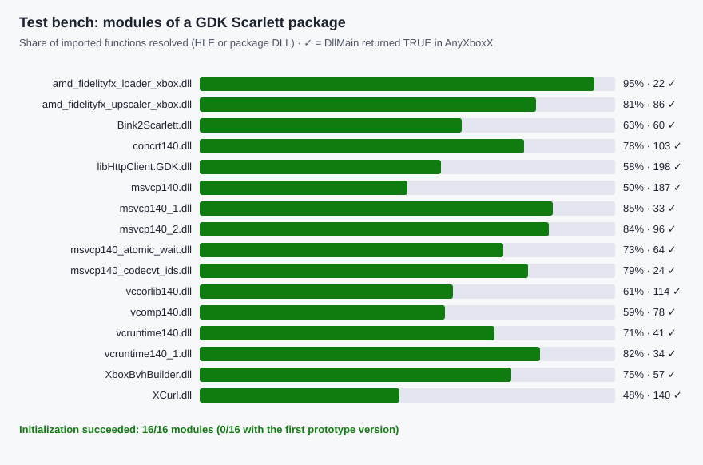
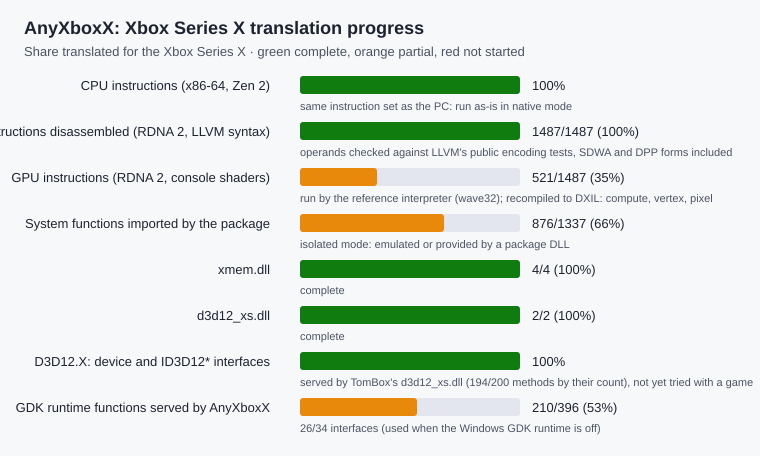

> Français : [avancee.md](fr/avancee.md)

# Progress and benchmark

Measurements from 21 November 2026. To reproduce them: `python PrototypeScarlett/scarlett.py --banc <folder>`.

## Method

The benchmark loads each PE module of a folder, runs its TLS callbacks, then `DllMain(base, DLL_PROCESS_ATTACH, 0)`. A module is **initialized** when `DllMain` returns `TRUE`. The benchmark copies no file into the repository: only module names and measurements are published.

Test cases used:

1. `PrototypeScarlett/demo.pe`, the project's free demo.
2. The 16 runtime DLLs of a retail GDK Scarlett package present on the development machine. The game's main executable is absent from the package: only library startup is tested.

## Results on the 16 DLLs

| Version | Modules loaded | `DllMain` succeeded | Imports resolved | Unemulated calls |
|---|---|---|---|---|
| First version (a single GDK import accepted) | 0/16 | 0/16 | 1 function | — |
| HLE layer, first pass | 16/16 | 4/16 | not measured | — |
| Added `_initialize_onexit_table`, `IsProcessorFeaturePresent`, locale, math | 16/16 | 16/16 | 523/1337 (39 %) | 7 |
| Several linked modules: each DLL loads its dependencies from the package | 16/16 | 16/16 | 782/1337 (58 %) | 0 |
| `.exe` startup, CRT text, events, PC GDK interface | 16/16 | 16/16 | 871/1337 (65 %) | 0 |
| `xmem.dll` emulated (`XMemAlloc`, `XMemFree`…) | 16/16 | **16/16** | **876/1337 (66 %)** | **0** |

An import is **resolved** when it points to a function emulated in Python or to an export of another DLL of the package. Since multi-module loading, `msvcp140.dll` runs with the package's real `vcruntime140.dll`, and `concrt140.dll` with the real `msvcp140.dll`.

Functions that unblocked the most modules:

| Function | Effect |
|---|---|
| `_initialize_onexit_table` | 12 DLLs failed in CRT initialization |
| `IsProcessorFeaturePresent` | 128 calls per pass: reports SSE to SSE4.2 (the emulated processor has no AVX2) |
| `setlocale`, `__pctype_func`, `___lc_locale_name_func` | `msvcp140.dll` read an error code as a pointer |
| `exp`, `log`, `floor` (XMM0) | first functions with a floating-point argument |

| `RtlPcToFileHeader`, `GetProcAddress`, `RegisterTraceGuidsW`, `___mb_cur_max_func` | last missing calls of the linked DLLs |

No more unemulated calls during the initialization of the 16 DLLs. The next gaps will appear when the game's own code runs.

## Translation of the console DLLs

Measurement: `python PrototypeScarlett/scarlett.py --traduction <package folder> docs/images/traduction.svg`. The package DLLs import only two console-specific libraries:

| DLL | Imported functions | Translation (C++ runtime, `runtime/`) |
|---|---|---|
| `xmem.dll` | `XMemAlloc`, `XMemFree`, `XMemVirtualQuery`, `XMemGetWorkingSetStatistics` | `XALLOC_ATTRIBUTES` attributes decoded with the ERA layout (ported from Xbox2Windows): PC heap at the requested alignment (64 bytes at least, 4 KiB for large blocks), graphics types in their own page region, physical memory refused; allocation hooks; `XMemVirtualQuery(process, address, buffer)` with a graphics-memory flag at +0x30 (PC policy, field not confirmed). The statistics return a clean failure: their structure is not public. |
| `d3d12_xs.dll` | `D3D12SerializeVersionedRootSignature`, `D3D12CreateRootSignatureDeserializer` | Redirected to the PC's `d3d12.dll`: same contract, public structures. |

The C++ runtime is preloaded by its full path. Windows then finds these DLLs by name: a game DLL loaded by Windows itself also receives those of AnyXboxX.

The game's main executable is absent from the package. Its own console imports, notably the creation of the D3D12.X device, will be added to this list.

## GDK runtime: interface table

On PC, each `X*` function of the GDK static library (`xgameruntime.lib`) calls `QueryApiImpl(&provider, &interface, &object)`, then a method of the COM-like object: 0 `QueryInterface`, 1 `AddRef`, 2 `Release`, then the APIs. Each method receives `this`, followed by the arguments of the public function.

`python tools/gdk_interfaces.py` re-reads the library's disassembly and produces `runtime/xgameruntime/gdk_api_table.inc`: **396 functions across 34 interfaces** for GDK 2610. The largest ones:

| Interface | Functions | Served by |
|---|---|---|
| `XStore` (+ 3 interface versions) | 70 | **AnyXboxX** (local license, empty products, offline purchase and download) |
| `XGameUi` | 42 | Windows |
| `XUser` (+ 4 interface versions, `XUserGetGamertag`) | 44 | **AnyXboxX** (offline profile) |
| `XGameStreaming` | 32 | Windows |
| `XPackage` | 31 | Windows |
| `XGameSave` (+ `XGameSaveFiles`) | 30 | **AnyXboxX** (PC disk) |
| `XTaskQueue` / `XAsync` / `XThread` | 27 | **AnyXboxX** |

## Xbox Series X identity

`XSystemGetDeviceType` is not an interface: `xgameruntime.lib`, linked into the game, reads `HKLM\Software\Microsoft\Windows NT\CurrentVersion\OEM`, value `ConsoleMode`. The value 0x64 gives `XboxScarlettAnaconda`, and a missing value gives `Pc`. In native mode, AnyXboxX redirects the registry functions of the game **and of the DLLs in its folder** to a simulated registry (`runtime/xgameruntime/registry.cpp`): only this key is simulated, the rest goes to the real registry.

`XGameGetXboxTitleId` returns the `<TitleId>` of the game's `MicrosoftGame.config`. `XSystemGetAnalyticsInfo` reports the "Windows.Xbox" family and the "Xbox Series X" model, and the Xbox Live sandbox is `RETAIL`.

## Saves

`XGameSave` and `XPersistentLocalStorage` write to the PC disk, in `%LOCALAPPDATA%\AnyXboxX\<TitleId>\` (or `ANYXBOXX_SAVE_DIR`). The layout is `saves\<configuration>\<XUID>\<container>\<blob>.blob`. Game names are encoded as `%XX` for any character outside `[A-Za-z0-9_-]`: no name can leave the folder. Each blob is written to a temporary file, then renamed, which avoids half-written saves. The simulated quota is 256 MiB per configuration; there is no cloud sync. Local storage reports the size of the `<PersistentLocalStorage><SizeMB>` of the `MicrosoftGame.config`.

`runtime/xgameruntime/served_interfaces.inc` lists the interfaces served by AnyXboxX. This file is read by both the C++ code and the `--traduction` measurement.

## Native execution

Since 21 November 2026, `--natif` loads an executable and runs it directly on the processor (Wine approach). First result: the **SimpleTriangle** test game **is displayed**, with the GDK runtime served by AnyXboxX. Details, screenshots and limits: [jeu-de-test.md](test-game.md).

## Multi-module loading

Resolution order of an import `dll!function` (`emu/modules.py`):

1. System DLL (`kernel32`, `api-ms-win-*`, `xgameruntime`…): always the HLE layer, even if a file with the same name is in the package.
2. DLL present in the package folder: loaded as a module, the import points to its export. Ordinals and forwards (`DLL.Function`) are followed.
3. Otherwise: HLE entry, or `E_NOTIMPL` if the function is not emulated.

Each module keeps its preferred base if it is free; otherwise it is relocated to a dedicated area (`0x6000_0000_0000`). Dependencies are initialized before the module that imports them; a `DllMain` that returns `FALSE` cancels the load, as on Windows.

## Known limit

A missing function returns `E_NOTIMPL` (`0x80004001`). This is correct for a function that returns an `HRESULT`. For a function that returns a `BOOL`, the value passes as a success; for a pointer, it causes an invalid memory access at `0x80004001`. The log then names the function to emulate.

## Free game for tests

The chosen test game is **SimpleTriangle** (`microsoft/Xbox-GDK-Samples`, MIT license), built for PC and compared with its native run: see [jeu-de-test.md](test-game.md). No free game exists as a Series X binary: the `Gaming.Xbox.Scarlett.x64` target requires the GDKX, reserved for studios under a non-disclosure agreement.
