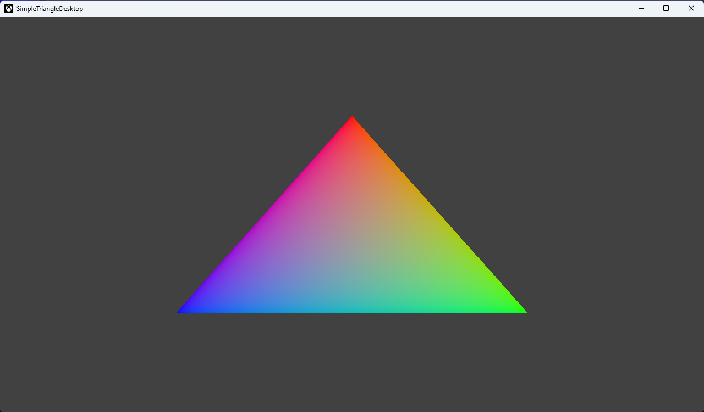
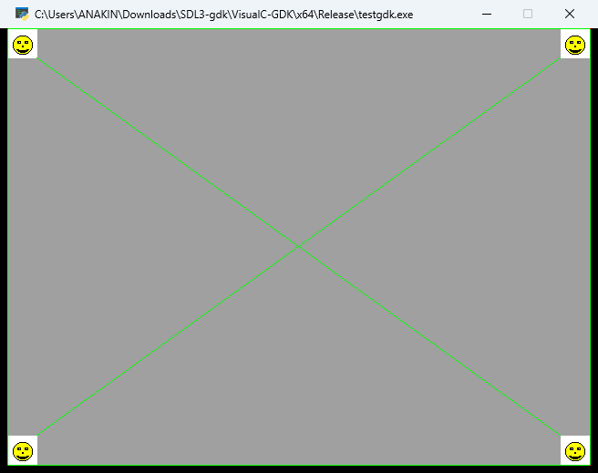

> Français : [jeu-de-test.md](fr/jeu-de-test.md)

# Test game: SimpleTriangle

A legal test game that already runs at 100 % on PC, to compare native behavior with AnyXboxX's. Measurements from 21 November 2026.

## Why this one

- **SimpleTriangle** is an official Microsoft sample, published under the MIT license in [microsoft/Xbox-GDK-Samples](https://github.com/microsoft/Xbox-GDK-Samples).
- It comes in two versions: `SimpleTriangle` for Xbox Series X|S and `SimpleTriangleDesktop` for PC. The game code is the same; only the platform layer changes.
- The Series X version only builds with the GDKX, reserved for studios under a non-disclosure agreement. The PC version builds with the [public GDK](https://github.com/microsoft/GDK): it is the reference.
- It is tiny (one window, DirectX 12, two shaders) but goes through every layer of a real GDK game: C startup, `xgameruntime.dll`, Win32 window, DirectX 12.

## Native reference



## In AnyXboxX, native mode: the triangle is displayed


```powershell
python PrototypeScarlett\scarlett.py --natif <...>\x64\Release\SimpleTriangleDesktop.exe
```

AnyXboxX maps the executable into memory itself, applies the relocations, declares its exception table (`.pdata`), binds its imports, then runs it directly on the processor. This is the approach of Wine and WinDurango.

- **Served by AnyXboxX**: `xgameruntime.dll`. The game loads it with `LoadLibraryExW`, and AnyXboxX intercepts this load to provide its own GDK runtime (`InitializeApiImplEx2`, `QueryApiImpl`…). It also intercepts `GetModuleHandle`, `GetModuleFileName` and `GetProcAddress`, so that the game sees itself and not `python.exe`.
- **Served by Windows**: the window (`USER32`), DirectX 12 (`d3d12`, `dxgi`) and the Visual C++ CRT. For this PC version of the game, these calls are already the PC's. For a Series X binary, `d3d12_xs.dll` (D3D12.X) and `kernelx.dll` will also need to be translated.
- **Security**: in native mode, the program is not isolated and has the user's rights. This mode is reserved for trusted programs. `--rapport` and `--banc` stay inside Unicorn, isolated.
- **Diagnosis**: `ANYXBOXX_TRACE=1` prints every DLL load, `GetProcAddress` and intercepted `QueryApiImpl`.

## In AnyXboxX, isolated mode (Unicorn)

| Game step | State |
|---|---|
| Loading: executable + `libHttpClient`, `vcruntime140`, `vcruntime140_1`, `msvcp140` linked | ✅ |
| C startup (`_initterm`, `argv`, locale, `_errno`…) then entry into `WinMain` | ✅ |
| Loading `xgameruntime.dll` and `InitializeApiImplEx2` (GDK initialization) | ✅ |
| Window creation (`RegisterClassExW`, `CreateWindowExW`, message loop) | ❌ not emulated in isolated mode |
| DirectX 12 device creation (`CreateDXGIFactory2`, `D3D12CreateDevice`…) | ❌ not emulated in isolated mode |
| Triangle display | ✅ in native mode, ❌ in isolated mode |

Isolated mode is for risk-free analysis. Connecting DirectX 12 to it would require copying every structure between the emulated memory and the PC; native mode avoids this work.

Imported functions: 202, of which **157 resolved (77.7 %)**: 75 emulated in Python and 82 provided by the Visual C++ DLLs. The remaining 45 are mostly `USER32` (window, mouse, messages), `d3d12`, `dxgi` and CRT files.

## What the test taught

1. **On PC, the GDK goes through an internal interface.** The game does not link `XGameRuntimeInitialize` directly: `xgameruntime.lib` loads `xgameruntime.dll`, then asks for `QueryApiImpl`, `InitializeApiImpl`, `InitializeApiImplEx`, `InitializeApiImplEx2`, `XErrorReport` and `UninitializeApiImpl` through `GetProcAddress`. Each `X*` API then gets an interface through `QueryApiImpl`. AnyXboxX accepts the initialization and does not provide any interface yet.
2. **The Visual C++ DLLs are not in the game folder on PC**, unlike a console package. Their folder must be given to AnyXboxX.
3. **A missing function that returns a pointer crashes** at address `0x80004001`. Tracing made it possible to emulate each function in the order the game needs it.

## Reproduce

Prerequisites: Visual Studio 2022 or 2026 with the C++ workload, and the public GDK (`winget install Microsoft.Gaming.GDK`).

```powershell
git clone --filter=blob:none --sparse https://github.com/microsoft/Xbox-GDK-Samples.git
cd Xbox-GDK-Samples
git sparse-checkout set --no-cone /Samples/IntroGraphics/SimpleTriangleDesktop/ /Kits/ATGTK/ /Kits/ATGTelemetry/ /Kits/DirectXTK12/
```

Then:

1. Place the NuGet package `WinPixEventRuntime.1.0.240308001` in `Samples\packages\`.
2. Run `Kits\DirectXTK12\Src\Shaders\CompileShaders.cmd dxil` with its full path.
3. Build `SimpleTriangleDesktop.sln` as `Release|x64`, with `-p:PlatformToolset=v145` under VS 2026.

Analysis in AnyXboxX, with the folder of the Visual C++ DLLs as the second argument:

```powershell
python PrototypeScarlett\scarlett.py --rapport <...>\x64\Release\SimpleTriangleDesktop.exe "C:\Program Files\Microsoft Visual Studio\18\Community\VC\Redist\MSVC\<version>\x64\Microsoft.VC145.CRT"
```

## Second test game: SDL3's `testgdk`

Measurements from 21 November 2026. `testgdk` is the GDK demo program of [SDL3](https://github.com/libsdl-org/SDL) (zlib license): sprites, sound, the controller and the `XUser` sign-in. It goes through `SDL3.dll`, which loads `xgameruntime.dll` itself with `LoadLibrary`.



| Mode | Result |
|---|---|
| Native (`--natif`) | ✅ window, sprites and sound. `XUserAddAsync` fails cleanly (`E_NOINTERFACE`): AnyXboxX does not yet provide the `XUser` interface behind `QueryApiImpl`. |
| Isolated (`--lancer`) | C and SDL startup pass; stops on the window and text (`USER32`, `GDI32`), not emulated in isolated mode. |

Two fixes were needed in native mode:

1. **Command line**: the game read Python's (`python scarlett.py --natif …`) and took it for its own arguments. AnyXboxX rewrites in place the buffers of `GetCommandLineW` and `GetCommandLineA`, which the CRT and all DLLs re-read, even those loaded by Windows.
2. **Current folder**: the game opens `icon.png` with a relative path. AnyXboxX changes into the game's folder before launching it.

In isolated mode, `GetCommandLineW/A`, `CommandLineToArgvW` and `GetEnvironmentStringsW` are now emulated.

### With the C++ runtime

Since the runtime moved to C++ (`runtime/`), `xgameruntime.dll` is preloaded in the process: **all** the game's DLLs go through AnyXboxX, including `SDL3.dll`, which Windows loads itself. The interfaces that AnyXboxX does not write yet are delegated to Windows' GDK runtime. Trace (`ANYXBOXX_TRACE=1`) over 10 seconds of play:

| Interface requested (`QueryApiImpl`) | Calls | Served by |
|---|---|---|
| `{073B7DCB-1FCF-4030-94BE-E3C9EB623428}` (task queue `XTaskQueue`) | 36 057 | Windows |
| `{01ACD177-91F9-4763-A38E-CCBB55CE32E0}` | 4 | Windows |
| `{973A344E-24BF-4D0F-8457-56C534892B29}` / `{2549F142-6419-4A06-97B5-931AAB7C2F34}` | 1 | Windows |

The task queue is requested thousands of times per second: this path must stay in native code. It is now written in AnyXboxX, in C++: **testgdk runs without Windows' runtime** (`ANYXBOXX_SYSTEM_RUNTIME=0`), and the `XUser` sign-in succeeds with AnyXboxX's offline local profile (gamertag settable through `ANYXBOXX_GAMERTAG`). When Windows' runtime is present, it serves all the interfaces, task queue included: its APIs (`XUser`…) can only read the queues they created.

Build: SDL3's `VisualC-GDK` still targets `Gaming.Desktop.x64`, which is absent from GDK 2610. This platform must be replaced with `x64` in the projects, `_GAMING_DESKTOP` added along with the GDK's `include`/`lib` folders (`windows\include`, `windows\lib\x64`), then `tests\testgdk\testgdk.vcxproj` built as `Release|x64` with `-p:PlatformToolset=v145` and `-p:SolutionDir=<…>\VisualC-GDK\`.

## Third test game: `Live/Fundamentals_Desktop`

Measurements from 22 November 2026. `Fundamentals_Desktop` is the Xbox Live example of [microsoft/Xbox-GDK-Samples](https://github.com/microsoft/Xbox-GDK-Samples) (MIT license): user sign-in, gamertag and profile picture, Store license, network connectivity and Xbox Live (`Xbl*`). It is the PC example that stresses the GDK runtime the most.

| Step | Before | After |
|---|---|---|
| GDK interfaces requested | 9, of which 8 served (`XStore` not served) | same |
| `XNetworkingRegisterConnectivityHintChanged` (under `ThrowIfFailed`) | served since #86 | served |
| Local profile, gamertag | ✅ | ✅ |
| `XUserGetGamerPictureAsync` (under `ThrowIfFailed`) | `E_NOTIMPL` → C++ exception `0xe06d7363`, stop | PNG generated at the requested size, the example continues |
| Isolated mode (`--rapport`) | 283 imports, 74.6 % resolved | same |

What the test taught:

1. **An `E_NOTIMPL` can be fatal.** Microsoft's examples wrap many calls in `DX::ThrowIfFailed`. A real game will do the same: an honest offline answer (generated image, subscription without events) is better than a failure.
2. **`XStore` is the next interface to serve**: the example asks for it at startup (game license, updates). Served offline since `feat/xstore-hors-ligne`: valid local license, empty product queries, purchase and downloads in `E_GAMESTORE_NETWORK_ERROR`.
3. Two unwritten `XNetworking` methods are called, probably by `libHttpClient` or `XCurl` for HTTPS security; the example tolerates them.

Reproduce (public GDK installed, Visual Studio 2026):

```powershell
git clone --filter=blob:none --sparse --depth 1 https://github.com/microsoft/Xbox-GDK-Samples.git
cd Xbox-GDK-Samples
git sparse-checkout set --no-cone /Samples/Live/Fundamentals_Desktop/ /Kits/ATGTK/ /Kits/ATGTelemetry/ /Kits/DirectXTK12/ /Kits/LiveTK/ /Media/Fonts/ /Media/Textures/
Kits\DirectXTK12\Src\Shaders\CompileShaders.cmd dxil          # with dxc in the PATH
$env:GameDKCoreLatest = "C:\Program Files (x86)\Microsoft GDK\261000\"
MSBuild Samples\Live\Fundamentals_Desktop\Fundamentals_Desktop.sln /p:Configuration=Release /p:Platform=x64 /p:PlatformToolset=v145
$env:ANYXBOXX_SYSTEM_RUNTIME = "0"; $env:ANYXBOXX_TRACE = "1"
python PrototypeScarlett\scarlett.py --natif <...>\x64\Release\Fundamentals_Desktop.exe "<Microsoft.VC145.CRT folder>"
```

## CPU instructions and shaders

- **CPU**: the Series X uses an AMD Zen 2 in x86-64, the same instruction set as a PC. Nothing needs translating. Only the AVX/AVX2 extensions are missing in Unicorn; native execution will provide them.
- **Shaders**: the PC version uses standard DXIL shaders (`VertexShader.cso`, `PixelShader.cso`) that the PC driver runs. On console, shaders would be shipped compiled for the RDNA 2 GPU (to be checked on a legal Scarlett binary). Translating them would require an RDNA 2 → SPIR-V or DXIL recompiler, like the one in the free PS4 emulator shadPS4 for the GCN GPU. AMD publishes the RDNA 2 instruction set documentation.
