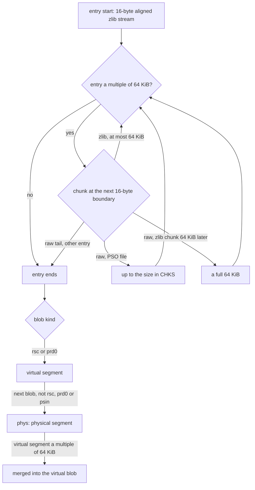

# RPF9 archives

The game's `*.rpf` files (RPF9). The table of contents and the name table are encrypted; the entry data is not.
`fivestar archive` recovers the entries without the table of contents and names each by its archive offset and kind.

## Header (0x40 bytes, plain)

All values little-endian.

| Offset | Size | Meaning |
|---|---|---|
| 0x00 | 4 | `RPF9` |
| 0x04 | 4 | End of the header area; data starts here or at the next 4 KiB |
| 0x08 | 4 | Size of the encrypted table of contents |
| 0x0C | 4 | Size of the name table (about 40 bytes per entry) |
| 0x10 | 8 | Unique per archive |
| 0x18 | 4 | 0x47A00 in every archive |
| 0x1C | 4 | 0x150 in every archive |
| 0x20 | 4 | Low 16 bits: 3 to 7 |
| 0x24 | 4 | Entry count |
| 0x28 | 4 | Key selector (one of four values) |
| 0x2C | 4 | 0x00090F01 or 0x00090F02 |
| 0x40 | 32 | Identical in every archive |

## Entry data

An entry is a run of chunks of 64 KiB inflated data:

- Each chunk starts at the 16-byte boundary after the previous one.
- A chunk is a zlib stream (header `78 01`, `78 5E`, `78 9C` or `78 DA`) or stored raw (incompressible data, short tails).
- Every chunk but the last inflates to exactly 64 KiB.

The carver applies these rules:

| Situation | Rule |
|---|---|
| Entry start | A 16-byte aligned zlib stream that inflates completely (Adler-32 checked) within a 16 MiB input window, to at most 64 MiB |
| Next chunk | Read while the entry is a multiple of 64 KiB: a zlib chunk of at most 64 KiB output at the next 16-byte boundary |
| Raw chunk in a PSO file | Taken up to the size declared in `CHKS` (64 KiB while `CHKS` is not yet in view; cut back once it is) |
| Raw chunk in another entry | Taken as a full 64 KiB only when a zlib chunk follows exactly 64 KiB later |
| Raw tail of another entry | Left out (its size is not known) |
| Physical segment | A blob that starts where a `rsc` or `prd0` blob ended, and is neither of those nor `psin` |

Paged resources keep their virtual and physical segments in separate chunk runs, so they come out as two blobs. When
the virtual segment is an exact multiple of 64 KiB, the physical run is merged into it.



### Blob kinds

| Kind | Test on the inflated bytes |
|---|---|
| `prd0` | u64 0 at +0x00 and `0DRP` at +0x10: a PSO-backed paged resource ([pso.md](pso.md)) |
| `rsc` | u64 0 at +0x00 and a u64 at +0x08 in 0x50000000..0x5FFFFFFF (other paged resource), or starts with `RSC` |
| `phys` | Physical segment (see above) |
| `psin` | `PSIN`: a PSO file |
| `xml`, `bk2`, `riff`, `dxbc`, `sgd5`, `etpf`, `rds5` | Starts with `<?xml` (optionally after a UTF-8 BOM), `KB2`, `RIFF`, `DXBC`, `SGD5`, `ETPF`, `RDS5` |
| `txt` | Starts with `<`, `{` or `[`, or the first 64 bytes are printable ASCII, tab, CR or LF |
| `bin` | Anything else |

## Bink videos

`movies.rpf` stores Bink 2 videos raw. A video starts on a 16-byte boundary:

| Offset | Size | Meaning |
|---|---|---|
| 0x00 | 3 | `KB2` |
| 0x03 | 1 | Revision letter `a`..`z` |
| 0x04 | 4 | File size - 8 |
| 0x08 | 4 | Frame count (1 to 999,999) |
| 0x0C | 4 | Largest frame size (non-zero, below the file size) |
| 0x10 | 4 | Frame count again |
| 0x14 | 4 | Width (16 to 8192) |
| 0x18 | 4 | Height (16 to 8192) |
| 0x1C | 4 | Frame-rate numerator (non-zero) |
| 0x20 | 4 | Frame-rate denominator (non-zero) |

## Commands

```
fivestar archive header <dump dir>                     header fields of every .rpf, smallest first
fivestar archive words  <dump dir>                     first 12 header words and entropy of the next 4 KiB
fivestar archive stats  <archive.rpf> [--samples N]    share of sampled 8 MiB windows inside zlib streams
fivestar archive carve  <archive.rpf> <out dir> [--limit-mb N]
fivestar archive bink   <archive.rpf> [<out dir>] [--list]
fivestar archive pso    <command> ...                  see pso.md
```

`carve` writes `<offset as 10 hex digits>.<kind>.bin` and prints the blob count, inflated size and raw chunk count.
`--limit-mb` stops looking for new entries after that many MiB of the archive. `bink` writes `movie_<offset>.bk2`
and prints one line per video; `--list` only prints.

## Unknown

- The table-of-contents and name-table encryption.
- The 8 bytes at 0x10, the word at 0x20 and the 32 bytes at 0x40.
- The size of a raw tail of a non-PSO entry, and where a merged virtual segment ends.
