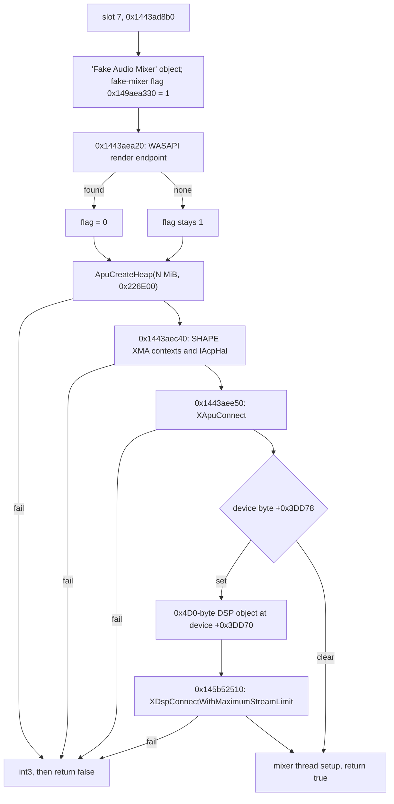

# Audio runtime

How the game starts its audio and what it needs from the console's audio hardware. The sound data itself is in
[audio.md](audio.md). Addresses are in `game_scarlett_master.exe` (base 0x140000000).

The engine mixes on the CPU and plays through WASAPI, but it does not decode on the CPU: Opus goes to the audio
processor through `xapu.dll` and XMA to the SHAPE XMA decoders through `acphal.dll`. The executable holds no Opus or
XMA decoder (no libopus tables, no `opus` strings) and imports no XAudio2. Bink video sound is the exception:
Bink decodes it and hands it to the game's mixer. A PC port therefore has to supply the
decoders; the loader runs the Opus queue and the XMA contexts on the CPU (`src/FiveStar.Loader/Shims/Apu`).

## Start-up

The audio device's vtable is 0x1465f4900; slot 7 (0x1443ad8b0) starts it:

Every hardware failure ends in an `int3` before `return false`, so a failing shim does not silence the game: it
stops it at a breakpoint. The WASAPI step is the only optional one.

| Step | Call site | What the game does |
|---|---|---|
| WASAPI | 0x1443aea6a | `CoCreateInstance(CLSID_MMDeviceEnumerator, CLSCTX_ALL)`, registers an endpoint callback, enumerates active render endpoints (looks for headphones or a headset by form factor), takes the default console endpoint; 0x141e7f5ed activates `IAudioClient` and reads its mix format |
| APU heap | 0x1443ad933 | `ApuCreateHeap(size << 20, 0x226E00)` |
| SHAPE contexts | 0x1443aec73 | `AcpHalAllocateShapeContexts` with only the fifth count set: 350 contexts, the XMA decoders |
| XMA buffers | 0x1443aed13 | one `ApuAlloc(0x222E00)`, cut into 350 pairs of 0x1700 bytes (XMA output) and 0x200 bytes |
| IAcpHal | 0x1443aed98 | `AcpHalCreate(&hal)`, `hal->slot0(0x1000, 0x1000)`, an event, then `hal->slot2(2, 0xF0F0F0F0, -1, &0xC0, 0)` |
| XApu | 0x1443aee69 | `XApuConnect(&config, &sharedMemory, &handle)`; the 0x18-byte config is set statically (0x145a87962) |
| XDsp | 0x145b5262e | when the device byte at +0x3DD78 is set, which it is on a normal boot; see [XDsp protocol](#xdsp-protocol) |

XAudio2 (`XAudio2_9.dll` in the boot log) is an import of `Bink2Scarlett.dll` (ordinal 1, `XAudio2Create`) and goes
unused: the game passes `BinkSetSoundSystem` its own open function (0x145f172c0 returns 0x141a9b300), which
fills Bink's 0x1C0-byte sound channel with the game's callbacks, so video sound is decoded by Bink on the CPU and
mixed by the game's engine.

## What the hardware does for the game

| Unit | Use | Evidence |
|---|---|---|
| XApu (`xapu.dll`) | Opus decode: 99.9% of the game's sounds | the Opus voice (format codec 0x0B, 48 kHz, 960-sample frames, 0x144ee99e0) sends one command per packet |
| SHAPE XMA (`acphal.dll`) | XMA2 decode | 350 XMA contexts; the CPU copies 16-bit PCM out of each context's 0x1700-byte output buffer (0x140078120) and acknowledges it with an IAcpHal message |
| SHAPE SRC, EQ, filter, DMA | not used | their context counts stay 0 |
| XDsp (`chad.dll`) | convolution effects on submix buses, in 1024-frame (mono) or 256-frame (stereo) blocks, and a second kind on 1024-frame mono blocks | activation configs and the command loop, below |
| Mixing, rate conversion, effects | CPU | the decoded PCM goes into the voice's ring buffer (0x144e64f00); output is WASAPI |

### XApu protocol

`XApuEnqueueCommand(handle, command*, 0)` takes a 0x40-byte command; each command is answered by one 0x50-byte
result (the game zeroes 0x50 bytes for it) that the game collects every audio frame with `XApuGetResultCount(handle,
0)` and `XApuDequeueResult` (0x144eaa840). The game reads only the result's type, stream and byte count.

| Offset | Size | Command field |
|---|---|---|
| 0x00 | 4 | Type: 1 create, 2 destroy, 3 decode, 5 reset |
| 0x04 | 4 | Stream (the game's numbers, below 0x100) |
| 0x08 | 16 | Sequence, options and a u64 context (VIctory's names); the result echoes the first 0x18 bytes |
| 0x18 | 4 | Create: channels; decode: 0 |
| 0x1C | 4 | Decode: the voice's rate as a float, 48000 (VIctory: a pitch); not applied |
| 0x20 | 4 | Decode: samples per channel to drop from the decoded packet: 312 (the Opus pre-skip) on a stream's first packet, else 0 |
| 0x24 | 4 | Decode: samples per channel to keep at most, 960 |
| 0x28 | 4 | Decode: packet bytes (the AWC u16 length prefix stripped) |
| 0x2C | 8 | Decode: packet address (unaligned) |
| 0x34 | 4 | Decode: output capacity, channels * 0xF00 |
| 0x38 | 8 | Decode: output address |

The shared memory `XApuConnect` returns holds per decode slot (below 0x80) a 0x280-byte packet staging area at
slot * 0x280 and a 0x1E00-byte output area at 0x14000 + slot * 0x1E00. A decode result's u32 at +0x34 is the bytes of
32-bit float PCM written, channels interleaved; the game multiplies by 32767 and packs to 16-bit. The result also
carries the samples per channel at +0x30, the output address at +0x38, a pitch of 1.0 at +0x40 and the packet bytes
and address at +0x44 and +0x48 (VIctory's layout).

The game's stream states (table at 0x149ae8c90): 1 creating, 2 resetting, 3 destroying, 4 ready, 5 decoded. A
create result moves 1 to 4, a decode result 4 to 5, a reset result 2 to 4, a destroy result frees the stream.

### SHAPE XMA protocol

The game keeps the context array pointer at 0x149ae9908 and per context a 0x20-byte record at 0x149ae9938 (+0x00
output buffer, +0x08 the 0x200-byte buffer, +0x10 state: 2 enabled, 0 free; +0x18 free flag). A voice takes a free
context round robin (0x1455cbc80), zeroes its 64 bytes and the 0x200-byte buffer and fills it (0x1400785d0); on its
next update it enables it (0x1443a73e0). From then on each update (0x140078120) copies the ready output into the
voice's ring buffer (0x144e64f00) and acknowledges it. The whole sound is one input buffer in APU memory; the game
never uses input buffer 1.

The fields, as dwords of the 64-byte context; bit 0 is the least significant. The names are those of the Xbox 360 XMA
context in Xenia, whose layout matches every field the game touches.

| Dword | Bits | Field | What the game does |
|---|---|---|---|
| 0 | 0-11 | input buffer 0 packets | bytes / 2048 (left 0 unless the size is whole packets) |
| 0 | 12-19 | loop count | 255 for a looping voice, else 0 |
| 0 | 20 | input buffer 0 valid | set |
| 0 | 21 | input buffer 1 valid | cleared |
| 0 | 22-26 | output buffer blocks | 23: 0x1700 bytes in 256-byte blocks |
| 0 | 27-31 | output write offset | read, in blocks |
| 1 | 0-11 | input buffer 1 packets | 0 |
| 1 | 12-13 | loop end subframe | (loop end sample >> 7) & 3 |
| 1 | 17-19 | loop start subframe skip | (loop start sample >> 7) & 3 |
| 1 | 20-23 | subframe decode count | 4 |
| 1 | 24-26 | start subframe skip | (start sample >> 7) & 3, for a voice that starts mid-sound |
| 1 | 27-28 | sample rate | 0 up to 24000 Hz, 1 to 32000, 2 to 44100, 3 above |
| 1 | 29 | stereo | set for two channels |
| 1 | 31 | output buffer valid | set; read when the offsets meet: set means empty, clear means full |
| 2 | 0-25 | input read offset | bit offset of the first frame (headers counted): 32, or the frame the start sample is in |
| 3 | 0-25 | loop start | bit offset of the frame the loop start sample is in |
| 4 | 0-25 | loop end | bit offset of the frame the loop end sample is in (default: the last frame) |
| 4 | 31 | current input buffer | cleared |
| 5, 6 | | input buffer 0 and 1 | the APU address of the sound data, both; only when `ApuIsVirtualAddressValid` accepts it |
| 7 | | output buffer | APU address of the 0x1700-byte buffer |
| 8 | | work buffer | APU address of the 0x200-byte buffer |
| 9 | 0-4 | output read offset | read, in blocks; the game never writes it |

The game finds a frame's bit offset itself: it sums the packets' 6-bit frame counts to the packet the frame starts
in, then walks the 15-bit frame lengths from the packet's first frame offset (0x1443a7440).

Messages, all `SendMessage(type, cookie, timeout -1, payload, 0)`:

| Type | Cookie | Payload | Sent | Meaning |
|---|---|---|---|---|
| 2 | 0xF0F0F0F0 | 0xC0 | once at start-up | unknown |
| 5 | 0xF6F6F6F6 | context | first update after the fill (0x1443a73e0) | enable: start decoding |
| 7 | context + 1 | context | voice ends (0x1400925e0) | disable; the record becomes free |
| 0x12 | 0xF1F1F1F1 | context, blocks | every update that took output (0x140078120) | the game took that many blocks from the read offset |

The game polls nothing else: ready output is write offset minus read offset (in blocks, modulo 23), or all 23 when
they meet and the output valid bit is clear. It takes 16-bit PCM, channels interleaved (it divides bytes by 2 and
the channel count to count samples). It never reads the input fields back: it ends a non-looping voice when it has
counted the sound's sample count out of the context: the packets' frame counts times 512 (0x1455cbd70), or the
voice's own end if that is earlier. A voice keeps two context slots; when it chains, the game copies the 0x200-byte
work buffer of the finished context into the next one and disables the finished one (0x1400781b6) before enabling
the next.

### XDsp protocol

The DSP object (constructor 0x145f0b960) allocates a 0x60000-byte pool (`XMemAlloc`, 0x141d6bdf0), zeroes it in
0x1000-byte pages and keeps them as input/output page pairs: 8 pairs in the first 0x10000 bytes, 40 pairs of
adjacent pages after them. It then connects and keeps the handle at +0x488; +0x4C8 is set when the connect succeeds,
and every effect asks 0x144e5b020 for the object only while it is set.

| Call | Call site | Arguments |
|---|---|---|
| `XDspConnectWithMaximumStreamLimit` | 0x145b5262e | pool, 0x60000, streams (0x18 or 0x1E, chosen by 0x140075140), 0x80, 1, `&handle`; succeeds only on 0 |
| `XDspActivate` | 0x1411d475d | handle, config, `&status`, `&stream`; succeeds only on 0 |
| `XDspSubmitCommand` | 0x144e5b20d | stream, command, `&id`; succeeds only on 0 |
| `XDspDeactivate` | 0x141166020 | stream |
| `XDspDisconnect` | 0x1443aea00 | handle |

Activation configs, as the two activation sites fill them:

| Offset | Size | Convolution (0x14003b97e) | Kind 2 (0x1443b3966) |
|---|---|---|---|
| 0x00 | 4 | 1 | 2 |
| 0x04 | 4 | flags: 2 for a two-channel effect, plus 8 for a two-channel response; so 0 or 10 | 0 |
| 0x08 | 4 | 1024 (frames per block) | 1024 |
| 0x0C | 4 | channels, 1 or 2: the effect's channel byte, which the game only pairs with a response of as many channels (0x14007cff1) | 1 |
| 0x10 | 4 | impulse response size in bytes / 4 | 0 |
| 0x14 | 8 | impulse response address | 0 |

The impulse response is an object the game holds (and keeps a reference to while the effect lives): +0x18 its
channels, +0x20 its state (5: ready), +0x50 the data, +0x5C the data's bytes. Nothing on the CPU reads the data: the
activation passes the pointer as it is (the only reader of +0x5C is 0x14003b92c), so the DSP gets the asset unchanged.

A command is 0x20 bytes: two floats of 1.0 at +0x00 and +0x04, the input page's address at +0x08, the output page's
address at +0x10, 0 at +0x18. Pages are 0x1000 bytes (1024 floats), an input page followed by its output page. The
game never waits: every audio frame it reads the status record the activation returned, and takes the output only
when the u32 at +0x04 (the completed count) equals the last id and the u32 at +0x0C is 0; otherwise it zeroes the
block (0x1443b2a40), so a late DSP result is silence, not a stall.

The convolution is an effect on a submix bus, which the mixer runs in 256-frame blocks (0x144e5a5be). With one
active channel (0x144e5acc0) the game gathers four blocks and submits 1024 frames; with two (0x1443b2a40) it
submits every block, channel 0's 256 floats then channel 1's 256 in the input page, and reads the output page the same
way. Either way it takes a result one submit later and copies it over the bus channel: the DSP output replaces the
signal. The dry signal is the game's own: before the effect it saves each channel and scales the bus by the wet gain
(effect +0x28), and afterwards it adds the saved channel back at the dry gain (+0x2C) (0x144e5a5ee).

Kind 2 (vtable 0x146682400) submits one to four 1024-float mono pages per call and copies each output page into a
ring of its own (0x1443b3980, 0x1443b3cc0). What it computes is not known.

### Pacing

The engine's mixer thread (0x141e95040) mixes one 256-frame block (5.3 ms at 48 kHz) and then sleeps for what is
left of the block, about 4 ms (0x1443ae230, `Sleep` through 0x14092eca0). The render thread (0x1443adc40) waits up
to 100 ms on the endpoint's event and copies the mixed blocks into the endpoint's buffers, through
`ISpatialAudioObjectRenderStream` (`BeginUpdatingAudioObjects`, one static object per channel,
`ISpatialAudioObject::GetBuffer`, `EndUpdatingAudioObjects`; 0x1443adf30), not `IAudioRenderClient`.

A desktop process sleeps in 15.6 ms timer ticks unless it asks for finer ones. With them the mixer woke about 64 times
a second (the boot logs show 65 `XApuGetResultCount` calls a second) instead of 187.5, so it mixed a third of what
the endpoint plays, and the endpoint played mostly the silence of an empty ring. The loader therefore takes a 1 ms
timer resolution for the whole run (`timeBeginPeriod(1)`, before mapped code runs; given back at the end) and opts
out of the Windows 11 throttling that drops it while the window is hidden (`--desktop-timers` keeps the 15.6 ms
ticks, to compare). It affects every sleep of the game: another thread sleeps in computed steps (0x143da3d60) and one
sleeps 1 s at a time (0x142215a60).

## On the PC

| Call | Loader |
|---|---|
| `ApuCreateHeap`, `ApuAlloc` and the address functions | one committed region ([loader.md](loader.md)) |
| `AcpHalAllocateShapeContexts` | XMA contexts from the APU heap; any other context kind E_NOTIMPL |
| `AcpHalCreate` | an IAcpHal object: slot 0, 1 and 2 return S_OK (messages logged once per type), slots 3 and 4 E_NOTIMPL, slot 5 releases |
| IAcpHal messages 5, 7, 0x12 | XMA decoding on the CPU, on the caller's thread: message 5 resets the context's decoder and 0x12 moves the read offset and sets output valid; both then decode (XmaStreamDecoder.DecodeFrameAt) from the input read offset into the ring, block by block, until it is full or the input is used up. Each frame gives all 512 samples per channel, as 16-bit little-endian PCM; the start skip, the loop (end subframe, jump, start skip, count) and the input buffer switch follow the fields above. Message 7 stops the context |
| `AcpHalReleaseShapeContexts` | frees the contexts |
| `XApuConnect` and the queue | a CPU queue: a command runs when enqueued and its result waits for the poll. Opus decodes with Concentus at 48 kHz, one decoder per stream kept across packets; the channel count comes from the output capacity; the decode drops the command's first samples and keeps at most its frame count |
| Chained XMA contexts | on enable a context writes a tag (context index and enable count) into its work buffer; a context whose work buffer holds another context's current tag, copied there by the game, takes over that decoder's overlap, so the chain plays as one continuous decode |
| `XDsp*` | streams on the CPU: a command runs and completes when it is submitted (id = completed count, written to the stream's status record). By default every effect writes a silent output page. With `--xdsp-convolution` a convolution stream convolves each channel of the input page with the response (uniformly partitioned FFT convolution, one block per partition, no added latency) and writes the output page, times the two command floats; kind 2 stays silent |

The convolution reads the response as 32-bit floats, a two-channel one as its channels one after the other; that is
inferred (the size is counted in 4-byte units and the DSP pages hold channels one after the other), not confirmed,
which is why it is off by default. Still needed: the response format, and a check that WASAPI on the PC accepts the
format the game asks for.

## Diagnostics

With `--sample-threads`, every sample's counter line has an `audio:` part: Opus streams created and destroyed, packets
decoded (failed, samples per channel), results taken; XMA enables, disables, takes (message 0x12), blocks written,
passes that found the input used up, contexts whose ring is not APU memory; XDsp commands. `--audio-capture <wav>`
records what the process tree plays through WASAPI process loopback (48 kHz stereo 16-bit), from a child copy of the
loader so the recorder's own audio client does not change the game's process, and prints how many seconds had sound
(a 0.1 s window whose peak reaches about -54 dBFS), the longest silence and the share with sound per 10 s.

## Unknown

- Whether the APU applies the decode's +0x1C value (48000 for every voice seen); the XApu config struct; the result
  fields the game does not read.
- The SHAPE_CONTEXTS layout beyond the XMA count (+0x10) and pointer (+0x38): six u32 counts and one pointer per
  kind are inferred from those two offsets.
- SHAPE XMA: the context layout and the message meanings are read from how the game fills, reads and sends them;
  what the hardware does in between is inferred: that it decodes on its own while enabled and the ring has room,
  that it outputs every frame whole (the game's sample count includes the first frame; FFmpeg drops it), how the
  loop end and start subframes apply (Xenia's reading), when it clears the input valid bit, the byte order and the
  rounding of its PCM, and what it keeps in the 0x200-byte work buffer (perhaps the overlap). The game seeks a start
  or loop sample 128 samples early (it takes the frame of sample - 128 when the sample is 128 or more), which may be
  the hardware's output delay. Message 2 and slots 3 and 4 are unknown.
- Who sets the XDsp byte at +0x3DD78; the XDsp connect arguments 0x80 and 1; what kind 2 computes; the two 1.0
  command floats (read as gains); the status record fields other than +0x04 and +0x0C.
- The impulse response data: whether it is time-domain 32-bit float PCM or already transformed for the DSP, and how a
  two-channel response is laid out. The asset that produces the response object was not found, and chad.dll is not in
  the package. How the DSP itself splits a two-channel page (the config says 1024 frames, the game fills 2 x 256).
- A frame that runs across the boundary of two chained XMA contexts: the CPU decoder drops it (the XMA sound the
  tests use starts every packet with a new frame, so a chain split at a packet splits between frames).
- How the game behaves when an XMA context never produces output; whether its XMA data is in APU memory at all (a
  context whose data is not gets no input pointer).
