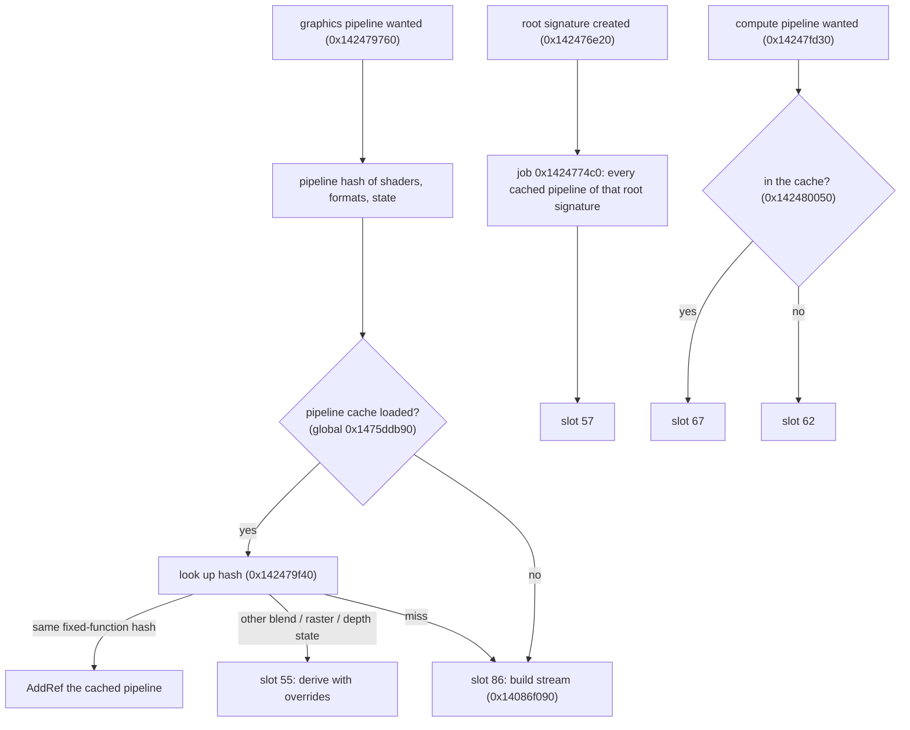
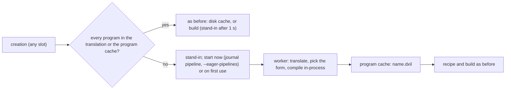
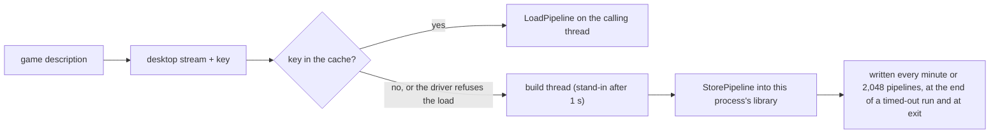
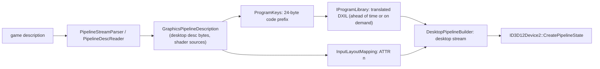

# D3D12.X pipeline creation

How the game creates pipeline states on the D3D12.X device and how the loader turns them into desktop
`ID3D12PipelineState` objects. Read from `game_scarlett_master.exe` (image base 0x140000000); slot numbers are device
vtable slots ([d3d12x-shim.md](d3d12x-shim.md)). Items marked *inferred* follow from how the game fills or uses a
value, not from a header. Code: `src/FiveStar.Loader/Shims/D3D12X/Pipelines`.

## The five slots

Every call passes `ID3D12PipelineState`'s IID (0x1461e06b8) and an out pointer last.

| Slot | Offset | Call site | Arguments after the device | Description |
|---|---|---|---|---|
| 55 | 0x1B8 | 0x14247a5c2 | base pipeline, u32 count, override array, IID, out | derive from a cached pipeline (below) |
| 57 | 0x1C8 | 0x142477578 | cache description (0x108 bytes), IID, out | graphics pipeline of the pipeline cache |
| 62 | 0x1F0 | 0x14247fe66 | `D3D12_COMPUTE_PIPELINE_STATE_DESC`, 0, 0, IID, out | compute pipeline; the two extra arguments are always 0 |
| 67 | 0x218 | 0x1424800d5 | cache description (0x48 bytes), IID, out | compute pipeline of the pipeline cache |
| 86 | 0x2B0 | 0x142479a87 | `D3D12_PIPELINE_STATE_STREAM_DESC`, IID, out | graphics pipeline from a stream (desktop `ID3D12Device2::CreatePipelineState`) |

Slot 101 (0x1424813ef, state-object IID) creates the ray-tracing state object and is not covered here.

A graphics result is stored at +0x38 of the game's pipeline object (and bit 7 of +0x1D set), a compute result at
+0x120. Cached pipelines are kept in the cache's hash map as `pointer >> 1` and AddRef'ed on every hit.

## Creation jobs

Compute pipelines are created in deferred jobs. Loading a compute shader (0x140f9f650: bytecode read, root signature
at +0x118) takes an item from a pool of 32 (0x140f9fbd0), sets its callback 0x14247fd00 and the shader object at
+0x20 and queues it (0x1450f6bb0). The item counts in the pool counter 0x1475e8eb0.

| Function | Does |
|---|---|
| 0x14247fd00 | runs 0x14247fd30 for the shader object, then 0x140699390; returns 1 whatever the result |
| 0x14247fd30 | slot 67 when the cache has the program (0x142480050), else slot 62; on failure releases the root signature and leaves +0x120 at 0 |
| 0x140699390 | returns the item to the pool and decrements 0x1475e8eb0; at 0x80000001 it sets the event at 0x1475e8eb8 |
| 0x1458044a0 | waits until the pool is empty: adds 0x80000000 to the counter and waits for the event when jobs are left |

A task of the frame graph calls 0x1458044a0 (from 0x142499630), so the frame does not end while a creation runs. A
failed creation still completes its job, but the game later reads +0x10 to +0x2F of the pipeline at +0x120 without a
null check (0x14248c700; 0x14248c30d reads +0x10 of it): the console never fails here. Every creation slot (55, 57,
62, 67, 86) therefore answers a creation that gives no pipeline (driver failure, missing program, unreadable
description) with S_OK and a stand-in that never builds (`StandInPipelines.Unbuilt`); the failure is still counted
by cause in the sample summary, and the work recorded with it stays skipped. A failed compute pipeline in the story
mode load reached the game as null and faulted at 0x14248c30d. The cached graphics pipelines of a root signature
(0x1424774c0, slot 57) are created in jobs too.

### Stand-ins

The desktop driver compiles a translated program in seconds and the largest ones (the screen-probe and ray-traced
shadow compute programs, 5 to 10 MB of DXIL) in minutes; with a cold shader cache the frame waited for all of them.
`StandInPipelines` runs every creation of slots 55, 57, 62, 67 and 86 on the threads of a `PipelineBuildQueue` (half
the logical processors):

| Case | The game gets |
|---|---|
| done within `PipelineSlots.CreationBudget` (1 s) and no creation queued before it | the desktop pipeline or the failure |
| still running, or queued behind others | S_OK and a stand-in |

**First use.** A story load creates about 85,000 pipelines (52,000 distinct desktop ones built in the first 8
minutes of a cold boot, 32,000 more still queued), while a scene draws with few of them. So by default a pipeline the
disk cache lacks is not built at creation: the game gets a stand-in at once, and the build is queued when a command
list first sets the stand-in (SetPipelineState or a Reset with an initial pipeline). Pipelines an earlier boot used
(the journal, [Warm-up](#warm-up)) are queued at creation instead, so they are ready by the time the game draws.
`--eager-pipelines` builds every one at creation, as before. The sample summary counts the stand-ins deferred to first
use and how many of them were used.

A stand-in is our own `ID3D12PipelineState` (`StandInPipelineObject`): a vtable, the desktop pipeline once built
(0 before), 0x20 zero bytes the game reads, its own reference count. Its last Release releases the desktop pipeline,
or the build does when it ends later. Slot 25 of the command list (SetPipelineState) sets the built pipeline; while
it is not built the list sets nothing and drops its draws, dispatches and ExecuteIndirect calls until the next
SetPipelineState (counted in the sample summary). A derive (slot 55) from a stand-in uses the description kept
under the stand-in's address; the rectangle-list variant is made from the built pipeline.

**Waiting by name.** `--wait-pipelines <part,...>` waits instead of skipping for a stand-in whose name holds one of the
parts (case-insensitive): at its first SetPipelineState the recording thread waits for the build, which the first use
made urgent, up to 60 s (`PipelineWaits`), so a frame that must be whole, such as the G-buffer of a cutscene's first
world frames, is drawn whole. The game's hang watchdog is paused meanwhile (`WatchdogPause`: the flag 0x1471b6330 the
game itself sets around long work, its earlier value put back afterwards). Past the limit the stand-in stays, its work
is skipped as without the option, and it is not waited for again; each wait is logged once per name and counted in the
sample summary (`waited for by name`). A mesh pipeline's compile can take minutes and 7 to 9 GB, so name only what the
frame needs. A stand-in is named by its programs; one waiting only for a pair's linked producer by both programs and
`(linked producer)`.

Memory while builds wait (a cold story load queues thousands):

| Item | Rule |
|---|---|
| Queued stream | keeps its subobjects and references the programs' DXIL; the native copy the driver reads is made for the cache lookup and again for the build, and freed while the stream waits in the queue (`DesktopStream.Release`) |
| DXIL | `TranslatedProgramLibrary` keeps the most recently used programs up to 1 GiB and reads older ones again; rectangle-list recipes keep program names, not DXIL |
| Build start | waits for the memory the compile is expected to take (`CompileBudget`, below), since one driver compile can take gigabytes; also the concurrency rule below |

**Memory.** The story load asks for about 29,000 pipelines the warm cache did not hold (15,000 by 210 s, 14,000 more
at 870 s); 16 build threads compiling them took the loader from 19 to 74 GB private on a 64 GB machine, and at 978 s
the commit charge reached the commit limit (129.1 of 129.2 GB) and the process ended without a record. So a build
thread starts a build only while the machine has 8 GB of commit and 4 GB of physical memory available plus 2 GB of
each for every compile running, the new one included (`WarmMemoryGuard.RoomForBuild`, polled every 2 s): during the
load that leaves one to a few compiles instead of 16. Commit counts with the growth Windows can still give the page
files (PageFileGrowth): to the configured maximum, or three times the physical memory for a system-managed page
file, within the free space of its drive less 16 GB. On a machine whose system-managed page file had shrunk to a
82.6 GB limit, the limit alone parked 15 build threads while 16 to 28 GB of physical memory was free. 

**Compile budget.** That 2 GB per compile was far too little: the NVIDIA compiler grows a doubling arena per
pipeline (1, 2, 4, 8 GB, [debugging.md](debugging.md#memory-map)), and six mesh-shader pipelines of 1 to 3 MB of DXIL
admitted together at 100 s took the loader from 26 to 60 GB private by 165 s and the machine to its commit limit. A
compile now also waits, on its build thread, until free physical memory and commit cover the reserves (physical: 4 GB plus half the game's RAM-backed growth over the last minute, at most 8 GB in all; commit: 8 GB of the system commit left now, without the growth Windows could still give the page file, which kept the check from ever refusing in boot w35 until its device was removed at 77.4 of 79.4 GB committed; an urgent compile, a stand-in the game shows, needs only the 4 GB floor and its own estimate: boot w21 held build threads 236 s in all by 175 s with 11 to 15 GB free behind a reserve of up to 10 GB and one running compile's 7 GB estimate),
its estimate (2,816 bytes per byte of DXIL, 0.5 to 16 GB: the plain superstep form of one foliage mesh pipeline, 13 MB of DXIL, took about 20 GB of nvgpucomp64 arenas by itself; with the superstep carry it is 2.75 MB and took 6.4 GB; on AMD adapters, PCI vendor 0x1002, the estimate is 4 GB per MB plus 2 GB per MB squared, at most 48 GB: issue #19 measured one program alone at 1.0, 4.9, 17.2 and over 30 GB for 0.48, 1.5, 2.9 and 5.0 MB of DXIL on an RX 7800 XT; a compile whose estimate and the 4 GB floor pass the machine's physical memory is never admitted: its pipeline stays a stand-in, logged once and recorded with the vendor and driver version in `unbuildable.txt` in the pipeline cache folder, and no build thread waits for it; with `--host-pipelines` (off by default) a compile of more than 2 MB of DXIL runs first in a child process, `fivestar-loader --pipeline-host` (`PipelineHost`), which a job object holds to the free memory less the floor (at most 24 GB, 48 GB on AMD) and which is ended after 10 minutes: one that passes a limit stays a stand-in and is recorded like an unbuildable one, one that builds leaves the pipeline in the driver's disk cache, which the loader's own create of it then reads, since the host is the same executable (on an RTX 4090 the 2.75 MB foliage pipeline took 191 s in one process and 0.06 s in the next; loading it in a new process from its `GetCachedBlob` still took 95 s and 6.8 GB, so the host returns no blob); fitted on the private peaks of 101 compiles measured in a boot: alone at most 0.40 GB, with others running at most 4.70 GB and 2.69 GB per MB) and what the running compiles are still reserved: their whole estimates for their first 30 s, then the process's RAM-backed growth since each started, between a quarter of its estimate and the whole (in boot w32 one 2 MB compile kept 7.5 GB reserved for minutes while the process grew 4 GB, and nothing else started) (`CompileBudget`; a build thread with a creation no command list waits for gives it back to the queue rather than wait in the budget, and the build queues check only the machine's reserves, not a share per thread, which in w32 held 7 of 16 threads off 1,827 urgent creations; their growth so far used to be subtracted, but that was mostly textures and their video-memory mapping, so in boot w11b seven compiles ran at once and the working set rose by 20 GB in 30 s). Compiles of less than 256 KB of
DXIL never wait, so a small compute pipeline made on the game's thread is not held up. While an urgent compile (a
pipeline a command list has set, or one made on a game thread) waits, no other starts, and only half the build threads
take creations no command list waits for. Among the urgent ones, the build whose stand-in the game misses most goes first: skipped in the most frames, then the most draws and dispatches skipped (`StandInUse`), so what is drawn every frame is built before what was drawn once (a cold boot after a translator change queued about 1,500 behind about 85,000 stand-ins). Two ceilings bound the loader itself: at most `--max-driver-compiles`
(by default one per 5 GB of RAM, 2 to 12: 12 on a 64 GB machine, 6 on 32 GB, 3 on 16 GB, whose page file cannot be counted on for the arenas' commit; a safety ceiling: a cap of 4 refused 1,660 compiles by 154 s in boot w33 and one of 6 refused 6,486 by 493 s in w35, while free memory refused 291 and 845) compiles of 256 KB of DXIL or more at once, and none starts while private bytes, the running ones' remaining
estimates and its own would pass `--compile-ceiling` (none by default: free memory decides); one always may when none runs. Compiles of more than 2 MB of DXIL run together only while their reservations stay within half of the free memory past the reserve (one at a time before, which refused 1,981 compiles by 493 s in boot w35), and while the game loads (its loading-screen flag is set, or the boot is younger than 120 s) waits unless a command list or a game thread waits for it: w18's spike was a 9 MB compute superstep form compiling for a minute at the story load, and in w19 two 2.8 MB foliage pipelines ran side by side from 47 s and neither finished by 245 s (one alone took 93 s). Private bytes count the
compile host's and leave out the loader's write-combined memory (the driver's system-memory pools grew by 20 GB after
the story load and held compiles to one at a time), and program work waits for the same ceiling, so `--warm-pipelines` runs bounded too (a 4-job warm-up
took free memory from 43 to 7 GB in 2 minutes). A cold boot to 450 s
reached 40 GB private, 8 GB of it from the 7 compiles that started at the story load. At a warm boot the journal's creations held the budget (build threads
waited 137 s in it in all) while the game's first uses queued behind them. The sample summary names the
driver compiles running (pipeline, MB of DXIL, age) and counts those waiting. A pipeline with 4 MiB of DXIL or more goes to a thread of its own
that also waits for 40 GB of commit, so it never holds up the others; until then its draws stay skipped. The sample summary counts the
queued builds and the threads waiting for memory.

### Programs on demand

As console emulators do, the loader translates and compiles a program when a pipeline first needs it, so a boot needs
no up-front translation (`fivestar shader translate`, about 2 hours and 36 dxc CPU-hours for all 25,908 programs).
`OnDemandPrograms` is the program library: a program comes from `--translated-dir` when given and there, else from the
program cache, else it is made. Code: `OnDemandPrograms`, `ProgramProducer`, `ProgramWorkers`, `OnDemandStart`.

| Item | Rule |
|---|---|
| Making a program | `CorpusTranslator.TranslateFile` with the default translator choices; the form the adapter runs is picked as with `variants.json` (native, wave32 variant, mesh superstep form) and only that one is compiled. A mesh fallback is not compiled: pipelines cannot run it |
| Compiler | `--shader-backend dxil` (the default): the [DXIL backend](dxil-backend.md) (`DxilBackendCompiler`), each container checked by dxil.dll's validator; a program it cannot lower or the validator rejects goes to dxc, and the summary counts both (`DXIL backend N, dxc M (U not lowered, I rejected by validation)`). The backend runs in a compile host, the loader itself started as `fivestar-loader --compile-host [dxil.dll]` with server GC (`CompileHost`): in the loader process its allocations paused the game's threads (81 s of GC pauses in the slow frames of a cold boot, against 1.5 s with dxc), and a compiler crash no longer ends the game. The host makes programs whole: it translates the program, picks the adapter's form and compiles it, and sends back only the source of a form the backend did not take, which the loader compiles with dxc; so the translator's allocations stay out of the loader too. The host compiles at most three sources of 2,000,000 characters or more at a time (16 at once took it to 8 to 12 GB) and compacts its heap when it goes idle above 4 GB. A host that ends is started again at the next request, the requests it held go to dxc; a request not answered in 120 s goes to dxc (the slowest program took 37 s), and a host that answered nothing meanwhile is wedged and is ended; when none starts the backend runs in the loader. A small program compiled at start brings the host up before a game thread needs it. The summary adds `compile host: N started, E ended, G GB private`. `--shader-backend dxc`: dxc alone, in the loader |
| dxc | `DxcLibraryCompiler`: the DXC API of `dxcompiler.dll` (IDxcCompiler3) in the loader process, with `dxil.dll` loaded first so the DXIL is signed, and the arguments of dxc.exe, so the DXIL (and the disk cache key) is the one `translate` writes. Vertex, mesh and geometry programs compile with `-Gis` (no fast-math reassociation or contraction), so two passes computing the same position round it the same (a depth prepass and an EQUAL test; SharpEmu marks such operations precise, facts only); the DXIL backend writes no fast-math flags at all. Found from `--dxc`, `FIVESTAR_DXC`, beside the loader, then the Windows SDK; without it programs are not made on demand |
| -Od (dxc) | for sources over 2,500,000 characters, and for sources whose -O3 compile timed out or took 180 s or more in a `compile-times.tsv` (of `--translated-dir` and the program cache's own); an in-process compile cannot be stopped, so there is no time limit |
| Threads | `--shader-jobs` (default half the logical processors with the backend, whose workers wait for the compile host about 80% of the time: offline, 8 workers made 21 to 23 programs/s and 16 made 27; a quarter with dxc) and one more for sources of 2,000,000 characters or more, so a compile of minutes holds up nothing else. Work a command list waits for goes before prefetched work, and only half the threads take prefetched work: a warm boot's journal queues a thousand programs or more at once. A thread waits for memory before it takes work, so urgent work queued meanwhile is taken first. Work starts only while the reserves and 512 MB per running program are free (`WarmMemoryGuard.RoomForPrograms`; the heavy thread `RoomForHeavyBuild`): the largest tiled-lighting program peaks at 175 MB in a whole `fivestar shader dxil` process. Counting a driver build's 2 GB each kept 11 to 15 of 16 threads waiting in boot w36 while 3,000 programs were queued |
| Prefetch | at device creation the programs of the journal's pipelines are queued in first-use order |
| Priority | the first time a command list sets a stand-in, its programs and its queued creation become urgent (StandInPipelines.Promote, PipelineBuildQueue.Promote): they go before the journal's pipelines and every prefetched program. Before, a journal pipeline's stand-in kept the prefetch priority when the game used it, and at the story load programs were ready after 238 s on average. Among urgent programs, those whose stand-ins the frames skip most go first (`ProgramJob.Score`, the highest `StandInUse.Score` of the stand-ins waiting, read when a worker picks), as the pipeline creations do. In boot w36 the urgent queue was first come, first served: the tiled-lighting and composite passes, skipped every present from 92 s, got their pipelines at 380 to 440 s for about 3 s of work each (translation under 1 s, DXIL 0.3 to 1.4 s, driver 1 to 8 s) |
| Small compute | a compute pipeline whose shader container is 16 KB or less (the culling chain's argument initialisers) waits up to 250 ms at its first use, its queued creation run on the game's thread when memory allows, so it is rarely a stand-in: a skipped initialiser leaves its consumers stale counters. Programs it lacks are translated and compiled on the game's thread at that first use (a small program takes milliseconds; the workers' queue took a minute or more during the story load), unless a worker already runs them or they are heavy; it is never left sleeping on programs being made elsewhere, never runs its creation while other compiles wait in the compile budget, nor one the budget has no room for (it goes back to the build threads, urgent, and the stand-in stays: in boot w12b a game thread waited in the budget until the hang watchdog ended the game), and all game threads share a first-use budget (FirstUseBudget: 0.25 s per second, at most 1 s), past which a first use keeps its stand-in; inline making takes 0.25 to 0.5 s per program under load, and waiting held the game's Subrender workers 250 ms per stand-in, past the game's 30 s hang watchdog ([debugging.md](debugging.md#hang-watchdog)). The summary counts them (small compute pipelines made at first use, those with programs made inline, and those not waited for) |
| Skipped work | the first 64 pipelines whose work a list skipped are logged by name; the summary counts the lists that ran work after a skipped dispatch or draw, with the most frequent names. With `--skip-compute-chains` (off by default) a skipped dispatch or ExecuteIndirect also skips every later one of its recording (counted: skipped after a skipped one of their list); it did not stop the story-load corruption and skipped thousands of dispatches |
| Program cache | `--program-cache` (default `<work-dir>\program-cache`; `fivestar run` passes `<work>\program-cache`): `<identity>/<adapter>/<name>.dxil`. The identity hashes FiveStar.Shaders (or the loader when published as one file), the translator choices, the compiler (backend or dxc), the DXC files and arguments and the runtime headers, so a new translator or another `--shader-backend` starts a new folder. The adapter folder names the shader model, wave lane range, mesh tier and measured mesh wave (`-ms64`). A failure that would repeat (translator refusal, no form for the adapter, a source error from the compiler) is kept as `<name>.fail` and not retried with the same identity. Compiled programs are also kept by what they were compiled from, in `content/<aa>/<key>.dxil` beside the identity folders (`ProgramContentStore`): the key hashes the HLSL, the profile and optimization level, the runtime headers and the compiler (dxc's files, or the DXIL backend's sources: every source of FiveStar.Shaders but `Translation/`, hashed at build as the `CompilerSources` assembly metadata). A new translator starts a new identity folder, but each program it translates to the same HLSL is copied from the store instead of compiled, and its pipelines, keyed by DXIL, stay in the pipeline cache; only the programs whose HLSL changed compile again. The compile host and the loader share the store |
| Rectangle lists | a geometry shader missing from `rect-gs/` is compiled into `<program cache>/rect-gs/` on the first rectangle-list draw |

`--no-on-demand` turns this off (only `--translated-dir` provides programs). The sample summary adds
`programs on demand: N asked for, M translated and compiled, K found compiled, ready after A s on average and B s at
most, F failed (count cause; ...), Q queued, R running, W waiting for memory`, and the stand-ins count those `with
programs made on demand`.

dxc compiles inside the loader, so a dxc crash ends the game; `fivestar shader translate` keeps dxc.exe (one
process per compile, killed at its time limit) for the full run.

### Linked producers

A producer translated on its own does not always link with its pixel shader: in the opening cutscene the runtime
refused the G-buffer pipelines `PS_DeferredTextured*` + `MS_VS_Transform*` with E_INVALIDARG (debug layer error 666:
the PS reads `ATTRLO3`/`ATTRHI3`, f16 halves a mesh program with more than two params does not export), so the world
geometry they draw stayed skipped. `ProducerLinks` checks each pair's PSV0 signatures (`StageLinker.Links`: every
PS input has a producer output of the same semantic in the same register). A pair that fails gets a stand-in, and a
program worker makes the linked forms ([shader-translation.md](shader-translation.md#stages), Linkage): for a mesh
producer the PS without the inputs it never reads (`<ps>.trim.dxil`), then the producer linked to that PS
(`<producer>.link-<key>.dxil`), both in the program cache. The pipeline is then built from them. The warm-up links on its
own threads. The summary of programs on demand counts the pairs that needed a link, the links made and those that failed
(a failure is kept as `.fail` with the source and the compiler's report beside it).

### Disk cache

The driver's own shader cache stores a compile only once it finishes, so a boot that ends before the largest
programs are built compiles them again next time. `PipelineLibraryCache` keeps every built desktop pipeline in
`ID3D12PipelineLibrary1` files in `--pipeline-cache <dir>` (default `<work-dir>\pipeline-cache`; `--no-pipeline-cache`
turns it off).

| Item | Rule |
|---|---|
| Key (pipeline name) | the first 16 bytes of a SHA-256 over the stream: each subobject's type and payload, the DXIL itself in place of shader pointers, the input element count and the elements' semantic names and fields; the root signature is left out (the salt covers it). Everything the loader substitutes (renamed input elements, render-target and depth format substitutes, the program variant's DXIL) is in the stream, so in the key. The padding of the blend and depth-stencil descs is zeroed first (`StatePadding`): the game leaves stack bytes there, which gave one pipeline a new key on every boot |
| Salt | SHA-256 of a format string and the serialized bindless root signature; files with another salt are deleted. The format string's number goes up whenever keys or streams change (now 2) |
| Refusals | `LoadPipeline` compares the stream with the one the pipeline was stored with. A key the driver refuses is built anew and not offered to the driver again in that process. Mesh pipelines were all refused (debug-layer warning 972) until their stream named the topology type: the runtime keeps the mesh shader's output topology as the pipeline's, and a stream without the subobject reads as undefined. Translated mesh programs output triangles, so mesh streams carry `TRIANGLE` (checked on WARP by `D3D12XPipelineKeyTests`) |
| Segment file `<utc time>-<pid>-<n>.psolib` | `FSPL`, u32 version 1, the 32-byte salt, u32 name count, u32 0, u64 library size, the 16-byte names, then the serialized library at a 256-byte boundary |
| Opening | every segment is mapped read-only and its names indexed; a background thread gives the segments, newest first, to `CreatePipelineLibrary` (8 segments, 830 MB: 0.9 s) while the device is created. A pipeline whose segment is not open yet is built as if not cached. A segment the driver refuses (D3D12_ERROR_ADAPTER_NOT_FOUND, D3D12_ERROR_DRIVER_VERSION_MISMATCH, a damaged blob) is deleted |
| New pipelines | go to an empty library of this process. Every minute, after every 2,048 new ones and at exit it is sealed (a new empty library takes new ones at once), written to a segment file of its own through a `.tmp` file and a rename, and replaced by that file mapped read-only; no lock the game waits on is held while the driver serializes |
| Size | past 32 GiB the oldest segments are deleted when the cache opens |

A build that finds its key in the cache when its thread takes it loads the pipeline instead: the game asks for the
same desktop pipeline again (game pipelines that differ only in what the desktop form drops, such as the root
signature) while the first build still waits in the queue.

Processes never write each other's segments, so the game and the warm-up can share the folder. A cache hit is
synchronous: the game gets the desktop pipeline itself, never a stand-in. The sample summary counts loads, stores and
loads the driver refused.

### Warm-up

`fivestar-loader --warm-pipelines <shaders.rpf | cache blob> --shader-dir <fssm> [--translated-dir <dxil>]
[--program-cache <dir>] [--pipeline-cache <dir>] [--warm-jobs N] [--warm-step K] [--warm-match text] [--warm-used-only]`
runs no game. Programs come from the translation and the program cache, and those both lack are made on demand
first, as in the game ([Programs on demand](#programs-on-demand)), so the game's next boot finds programs and
pipelines ready. On the
default adapter it first takes the pipelines earlier boots asked for (the journal, below) in the order the game first
asked, then (unless `--warm-used-only`) reads the console pipeline cache ([pipeline-cache.md](pipeline-cache.md)) and
turns every compute and graphics record into the description slots 67 and 57 would get, and builds each through the same factory as the game, on
`--warm-jobs` threads (default 4), without a time limit. No build starts while less than 8 GB of commit is available; a pipeline with 4 MiB of DXIL or more is built alone on its own thread and only with 40 GB of commit available, else it is left out (logged) for a later run or the game: one ray-traced shadow program passed 30 GB in the NVIDIA driver. Compute pipelines go first, the
largest code first. A pipeline whose key is cached is skipped, so a stopped run (Ctrl+C finishes the running builds
and writes the cache) resumes; pipelines the driver refuses are listed in `warm-failures.txt` in the cache folder
and not retried while their key stays the same. Builds over 20 s are named in the log; every 30 s it prints the
counts. `--warm-step K` takes every K-th record, `--warm-match` only records with a program whose name contains the
text. With `--d3d12-debug` the runtime's reason for each refused pipeline goes to the log. Its builds go through the same compile budget as a boot's, `--min-free-memory` and `--max-commit` end it (and its helper processes) as they end a boot, and with `--host-pipelines` its heavy compiles run in pipeline hosts, so a quiet-slot pre-build after a merge stays within memory: `fivestar-loader --warm-pipelines <shaders.rpf> --warm-used-only --shader-dir <fssm> --program-cache <dir> --pipeline-cache <dir> --warm-jobs 2 --host-pipelines --min-free-memory 6 --max-commit 100 --log warm.log`. `fivestar setup` runs it as the `pipeline-warm` step ([setup.md](setup.md)).

Slot 86 streams and slot 55 derives are not in the console cache; the journal brings them to the warm-up.

**Journal.** A boot appends every description whose pipeline a command list first sets (all five slots, derives
included; with `--eager-pipelines` every description at creation) to `pipelines-used.bin` in the cache folder, once
each, in first-use order across boots (`PipelineJournal`). A pipeline the disk cache answered is not seen at use, so it
enters the journal on the first boot that has to build it (after a new translation). The idea of keeping the last
run's pipelines and starting them during loading follows VIctory (THIRD_PARTY_NOTICES.md). A record
holds the description with each shader as its 24-byte code-block prefix, not its translation, so it still names the
pipeline after a new translation, which makes every cached pipeline stale (the DXIL is in the key). A vertex shader
given as a container then takes its input signature from the extracted program of that prefix, the same ISG1. Each
record is flushed at once, so a boot that crashes keeps what it asked for; a record cut off is dropped when the next
boot opens the file. `--warm-step` and `--warm-match` apply to the journal's pipelines too.

**Prebuild.** From device creation on, a boot builds every journal pipeline the disk cache lacks, in first-use
order (`JournalPrebuild`, `--prebuild-jobs <n>` threads of below-normal priority; off by default until a boot A/B shows it helps without adding device removals: w64d ended at a commit charge of 82 of 79.4 GB with 12 compiles in flight, and testers have 16 GB machines): before, a
journal pipeline was queued only when the game created it, just before its first use, so the world's G-buffer
pipelines each cost a 20 to 60 s driver compile at the cutscene (w64e took over 10 minutes to reach the world). A
prebuild never waits in the compile budget: one that may not start now is given back and tried again in a pass 30 s
later, as is one whose programs or linked producer the boot's prefetch has not made yet; the prebuild ends after 20
passes in a row that build nothing. The sample line counts what it built, found cached, gave back and refused. The
idea follows VIctory, which starts the last run's pipelines at device creation (THIRD_PARTY_NOTICES.md).

**Measured (RTX 4090, 64 GB, 4 jobs, driver cache partly warm).** Every 20th record (1,409 pipelines): 1,367 handled
in 26 minutes, 981 built into 137 MB (about 140 KiB each), the rest refused by the runtime (E_INVALIDARG, the stage
linkage errors under Unknown). Graphics pipelines with a mesh shader take 2 to 6.5 minutes each and dominate, so the
full 28,164 take about 9 hours. Alone, the screen-probe compute programs take 73 to 109 s; the ray-traced shadow
programs in the dispatch-loop form took over 500 s and more than 30 GB in the driver. A 180 s boot after an empty
cache stores about 56,000 pipelines (the other 15,000 are still queued when it ends); the next boot loads them
without stand-ins: no stand-in in its first 10 s (against 5,000 cold), 108 presents by then (115 cold).

## Pipeline-state stream (slot 86)

0x14086f090 zeroes 0x2B0 bytes and writes a fixed stream; the desc is `{u64 0x2B0, stream}`. Each subobject is a u32
type, then its desktop payload, pointer-aligned as with the d3d12.h stream helpers.

| Offset | Type | Payload |
|---|---|---|
| 0x000 | 0 root signature | +0x08 pointer (the pipeline's root signature, +0x80 of its shader set) |
| 0x010 | 1 VS, or 24 mesh shader | +0x18 `D3D12_SHADER_BYTECODE` |
| 0x028 | 2 PS | +0x30 |
| 0x040 | 3 DS | +0x48 |
| 0x058 | 4 HS, or 23 amplification shader | +0x60 |
| 0x070 | 5 GS | +0x78 |
| 0x088 | 8 blend | +0x8C `D3D12_BLEND_DESC` copied from the blend-state table |
| 0x1D8 | 9 sample mask | 0xFFFFFFFF |
| 0x1E0 | 10 rasterizer | +0x1E4 `D3D12_RASTERIZER_DESC` |
| 0x210 | 21 depth-stencil 1 | +0x214 `D3D12_DEPTH_STENCIL_DESC1` |
| 0x250 | 17 sample desc | count `1 << table[n]`, quality from a table |
| 0x260 | 12 input layout | +0x268 `D3D12_INPUT_LAYOUT_DESC` (elements built by 0x14086fa70) |
| 0x278 | 14 primitive topology type | |
| 0x280 | 15 render-target formats | +0x284 eight formats, +0x2A4 count (one past the last non-zero) |
| 0x2A8 | 16 depth-stencil format | |

The vertex slot gets type 24 when the shader's flags (+0x50, bits 56 and 57) mark it as a mesh shader, and the hull
slot then type 23. On the desktop 24 is the amplification and 25 the mesh shader, so the console enum is one lower
for both (*inferred*). Every other value is the desktop one.

### Shader bytecode

The bytecode of every stage comes from 0x14086f8e0 and the game's shader object:

| Shader object | Meaning |
|---|---|
| +0x08 | loaded bytecode (0 until first use) |
| +0x18 | 64-bit shader hash (the root-signature key of the cache) |
| +0x20 | stored size |
| +0x30, +0x38, +0x40 | file, reader and offset of the stored bytes |
| +0x50 | flags |

When +0x08 is empty the stored bytes are read. If they start with the u16 0xDCE7 they are an SGD5 shader record from
its constant field on (`E7 DC 0D 00`, compressed size, decompressed size at +8) and are inflated
([shader-containers.md](shader-containers.md)). The bytecode is therefore the shader's DXBC container, whose XDAT
section holds the FSSM program.

## Compute desc (slot 62)

`D3D12_COMPUTE_PIPELINE_STATE_DESC` (0x38 bytes): root signature at 0 (+0x118 of the game's compute object), CS at 8
(a DXBC container, as above), NodeMask 1 at 0x18, no cached blob, no flags. The game releases the root signature when
the call fails.

## Pipeline cache (slots 57, 67)

The `PS 00 09` blob of shaders.rpf ([pipeline-cache.md](pipeline-cache.md)) is the game's `.d3d12PipelineCache`
(string at 0x14678331a). The object at 0x1475ddb90 (constructor 0x14248d9b0) holds the magic, two 32-byte strings
and a u64; the loader (0x14248e070) accepts a file whose header equals them at 0x00, 0x04, 0x24 and 0x48, then reads
the record tables, both indexes, the metadata area and the code area (into 256-byte aligned memory).

0x14248f680 turns each graphics record into a map node keyed by the record's u64 at 0x10 (the shader hash of the
root signature), holding record 0x00..0x37 and this description:

| Offset | Size | Field |
|---|---|---|
| 0x00 | 8 | root signature (set by the caller) |
| 0x08 | 16 | fixed-function state metadata {pointer, size} |
| 0x18 | 16 | input-layout metadata {pointer, size} |
| 0x28 | 7 × 32 | per record slot: {code pointer, code size, shader-metadata pointer, shader-metadata size}; zero when empty |

Compute records become a 0x48-byte description: root signature, state metadata, the record's 0x0C metadata, then one
slot as above at 0x28.

When a root signature is created for a shader hash, a job (0x1424772f0 → 0x1424774c0) creates every cached graphics
pipeline of that hash through slot 57 and enters it in a second map by the record's u64 at 0x00 (the pipeline hash).

The lookup 0x142479f40 compares the record's 0x18 with the wanted fixed-function hash; on a mismatch it compares
0x20, 0x28 and 0x30 with the hashes of the wanted depth-stencil, rasterizer and blend state and derives (slot 55).
So 0x18 is a hash of all fixed-function state and 0x20 / 0x28 / 0x30 hash the depth-stencil, rasterizer and blend
states (*inferred* from the comparisons).

### Derive (slot 55)

The override array has 0x14C-byte entries, a u32 kind then the desc:

| Kind | Desc |
|---|---|
| 0 | `D3D12_DEPTH_STENCIL_DESC` (write mask 0 when depth is off) |
| 1 | `D3D12_RASTERIZER_DESC` |
| 2 | `D3D12_BLEND_DESC` |
| 5 | written after kind 0 when the state asks for it: 16 zero bytes, the stencil read and write masks, 0; meaning unknown |

Each desc is built from the compact state tables with desktop enum values. Entries come in the order rasterizer,
depth-stencil (then 5), blend, each only when its hash differs.

### Topology type

The stream's topology type comes from the state's topology byte (+0x1E) through a table (0x1461edaac, 4 for bytes
above 20). The table yields 0 to 4 and 19 for byte 17. The command list's topology setter (0x140032570) passes
topologies 6 and 0x13 to the D3D12 interface as triangle lists, so 19 is a triangle-class type (*inferred*: a
rectangle list) and becomes `TRIANGLE`; so does 0.

## Translation

| Game item | Desktop pipeline |
|---|---|
| Shader (DXBC container or cache code block) | the translated program whose code block starts with the same 24 bytes (the FSSM program inside a container and the cache's code block share them); DXIL is read from the ahead-of-time translation or the program cache, or made on demand |
| Shader stage | from the program's hardware stage: VS, PS, GS, NGG as mesh shader (no input assembler then, topology type `TRIANGLE`) |
| Root signature | `BindlessRootSignature`, created once per device; the game's root signature is kept in the description for binding translation |
| Input layout | an element becomes `ATTR` p, p the position of its semantic name and index among the non-system ISG1 inputs of the VS; elements the VS does not read become `UNUSED` k. A stream VS is its own DXBC container; a cache VS (a bare code block) takes the signature of its program's container, `<shader-dir>/../dxbc/<name>.dxbc` (`ProgramSignatures`), and only without that file element n becomes `ATTR` n |
| Blend, rasterizer, depth-stencil | passed through (stream); decoded from the context registers (cache) with 0 values replaced by the D3D12 default. Console combinations the runtime refuses are rewritten (`DesktopStateRules`): a dual-source factor on target 0 turns independent blending off and gives targets 1 to 7 the default blend; a forced sample count with depth or stencil on becomes 0; a NaN depth-bias clamp or slope scale becomes 0 (CreateRasterizerState refuses NaN; the console cache's registers hold none, game descs are not checked yet) |
| Topology type | 1 to 4 pass; 0, the console type 19 and other values become `TRIANGLE` (stream and cache) |
| Render-target and depth formats, sample mask and count (cache) | the record's 0x0C entry ([pipeline-cache.md](pipeline-cache.md#pipeline-outputs-and-vertex-input-layout)); the console's D16_UNORM_S8_UINT (118) becomes D32_FLOAT_S8X24_UINT (`DepthFormats`). Only without that entry are they guessed from the registers |
| Derive | the base pipeline's description (kept per created pipeline) with the overrides applied, created anew; the formats are the base's, which the game found by a pipeline hash over them |

`TranslatedProgramLibrary` reads DXIL from the output of `fivestar shader translate` (or from the program cache of
[programs on demand](#programs-on-demand)), finding names through a `ProgramIndex` of the extracted programs. A description that cannot be read is logged once and answered with
E_NOTIMPL; a shader without a translation with HRESULT_FROM_WIN32(ERROR_NOT_FOUND). The `--sample-threads` summary
counts failed creations by slot and cause (`no extracted program <key>`, `no loadable form of <program>`, `desktop
creation <HRESULT> (<programs>)`), names the 8 most frequent, then every key of a program not among the extracted ones
with its failures (`N for K missing programs (count x key; ...)`, or `none for missing programs`), and lists the
creations running with their age. A missing program is one the extraction did not find
([shader-containers.md](shader-containers.md)); with the executable's programs and the scan fix none was left in boot.

### Variant per adapter

When the translated folder holds `variants.json`, `ProgramVariantPicker` picks each program's file with
`VariantSelector` ([shader-translation.md](shader-translation.md#wave-size)) for the desktop device: shader model,
`WaveLaneCountMin`/`Max` (D3D12_OPTIONS1) and the mesh-shader tier (D3D12_OPTIONS7), read by `DesktopAdapter`.

| Selector result | File loaded |
|---|---|
| native | `<name>.dxil` |
| variant | `<name>.w32.dxil`: the group-wave or superstep form of a compute program pinned to a wave size outside Min-Max, or the superstep form of a mesh program whose floor is above the measured mesh wave (`WaveLaneCountMin` when unmeasured) |
| fallback (mesh program, no mesh shaders or over the output limit) | `<name>.dxil`, logged once: a pipeline takes one shader per stage, and the compute + vertex-pulling fallback needs its own draw path |
| incorrect, compute pinned without a variant | none, logged once with the adapter's wave range; creation returns ERROR_NOT_FOUND instead of a driver error |
| incorrect, other | `<name>.dxil`, logged once (results may differ from the console) |

Without `variants.json` every program loads `<name>.dxil` and a warning says so.

## Device hookup

When the device is created and the loader has `--shader-dir` and either programs on demand or `--translated-dir`,
`XboxDeviceFactory` builds the `PipelineSlots` (a `PipelineFactory` over the desktop `ID3D12Device2`,
`BindlessRoot.Create`, the `OnDemandPrograms` or a `TranslatedProgramLibrary`, the `StandInPipelines` with their build
threads and the disk cache) and `PipelineSlotHandlers.Register` binds slots 55, 57, 62, 67 and 86 through
`XboxObjects.SetHandler`. Without them the slots stay logged E_NOTIMPL stubs. Pipeline states are returned
unwrapped, so slot 55 receives the desktop pointer it registered.

## Unknown

- Whether refusals remain after the mesh topology fix (before it, about 2,000 keys per boot, mostly shadow,
  linear-depth and puddle passes; on WARP every mesh pipeline was refused, on the NVIDIA driver fewer).
- Whether the 15-block cycle without an exit edge in the ray-traced shadow programs (`*_Tiled`: from 0x11fd8 through a
  far-jump island at 0x38758 back to 0x11fd8, the jumps made with `s_getpc_b64`/`s_sub_u32`/`s_setpc_b64`) is the
  console's code or an island target off by one instruction (0x11fd4 holds the loop's `s_cbranch_execz`). The
  structurizer refuses it ("loop without exit"), so these programs translate to the dispatch-loop form (3,700 cases,
  10 MB of DXIL), which the driver compiles for minutes with tens of gigabytes.
- Whether pipelines the runtime refuses remain after linked producers ([Linked producers](#linked-producers)); the
  debug layer reported stage linkage (errors 660, 662, 666) for them.
- Override kind 5, and whether kinds 3 and 4 exist.
- The meaning of the shader flags beyond the mesh bits, and of the second stored bytecode (+0x10, size +0x2C) that
  0x14086f8e0 reads when its last argument is set (the pipeline paths pass 0).
- Whether the depth view of a D16_UNORM_S8_UINT target gets the same desktop format as the pipeline
  (D32_FLOAT_S8X24_UINT); no such target has been created yet.
- Running the mesh fallback (and linked VS forms) through pipelines, for adapters without mesh shaders.
- When the console topology type 19 is used: no pipeline in boot has it (all have type 3); topology 6 is the triangle
  fan by the hardware table (type 5).
- Which pipelines' programs read graphics user SGPRs 0 to 7 as their own; the command list fills them with SGPRs 8
  to 15 for mesh programs ([d3d12x-shim.md](d3d12x-shim.md#binding)).
