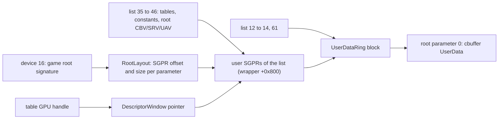

# D3D12.X device shim

The game imports three functions from `d3d12_xs.dll`: `D3D12XboxCreateDevice`, `D3D12ConfigureVirtualMemoryX` and
`D3D12SerializeVersionedRootSignature`. All other rendering goes through COM vtables on the device and the objects
it creates. This page lists what the game passes and calls, read from `game_scarlett_master.exe` (addresses at image
base 0x140000000), and how the loader shims it. Field and method names marked *inferred* come from argument shapes,
not from the GDK header: the PC GDK (`Microsoft GDK\261000`) ships only `windows\include` headers, none for
D3D12.X.

## Startup order

The device is created in one function (0x142478440), after the game registers and shows its own Win32 window
(`RegisterClassExA`, `CreateWindowExA`, `ShowWindow`):

1. `D3D12ConfigureVirtualMemoryX` (call at 0x141e1cfe0), then `XMemVirtualAlloc` reserves the GPU virtual range.
2. `D3D12XboxCreateDevice` (call at 0x1424785b7). The device pointer goes to 0x1475df048 and is copied to eleven
   more globals (0x1475deff8 to 0x1475df040, 0x148759d00).
3. On an OS build of 10.0.26100.9628 or later: device slot 49 with (0x11F, 1).
4. Slot 26 (GetCustomHeapProperties) for heap types 1, 2, 3; slot 8 (CreateCommandQueue) for one direct queue
   (stored at 0x148759ff8); slot 48 four times for four more queues (0x1475e7038 to 0x1475e7050).
5. Slot 9 and slot 73 create command allocators and lists; the lists record X-only slots 132 and 131 and are closed
   (slot 9).

## D3D12XboxCreateDevice

`HRESULT D3D12XboxCreateDevice(IGraphicsUnknown* adapter, const D3D12XBOX_CREATE_DEVICE_PARAMETERS* parameters,
REFIID riid, void** device)`. The game passes a null adapter and `riid` = `5405c344-d457-444e-b4dd-2366e45aee39`,
the desktop IID of ID3D12Device11 (`XboxBvhBuilder.dll` also takes an `ID3D12Device11*`).

The parameter block (D3D12XBOX_CREATE_DEVICE_PARAMETERS) is 0x50 bytes, cleared before it is filled (0x142478559).
Field names are those of the public header as mirrored in ebiten's Go binding (`d3d12_windows.go`), offsets by x64
alignment; the values are what the game writes:

| Offset | Field | Value |
|---|---|---|
| 0x00 | Version | 0x00020004 |
| 0x04 | ProcessDebugFlags | 0 |
| 0x08 | GraphicsCommandQueueRingSizeBytes | 0x00100000 (1 MiB) |
| 0x10 | pOffchipTessellationBuffer | 0 |
| 0x18, 0x1C | GraphicsScratchMemorySizeBytes, ComputeScratchMemorySizeBytes | 0 |
| 0x20 | DisableGeometryShaderAllocations | byte at 0x14a943957, set at run time |
| 0x24 | DisableTessellationShaderAllocations | byte at 0x14a943958, set at run time |
| 0x28 | DisableDXR | 1 |
| 0x2C | DisableAutomaticDPBBBreakBatchEvents | 0 |
| 0x30, 0x38 | pDXRStackBuffer, DXRStackBufferOverrideSizeBytes | 0 |
| 0x3C | CreateDeviceFlags | 0x20 (bit meaning not public) |
| 0x40, 0x44 | AutoHDRPaperWhiteLevelNits, DisableAutomaticCommandSegmentChaining | 0 |

The game sets DisableDXR and builds its acceleration structures with `XboxBvhBuilder.dll` and traverses them
inline ([raytracing.md](raytracing.md)).

## D3D12ConfigureVirtualMemoryX

One pointer to a 32-byte block, zero except the dword at +4: `ceil(size / 16 GiB) + 2`, where `size` is 16 GiB when
the console-type query (0x1455deb88) returns 6 and 24 GiB otherwise. The same `size` is then reserved with
`XMemVirtualAlloc`. A failing HRESULT hits an `int3`.

## Calling convention

- Device methods that return a struct take the return buffer in rcx and the object in rdx (slot 25 at 0x14034413f,
  slot 26 at 0x14247870d, slot 108 at 0x140abfe07). The desktop ABI is the other way round. Resource GetDesc (slot
  10) uses the desktop order (object in rcx, call at 0x14501f80b).
- AddRef and Release are ordinary vtable calls (slots 1 and 2); the game does not touch reference counts directly.

## Vtable census

A static scan of every function in `.pdata` (scratch tooling, not in the repository) follows the device from its
globals, through function parameters and return values, and types each created object by the IID passed next to
its out-pointer. The counts are call sites, not run-time frequency; objects reached only through engine structures
are under-counted.

### Device (85 sites, 42 slots)

Slots 0 to 43 follow desktop ID3D12Device order: every creation slot below passes the IID of the desktop object it
should create. From slot 44 on the order is not desktop's.

| Slot | Offset | Sites | Method | Evidence |
|---|---|---|---|---|
| 0 | 0x000 | 1 | QueryInterface | asks for IDXGIDevice |
| 2 | 0x010 | 2 | Release | |
| 8 | 0x040 | 2 | CreateCommandQueue | queue IID |
| 9 | 0x048 | 5 | CreateCommandAllocator | allocator IID |
| 14 | 0x070 | 3 | CreateDescriptorHeap | descriptor-heap IID |
| 15 | 0x078 | 10 | GetDescriptorHandleIncrementSize | types 0 to 4 at start-up (0x142478e3d), only type 0 kept; 4 is console-only and answered 0 |
| 16 to 21 | 0x080-0x0A8 | 1 each | CreateRootSignature, CreateConstantBufferView ... CreateDepthStencilView | |
| 24 | 0x0C0 | 1 | CopyDescriptorsSimple | (1, dest, src, type) |
| 25 | 0x0C8 | 3 | GetResourceAllocationInfo | struct return, swapped registers |
| 26 | 0x0D0 | 3 | GetCustomHeapProperties | struct return, swapped registers |
| 27 | 0x0D8 | 1 | CreateCommittedResource | resource IID |
| 36 | 0x120 | 1 | CreateFence | fence IID |
| 39 | 0x138 | 1 | CreateQueryHeap | query-heap IID |
| 41 | 0x148 | 5 | CreateCommandSignature | command-signature IID |
| 48 | 0x180 | 4 | X: create command queue | queue IID, desc, IID, out |
| 49, 50 | 0x188, 0x190 | 1 each | X | |
| 55, 57, 62, 67, 86 | | 1 each | X: create pipeline state (five variants, [d3d12x-pipelines.md](d3d12x-pipelines.md)) | pipeline-state IID |
| 61 | 0x1E8 | 1 | X: create sampler (*inferred*) | (0x6c-byte desc, CPU handle), desc filled at 0x1412b96b0; the game then flushes the descriptor (0x1412b9800) |
| 70 | 0x230 | 6 | X: create SRV without a resource object (*inferred*) | (D3D12_RESOURCE_DESC, 64-byte view desc: desktop SRV desc + GPU address at +0x28, CPU handle) (0x144ecc800) |
| 71 | 0x238 | 2 | X | |
| 73 | 0x248 | 3 | X: create command list | (16-byte desc, allocator, PSO, IID, out) |
| 74 | 0x250 | 1 | X: register a mapped range (*inferred*) | (address, 0x185c0 pages, 8-byte out) after mapping the streaming range (0x141e6c2bb) |
| 78 | 0x270 | 1 | X: SetFrameIntervalX (*inferred*) | (null, interval µs, period, 0) ([Present](#present)) |
| 79 | 0x278 | 3 | X: ScheduleFrameEventX (*inferred*) | (type, offset µs, null, 0) |
| 80 | 0x280 | 3 | X: WaitFrameEventX (*inferred*) | (type, timeout, null, flags, UINT64* token in/out) |
| 81 | | 1 | X | |
| 101 | 0x328 | 1 | X: create state object | state-object IID |
| 108 | 0x360 | 1 | X: GetResourceAllocationInfo1 (*inferred*) | struct return, mask, count, descs, per-desc infos |
| 119, 132 | | 1-2 each | X | |
| 127 | 0x3F8 | 1 | X: create committed resource (*inferred*) | CreateCommittedResource3 arguments: initial barrier layout, no castable formats (0x14193e1b4) |
| 133 | 0x428 | 3 | X: create resource at a GPU address (*inferred*) | (address, desc, initial barrier layout, clear, resource IID, out) |

### Command queue

The queue's own methods sit two slots later than on the desktop: GetTimestampFrequency is slot 18 (one
`UINT64*`), Signal slot 16 (fence, value). The shift is the queue's, not ID3D12Pageable's: the descriptor heap,
also pageable, has GetCPUDescriptorHandleForHeapStart at desktop slot 9 (call at 0x141c74559).

| Slot | Offset | Sites | Method |
|---|---|---|---|
| 16 | 0x080 | 1 | Signal (*inferred*) |
| 18 | 0x090 | 1 | GetTimestampFrequency (*inferred*) |
| 23 | 0x0B8 | 1 | X: suspend, argument 0 (*inferred*: process-lifetime suspend) |
| 24 | 0x0C0 | 1 | X: resume (*inferred*) |
| 31 | 0x0F8 | 1 | X: page mappings (*inferred*), not presenting: (count, range array, object, dword, 0) on another queue (global 0x1471bfce8), after the game maps 64 KiB pages itself (0x140f2cc7f) |
| 32 | 0x100 | 2 | X: PresentX (*inferred*), [Present](#present) |
| 35 | 0x118 | 2 | X: execute command lists (*inferred*): (count, lists, object from a global, flags 0 or 3) |

The per-frame submit is 0x142481e90: slot 35 (up to 256 lists), then slot 32, with device slot 80 called between
frames ([Present](#present)).

### Command list

The game asks slot 73 for desktop ID3D12GraphicsCommandList (`5b160d0f-...`) in one place and for
`c3827890-4024-474c-98cf-645b51dc4874`, not a desktop IID, in the others. Close is slot 9 as on the desktop.
Slots 131 and 132 (X-only) take (register offset, value, 0, mask 0xFFFFFFFFFF00): register writes. Other ports name 131
FlushGpuCacheRangeX, 132 FlushShaderCacheRangeX and 69 FlushPipelineX (newer layout); all three are a global UAV
barrier here (`CacheFlushSlots`, as XCL does; stubs before), which only orders work, harmless for register writes.

Most commands are recorded inline: the game compares the list's write pointer (+0x18) with a limit (+0x28 before
draws, +0x30 otherwise), writes PM4 packets itself when there is room, and calls the vtable slot only when there is
not. It also writes state into the list object (+0x140, +0x544 to +0x563) and reads +0x548 and a register table
at +0x144 / +0x344. The 34 functions that load the list from the graphics context (+0x127C8) call these slots; the
method follows from the arguments and from the inline packet written instead:

| Slot | Desktop | Method | Evidence |
|---|---|---|---|
| 9 | 9 | Close | creation code |
| 12, 13 | 12, 13 | DrawInstanced, DrawIndexedInstanced | 4 and 5 counts; limit +0x28 |
| 20 to 24 | 20 to 24 | IASetPrimitiveTopology ([Boot](#boot)), RSSetViewports, RSSetScissorRects, OMSetBlendFactor, OMSetStencilRef | (1, rects), float*, one dword |
| 25 | 25 | SetPipelineState | PSO; caches PSO state at +0x544 |
| 26 | 26 | ResourceBarrier (*inferred*: desktop order of 0 to 25) | not called in boot |
| 28, 29, 30 | 52 to 54 | BeginQuery, EndQuery, ResolveQueryData (*inferred*) | (heap, type, index) from a record's +0x58 and +0x68 and an index allocator (0x142474f50, 0x142475010, 0x142482b99); 30 has 7 arguments (0x1424843b0) |
| 32 | 28 | SetDescriptorHeaps | (2, {main view heap, sampler heap}) at 0x144e4cac2, when a context takes a new list |
| 33, 34 | 29, 30 | SetCompute/GraphicsRootSignature | root signature from the PSO (+0x80) |
| 35, 36 | 31, 32 | SetCompute/GraphicsRootDescriptorTable | (index, GPU handle); inline dword + low dword |
| 37, 38 | 33, 34 | SetCompute/GraphicsRoot32BitConstant (*inferred*: between 36 and 39) | |
| 39, 40 | 35, 36 | SetCompute/GraphicsRoot32BitConstants | (index, count, data, 0) |
| 41, 42 | 37, 38 | SetCompute/Graphics root CBV (*inferred*: between 40 and 43) | |
| 43 to 46 | 39 to 42 | SetCompute/Graphics root SRV and UAV | (index, GPU address); inline dword + qword |
| 47, 48 | 43, 44 | IASetIndexBuffer, IASetVertexBuffers | view* or null; (0, count, views) |
| 50 | 46 | OMSetRenderTargets | (count, handles, FALSE, DSV*) |
| 51, 52 | 47, 48 | ClearDepthStencilView (*inferred*), ClearRenderTargetView | (handle, color*, 0, null) |
| 61 | 59 | ExecuteIndirect | (signature, 1, argument buffer, offset, null, 0); 8 sites |
| 62 | | X: CopyMemoryToMemoryX (destination, source, bytes, flags) | (GPU address, GPU address, dword, 0) (0x1409796a0, after the game makes a texture); a CopyBufferRegion between the desktop buffers over game memory |
| 85, 86 | | X: CopyTextureRegionX, CopyResourceX (the desktop arguments, then flags) | the game's texture copy 0x1404F4210 (texture to texture, buffer to texture from its upload ring); textures move to COPY_DEST / COPY_SOURCE and back (`TextureCopies`). Names after victory-gta6, whose older list layout has them two slots lower (60, 83, 84) |
| 70 | 62 | OMSetDepthBounds | floats in xmm1, xmm2 |
| 71 | | X: Write32BitValueBottomOfPipeX (address, value, flush, flags) | (address, dword, 0, 0) (0x144ed46a3): a per-frame array of 18 dwords at [0x1475DF268] |
| 72 | | X: Write64BitValueBottomOfPipeX (address, value, flush, flags); flags 1 or 2 write the GPU timestamp | (address in a type-2 query record's result array, 0, 0, 1) (0x142482b31) |
| 73 | | X: Wait32BitValueX (address, comparison, value, mask, flags) (*inferred*, no call site identified) | |
| 74 | | X: Wait64BitValueX (address, comparison, value, flags) | (address, 7 = GREATER_EQUAL, qword, 1) (0x142484b0c): wait until a pending record's +0x50 cell reaches the frame number (0x144e39e77), or until the cell at [0x1475E75D0] reaches the counter 0x146891a00 that the CPU writes there itself (0x14044b6c3) |
| 75, 126, 142 | | X: state writes (*inferred*) | one byte (0x14003281a); (byte, packed dword pair) (0x140032638); one qword (0x1400329e3) |
| 146 | | X: Barrier (ID3D12GraphicsCommandList7) | (group count, D3D12_BARRIER_GROUP*) (0x14003210d, 0x144da61d1), below |
| 148 | | X: upload allocation | (size, alignment) returns a pointer the caller also uses as a GPU address; XboxBvhBuilder.dll only (0x180020ed6), no call in the exe |

**Enhanced barriers (146).** The game queues barrier groups in its graphics context (+0x12780 + 0xA0, at most 256
groups of 16 bytes: type, count, pointer) and flushes them with slot 146 (0x1400320e0), then clears the counters. The
queueing functions fill the public structures: 0x1400095e0 adds a D3D12_BUFFER_BARRIER (40 bytes: sync, access,
resource from the game's record +0x20, offset 0, size UINT64_MAX) to a type-2 group, 0x1400097f0 a
D3D12_TEXTURE_BARRIER (64 bytes: sync, access, layouts, resource, all subresources, flags) to a type-1 group; 1024
buffer and 1024 texture barriers at most. Boot calls it from 0x140032113.

Slots 32 to 52 are the desktop slot + 4: the queries moved up to 28 to 30 (*inferred*); between 52 and 61 two desktop
methods are missing. The exe writes no barrier packet inline: no ACQUIRE_MEM, RELEASE_MEM or EVENT_WRITE header is an
immediate (the inline packets are 0xB6 and 0xB8 register writes). The inline form
of a descriptor table is (dword from the root signature's register table at list +0x144 + index * 4, low dword of the
GPU handle): the table reaches the program as a 32-bit address in one user SGPR. The game derives a GPU handle as its
CPU handle + (GPU start - CPU start) (0x1400321d8; heap record at 0x1475e7378: +0x18 heap, +0x20 CPU start, +0x30
increment, +0x38 GPU start - CPU start).

### Descriptor heaps

The game allocates CPU descriptor memory the console way: D3D12.X takes it from the title's `XMemAlloc` hook (the
exe exports `__XMemAllocationHooks__`). Around the creation of the main shader-visible heap (0x141cf3280, 1245184
descriptors) the game pushes a hook that answers allocator id 128, object type 4 with memory it reserved, and breaks
into the debugger unless slot 9 then returns that memory.

The game treats that memory as plain memory, 32 bytes per descriptor (measured at boot):

| Descriptors | Bytes | Use |
|---|---|---|
| 0 to 327,679 | 0 to 0x9FFFFF | persistent views, written through slots 17 to 24 and 70; free list in dword 0 of each free descriptor (next free index, last 0xFFFFFFFF), filled by the game before the first view; boot writes 0 to 10 and 17 to 101 |
| 360,448 on | 0xB00000 on | the start of the 0xAE00000-byte slot-133 pool, which overlaps the heap's last 0x1B00000 bytes |

Per-draw tables are not written through the device: 0x1400321d8 takes room from the graphics context's linear
allocator (0x142484aa0: count × increment bytes), 0x144d9efc0 copies each 32-byte descriptor into it with AVX moves
from the persistent descriptor its binding names (record +0x18), and the table's GPU handle is that address + (GPU
start - CPU start). Boot binds such tables at descriptors 368,373 to 372,600, in pool memory next to other data
(vertex positions).

## Shim

`XboxDeviceFactory` (`src/FiveStar.Loader/Shims/D3D12X`) implements `D3D12XboxCreateDevice` on a desktop
ID3D12Device (default adapter, feature level 12_1). `D3D12ConfigureVirtualMemoryX` logs its argument and returns
S_OK.

### Wrappers

Every object the game gets is a wrapper (`XboxObjects`): a pointer to the D3D12.X vtable, then the desktop object at
+8. One native block holds a vtable per interface (`XboxInterfaceKind`), so a pointer whose vtable lies in it is a
wrapper.

- Slots listed in `XboxInterfaces` are generated tail-call thunks: `mov rcx,[rcx+8]; mov rax,[rcx]; jmp
  [rax+desktop*8]`, with the slot remapped; struct-returning slots load the object from rdx and swap rcx and rdx.
  Arguments in rdx, r8 or r9 that may carry a wrapper are unwrapped first (`test; jz; mov r10,[reg]; range check;
  mov reg,[reg+8]`), any other pointer passes through. No managed code runs on these calls.
- Every other slot is a stub that logs its first call as `d3d12_xs.dll!<interface>.X::SlotN` with the caller and
  returns E_NOTIMPL.
- QueryInterface returns the wrapper when the desktop answer is the object itself, Release frees the wrapper with
  the desktop object, GetDevice returns the device wrapper.
- `XboxObjects.SetHandler(kind, slot, handler)` binds any slot to a native function (an `[UnmanagedCallersOnly]`
  method taking the wrapper first), before or after the vtables exist. `Wrap`, `Unwrap` and `WrapResult` are the
  helpers for handlers that create or receive objects.
- Pipeline states (slots 55, 57, 62, 67, 86, [d3d12x-pipelines.md](d3d12x-pipelines.md)) are returned unwrapped.
- The device wrapper is 0x20 bytes; its byte at +0x18 is 1. The game (0x14006ddf5, 0x144d9f5dc, 0x144fd2b7e) and
  the FSR DLL read it before writing a descriptor: 0 makes them write a raw buffer descriptor (V#) or copy the
  32-byte record themselves, non-zero makes them call slot 17 (CreateConstantBufferView) or slot 24
  (CopyDescriptorsSimple). The shim's records hold desktop indices, not hardware descriptors, so it asks for the
  calls (before, the byte lay past a 16-byte wrapper and was whatever the allocator left there).

| Interface | Forwarded slots | Slot map |
|---|---|---|
| Device | 1 to 43 | desktop order; 25, 26, 43 swap; views (18 to 21), 31, 42 unwrap |
| Command queue | 13 to 20 | desktop slot + 2; Signal and Wait unwrap the fence; 20 (GetDesc) swaps |
| Command allocator | 8 | desktop (*inferred*) |
| Command list | 8 to 25, 50 to 52, 70 | as in the table above; 139 is Reset with a third argument (0x142474cce); Reset, ClearState, copies and SetPipelineState unwrap |
| Resource | 8 to 14 | desktop |
| Heap, descriptor heap | 8 | GetDesc, swaps |
| Fence | 8 to 10 | desktop (*inferred*); 12 is a handler |
| Query heap, command signature | none past the base slots | |

The command-list wrapper is 4 KiB and zeroed: write pointer and limits stay 0, so every inline command calls its
slot. Reset (10, 139), draws and dispatches (12 to 14, 61) and slots 32 to 46 are binding handlers
([Binding](#binding)); 47 and 48 (index and vertex buffers, `InputBuffers`) translate each view's console address
to the desktop buffer over that memory (an address outside known memory unbinds the buffer, warned once).

### Handlers

| Interface | Slot | Handler |
|---|---|---|
| Device | 8, 9, 12, 14, 27 to 30, 36, 39, 41 | desktop creation, result wrapped; wrapped heap, allocator and PSO arguments unwrapped; resource descs made desktop ones (below); in command signatures the X-only argument type 0x69 (12 bytes, built next to a DISPATCH one) becomes DISPATCH |
| Device | 25, 38, 108 | allocation info (108 through ID3D12Device4::GetResourceAllocationInfo1) and footprints on desktop descs; the game breaks into the debugger when a size does not fit 32 bits (0x140344196) |
| Device | 17 to 24 | view creation and descriptor copies with CPU handles translated (below) |
| Device | 34, 35 | MakeResident, Evict: S_OK (desktop objects are resident from creation) |
| Device | 48, 73 | compute queues (flags reduced to DISABLE_GPU_TIMEOUT) and command lists, wrapped |
| Device | 61, 70 | the desktop sampler of the console sampler desc, and an SRV on the desktop texture at the view's address ([gpu-resources.md](gpu-resources.md)) |
| Device | 74 | logged, output zeroed, S_OK |
| Device | 127 | committed resource (below) |
| Device | 78 to 80 | frame interval, frame events and their wait on a timer ([Present](#present)) |
| Device | 133 | buffer at a game address (below), or a texture registered by address ([gpu-resources.md](gpu-resources.md)) |
| Command queue | 12, 35 | unwrap up to 256 lists per call and run desktop ExecuteCommandLists, after waiting for a list still running from its last submission ([Boot](#boot)); 35 ignores its frame object and flags |
| Command queue | 16 | Signal: the time and value are kept on a wrapped fence (for the log's Signal-to-cell latency), then desktop Signal |
| Command queue | 32 | present on a swap chain ([Present](#present)) |
| Resource | 2 | Release that also frees a slot-127 resource's title memory |
| Resource | 11 | the console address for a slot-133 resource, else the desktop GPU address |
| Fence | 2, 12 | 12 returns a cell holding the completed value, which the game polls (0x144fb0ad0); a mirror thread keeps every such cell current (SetEventOnCompletion(value + 1) on a shared event) |
| Descriptor heap | 9, 10 | heap start handles returned in rax; for the game's shader-visible view and sampler heaps both return the title memory ([Binding](#binding)) |
| Device | 16 | CreateRootSignature; the parameter layout is kept ([Binding](#binding)) |
| Command list | 10, 12 to 14, 32 to 46, 61, 139 | [Binding](#binding) |
| Command list | 47, 48 | IASetIndexBuffer, IASetVertexBuffers with console addresses translated |
| Command list | 20 | IASetPrimitiveTopology with console topologies made desktop ones ([Rectangle lists](#rectangle-lists)) |
| Command list | 25 | SetPipelineState, recorded for [Rectangle lists](#rectangle-lists) |
| Command list | 9, 26, 146 | Close, ResourceBarrier and Barrier with resource states ([gpu-resources.md](gpu-resources.md#barriers)) |
| Command list | 148 | a 32 MiB persistently mapped upload ring, made on first use, whose CPU range is in the address table as a console GPU range (`UploadArena`); a range is reused once the ring has passed it |

### Game memory on the GPU

Slot 133 (GPU address, buffer desc, 0xFFFFFFFF, null clear value, IID, out) asks for a buffer over XMem pages the
game mapped itself (`XboxPlacedResources`). The store's whole-section view of each page section
([physical-memory.md](physical-memory.md)) is opened with `ID3D12Device3::OpenExistingHeapFromAddress`
(`OpenExistingHeapFromFileMapping` rejects the pagefile sections with E_INVALIDARG). The range is split into runs of
pages contiguous in one section; each run becomes a buffer placed at its section offset, with
ALLOW_CROSS_ADAPTER (required on such heaps) and the game's flags reduced to UNORDERED_ACCESS (it passes 0x20004).
The game's resource is the first run's buffer; GetGPUVirtualAddress returns the console address; every run's
console range and desktop GPU address go into `XboxPlacedResources.Addresses`, the translation the command-list
and descriptor work will use (on the console GPU address == CPU address). UpdateTileMappings does not take these
(cross-adapter) heaps, so one resource cannot span sections; the page store therefore gives a multi-page allocation
consecutive pages of one section, in the address order of the placeholder it is mapped into
([physical-memory.md](physical-memory.md)). The game's 0xAE00000-byte pool (three pieces of one placeholder, mapped
later piece first) is one run and one buffer. A range with no mapped page in memory the game committed itself (3,259
buffers in a boot, such as the 0x283 / PAGE_GRAPHICS_READWRITE allocation) shares the buffer over that allocation
(below); its offsets stay console ones, so buffer views (`BufferViewRanges`), CopyBufferRegion (list slot 15) and
ExecuteIndirect move them to that buffer (`BufferCopies`). Elsewhere it gets a committed buffer that is not shared.
A texture at a game address becomes a committed desktop texture of its own, filled from the game's bytes unless the
GPU writes it ([gpu-resources.md](gpu-resources.md)).

Memory the game commits itself (XMemVirtualAlloc with MEM_COMMIT, such as the 2.2 GiB heap with PAGE_GRAPHICS_*
protection) is GPU memory on the console too. The first console GPU address there that the table misses opens the
whole VirtualAlloc allocation as a heap (OpenExistingHeapFromAddress) with one placed buffer over it
(`XboxGameMemoryBuffers`). CBVs (slot 17) translate their address this way and grow to 256 bytes; an address
outside known memory or off the desktop's 256-byte alignment (the console takes 16) gets a null CBV, logged once.
The console GPU writes only to graphics memory: an allocation made with PAGE_GRAPHICS_READWRITE or
_EXECUTE_READWRITE, or MEM_GRAPHICS (`GraphicsAllocations`, from the XMemVirtualAlloc flags). Any other allocation,
or one not made through XMemVirtualAlloc, gets a buffer without unordered access, so the address map names a null
UAV for its pages and program writes there are dropped; it is warned once per allocation. In 40 boots every
allocation covered this way was graphics read-write (0x2404, 0x22004, 0x42404).

**Resource descs.** Before the desktop sees one: flag bits above 0x1FF dropped (0x20000 on GPU-memory buffers,
0x300000 on textures), a console layout (0x100 + XG swizzle mode, set at 0x1403440f7) made UNKNOWN, and
ALLOW_UNORDERED_ACCESS dropped from textures when no format of their DXGI cast family (the typeless format and its
members, `FormatFamilies`) reports D3D12_FORMAT_SUPPORT1_TYPED_UNORDERED_ACCESS_VIEW, the rule the runtime applies
(R32G8X24_TYPELESS, the desktop form of the console's D16_UNORM_S8_UINT). Should the runtime refuse a desc anyway, the
allocation-info query runs again without the flag. A depth-stencil texture loses ALLOW_RENDER_TARGET,
ALLOW_UNORDERED_ACCESS and ALLOW_SIMULTANEOUS_ACCESS (the console sets UAV on depth, debug error #599), and a UAV of
any texture made without the flag becomes a null view (it would remove the device). Render-target and UAV textures in
B5G6R5, B5G5R5A1 or B4G4R4A4 take a substitute format; see [gpu-resources.md](gpu-resources.md#render-target-formats).

**Allocation info (slots 25, 108).** A texture desc in a console layout (0x100 + swizzle mode), or with layout
UNKNOWN and none of ALLOW_RENDER_TARGET, ALLOW_DEPTH_STENCIL, ALLOW_UNORDERED_ACCESS, gets the XG layout's size and
alignment ([xg.md](xg.md); UNKNOWN takes the suggested mode), as the console reports it, not the desktop driver's
(`ConsoleAllocationSizes`). So does a single-sample render target, depth target or UAV texture with layout UNKNOWN:
the game places those in its 2.2 GiB graphics heap at the size slot 108 answers (0x140abfad0), while the shim backs
them with desktop textures of their own. AMD's driver (RX 7800 XT) adds its compression metadata, 0x1330000 bytes for
a 2560x1440 depth target where XG gives 0xb40000; with the desktop sizes the heap held 2050 MB of its 2199 MB after
boot and the story load stopped on a 46 MiB request (the allocator's fatal path, 0x142219650). Buffers, multisampled
textures, or a query mixing them keep the desktop answer. The game sizes streamed
textures without size fields in their header this way (0x1451fb8f3 through 0x140343e80, desc built without a
layout), stores the size in 4 KiB units in its streaming table (0x149c3e1d0, 0x38-byte entries, words +0x18 offsets
and +0x20 sizes) and reads exactly that many bytes from the archive (0x1443c4850); the archive's compressed chunks
were cut to the console size, and a read that ends inside one breaks at 0x144ffd879. At the pad pairing that was a
128x4 R16G16B16A16 texture: 0x2000 bytes on the desktop, four 4 KB blocks (0x4000) on the console and in its chunk. The chunk table entry (8 bytes)
holds the compressed offset in 256-byte units (bits 0-25), the codec (bits 26-29, 0 = stored), the uncompressed
offset in 4 KiB units (bits 30-51) and the padding bytes after the compressed data (bits 52-63); a compressed
chunk is read whole.

**Resource Map (slots 8, 9).** A resource the game placed (slot 133) maps to its own memory, as on the console;
0x145121891 maps a texture and writes a mip at its XG offset. Others map on the desktop.

**Spare allocators.** The game takes a list and an allocator from separate pools (0x140188430) and resets the list on
an allocator that may back another recording list, which the console allows; the desktop answers E_INVALIDARG and the
game breaks at 0x142474ce1. The list then records on a spare allocator kept for that game allocator and reset with it
(allocator slot 8; SpareAllocators). A list whose Close failed (an invalid call was recorded) is refused by every
later Reset, on any allocator, with E_INVALIDARG; such a list gets a new desktop list behind the same wrapper (the old
one is kept, as the GPU may still run it), and the failed Close is warned once. Barriers leave out write states the
desktop resource has no flag for (ResourceStates.Allowed; error #523 on a depth texture moved to UNORDERED_ACCESS).
**Bottom-of-pipe writes (list slots 71, 72; `BottomOfPipeWrites`).** Each is a desktop WriteBufferImmediate in
MARKER_OUT mode (after the list's earlier work) at the desktop address of the game address: 71 one dword, 72 a
qword, or with flags 1 or 2 a timestamp taken from the CPU clock at recording, in the console's 100 MHz units. None
of them feeds the transient pool's retire tokens, which complete through the queue fences (0x144dad000, 0x142474880).

**Memory waits (list slots 73, 74; `MemoryWaits`).** The queue does not go on until `(memory & mask) op value` holds
(op a D3D12_COMPARISON_FUNC; slot 74 compares all 64 bits, and its fourth argument is flags, not a mask). Slot 74
was taken for a qword write until XCL's notes and the call arguments showed it is a wait: it wrote the value the
queue should wait for. The game's waits are on frame cells: a record's +0x50 cell must reach the frame number
(0x144e39e60), which other queues write there with Write64BitValueBottomOfPipeX (0x1406c6630, 0x1407d2150). The
desktop has no memory wait. A list records its waits (`ListMemoryWaits`; a wait on an address the same list wrote
before is met in order and dropped, as are NEVER and ALWAYS). At submission a list with waits goes alone after the
lists before it; when a wait does not hold yet, the desktop queue waits on that queue's own fence, which a watcher
thread signals once memory holds, or after 5 s (logged with the writer list and where it was submitted); an address
that timed out is not waited for again. Before the shim blocks the CPU on a queue (a list submitted again while its
last run is unfinished, `ListSubmissions`), that queue's waits are released, since the writer may come from the
blocked thread. One fence for all queues held a writer behind an unrelated wait on another queue: per-queue fences
took the story-load timeouts from 17 to 0 (the first frame's waits take longer than 0.5 s but under 5 s). Every
ticket a queue waits for is signalled: by the watcher (a watch that throws is logged and releases every pending wait)
or, when the device is bound again, at once (XCL #1452 lost the device right after queue Waits nobody signalled).

A wait recorded after any command of its list splits the list there (`ListSplits`; command-list forwarding thunks
count their calls in the wrapper, and handlers that record work count themselves), as victory-gta6 cuts its lists:
the desktop list so far is closed as a segment, and recording goes on in another desktop list on the same allocator
with the state set again (`ListReplayState`: heaps, bindless roots, pipeline, topology, vertex and index buffers,
targets, viewports, scissors, blend factor, stencil reference, depth bounds; not open queries or predication).
Segments run in queue order, each after its waits; a wait at the list's start or right after another joins the
current segment's. `--no-split-at-waits` holds no wait recorded after work instead.

The stall that kept splitting off (boots 9 and 10: every queue held for 5 s at one frame, the next frame's writer
lists recorded but not submitted) was our present throttle (`GpuFrameThrottle`): at a present it blocked the
submitting thread until the GPU finished the work of two presents before, and that work stood at a wait whose writer
the same thread submits after the present. victory-gta6 releases all held waits at a present, and so do we now (boot 13,
with splitting on, stalled 5 s at the first story-load frame with the game's own frame wait, 0x142474f80, behind a
held queue, and the device was removed); the throttle also releases them when it has waited 250 ms. Wait checks read memory without VirtualQuery (victory-gta6 measured
about 8 ms per query in the game's 1.1 GB allocation): a page in a mappable reservation must be mapped, other memory
must be in the address table. The device's Dispose logs the counts.

**Indirect-argument clamp (`IndirectClamp`).** Before an ExecuteIndirect with a one-argument signature (all five of
the game's: draw, indexed draw, dispatch, the X dispatch 0x69 and mesh dispatch), a compute program of ours (HLSL
compiled once by Windows' d3dcompiler_47) copies the records into the list's scratch buffer and clamps them, and the
list executes the copy: 2^24 vertices and 2^26 vertex instances per draw, 65,535 groups per dimension and 2^20 per
dispatch (more runs nothing), mesh dispatches one-dimensional, a first dimension over 65,535 run empty (a record the
game did not fill). A skipped or mistranslated argument pass leaves garbage there, and a dispatch of 0xFFFFFFFF groups
runs until the driver resets the device. The game's buffers are not touched; the list's compute root signature and
pipeline are set again after the clamp. Records past a count buffer's count are copied unclamped and never run.
A recording also has a budget of 2^27 work items, as victory-gta6's clamp has (a vertex instance counts 1, a compute
group 64, a mesh group 128): a record that does not fit what is left runs empty and charges nothing (a counter in
the scratch buffer, zeroed by the recording's first clamp, charged by compare-exchange). Each record alone stayed in
bounds, but the opening cutscene lost the device at about 300 s (5 s without progress on every queue) once linked
G-buffer pipelines drew from culling output that skipped passes had left stale.

A compute list names only compute states (VERTEX_AND_CONSTANT_BUFFER, UNORDERED_ACCESS, NON_PIXEL_SHADER_RESOURCE,
INDIRECT_ARGUMENT, COPY_DEST, COPY_SOURCE, acceleration structure) and a copy list only the copy ones
(`ResourceStates.Legal`): any other bit fails the desktop Close. Render targets rest in RENDER_TARGET, so a compute
list's transition of one (or to PIXEL_SHADER_RESOURCE) is left out and the texture keeps its state on that list
(warned once). The per-list table of moved textures grows as needed; at 64 entries it used to stop tracking, and the
untracked textures were never moved home at Close.
**Buffer views on split buffers.** A slot-133 buffer over pages in two sections is two desktop buffers, and the
game's object is the first. A slot 18/19 buffer view goes to the run that holds its first element and is cut at the
run's end (BufferViewRanges); a view past the first run's end removed the device (error #31). 16 of 3,388 buffers
in a boot split; the elements past a cut read 0 until such a buffer is one desktop resource.

**Committed resources (slot 127).** Created in the state of the initial barrier layout (buffers COMMON), heap flags
0 (the game passes 8). On the console D3D12.X takes their memory from the title's XMemAlloc hook, and the game checks
it: around its two 4K render targets (0x14247ad10) it pushes a hook for D3D allocations with page-size field 2 that
hands out a 64 MiB region, and breaks into the debugger unless all but 2 MiB of it was used. The shim allocates a
texture's XG console size (a desktop driver pads: an RDNA3 card asks 0x2010000 bytes per 4K target, and two overrun the
region) and a buffer's desktop size, with attributes 0x11808000 (allocator 128, page size 2, 64 KiB alignment), and
frees it with the resource.

**Root signatures.** `D3D12SerializeVersionedRootSignature` drops the flag bits above 0xFFF (`XboxBvhBuilder.dll`
passes 0x3000000) and logs the serializer's message when it still fails.

**XboxBvhBuilder.dll.** Its constructor builds compute pipelines from console shader code (device slot 62) and
throws when that fails. Its seven exports bind to shims: prebuild sizes from the desktop's
GetRaytracingAccelerationStructurePrebuildInfo, builds, copies and rehydration logged once and skipped. With
`--raytracing` the DLL's own CPU paths give console sizes and rehydrate BLASes ([raytracing.md](raytracing.md)).

### Binding

Every list runs `BindlessRootSignature` (the one the pipelines use); the game's root arguments become the user data
of the translated programs (`Shims/D3D12X/Binding`).

- **Heaps** (`XboxDescriptorHeaps`, `ShaderVisibleHeap`). The game's shader-visible view and sampler heaps take
  title memory from the game's hook (allocator id 128, object type 4; pinned memory of the shim's own without a game
  image). Slots 9 and 10 both return it, so a CPU or GPU handle is the address of the descriptor's 32-byte record,
  as on the console. A record's dword 0 is the desktop index standing behind the descriptor, the rest zero: slots
  17 to 22, 61 and 70 write it with the view, so the game's own copies of records (its per-draw tables) carry
  desktop indices. The desktop view heap holds 10 reserved descriptors then whole 4096-descriptor pages up to
  1,000,000 (the tier-2 limit): 0 is a raw SRV over the descriptor window (`GPU_MEM_HEAP`), 1 a raw UAV over it, 2
  to 5 null descriptors for the mesh fallback table (root parameter 1; 5 is also what a record naming nothing
  reads), 6 a sink, 7 the address map (`GPU_MAP_HEAP`, below), 8 and 9 the null SRV and UAV its unmapped pages name.
- **Buffer records** (`BufferRecord`, `BufferRecords`). A buffer view's record is its V# as the console lays it out:
  stride and num_records, the format word with its OOB_SELECT, and in dword 0 and dword 1 bits 0-15 either the desktop
  heap index (base_hi 0) or, for a read-only view, its console GPU address (the resource's slot-133 address plus the
  first element, a CBV's location, a slot-70 view's address). Programs read V#s from tables and build pointers from
  their base: `MS_VS_Transform_PositionOnly` s_loads a V# and then loads through base + 0x40; with the heap index
  there, it read the descriptor window and its meshlet V#s came out empty. A read-only view (SRV, CBV, slot 70) gets
  its address when the address map has a view for its pages now (`GameMemoryViews.Maps`, what `gpu_page` reads: the
  XMem pages the game mapped have one without any placed buffer, which is why the address table missed slot-70 views
  such as PositionOnly's) or the address table covers it; the GPU only reads, and the map gives it the bytes the game
  wrote. A UAV gets it only when the address table's range is the view's own desktop resource, so its writes land where
  the command processor reads (indirect arguments, copies). With every record based, boots hung or crashed at 120 to
  130 s, UAV writes reaching memory the desktop resources did not show. The first 8 records of each reason that keep
  the heap index are logged (no console address, no map or table coverage, a UAV over another resource), with XMem or
  not and slot-127 committed or not. A record with an address keeps the desktop index in dword 4 (the shim's copies to desktop heaps); the
  window mirror holds it in dword 4 for every record (the debug readers). `--buffer-records-heap-index` keeps the heap
  index in every record. Views written into the game's desktop (non-title) heaps keep their fields by desktop handle
  (`DesktopRecords`), and a copy from one into a title heap writes them into the copied records: before, those copies
  wrote none, and PositionOnly's per-meshlet V#s, read from such copies, came out as {heap index, 0, 0, 0}. The first
  16 copies that carry fields are logged with their game index.
- **Raw views at kept-index slots** (`RawBufferViews`, on unless `--typed-buffer-views`). A program reaches the slot of a
  record that keeps the heap index (or has no V# fields) directly and reads it as a ByteAddressBuffer, writes it as a
  RWByteAddressBuffer at the same index, and issues the load even when its range check fails; a typed, structured or
  constant-buffer view there is a type mismatch, undefined in D3D12 (w47 kept a 16-bit typed view of 3,072 indices).
  Such SRVs, UAVs (without their counter) and slot-70 views are written raw over the same bytes, or null (reads 0)
  when they start off D3D12's 16 raw bytes or have no element size; a constant-buffer view in a game heap that gets
  no raw view becomes a null raw SRV. Based records are left alone. The sample summary counts the views made raw, the
  null ones and the read-only kept-index slots a program's write could reach (the case a UAV alias would cover).
- **Window guard** (`WindowGuard`, on unless `--no-window-guard`). The window holds room for 2,097,152 view records
  (the game's main heap has 1,245,184; the regions past the records started after 1,000,000 before, so the shim's
  mirror of records 1,000,000 and up wrote into the store-trace ring, the window flags and the mesh probe's ring), then
  the guard's table, the store-trace ring, the window flags and the mesh probe's ring. A program's store or atomic
  through a 32-bit pointer would land in the window; the prelude drops it (an atomic goes to a sink) and counts it per
  program (`FIVESTAR_PROGRAM_ID`), and each captured present logs the programs that did since the last. A cap table
  follows (`FIVESTAR_CAP_TABLE`, 1,024 slots of {program id, threads past the superstep block cap, groups past the
  round bound}, the two-phase form's barrier bound counted with the rounds): each captured present and each
  `--sample-threads` sample (counts as they stand, the GPU running) warns with the programs that ran into the caps
  since the last, so a loop fed a garbage trip count is named (LinearDepthSkin's layer
  loop in w49). The store-trace ring starts after it (`TRACE_BASE` 0x04016100).
- **CPU-only view heaps** take title memory too (the game creates eleven of 3,128 descriptors and copies their
  32-byte records into its per-draw tables itself, 0x144d9efc0). Their records name descriptors of the desktop
  shader-visible heap: every view written into one takes the next descriptors of a ring of 16 remap pages
  (`DescriptorRing`, 65,536 descriptors), so a record copied earlier keeps naming the view it copied until the ring
  wraps. They are never mirrored to the window.
- **Remap** (`DescriptorRemap`). The game's 1,245,184 view descriptors fall into 304 pages; a page gets the next
  of the 244 desktop pages the first time a view is written in it (a lock only then; lookups read an array), and
  stays contiguous inside. Boot touches one page. Only views written past all 244 pages land in the sink (warned
  once). The sampler heap gets 2048 samplers (the game asks for 128), game index = desktop index; 1024 to 2047
  (`STATIC_SAMPLER_BASE`) hold the samplers of the programs' literal S#s (the root signatures' static samplers the
  console compiler bakes in): each S# and use (sample or depth compare) has the slot an FNV-1a hash of its words gives
  (`StaticSampler`), so programs, processes and runs agree on it. Producers append each program's header lines to
  `static-samplers.txt` beside its DXIL (on demand, the compile host, `shader translate`/setup); `StaticSamplerHeap`
  makes the samplers (`DesktopSampler`: comparison filter for a compare, min/max reduction, LOD and anisotropy as the
  S# says) when the heap is attached, a folder is added and a program is loaded, and warns if two S#s share a slot.
  Before, every slot held one trilinear wrap sampler, so clamp, border and point sampling were lost and depth compares
  ran without a comparison sampler. The corpus has 18 such S#s in 6,011 programs (2,309 uses of a clamp
  less-or-equal compare); a trilinear stand-in fills slots no program named.
- **Copies (23, 24)** walk the ranges in runs both sides share. Inside one title-memory heap, and between the
  CPU-only view heaps and the shader-visible one, they copy records; into a title-memory heap from a desktop heap, a
  desktop copy per desktop run with the records written; out of one, a desktop copy of what each record names.
- **CBVs (17)** written into a title-memory heap become raw SRVs over the same bytes (the buffer behind the
  address, `AddressBufferViews`): programs read every V# as a `ByteAddressBuffer`, and a CBV in the heap fails
  that read (GPU-based validation #939). Elsewhere a CBV stays a desktop CBV.
- **SetDescriptorHeaps (32)** binds the desktop heaps behind the wrappers. A root signature set before any heap
  binds the main heaps first; a heap change sets the bindless root signature again.
- **Root signatures (16, 33, 34).** Device slot 16 reads the RTS0 part of the blob into a `RootLayout`: parameters
  packed into user SGPRs in order, a table one, root constants one per value, a root CBV/SRV/UAV two, from s8 for
  graphics and s4 for compute ([pipeline-cache.md](pipeline-cache.md#bindings)). List slots 33 and 34 keep the
  layout and set the bindless root signature and the fallback table.
- **Root arguments (35 to 46)** write user SGPRs: a table its window pointer, constants their values, a root
  descriptor the console GPU address as passed (its memory gets a desktop buffer if none covers it yet, so the
  address map holds it). Graphics SGPRs 8 to 15 are also written to dwords 0 to 7, where mesh and geometry programs
  read them (`user_sgpr(n - 8)`).
- **User data** goes out at the next draw or dispatch after a change, only the dwords the root signature uses: by
  default copied to a 512-byte block of `UserDataRing` (write-combined upload memory) with root parameter 0, a root
  CBV, pointed at it. `--user-data-constants` makes parameter 0 32 root constants (33 of the 64 root-signature
  DWORDs with the fallback table) set straight from the list's SGPRs, 30 to 47 ns a draw instead of about 130
  (`D3D12XUserDataBenchmarks`). Programs must read them so (`FIVESTAR_USER_CONSTANTS`), so the mode takes programs
  made on demand, in a program cache of their own and with a pipeline cache key of their own (the root signature
  salts it); the ahead-of-time translation is not used, and without a compiler the user data stays in the ring.
- **Address map** (`GameMemoryViews`). Programs read a root descriptor's address, and any pointer or V# the game
  builds in memory, as a console GPU address: `VS_Clear`, the executable's clear, builds its V# from a root SRV
  (`s_mov s0, s8; s_or s1, s9, 0x10000; s_mov s2, -1; s_mov s3, 0x11014fac`), as about 970 of a sample of 2,591
  programs do. Every range the address table gains (slot-133 runs, game memory, the upload ring) gets a raw SRV and
  UAV per 256 MiB of its buffer (each view up to 512 MiB, the raw element limit; no UAV on the upload buffer), from 4
  reserved remap pages (8,192 pairs), and the map in write-combined system memory names, per 64 KiB page, its
  chunk's pair and offset ([shader-translation.md](shader-translation.md#resources) has the layout; 64 spans of
  4 GiB). Ranges added before the game's view heap exists wait for it. The boot's first clears read a record in the
  slot-133 pool: header 0x8e3 (positions from byte 16, 28 bytes apart), header 0xee4 (colours from byte 28), a
  full-screen triangle and opaque black (0, 0, 0, 1), so their targets stay black (RGB) either way.
- **Draws and dispatches (12 to 14, 61)** upload the bind point's 128 dwords when they changed (a 64 MiB upload ring
  of 512-byte blocks, a block reused after 131,072 others) and point root parameter 0 at them; ExecuteIndirect
  unwraps its signature and buffers. Reset (10, 139) clears the list's binding state.
- **Descriptor window.** A buffer (custom heap, write-combined system memory, UAV): from 0 one 32-byte record per
  game view descriptor in game order (a T#; buffers and CBVs use the first 16 bytes), room for 2,097,152, then a
  1024-record null table at 0x4000000 and one 16-byte record per sampler at 0x4008000. A 32-bit descriptor address is
  heap-relative on the console, and the game makes such addresses itself: MS_VS_Transform_PositionOnly reads its
  meshlet V# at root constant 2 (the game sets 0) + (root constant 0 & 0x3ff) × 32, game index 147. With the view
  records at 0x10000 that address read sampler record 0x126 and every typed load through the V# failed its range
  check (w26); with them at 0 it reads the descriptor's record (VIctory models the console the same way, THIRD_PARTY_NOTICES.md: tables are
  byte offsets in their heap, the heap pointer is 0). The sampler heap is a space of its own, also based at 0:
  Scaleform's FTexTG programs read their S# at a root constant + index × 16, so an S# load through a 32-bit pointer
  reads the sampler records (shader-translation.md, `SamplerPtrLoad`), and a sampler table's pointer is index × 16.
  With the sampler records at 0x4008000 and no such split, w27's front-end UI read view records as S#s and the device
  was removed. Dwords 0 to 3 of each mirror those
  of the title record: the desktop index (a record naming no desktop descriptor reads 5) and a buffer view's V#
  dwords 1 to 3 (below). A table's user SGPR is the window offset of its
  first record (base + (handle - title start) / increment × record size, for views the heap-relative address), so a program's `MemLoad(table + k * 32)`
  reads the heap index of the table's k-th descriptor wherever the game put the table. Records are mirrored when the
  shim writes them and, for a table, at SetRootDescriptorTable: as many as the root signature's table spans (end of
  its last range, at most 1024, unbounded ranges 1024) and at least 16, skipping records whose dwords 0 to 3 did not
  change (a shadow array). The game places a table's descriptors at the offsets of its own binding entries, not where the
  root signature's ranges say: `default_ps_tex` reads its T# at record 1 of a table whose root signature spans one. A handle outside both heaps reads the null table (warned once).

The window covers the console's 32-bit pointer space (pointers whose high dword is 0, as tables are); every other
address goes through the address map. Buffer views stay typed or structured desktop views, while programs read every
V# as a `ByteAddressBuffer`. A buffer view's record is a hardware V# whose base address is the desktop index
(`BufferRecords`): base_hi (dword 1 bits 0-15) 0 tells programs that dword 0 is a heap index, not an address.

| Dword | Read by | CBV | Structured | Typed | Raw |
|---|---|---|---|---|---|
| 1 bits 16-29 | `idxen` accesses: index × stride | 16 (float4 rows) | structure | format's element | 0 |
| 2 | program code only (num_records: size and empty-buffer checks) | rows | elements | elements | bytes |
| 3 | `buffer_load/store_format`: the gfx10 unified format (bits 12-18) and DST_SEL (bits 0-11), RESOURCE_LEVEL 1 (`BufferFormatCodes`); range checks: OOB_SELECT (bits 28-29) | 32_32_32_32 FLOAT, OOB_SELECT 1 | 32 UINT, OOB_SELECT 0 | the view's format; B8G8R8A8 and B8G8R8X8 select z, y, x; OOB_SELECT 1 | 32 UINT, OOB_SELECT 3 |

Counts are the game's, before the view is fitted to the desktop buffer. V#s a program builds itself carry the same
words (`VS_Clear`: 0x11014fac, 32_UINT, x y z w), so one decoder serves both. Texture records keep dwords 1 to 3 at
0. In a tenth of the programs (2,591), 1,121 use `buffer_load_format` with the V#'s format and 1,669 an `idxen`
stride; with dword 3 at 0 every such load of a typed buffer read (0, 0, 0, 1).

Before dword 1 was filled it was 0 for every view: the Scaleform batch programs (`VBatch*`, which read row batch × 4 + k of
their CBV for each vertex's matrix) read row 0 for every row, so both screen coordinates got the same value and every
vector shape of the UI collapsed onto the line x = y: the diagonal across the first-run screens, the letters drawn as
shapes rather than from the glyph cache (in the boot's text, those with ascenders or descenders) and the
brightness-calibration symbols.

### Present

**Frame pacing (device 78 to 80).** At device creation (0x142478dc2) and whenever a present record carries another
frame-rate setting (0x142482780), 0x14247ab10 picks a refresh divider (refresh rate / target rate, 1 to 4) and
calls slot 78 with the interval from a table at 0x1461ece60 (16667, 16667, 33333, 50000, 66667 µs at 60 Hz;
8333, 8333, 16667, 25000, 33333 at 120 Hz) and period 3 (2 in one mode), then slot 79 (type 0, offset). Device
creation also schedules type 2 at offset 0 (0x142478de4). Boot logs interval 33333 µs, period 3: 30 frames per
second at 60 Hz. Slot 80 is called three ways:

| Site | Arguments | Use (*inferred*) |
|---|---|---|
| 0x142484637 | (0, INFINITE, null, 0, &token = 0) | the main loop waits for the next frame origin and gets its token; only in the vsync-locked mode, else the token is 0 |
| 0x142482448 | (0, 0, null, 2, &global 0x1475e0e88) | the render thread takes the current token without waiting, when its record has none |
| 0x142482405 | (2, INFINITE, null, 0, &token of that frame) | before a present, wait for event 2 of the frame's token (from a 16-entry table at 0x1475de4b0) |

The token (global 0x1475e0e88) is the frame object queue slot 35 gets as its third argument and every plane's
first field.

**PresentX (queue 32).** (plane count, planes, parameters) from the render thread's record (type byte 2; the game
breaks on a failing HRESULT, 0x144e9b660). A record holds up to two plane entries of 0x18 bytes (resource, dword,
width, height) and builds one 0x48-byte plane each:

| Offset | Value | Meaning (*inferred*) |
|---|---|---|
| 0x00 | frame token | the slot-80 token |
| 0x08 | 1 | resource count |
| 0x10 | pointer to the entry's resource | ID3D12Resource* const* |
| 0x18 | RECT {0, 0, width, height} | source rect |
| 0x20 | float[4] {0, 0, 1, 1} (0x146159cd0) | normalized destination rect |
| 0x28 | the entry's dword | ColorSpace; 0 at boot |
| 0x2C to 0x47 | 0 | ScaleFilter, ExtendedDescCount, pExtendedDescs, Flags (public names, ebiten's binding) |

The parameter block (D3D12XBOX_PRESENT_PARAMETERS: ImmediateThresholdPercent, ViewCount, ExtendedDescCount,
pExtendedDescs, Flags; public names) is 0x20 bytes, zero except Flags at +0x18 = (record byte +0x3E == 0); all zero
at boot. The flag's value is not public; Mesa's Xbox backend sets D3D12XBOX_PRESENT_FLAG_IMMEDIATE there for an
immediate present.
Count 0 (0x14248b68a at shutdown, 0x14248d847 before the game releases and recreates its render targets) shows
nothing. Boot presents one plane: the 3840x2160 render target from slot 127 (R8G8B8A8 family), color-space dword 0.

**Shim.** `Shims/D3D12X/Present`:

- Slot 32 (`Presenter`) creates at the first present a flip-model swap chain (FLIP_DISCARD, 3 buffers, frame-latency
  waitable object, latency 2, SCALING_STRETCH, Alt+Enter off) on the presenting desktop queue and the game's window:
  the largest visible top-level window of the process that is not the console (the game's own, titled by the game).
  The buffers take the window's client size and the flip-model format of its typeless family (R8G8B8A8, B8G8R8A8,
  R10G10B10A2, R16G16B16A16); a new client size or plane format resizes them after the GPU is idle. A minimized
  window skips the present.
- **Window and scaling.** The game creates its window itself (0x142478440: `sgaWindowClass`, WS_OVERLAPPEDWINDOW at
  CW_USEDEFAULT, sized to the render size, frame included: 3840x2160) and leaves its messages to DefWindowProcA.
  Before, the buffers had the plane's size with SCALING_STRETCH and the process was not DPI aware: Windows scaled the
  window by the display's scale factor (5760x3240 for 3840x2160 at 150%), so only its top-left part was on screen
  and the frame looked zoomed in; any client area not 16:9 also stretched the frame. Now the loader is per-monitor
  DPI aware (v2) from the start of a run, a window larger than its monitor's work area is fitted there at the first
  present (the largest 16:9 client area, centered; `GameWindowFit`), and the frame is scaled to the client area with
  its aspect ratio (`PresentScaler`, black bars).
- Each present waits for the latency object and puts the source rect of plane 0 into the back buffer: a copy when the
  client area has the plane's size (CopyTextureRegion, the plane RENDER_TARGET to COPY_SOURCE and back, which is the
  state the debug layer tracks for it at present; the back buffer PRESENT to COPY_DEST and back), else a full-screen
  triangle that samples it bilinearly into the largest rectangle of its aspect ratio over black (programs compiled by
  d3dcompiler_47; the plane in PIXEL_SHADER_RESOURCE meanwhile). Then it runs the list on the presenting queue and
  presents with sync interval 1. One allocator and one shader view per back buffer, retired by a fence; nothing is
  allocated per frame. A second plane is not composed.
- Color space: FP16 gets scRGB, R10G10B10A2 with dword 12 (HDR10 as a DXGI_COLOR_SPACE_TYPE) gets HDR10, otherwise
  sRGB; set with SetColorSpace1 when the display path supports it.
- `--present-test` draws eight color bars and a block that moves one step per present instead of the plane (also
  used for a plane format no flip-model format shares, or MSAA).
- Device 78 to 80 (`FramePacer`): origins every interval from the last interval change, token k at origin k; event
  type t at origin + its slot-79 offset. A type-0 wait with flag 2 or timeout 0 returns the current token at once, a
  blocking type-0 wait sleeps (high-resolution waitable timer) until the next origin and returns its token, a wait
  for another type with a token returns once that frame's event passed. A finite timeout that ends first returns
  S_FALSE, a wait for a type slot 79 never scheduled (other than the origin) E_INVALIDARG, as in XCL's
  implementation. The game's three call sites break only on a failing HRESULT (0x14248463e, 0x14248244e;
  0x14248240d through 0x144e9b660) and never pass a finite non-zero timeout.
- GPU lag (`GpuFrameThrottle`). The frame events come from a timer, so on their own they let the game run ahead of a
  GPU that falls behind, as during the story load. Each present notes how far every queue has been submitted (its
  shim fence), then waits until the GPU has finished everything submitted up to the present two before. A wait gives
  up after 5 s, counted in the sample line (`presents waited for the GPU`). This is why: the game retires transient
  memory by frames while GPU passes of earlier frames still wrote argument records into it, over the pool's block-end
  nodes (boot 6, sooner with 1 ms timers).
- A present uses up its plane's token: the current token is at least the last presented one + 1 (reset with the
  grid). The render thread takes the current token (0x142482448), waits for event 2 of the frame two presents back
  (0x142482405) and presents; with a token per origin that wait sleeps, and the game runs at its interval (33.3 ms
  at boot). Before, every present in an interval got the same token, the wait was always over, and the game
  presented at the display's refresh (4.17 ms at 240 Hz).

The log gets the first plane and parameter block, the swap chain, the first eight presents and the mean interval
every 600 presents and at exit. A present 250 ms or more after the previous one is logged (first 64) with where the
time went: the game (and its slot-80 waits), the latency wait, the back buffer's retire wait, the copy submission,
Present, the runtime's GC pauses, the longest Signal-to-cell time of the fence mirror and each fence's cell against
its desktop completed value.

**Measured (120 s boots, RTX 4090, 32 threads).** The fence cells never lag: at every slow present each cell equals
the desktop completed value, and Signal-to-cell stays under 30 ms (the first frame excepted). Frames of 120 to 600 ms
in the first 10 to 20 s after the first present are the game's own time while the driver compiles the boot's
53,000 pipelines on every core (game threads Ready, not waiting); afterwards presents come every 33.3 ms. The
frame-end wait (0x142474740 keeps two frames in flight and spins at 0x144fb0ad0) is short: under 1 % of
running-thread samples. Stalls of 15 to 40 s came from `--profile-threads` (below and [loader.md](loader.md)).

**After the story load.** The opening cutscene ran at 1 to 2 fps (600 to 870 ms of game time a frame, GPU idle at
every present) while game threads sat in VirtualQuery called from the shims. In the game's 2.2 GiB heap one call
walks the page tables for about 4 ms, and the shims asked per Map and Unmap, per CPU-mapped texture each frame, and
per address-table miss. Allocations are now found with QueryVirtualMemoryInformation (about 1 µs), and XMem pages
are skipped first. The cutscene then runs at the game's 30 fps (warm caches, RTX 4090, 7950X3D).

### Rectangle lists

Topology 17 is the AMD rectangle list (hardware type 0x11): three vertices per rectangle, the fourth corner made by
the rasterizer as the sum of the corner's two neighbours minus the corner. Topologies 6 and 0x13 (hardware 5 and 0x13,
the quad list) never reach slot 20: the game's setter passes them as 4. Every pipeline the game creates has topology
type 3 (triangle), so a rectangle list is only known from slot 20. In boot every draw is a rectangle list: two
`DrawInstanced(3, 1, 0, 0)` per frame, one with `VS_Blit`/`PS_BlitColour` and one with
`sga_dr_vs_pos_color_tex`/`default_ps_tex`, both with positions from a vertex buffer.

The topology becomes a triangle list and the draw runs with the pipeline's rectangle-list variant: the same pipeline
plus a geometry shader (`RectangleGeometryShader`) whose vertex struct is the vertex program's output signature
(PSV0), in and out, so the pixel shader links unchanged. Per triangle it takes as the corner the vertex opposite the
longest screen-space edge, adds the fourth vertex (neighbours minus corner, every output member; render-target and
viewport indices stay the corner's) and emits a strip of two triangles with the input's winding.

| Step | Where |
|---|---|
| Compile one geometry shader per distinct output signature into `<translated>/rect-gs/gs_<hash>.dxil` | `fivestar shader rect-gs <translated>` (2,191 vertex programs, 211 shaders) |
| Keep each created pipeline's description and programs | `RectanglePipelines.Remember` (pipeline factory) |
| Record the pipeline (slot 25), the console topology (slot 20); clear on Reset | `RectangleDraws`, state at wrapper +0xF00 |
| First draw under topology 17: build the variant once (by the same hash), bind it | `RectangleDraws.BeforeDraw` (slots 12, 13) |
| Another topology: bind the game's pipeline again | slot 20 |

A pipeline with a mesh or geometry stage, or without its `rect-gs` file, has no variant: its rectangle-list draws
stay triangles (warned once). The log counts expanded draws every 4,096.
### Debug layer

`--d3d12-debug` turns on the D3D12 debug layer before the device is created (`--d3d12-gpu-validation` adds
GPU-based validation) and DRED auto-breadcrumbs and page-fault reporting. The debug layer needs the Graphics Tools
optional feature (`d3d12SDKLayers.dll`); without it a warning says so and only DRED is on. Info-queue messages go to
the log through ID3D12InfoQueue1::RegisterMessageCallback on the thread that caused them: errors and corruption
with the mapped frames that made the call, warnings as warnings, the rest as details. Message #245
(CREATEINPUTLAYOUT_TYPE_MISMATCH) is denied in the storage filter: translated vertex shaders declare every fetched
attribute float4 and read its bits with `asuint`, so an integer element (R8G8B8A8_UINT) arriving unconverted is
intended. Without the callback the
stored messages are drained after a failed creation. A private fence waiting for UINT64_MAX notices device
removal when it happens; the removal reason, the stored messages and the DRED breadcrumbs and page-fault
allocations are then logged once.

Two bisection aids: `--d3d12-skip list:20,queue:35` makes the named slots do nothing and return 0 (whatever handler
is bound before or after), and `--d3d12-trace-queues` logs the first 4000 submissions (with the X frame object and
flags), queue Signal and Wait and CPU fence signals, numbering queues and fences as they appear. Without
`--shader-dir` the boot reaches the first frames in about 15 s, which makes a run per bisection step cheap.

### Queue progress

Always on (`QueueProgress`): each queue keeps its last 1,024 calls, ExecuteCommandLists with the draws, dispatches and
indirect executions its lists recorded and the last pipeline set (named by its translated programs), and Signal and
Wait (queue slot 17, a handler for this) on game fences. A watch thread reads every queue's shim fence
([Resubmitted lists](#boot)) four times a second. A queue whose submitted work has not advanced for 1.5 s is logged
once per stall as `[gpu] queue #n: executions done up to v of w, no progress for t s`, with the oldest unfinished
execution (the one the queue waits on, with its breadcrumbs) when it is older than the last 16 calls, then those 16
calls (`NOT DONE` marks the ones the GPU has not finished; a Wait shows the fence's value then) and the memory line of
the thread sampler. With 64 calls kept, the w3 boot's hang showed only executions queued behind the stuck one. A removed device sets every fence to UINT64_MAX; the watch then logs every queue
as last seen, without the debug layer as well, after the removal reason (GetDeviceRemovedReason through the fence's
device: DEVICE_HUNG 0x887a0006 is a GPU timeout), with the GPU's memory groups (local and non-local: usage, budget,
reservation) and how much of the game's memory is open in place (section heaps, the game's own allocations). Boot w39 lacked the reason: all five queues stopped within 0.3 s of
an execution of 2 dispatches and 103 ExecuteIndirects, and the device went 5 s later.

`--d3d12-breadcrumbs` (`GpuBreadcrumbs`) adds where each list of an unfinished execution stopped: before every draw,
dispatch, ExecuteIndirect, CopyBufferRegion, ResourceBarrier and Barrier, and at Close, a list writes its recording's
number and the operation's index to that recording's dword of a readback buffer with WriteBufferImmediate(MARKER_OUT),
which waits for the work before it. Each recording (Reset to Close) takes the next of 8192 slots and keeps its first
512 operations: kind, pipeline, a dispatch's group counts, a draw's counts, and an ExecuteIndirect's signature (the
game's description, also logged at creation) and argument address. A submission notes in each of its recordings the
fence value it ends at, so a list recorded again before its last submission finished keeps both. The report lists
them in submission order with `not started`, `finished` or `STOPPED at operation n` and that operation, for an
ExecuteIndirect with its argument dwords as title memory holds them at the report. Work between markers that has no
handler of its own (clears, texture copies, queries, X-only slots) shows as the operation after it; a list with no
marked operation that is `not started` while the one before it `finished` stopped inside such work. Each marker
drains the GPU, so it is a diagnosis mode, not for play.

**The story-load hang.** Five unattended boots to the story load ended the same way about 400 s after the load started
(boot 1 instead reached the commit limit first, see [d3d12x-pipelines.md](d3d12x-pipelines.md#stand-ins)): the first
executions on the four compute queues (meshlet culling, strand and imposter work), which stay idle until then, and the
direct queue's next execution (depth pyramid, then 32 lists of post-processing dispatches) never finish, and 2 to 5 s
later the device is removed with DXGI_ERROR_DEVICE_HUNG. Memory was not short then (10.7 GB physical free, 15 GB of
commit). With breadcrumbs, compute queue #2's first list stopped at operation 12 of 20, under the pipeline
`meshlet_culling~CS_AllocBatchCSCullOutput` (no loop in its translation; the list's one ExecuteIndirect is the likely
operation, so its arguments, built for the X-only argument type 0x69 that becomes DISPATCH, are the open question);
every other list had not started. The buffer-stride fix in descriptor records did not change it. With markers per
recording (four boots, also with the 24 programs the scanner had skipped), that list finished and queues #2 and #4
stopped in their second execution at a plain dispatch (45 to 80 groups) of `InstanceCulling~CS_Prop_BatchCull`;
queues #3 and #5 finished the same list shape. No boot stopped at an ExecuteIndirect. Broadcasting every scalar branch
condition from lane 0 in that program's wave32 variant did not help; bounding its loops did, and the next stop was a
direct-queue dispatch of `scattering_transmittance_system~CS_DensityShadowMapCheckerboard`, a ray march whose float
step counter cannot reach its bound. With every loop bounded ([shader-translation.md](shader-translation.md#loop-guard))
three boots passed that point without a GPU stall and ended on the CPU: once list slot 139's Reset refused with
E_INVALIDARG on a compute list even on a fresh allocator (the game then breaks at 0x142474ce1; the list's last Close
had failed on a graphics state in a compute-list barrier, see Spare allocators under
[Game memory on the GPU](#game-memory-on-the-gpu); now avoided), once a silent end at 115 of 123 GB of commit (debug layer on, cold pipeline cache), once an access violation at 0x144e9b4b2: the game's
transient-memory allocator (0x140188430 on context +0x12780, block from 0x14005c280) walks a list at block +0x48 whose
nodes hold garbage (0xa, 0x200000009). Boot 2 had the same fault after its GPU hang. The nodes live inside the
pool's blocks, which the GPU can also write through the address map; `fivestar-loader --watch-transient`
([debugging.md](debugging.md#transient-pool-watch)) logs the first bad node and the root descriptors that pointed
into its block. VIctory (a GPL-3.0 port) met a crash in the same function (0x144e9b54a) from copying shader-written
buffers back over the game's newer CPU writes; the shim makes no such copy (game memory is the desktop buffer), and
fence cells follow the desktop completed value, so neither cause applies here as such. The loops' inputs are wrong on
the PC, and something writes over CPU data in title memory; both were before the root-descriptor address map.

The game's five command signatures are DRAW (stride 16), DRAW_INDEXED (20), 0x69, DISPATCH and DISPATCH_MESH (12
each, 0x1424794da); the 0x69 one is used by 0x14248cd20 (list at context +0x12348) and 0x140094421, DISPATCH by
0x14248cbe0 (list at +0x127C8). The 0x69 type's argument dword after the type is written as 0.

Two readback aids (`DrawTrace`, `FrameCapture`; debug only, they allocate and wait for the GPU):

- `--d3d12-trace-draws` logs the first 24 draws, and 32 after each captured present: pipeline (programs, input
  layout, target formats, blend, rasterizer and depth state), render targets, viewport, scissor, depth view, vertex
  buffers with their first vertices, the graphics user SGPRs, the first 8 records of every table with the view
  each names, the game's own record and a buffer's first values, and every root CBV, SRV or UAV with its address and
  the first 16 dwords there. After each traced draw the first render target is
  copied inside the game's list (`DrawProbes`) and summarized two presents later (non-black pixels, their box, mean
  colour). At each captured present a census (`DrawCensus`) logs every draw, dispatch and ExecuteIndirect since the
  previous one, counted by pipeline and first render target, recorded or skipped (a stand-in's work); for a dispatch
  the target is the list's last one. `--d3d12-dump-targets` adds, in the frame after each captured present, a readback
  of every render and depth target at least 1024 wide the 1st, 2nd, 4th, 8th... time a list leaves it, at most 96, written
  as `present-N-target-0x<resource>-leave-K.png` beside the captures (depth and one-channel floats as grey, float colour formats
  clamped to 0..1). With `--d3d12-trace-pipeline <text>` an ExecuteIndirect of a matching pipeline in that frame is logged too (its first argument records from game memory, targets, bindings, and for each user SGPR pair holding a GPU address and each root view whether the address map has a page there or the GPU reads zeros), and its first render target and depth target are read back right after it. The game executes some closed lists again, so a probe's buffer is released only once its list was reset
  (releasing it at the report removed the device, debug-layer error #921).
- `--d3d12-trace-pipeline <text>` (implies the draw trace) also logs, in the frame after each captured present, up to
  64 draws whose pipeline name holds the text, without probes: a frame's UI draws (`sgd2_` Scaleform programs such as
  `FVertexCxform`) come long after its first 32.
- `--d3d12-trace-records <offset,...>` adds to each of those draws the window records at these byte offsets from every
  user SGPR holding a record-aligned window offset (a descriptor pointer the game passes as a root constant, which the
  tables do not show): the record dwords, a T#'s base and its address-map state, a V#'s base (or the heap index it
  holds), its map state and the first 10 dwords there (a constant buffer's values); then the game's own heap record at
  the same index, to tell a record the window lacks from one the game never wrote. An entry `offset@byte` also shows
  the dword at that byte of the V#'s buffer: `0x380@0x11c` is the loop count of `MSNC_VS_LinearDepthSkin_f1f2249c`,
  dword 0x11c of the constant buffer whose V# is record 28 of its table.
- `--probe-pipeline <text,...>` makes the mesh, pixel and compute programs whose name holds one of the texts with probe code (`MeshProbe`,
  `MeshProbes`), in any of its forms (two-phase, staged, the superstep form of the wave32 variant): every load site (a
  buffer, formatted or pointer load with the range check before it, an s_buffer_load's compare included) marks itself
  when its range check fails, it reads an unmapped page of the address map or a record naming no descriptor, and thread
  0 notes the register each site's line loads the first time and m0 at GS_ALLOC_REQ. At the end of each group thread 0
  appends {group, the counts it gave SetMeshOutputCounts, m0, culled primitives, vertex 0's position, the three site
  masks, the values of sites 0 to 31, the number of sites, the sites loading through a 32-bit pointer and the first
  window address each of sites 0 to 31 read} to a ring in the descriptor window past the window flags, so
  a count of 0 shows whether its load read 0 from memory or failed its check. The program index names such a program
  `<name>.probe-<ring offset>`, so its DXIL, links and pipelines are cache entries of their own and the other programs
  stay warm. At each captured present the records since the last are summed up per program, each flagged site with its
  text (kept as `<name>.sites.txt` beside the DXIL) and, for a window load, the view record index it read (the game
  index the copies and writes log). A pixel or compute program (FIVESTAR_STAGE_PROBE) keeps its notes per invocation,
  and at its end the first lane of each wave appends a record: the wave's site masks, its own values and window
  addresses, its pixel (x, y) from SV_Position or its group, and the colour a pixel program returns in its first
  float4 target. The summary gives the waves, the colours (how many black, NaN or infinite) and the sites, so a pass
  that comes out black shows whether it read zeros, failed its checks or read null records.
- `--capture-presents 60,300` reads the presented plane back at those present numbers once the presenting queue is
  idle and logs the same summary; `--capture-dir <dir>` also writes `present-N.png` there. Only the plane is read,
  never the window or the desktop.

### Boot

The device removal after the descriptor heaps was a CreateUnorderedAccessView (call from 0x141647616): a raw
R32_TYPELESS view over the whole 0xAE00000-byte slot-133 pool, on the first of four placed buffers (0x1B00000
bytes). With the pool in one buffer, boot passed, in order: GetResourceAllocationInfo with console flags and layouts
(0x140344196), the render-target budget (slot 127, 0x14247af2d), root-signature flags in XboxBvhBuilder.dll, its
console compute pipelines, command-signature argument type 0x69, slot 74 (0x141e6c2c5), slot 108 (0x140abfe1b),
slot-133 textures, list slot 139 (0x142474ce1), resource GetDesc register order, the first ExecuteCommandLists,
WaitFrameEventX (device 80) and the first present (queue 32: the game's window shows the plane, black so far, or
the test pattern), then texture formats refused as UAVs, fence slot 12 (0x144fb0b03) and unaligned CBVs.

**The GPU hang after the first frame** (DXGI_ERROR_DEVICE_HUNG; every list submitted after it stopped before its
first command, DRED page fault at VA 0, the game then broke at 0x142474606, its device-removed handler behind the
fence wait 0x144fb0e29) was IASetPrimitiveTopology (list slot 20) forwarding the console value 17. The desktop
runtime and debug layer do not check the value; the GPU hangs when the next list starts. The queue trace showed a
plain protocol: all work on the direct queue, (1 list, flags 0; 2 lists, flags 3) per frame, one Signal before and
one after each present, no queue Wait, and the compute queues of slot 48 unused in boot. Bisection without
pipelines: the hang stayed with present, clears, draws and binding skipped and went with slot 20 skipped. The
game's inline form of the call (0x140032570) maps topologies 6 and 0x13 to 4 itself and writes the rest through a
table to the hardware primitive type (0x1461ecf30: 17 -> 0x11, the rectangle list). The handler
(`PrimitiveTopologies`) sets 17 as a triangle list ([Rectangle lists](#rectangle-lists)) and drops any other value the
desktop does not define, warned once. With the GDK ABI table loaded, a 120 s boot with pipelines presents a frame
every 33.3 ms, the interval the game asks device 78 for ([Present](#present)); the window stays black.

The game clears and draws to render targets it created in UNORDERED_ACCESS or SHADER_RESOURCE without a barrier;
with home states ([gpu-resources.md](gpu-resources.md#barriers)) the debug layer reports no resource-state error in
boot.

**Resubmitted lists.** The list the present path submits from the table at 0x1475e7300 (0x142482660; recorded once
at device creation) can run again while its previous submission is still executing, which the console allows and
the desktop does not (debug-layer error #553, about once per 500 presents at 240 Hz; the submission is dropped).
`ListSubmissions`: each queue signals a fence of its own after every submission, each list wrapper keeps that value
(+0xE00), and a list still in flight is waited for on the CPU before it is submitted again. The coreclr fault that
followed this wait at first (coreclr+0x165f05) was heap corruption from the TLS host ([loader.md](loader.md)),
which any change of timing exposed.

## Unknown

- Device slot 71; what slot 74's output is; whether list slot 139's third argument is flags. The open points of
  slots 61, 70 and 133 are in [gpu-resources.md](gpu-resources.md).
- CBVs at addresses the desktop cannot express (16-byte aligned); the allocator's slot 9 (callback, context).
- List slots 27, 31, 53 to 60 and above 70 apart from those named; the list slots that take wrapped resources
  inside structures (texture copies) and GPU addresses.
- Whether root constants take one SGPR per value (they are always the last parameter, so the metadata cannot tell),
  and what graphics s0 to s7 and compute s0 to s3 hold.
- Device slots 44 to 133 apart from those named above; the meaning of the desc dwords of slots 48 and 73.
- The slot maps marked *inferred*: allocator, resource and fence have no X call site in the census.
- Present: the values of the plane's ColorSpace and the parameter Flags, how a second plane is placed and blended,
  which flags slot 80's flag 2 and slot 78's period stand for, and the layout the console expects the plane in; queue
  slot 31's arguments.
- Which descriptors the game uses past boot (boot ends at the GPU hang); whether it reads fields of a descriptor
  back from title memory (it finds the shim's record there, not a T#); whether the console's view increment is 32
  bytes (the shim forwards the desktop's, 32 on the machine measured; the table copy at 0x144d9efc0 assumes 32);
  whether descriptors in the pool past the heap's end are bound as tables.
- The bits of CreateDeviceFlags (0x20); the block's words past 0x48.
- Which rectangle vertex the hardware takes as the corner (the variant picks the right angle, which agrees for
  rectangles), and how flat attributes and culling apply to the derived corner; rectangle lists drawn by mesh programs.
