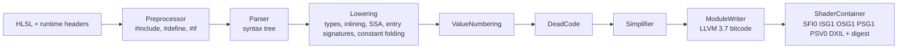

# DXIL backend

`src/FiveStar.Shaders/Dxil` compiles the translator's HLSL straight to a DXIL container, without dxc. dxc's optimizer
spends about 36 CPU-hours on a full translation, and the GPU driver optimizes the DXIL again when it builds a pipeline;
the backend writes plain SSA and leaves the optimizing to the driver. It compiles every stage the translator emits:
compute, pixel, vertex, mesh and geometry (including the rectangle-list geometry shaders of `shader rect-gs`).

```
fivestar shader translate <fssm> <out> --backend dxil        the backend, dxc for what it cannot lower
fivestar shader translate <fssm> <out> --backend dxil-only   no dxc at all (programs it cannot lower fail)
fivestar shader rect-gs <out> --backend dxil|dxil-only       the same for the rectangle-list geometry shaders
fivestar shader dxil <hlsl file or folder> [--out <dir>] [--validate] [--compare] [--stages cs,ps,vs,ms,gs]
                     [--jobs N] [--step K] [--limit N] [--repeat N] [--phases] [--ir <file>]
```

The loader compiles the programs it makes on demand with the backend by default, validated by dxil.dll, with dxc for
the rest ([programs on demand](d3d12x-pipelines.md#programs-on-demand)); `--backend dxil` validates the same way.

`dxil` compiles already translated HLSL (the stage is read from the entry point), checks each container with dxil.dll's
validator (`--validate`), and writes `<out>/dxil-backend.tsv` (name, characters, milliseconds, bytes, status, reason).
`--compare` also compiles each program with dxc and checks that the signatures are dxc's: ISG1, OSG1 and PSG1 byte for
byte except the inputs' read masks (dxc's optimizer drops some reads the backend keeps), the PSV0 elements field by field. `--repeat` times the last of N compiles (after JIT warm-up), `--phases` times
preprocess, parse, lower and write with the bytes each allocates and the GC pauses, `--ir` lists the IR of one program.

## Design

The translator's IR is its HLSL: emitters write statements as text and the runtime headers (`rdna_prelude.hlsli` and
the others) define the helpers they call. The backend is a compiler for that dialect, so the headers stay the one
definition of every helper (buffer range checks, the address map, the descriptor window, wave emulation) and the loop
guards are already in the code.



| Part | Folder | Notes |
|---|---|---|
| Preprocessor, lexer, parser | `Hlsl` | object-like macros only; casts need a known type name |
| Types, values, places | `Lowering` | every value is its flattened scalars; arrays live in memory (alloca, shared memory, constant tables) |
| SSA | `Lowering/SsaBuilder` | Braun et al.: definitions per block, phis at joins, trivial phis removed |
| Calls | `Lowering/FunctionInliner` | every call inlined (DXIL has one function); `return` jumps to the call's exit |
| Intrinsics | `Lowering/*Intrinsics`, `TextureLowerer`, `RawBufferLowerer` | as dxc's HLOperationLower: math, derivatives, wave and quad, barriers, atomics, raw buffers, textures |
| Entry points | `ComputeEntry`, `GraphicsEntry`, `MeshEntry`, `GeometryEntry`, `SignatureBinder` | thread ids; signature elements from the parameters and the returned struct |
| Module | `Ir` | types, interned constants, instructions, metadata; `ModuleWriter` writes the frequent function records in abbreviations |
| Container | `Container` | shader model 6.7, validator 1.7, PSV0 runtime info version 2; signatures packed as dxc packs them |

**Size.** The driver's compile of a pipeline grows with the DXIL it gets (about 54 s for a 1.27 MB mesh program on
the RTX 4090, 190 s for a 2.75 MB one), so the backend removes what the translator repeats. `IrBuilder` folds while
lowering (`ConstantFolding`): integer operations, comparisons and casts of constants, comparisons of a value with
itself, selects on a constant, and the integer identities; floating-point operations stay as written.
`ValueNumbering` then walks the dominator tree: a pure instruction (arithmetic, casts, compares, selects, extracts,
addresses, readnone `dx.op` calls, constant-buffer loads) equal to one in a dominating block is replaced by it, and one
that reads only constants and entry values moves to the entry, so the descriptor-heap handles each buffer access made
again in its own branch are made once; buffer and texture reads match only later in the same block with no write,
atomic or effectful call between; wave operations never match. `fivestar shader dxil --no-optimize` writes the
unoptimized form for comparison. VIctory reports about 43% fewer host instructions from the same kind of passes.

| Program (translated today) | DXIL before | after | instructions before / after |
|---|---|---|---|
| `CS_ShadowRenderTiledCascadesCBPPPC`, w32 form | 6.59 MB | 5.26 MB (-20%) | 545,280 / 312,315 |
| the same, native | 2.77 MB | 2.20 MB (-21%) | |
| `CS_ScreenProbes_ActivateProbes` | 13.39 MB | 9.98 MB (-25%) | |
| `MS_VS_TransformD`, w32 form | 2.65 MB | 2.04 MB (-23%) | |
| the same, native | 2.02 MB | 1.63 MB (-19%) | |

`Simplifier` follows (skipped by `--no-optimize` too), twice, each round cleaned by `DeadCode`. A block that only its
predecessor's unconditional branch reaches joins it (every inlined call and structured region ends in one); a branch on
a constant or to one block twice becomes unconditional, a phi of one value that value, and `ConstantFolding` folds
what that decides. Wave and quad reads (ballot, any, read-lane, active ops) are declared nounwind as dxc declares them,
so no pass removed them: one nothing reads goes, and one with the operands of an earlier one in its block, with no
effect between them (a discard or barrier may change the lanes), is that one. The translator's EXEC emulation makes
a ballot pair for every mask write and an any for every SCC, most never read.

| Program (translated today) | after `ValueNumbering` | after `Simplifier` | AMD RX 7800 XT pipeline |
|---|---|---|---|
| `CS_RaytracingResolve` (wave32) | 1.57 MB | 1.06 MB (-32%) | 36.5 s, 8.4 GB -> 26.2 s, 3.6 GB |
| `CS_ScreenProbes_ActivateProbes` (wave64) | 9.98 MB | 8.50 MB (-15%) | over 50 GB either way |

All five pass dxil.dll validation. What is left is mostly the wave emulation's control flow: in the cascade program
73,515 phis (about 6 operands each) and 124,610 blocks, which neither pass touches.

**Short-circuit evaluation.** `&&`, `||` and `?:` on scalars skip their later operands (HLSL 2021) unless those are
pure: no assignments, memory reads or wave operations, and calls only of arithmetic intrinsics and pure user
functions. Pure operands are computed and combined with `and`, `or` and `select`.

**SSA at joins.** Code is structured, so each join closes a region (if, switch, loop, inlined call) that starts at one
block. Writes are numbered in lowering order and a region is the span of numbers lowered inside it; a read at the
join of a slot with no write in that span continues at the region's start. Without this, a register read after N joins
made N phis and removed them again.

**Floating point.** Operations carry no fast-math flags, so the driver may not reassociate or contract them; dxc
compiles with fast-math by default.

**Digest.** `ContainerHash` is the modified MD5 D3D12 checks (`DxilContainerHash`): the bit count first in the last
block, `2 × bytes + 1` last. D3D12 and WARP accept the container without dxil.dll signing, and the validator computes
the same digest (`DxilContainerTests`).

**Root signature.** The same as for dxc's output (`docs/shader-translation.md`, Resources): `g_user4` at b0 space 0, everything else
through `ResourceDescriptorHeap` and `SamplerDescriptorHeap`; no RTS0 part.

## Signatures

A graphics entry point's signature elements are its parameters with a semantic, or the fields of a struct parameter,
and the fields of the struct it returns (mesh: the `out vertices` and `out primitives` element structs; geometry: the
input vertex array's element struct and the stream's vertex struct). Elements are numbered in that order.

| Signature | Registers |
|---|---|
| Vertex inputs | one row each, in order |
| Pixel outputs | `SV_TargetN` in row N; depth, coverage and stencil reference without a register |
| Every other signature | dxc's prefix-stable packing: each element in the first row and column it fits, in order |

In the packed signatures a row holds elements of one interpolation mode, and inside a row arbitrary values come before
system values, which come before system-generated ones (`SV_IsFrontFace`, a pixel shader's `SV_PrimitiveID`); clip and
cull distances get rows of their own. An element without a modifier is interpolated linearly when it is a float and
not at all otherwise; the position is never perspective-corrected, a primitive output never interpolated. The same
packing as dxc's matters: D3D12 links stages by register, and the translator's stage linker
(`Translation/StageLinker`) relies on it.

| Semantic | Read or written through |
|---|---|
| inputs | `loadInput` (geometry: with the vertex index); `GetAttributeAtVertex` becomes `attributeAtVertex` |
| `SV_SampleIndex`, `SV_Coverage`, `SV_InnerCoverage` (pixel), `SV_PrimitiveID` (geometry) | their own operations; in the signature without a register, or not at all (coverage) |
| outputs | `storeOutput` at the exit (geometry: at each `Append`, then `emitStream`; `RestartStrip` is `cutStream`) |
| mesh vertices, primitives, indices | `storeVertexOutput`, `storePrimitiveOutput`, `emitIndices` at each write; `SetMeshOutputCounts` |

The usage mask of each element is the components the module still loads or stores after dead-code removal.
ISG1/OSG1/PSG1 list the rows sorted by register (no register last) and then by name, each distinct name once; PSV0
lists the elements in order. The view-ID state (`dx.viewIdState` and the PSV0 dependency table) declares every output
dependent on every input, as VIctory does, instead of tracing the dependencies.

A pixel shader with `[WaveOpsIncludeHelperLanes]` gets the entry attribute of that name (shader model 6.7).

## Measurements

The dump's programs (structured form, wave emulation), on a 64 GB machine with other work running, so times are upper
bounds. Compile times of the backend are with server GC (the `fivestar` default): its IR lives until the program is
written, collections mark a large live graph, and server GC marks it on every core.

| | dxc -O3 | backend |
|---|---|---|
| All 2,689 compute programs | | all compile and pass dxil.dll validation (22 needed gathers with computed offsets to drop the advanced-texture-ops flag) |
| All 12,067 pixel, 2,192 vertex, 8,765 mesh, 195 geometry programs | | all lower; all pass validation but 46 mesh programs whose outputs exceed 32 KB, which dxc refuses as well |
| Compile time, every graphics program (4 jobs), median / p90 | | ps 30 / 231 ms, vs 9 / 68 ms, ms 66 / 313 ms, gs 6 / 21 ms; 2,513 s in all (6,378 s before server GC and the allocation work) |
| Signatures against dxc, every 60th graphics program (384) | | equal in every register and element; in 2 an input dxc's optimizer stops reading is still read |
| Compute compile time, 54-program sample, 4 jobs, wall | | 7 s (18 s before server GC and the allocation work) |
| Compute compile time, 54-program sample, one job, sum of steady-state compiles | | 9.7 s (18.1 s before) |
| Graphics compile time, 84-program sample (41 ps, 8 vs, 35 ms), 4 jobs, total / median | ps 46.2 s / 124 ms, vs 2.7 s / 120 ms, ms 300 s / 1.0 s | ps 5.9 s / 23 ms, vs 0.5 s / 24 ms, ms 12.9 s / 101 ms |
| DXIL bytes, the same sample | 12.8 MB | 17.9 MB |
| DXIL bytes, 54 compute programs | | 26.1 MB (34.8 MB with unabbreviated records) |
| RTX 4090 pipeline creation, 58 graphics programs (30 ps, 4 vs, 24 ms) | | all accepted |
| Loader, cold boot to 90 s, programs made on demand (compile host) | 129 made, 1,440 queued, 231k draws skipped | 385 made, 650 queued, 1,423 draws skipped |
| Loader, GC pauses in the logged slow frames of a cold boot | 1.5 s | 81 s in the loader process, 0.9 s with the compile host |
| Outputs on WARP against dxc -O3, real pixel programs | | 19 of 24 equal in every word; 1 differs between runs of the same form, 2 too large for the harness, 2 still in WARP's compiler after 30 minutes |
| Outputs on WARP against dxc -O3, real vertex programs (compute harness) | | 20 of 24 equal in every word, 3 equal to dxc -Gis (dxc's fast-math), 1 skipped |

Earlier compute measurements: on a 33-program sample dxc -O3 took 418 s, dxc -Od 305 s and the backend 83 s; RTX 4090
pipeline creation for 113 programs took 921 s from dxc's DXIL and 973 s from the backend's, so the driver's compile
takes about as long on either and the backend saves dxc's time without moving it into pipeline creation.

## Coverage

Not lowered: function-like macros, matrices, `StructuredBuffer`, typed `Buffer` loads, signature elements that span
several rows (arrays) and hull and domain stages. The translator emits none of these. A program that uses one fails
with the line and the reason, and `--backend dxil` hands it to dxc.

## Testing

`DxilContainerTests` builds a module by hand, validates it and runs it on WARP. The ISA-reference cases run through the
backend too: every compute and pixel case (`The_dxil_backend_computes_what_the_isa_defines`,
`The_dxil_backend_shades_what_the_isa_defines`), the vertex program with fetch inputs, the geometry program with strips
and cuts, the native and superstep mesh programs, and the real `GS_VoxelizeGeneric` programs. `DxilBackendDifferentialTests`
compiles real compute, pixel and vertex programs both ways (structured form, the differential harness's synthetic
inputs; pixel shaders drawn with their feeder, vertex shaders in their compute harness) and compares every output word
on WARP; the variables of the control-flow differential size it.

## Size of the superstep form

Across the corpus the backend writes 86 (pixel) to 225 (mesh) bytes of DXIL per RDNA instruction at the median; the
largest programs are large at the source (the screen-probe compute programs, 88,000 instructions, 12.8 MB). The
outlier is the superstep form of mesh programs (`VW_GROUP_LANES`, which the loader picks for a 64-lane program on
32-lane hardware): `MSNC_VS_PropFoliageSkinDeferred` is 2.07 MB of DXIL natively and 13.85 MB in that form from only 7%
more HLSL. The form's `while (pc < PC_WAVE) switch (pc)` dispatch has about 2,600 cases over a few hundred registers,
so the join after the switch and the loop header carry phis with thousands of operands each (13,900 phis, 321,000
instructions). `fivestar shader dxil --memory-locals N` (`DxilBackend.MemoryLocalsCases`, off by default) keeps
numeric locals and non-constant statics in memory when the entry point has a switch of N cases or more: 8.78 MB (37%
less, 1.2 million instructions, 15,000 phis), valid under dxil.dll; `DxilMemoryLocalsTests` checks a dispatch loop's
results on WARP both ways. The driver compile of the 13 MB form took about 20 GB.

The translator's superstep carry (`TranslationOptions.SuperstepCarry`, on by default; the loader's and `shader
translate`'s `--plain-supersteps` turn it off) removes the cause instead. Registers pass between
cases through slots (`Waves/SuperstepCarry`): from each case's reads and certain writes it computes which registers
are live at each case boundary, gives registers never live at the same boundary one slot, and has a case load the
slots it reads before writing and store what it touched that a later case reads; no register is then live at the
loop header. The cases also sit in a tree of switches of 8 by address, so a value one case writes is joined over its
leaf and up the tree. Foliage: 362 registers in 236 slots; 9.41 MB with the slots alone, 4.64 MB with the tree alone,
2.75 MB with both (native 2.07 MB). The RTX 4090 driver builds the 2.75 MB form's pipeline in 93 s at 6.4 GB peak
private memory, against about 20 GB for the plain form. On every 20th mesh and compute program of the corpus (440 superstep
forms) the carry cuts the DXIL from 354 MB to 149 MB: 45% less at the median, 30% at least, 81% at most; no form
grows. The compute superstep cases and the mesh superstep programs run on WARP with and
without it.

A register no case on a path from the entry has mentioned still holds its declared zero, so it is carried only from
where one may have: a case that reads it before then sets it to zero. VGPRs first written under EXEC (`if (active) v =
..`) read their old value and were carried from the entry. Over the 8,765 mesh programs the registers carried across
stops fell from 9,738,222 to 7,304,680 (the most at one stop from 269 to 246, slots from 842,082 to 813,444);
`MSNC_VS_PropFoliageSkinDeferred` (0468631e) from at most 151 at a stop to 46, `MS_VS_TransformTerrainNormalTint`
(0025c19f) from 156 to 116, `MSNC_VS_LinearDepthSkin_f1f2249c` from 151 to 150 (its VGPRs are written before its first
stop). The carry comment names the most: `// carry: R registers in S slots, at most M across a stop`.

## Open

- VIctory notes that the AMD driver hangs on divergent loops whose exiting block is not the latch; the backend folds
  empty blocks into their predecessors but has not been checked on AMD hardware.
- About 3 KB is allocated per written instruction (syntax trees, values, SSA tables); a struct IR would cut it further.
