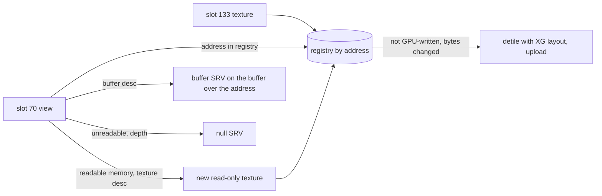

# Resources at console GPU addresses

On the console a texture is memory in the console tiling ([xg.md](xg.md)) at a GPU virtual address. The CPU fills
it (DirectStorage into the scatter-mapped streaming range, game copies), the GPU reads it through descriptors that
carry the address (device slot 70), and render targets and UAVs are written by the GPU. The PC GPU cannot read a
tiled texture from a heap over game memory (such heaps take row-major layouts only, [physical-memory.md](physical-memory.md)),
so the D3D12.X shim keeps a desktop texture per address and copies the memory into it. Buffers stay placed over the
game's pages ([d3d12x-shim.md](d3d12x-shim.md)). Code: `src/FiveStar.Loader/Shims/D3D12X/Resources`.

## Addresses

| Memory | GPU address | Where the CPU reads it |
|---|---|---|
| XMem pages (64 KiB, mapped by the game) | the mapped address | the same address |
| The streaming range | GPU-only alias range | the CPU range at the same offset |
| Memory the game committed (XMemVirtualAlloc with MEM_COMMIT) | the same address | the same address |

Translated programs reach buffer memory at these addresses (root descriptors, V#s and pointers the game builds)
through the address map of the buffers the shim placed there ([d3d12x-shim.md](d3d12x-shim.md#binding)).

The game reserves its 6 GiB streaming range twice: a CPU range (xmemFlags 0x21, PAGE_READWRITE, 0x141E6C1A6) and a
GPU-only range of the same size (0x3, PAGE_NOACCESS | PAGE_GRAPHICS_NOACCESS, 0x141E6C1CB). Pages are mapped only
into the CPU range (scatter mapping at 0x140F2CC3E); the address a texture's view carries is CPU address - CPU base
+ GPU base (0x144ECC8F0, bases at 0x149E1DAC0 and 0x149E1DAD0). The XMem shim pairs a GPU-only reservation with the
mappable CPU reservation of the same size made just before it (`XMemReservation.CpuView`); address lookups
(`XMemPhysicalMemory.TryLocate`, `CpuAddress`) go through the pair, so placed buffers at GPU-range addresses land on
the same pages.

## Textures

- **Registry** (`GpuTextureRegistry`): textures sorted by console address over the span of their XG layout; lookups
  take no lock. A texture registered over an overlapping range retires the old one. Of those over the same range (other
  views of the same memory, or a streaming slot reused) the newest keeps its reference until shutdown, since
  descriptors written earlier may still name it (`--kept-aliases <n>`, default 1; it was 2, a second texture of video
  memory per reused slot charged to commit, while a placed texture's heap range stays mapped after release anyway), and older ones are released 30 presents later; any other is
  released 8 presents later (the memory went to something else), and either only once every queue has finished the work
  it had submitted when the texture was retired (its shim fence), so no list still on the GPU can sample it. The grace
  was 600 and 120 presents without the fences; boot w36 held 4,905 retired textures, their video memory charged to
  commit, when commit reached its limit. Keeping them all was a leak: in the
  opening cutscene the game streams textures through the same memory, about 45,000 were made in 7 minutes, and once
  video memory was full the process grew by 2 to 3 GB every 30 s until the machine ran out.
- **Placed textures** (on by default, `--committed-textures` turns it off, `PlacedTextureHeaps`; a released texture's range stays mapped,
  so a stale read the game still makes hits memory, as on the console, instead of a freed resource: issue #23, and w28
  lost the device at 185 s without it while w29 ran 1,018 s into gameplay with it): read-only single-sample textures
  are placed in shared 256 MB default heaps (non-RT/DS textures only, every heap tier) instead of a committed resource
  each; the driver's write-combined system memory grew by about 0.55 MB per committed texture (22,000 textures, 17 GB
  by 275 s of a cold boot). A texture larger than 64 MB gets a heap of its own. A COM object set as the texture's
  private data gives its range back when the runtime destroys the texture; the registry's grace periods keep the GPU
  off a range before it is reused, and the upload writes the new texture whole before it is read. A shared heap empty for
  60 s goes back to the driver, past one kept for new textures (w36 held 58 heaps, 14.5 GB of commit); the sample line
  gives the heaps' size, the bytes in use and the heaps returned.
- **Slot 133** (`GpuTextures.CreatePlaced`): a committed desktop texture in its home state ([Barriers](#barriers)).
  With ALLOW_RENDER_TARGET, ALLOW_DEPTH_STENCIL or ALLOW_UNORDERED_ACCESS it is GPU-written and never filled from
  memory; otherwise it is filled at creation.
- **Slot 70** (`AddressShaderViews`): the registered texture at the view's address with the same extent and format
  (a GPU-written one with the same extent, whatever its format); else, when every byte of the desc's XG layout is
  readable, a new texture without RT/DS/UAV flags in PIXEL | NON_PIXEL_SHADER_RESOURCE, in the view's format when its
  element size equals the resource's. The SRV takes the view's format on a typeless texture and the texture's own
  otherwise (an invalid SRV desc removes the device). A view whose format another member of the texture's family would
  take (UNORM_SRGB on a UNORM target: the sRGB decode lost; UINT on UNORM or FLOAT: the integer reading lost) or one of
  another family (an alias of its bytes) is counted (`ViewCastLost`, `ViewReinterpretLost`) and each pair of formats
  named once. `--typeless-targets` (off by default, `TypelessTargets`) makes GPU-written R8G8B8A8, B8G8R8A8,
  B8G8R8X8 and R8 UNORM textures in their TYPELESS format so such views keep the game's member; a view the game makes
  without a desc on one gets the UNORM whole-resource desc.
- **Upload** (`GpuTextureUploader`): every subresource detiled by `XgCopier.From` into an upload buffer at the
  desktop's copyable footprint, copied on a private direct queue between transitions out of and back into the
  texture's state, waited for. The upload buffer is system memory, the GPU's non-local segment, whose budget is half
  the machine's physical memory (16.3 GB on a 32 GB machine), and the heaps over the game's XMem sections take from the same
  budget: the address map opens one over every mapped page's section ([d3d12x-shim.md](d3d12x-shim.md)), about
  6.2 GiB for the game's largest. On a 16 GB machine that left no room for the upload buffer, whose creation then
  threw on the game's thread and ended the process (0xE0434352, issue #13). A fill the desktop refuses, or whose copy
  does not finish, now fails without an exception: the texture keeps what it held (zeros when new) until its next refresh point, the
  counters count `UploadFailed` and the first eight are logged with the reason. The next fill makes a new upload buffer and queue.
- **Refresh points**: creation, and every slot-70 view of the texture. The game creates a texture's view once its
  data has arrived, so a view is where new bytes are taken. A 64-bit hash of the bytes skips unchanged memory.
- **CPU-mapped textures** (`GpuTextures.Watch`): a slot-133 texture the game maps (resource Map returns its memory)
  is written by the CPU whenever it likes; Bink decodes every video frame into its Y, Cr and Cb planes (1920x1080
  and 3840x2160 R8, mapped once). Such textures are checked once a frame, at the first ExecuteCommandLists after a
  present, and uploaded when the hash changed. Before this the planes kept the zeros of their creation.
- **GPU copies into a texture** (list slots 85, 86, `TextureCopies`) write only the desktop texture; on the console
  they write its memory. Such a texture is no longer refreshed from memory (`GpuTexture.CopiedInto`, counted as
  `UploadKeptCopy`), as victory-gta6 does. The 2048x2048 A8 glyph cache the controls hint samples (`FText`) is mapped,
  so the frame check re-uploads its memory whenever the CPU writes it; glyphs a copy had put there would vanish, which
  fits the missing letters ("M d" for "Move", *inferred*: the copies into it are not logged).
- **Buffer views** (`AddressBufferViews`): a slot-70 view with a buffer desc (or a texture desc without a format) is
  the game's desktop buffer SRV desc on the desktop buffer over the address (`XboxGameMemoryBuffers.TryFind`), its
  first element moved by the address's offset in that buffer; an address outside known memory, off the element size
  or past the buffer's end gets a null view.
- **Readability** (`GameMemorySource`): in an XMem reservation every 64 KiB page of the span must be mapped; elsewhere
  every byte must be committed and readable. Anything else gets no texture.

### Trade-offs and limits

- Change detection is explicit (creation, slot 70, a frame check of mapped textures), not watched: `MEM_WRITE_WATCH` does not apply to mapped
  views, and guard-page tracking would fault on every streamed page. CPU writes after the last view of a texture
  are not seen.
- Uploads are synchronous on their own queue and do not wait for the game's queues: a texture the GPU is reading in
  flight is overwritten without ordering.
- A descriptor that still names a released texture after its grace period, and is sampled, reads a released resource;
  the game rewrites its views when it reuses memory, so none has been seen.
- A texture the game mapped once stays checked every frame (a hash of its bytes); 12 in the intro video.
- XG layout spans larger than the game's own (128x1 A8 with 4 KB swizzle: 0x2000 computed, views 0x1000 apart)
  make neighbours retire each other.
- Depth-stencil (two-plane) textures are not uploaded; a slot-70 view of a desktop depth-format texture is null.
- GPU-written textures are not copied back to game memory; CPU reads of render targets see stale bytes, and
  resource Map on a slot-133 texture fails (default heap).

## Samplers

Slot 61 takes a 0x6c-byte desc (`ConsoleSamplerDescription`), filled by the game's only caller (0x1412B96B0, after
zeroing it) from a 0x2c-byte sampler state; `ConsoleSamplers` writes the desktop D3D12_SAMPLER_DESC.

| Offset | Field | Source in the game's sampler state | Desktop |
|---|---|---|---|
| 0x00 | 0 | | |
| 0x04 | mag filter | flags & 0x4 ? 1 : 2; 3 when flags & 0x40 | 1 point, 2 linear, 3 anisotropic |
| 0x08 | min filter | flags & 0x10 ? 1 : 2; 3 when flags & 0x40 | as above |
| 0x0C | mip filter | flags & 0x1 ? 2 : 1 | |
| 0x10 | unknown | flags & 0x4 ? 2 : 1 | not used |
| 0x14 | filter mode | table 0x146172FA0 [flags >> 7] | 1 MINIMUM, 2 MAXIMUM reduction |
| 0x18, 0x1C, 0x20 | address U, V, W | bytes 1, 2, 3 | D3D12_TEXTURE_ADDRESS_MODE, WRAP when out of range |
| 0x24, 0x28 | min, max LOD | floats at +0x1C | |
| 0x30 | mip LOD bias | float at +0x4 | |
| 0x34 | max anisotropy | byte 8 & 0x1F | clamped to 1..16 |
| 0x40 | comparison | byte 9 when flags & 0x80, else 1 (NEVER) | not NEVER: comparison reduction |
| 0x44 | border color | 4 floats at +0xC | |

The flags are the word at +0xA of the game's state.

## Barriers

Slots 127 and 133 take a D3D12_BARRIER_LAYOUT (3 UNORDERED_ACCESS and 6 SHADER_RESOURCE in the boot). The game's
barriers are enhanced barriers, flushed through list slot 146 ([d3d12x-shim.md](d3d12x-shim.md#command-list)); it
writes no barrier packet inline. It clears render targets it created in UNORDERED_ACCESS and draws to one created in
SHADER_RESOURCE. Code: `src/FiveStar.Loader/Shims/D3D12X/States`.

- **Home state.** Every desktop resource is created in, and rests between command lists in, a legacy state recorded on
  its wrapper (`ResourceStates`): textures with ALLOW_DEPTH_STENCIL in DEPTH_WRITE, with ALLOW_RENDER_TARGET in
  RENDER_TARGET, with ALLOW_UNORDERED_ACCESS in UNORDERED_ACCESS; other textures in the state the game asks for
  (layouts through `BarrierLayouts`), COMMON when that is a write state without its flag; buffers as asked (COMMON
  on game memory, promoting and decaying implicitly).
- **List slot 26** (ResourceBarrier, desktop D3D12_RESOURCE_BARRIER array, *inferred*). A transition of a texture the
  shim created goes from the state the texture is in on this list (home, or where an earlier barrier moved it) to the
  game's after-state; the game's before-state is ignored. Buffer transitions become UAV barriers. Resources the shim
  did not create keep the game's states. Aliasing and UAV barriers pass with resources unwrapped. Split barriers:
  the end half transitions.
- **List slot 146** (Barrier, D3D12_BARRIER_GROUP array) becomes the same legacy barriers: a texture barrier that
  changes the layout moves the texture to the state of its LayoutAfter (`BarrierLayouts`, the DIRECT_QUEUE_ and
  COMPUTE_QUEUE_ layouts included) as slot 26 does; one that keeps the layout is a UAV barrier when either access has
  UNORDERED_ACCESS, else nothing; LayoutAfter UNDEFINED is nothing. A buffer barrier is a UAV barrier on the buffer,
  a group of global barriers one UAV barrier on every resource (null resource).
- **Close (list slot 9)** moves every texture the list moved back home, so lists execute in any order.
- **Present** copies the plane from its home state to COPY_SOURCE and back.
- Barriers are legacy ResourceBarrier calls. Desktop enhanced barriers would need resources created with layouts:
  the debug layer refuses them on a texture created with a legacy state unless it is in COMMON at the list boundary
  (error #1350). A 45 s boot under the debug layer reports no barrier or resource-state error.

Without the debug layer's GPU-based validation a texture written as a UAV while resting in RENDER_TARGET (a render
target the game also writes from compute) is not reported; the GPU may then see stale compression.

## Depth formats

The console's D16_UNORM_S8_UINT (118) and its plane views R16_UNORM_X8_TYPELESS (119) and X16_TYPELESS_G8_UINT
(120) have no desktop form (`DepthFormats`, `DepthViewDescriptions`):

| Console | Resource | DSV, clear value, pipeline DSVFormat | SRV |
|---|---|---|---|
| 118 | R32G8X24_TYPELESS (19) | D32_FLOAT_S8X24_UINT (20) | R32_FLOAT_X8X24_TYPELESS (21) |
| 119 | 19 | unchanged | 21 |
| 120 | 19 | unchanged | X32_TYPELESS_G8X24_UINT (22) |

A null-desc DSV or SRV of a resource in format 19 gets the whole-resource 2D (array) view in 20 or 21; slot-70 views
take the SRV column.

## Render-target formats

The console renders to 16-bit color formats a desktop GPU may lack (TargetFormats, FormatSupport; on the RTX test
machine B4G4R4A4_UNORM has no render-target support and B5G5R5A1_UNORM no typed UAV). When CheckFeatureSupport reports
either missing for B5G6R5_UNORM (85), B5G5R5A1_UNORM (86) or B4G4R4A4_UNORM (115), every texture of that format with
ALLOW_RENDER_TARGET or ALLOW_UNORDERED_ACCESS is made R8G8B8A8_UNORM (28), and the rest follows:

| Where | Answer |
|---|---|
| Allocation info (slots 25, 108) | the console format without ALLOW_RENDER_TARGET: the console format's footprint (B4G4R4A4: 2 bytes a texel), which the game lays out its memory with; the desktop texture is committed apart (slots 27, 127, 133) |
| Resource creation (27, 29, 30, 127, 133) and clear values | the substitute |
| RTV, UAV, SRV descs (18 to 20) in the console format on such a texture | the substitute (TargetViewDescriptions); slot-70 views take the texture's format |
| Pipeline RTVFormats | the substitute, by the same check, so pipelines and targets agree |
| A texture read from memory (no RT/UAV flag, slot 70) | the console format, filled from the game's bytes |
| Copyable footprints (38) | the substitute's (copies go to the desktop texture) |

Shaders read the same normalized RGBA; values keep 8 bits where the console stores 4 or 5, so blends and repeated
writes are not quantized as on the console. A view of a substituted B5G6R5 texture reads alpha as 1 (component
mapping). A copy between a substituted texture and a texture of the console format read from memory would mix
formats; none was seen.

## Unknown
- Whether list slot 26 is ResourceBarrier (the exe has no call; the FSR DLL's global UAV barrier through it fits).
- How the console treats a texture barrier's subresource range other than all subresources (the shim moves the
  whole texture).
- Whether every GPU-only reservation aliases the CPU reservation before it; only the streaming pair is confirmed.
- The slot-70 view desc's +0x3C (3 or -4 from a texture flag) and the sampler desc's +0x10 and +0x14.
- Whether DirectStorage completion or the game's copy calls should refresh textures without a new view.
