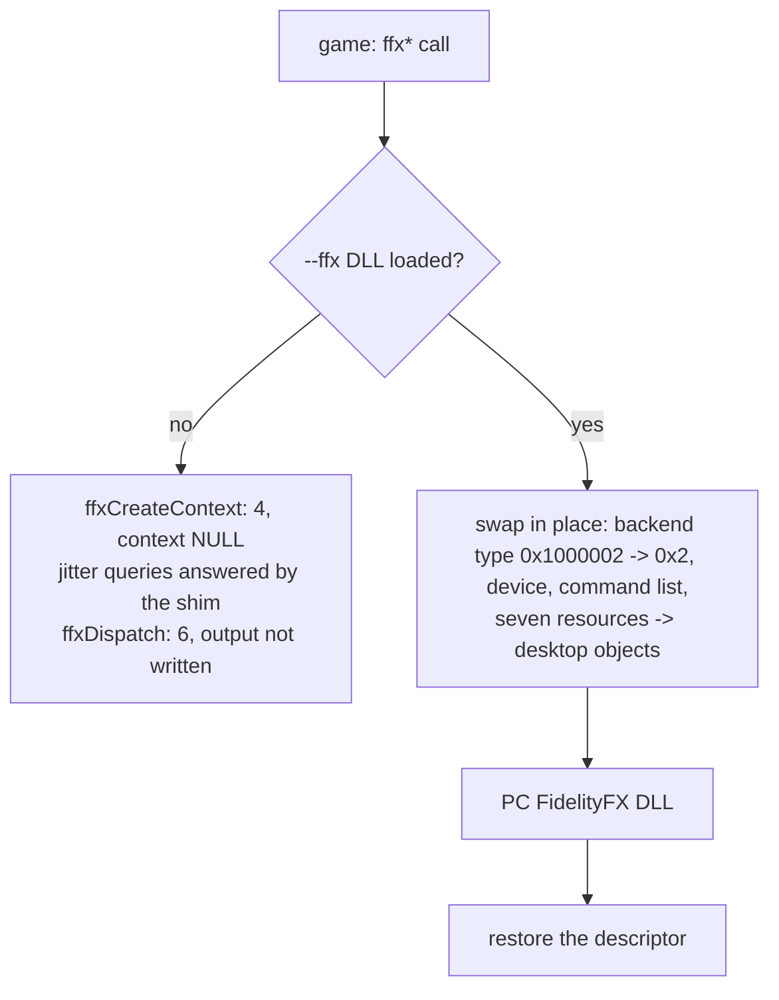

# Middleware

The package ships two middleware DLLs the executable imports: the FidelityFX API loader and Bink 2. Addresses are in
`game_scarlett_master.exe` at image base 0x140000000, or in the named DLL at 0x180000000. Facts read from the
disassembly; the Unknown section lists what is not confirmed.

## FidelityFX

### What the game calls

The executable imports `ffxCreateContext`, `ffxDestroyContext`, `ffxDispatch` and `ffxQuery` from
`amd_fidelityfx_loader_xbox.dll` (thunks at 0x145f3ff90..0x145f3ffc0). Every call comes from one upscaler object, a
static at 0x147b98e08 with vtable 0x146300b50; its context handle is at +0x128.

| Call site | Function | Descriptor type | Contents |
|---|---|---|---|
| 0x1428ef2cc | ffxCreateContext | 0x10000 upscale | flags, maxRenderSize and maxUpscaleSize from +0xF8, no message callback; allocator NULL |
| | chained | 0x1000002 console D3D12 backend | the D3D12.X device (global 0x148759d00) at +0x10 |
| | chained | 0x1000B upscale version | 0x1001001 |
| 0x1428ef30f | ffxQuery | 0x10004 jitter phase count | render width, display width, out at +0x10C |
| 0x1428ef625 | ffxQuery | 0x10005 jitter offset | frame index, phase count, out x, out y |
| 0x1428f0651 | ffxQuery | 0x10008 GPU memory usage | out (two UINT64) |
| 0x1428f03db | ffxDispatch | 0x10001 upscale | the graphics context's D3D12.X command list (+0x127C8), seven resources of 0x30 bytes, jitter, sizes, sharpening, frame time, pre-exposure 1.0, reset, camera |
| 0x1428ef512 | ffxDestroyContext | | allocator NULL |

The layouts of 0x10000, 0x10001, 0x10004 and 0x10005 match `ffx_upscale.h` of the public FidelityFX SDK. Frame
generation (types 0x2xxxx/0x3xxxx) is never created.

**The result of ffxCreateContext is not checked.** The game queries the phase count next and later computes
`frame % phaseCount` (0x1428f03e8, `div`); the phase count field starts at 0, so a failed creation without an answered
query divides by zero.

**When the game uses it.** The upscaler factory 0x1407e93b0 returns this object for kind 7 and another one (0x147b99040)
for kind 6. The selector 0x1407e93f0 returns 7 only when the console type is 6 (the GDK's inline device-type read,
0x1455deb88: 0x60 in the registry maps to 6, XboxScarlettLockhart, Series S) and bit 0x40 of a value from 0x1456dcf00
is set. The read uses `RegOpenKeyW`/`RegQueryValueExW` directly, not `XSystemGetDeviceType`; without the console key it
returns 1 (PC). So on a PC the game takes the kind-6 path and never calls FidelityFX unless something forces kind 7.

### The console DLLs

`amd_fidelityfx_loader_xbox.dll` (AMD FidelityFX (Xbox) Loader Library 1.0.2.0) routes by the effect byte of the
descriptor type (`type & 0xFF0000`) and loads the provider on first use with `GetModuleHandleA`, then `LoadLibraryA`:

| Effect | Provider | In the package |
|---|---|---|
| 0x01 upscale | `amd_fidelityfx_upscaler_xbox.dll` | yes |
| 0x02, 0x03 frame generation, swapchain | `amd_fidelityfx_framegeneration_xbox.dll` | no |

Without a provider it returns 2 (unknown descriptor type) from ffxCreateContext and 4 (no provider) from ffxQuery and
ffxConfigure; a null context or descriptor gives 6. It imports nothing console-only.

`amd_fidelityfx_upscaler_xbox.dll` is FSR 4 (the ML upscaler, `fsr4_model_v07_fp8_*` passes) built for one shipping
configuration: 1920x1080 output, the Quality ratio, HDR, inverted depth and auto exposure; other flags are rejected
with a "Shipping FSR4 configuration mismatch" message. Its shaders are DXBC containers whose `ACCC` part holds
console-compiled code, created through the D3D12.X device method `DeserializeComputePipelineStateX`. It imports
`d3d12_xs.dll!D3D12CreateRootSignatureDeserializer` and `xmem.dll`; everything else goes through the device it is
given. It does not run on a PC: the D3D12.X device shim has no pipeline deserializer and the code is console GPU code.

### On the PC

The loader binds the four imports (and `ffxConfigure`) to its own shim, `Shims/Ffx/FidelityFxBridge`, so neither
console DLL is mapped for the executable.

- `--ffx <dll>` names a PC FidelityFX API DLL (DX12). It is loaded with `LoadLibrary`; a missing file, a failed load
  or a missing export is logged and leaves FidelityFX off.
- With it, calls are forwarded. In the create chain the console backend descriptor (0x1000002) becomes
  `FFX_API_CREATE_CONTEXT_DESC_TYPE_BACKEND_DX12` (0x2) with the desktop device; in an upscale dispatch the command
  list and the seven resource pointers become the desktop objects. The descriptor is put back after the call. Other
  dispatch types return 2.
- Without it, ffxCreateContext returns 4 and leaves the context NULL; ffxQuery answers the phase count
  (`int(8 * (display / render)^2)`, at least 1), the jitter offset (Halton bases 2 and 3 at `index % count + 1`, minus
  0.5) and zero GPU memory; ffxDispatch returns 6 and logs once. The game therefore keeps running, but the upscaled
  output texture is not written.
- The device, command list and resources are unwrapped through `IDesktopObjectResolver`, implemented by the D3D12.X
  shim's `XboxObjectResolver` over `XboxObjects.Unwrap` ([d3d12x-shim.md](d3d12x-shim.md)).

**What the user supplies.** Nothing to run the game: the PC path does not use FidelityFX. To force FSR, the DX12 API
DLL of the AMD FidelityFX SDK (GitHub, GPUOpen-LibrariesAndSDKs/FidelityFX-SDK, the signed prebuilt DLLs of a
release: `amd_fidelityfx_dx12.dll` in SDK 1.1, `amd_fidelityfx_loader_dx12.dll` with its provider DLLs beside it in
SDK 2). The SDK source is MIT; the repository bundles none of it.

## Bink 2

### What the game calls

The executable imports 23 functions from `Bink2Scarlett.dll`: open (`BinkOpenWithOptions`), `BinkClose`, frame
stepping (`BinkDoFrame`, `BinkDoFrameAsyncMulti`, `BinkDoFrameAsyncWait`, `BinkNextFrame`, `BinkWait`,
`BinkShouldSkip`, `BinkGoto`, `BinkGetKeyFrame`, `BinkPause`, `BinkSetWillLoop`, `BinkSetVolume`), frame buffers
(`BinkGetFrameBuffersInfo`, `BinkRegisterFrameBuffers`), the async threads (`BinkStartAsyncThread`,
`BinkRequestStopAsyncThreadsMulti`, `BinkWaitStopAsyncThreadsMulti`), `BinkGetPlatformInfo` (codes 0x400 and up:
async-thread information), `BinkSetMemory`, `BinkSetOSFileCallbacks`, `BinkSetSoundSystem` and `BinkFreeGlobals`.

- Decoding is on the CPU into frame buffers the game registers; the game draws the planes itself. The GPU-assisted
  path (`BinkGetGPUDataBuffersInfo`, `BinkRegisterGPUDataBuffers`) is exported but not imported.
- `BinkSetSoundSystem` gets the game's own open function (0x145f172c0, argument 0, call at 0x14442fcf9), not Bink's
  `BinkOpenXAudio2`; Bink's own XAudio2 path (`XAudio2Create(&engine, 0x400, 1)` at 0x18000b8c4) is unused.
- Files go through the game's callbacks (`BinkSetOSFileCallbacks`) and memory through `BinkSetMemory`.

### Import resolution

Of the DLL's 60 imports: `XMemAlloc` and `XMemFree` bind to the xmem shims, `CreateFile2` and
`AddVectoredExceptionHandler` to the loader shims, five `VCRUNTIME140.dll` functions to the shipped runtime, and the
rest to System32 (`XAudio2_9.dll` ordinal 1 is `XAudio2Create` there too). No `d3d12_xs`, `xg_xs` or other
console-only import. The loader tests load it with every import resolved.

`BinkUtilCPUs` returns 7. Bink's thread start (0x180023a8b) sets an ideal processor and can pin the thread with
`SetThreadAffinityMask(1 << n)`, n taken from the thread number the game passes (*inferred*); the result is not
checked, so on a PC with fewer logical processors the thread runs unpinned. `docs/loader.md` has a patch that raises
the CPU count.

**Recommendation.** Run the shipped `Bink2Scarlett.dll` under the loader. It needs no PC Bink DLL and no new shims.
Bink is proprietary: the repository never bundles or replaces it.

## Unknown

- The meaning of bit 0x40 of the value from 0x1456dcf00 and of the override byte 0x147b98468 in the upscaler
  selector; whether any PC configuration reaches kind 7.
- Whether the type id of the PC backend descriptor (0x2) and of `ffxCreateContextDescUpscaleVersion` (0x1000B, value
  0x1001001) match the PC SDK the user supplies; the console upscaler accepts versions 0x1000000 to 0x1001001.
- Whether a PC FSR provider accepts the console's create flags (the value built from the bytes at +0x145..+0x148).
- The D3D12.X command-list recording slots, so a forwarded dispatch records on the desktop list the game also uses.
- The descriptor type 0x10009 the console upscaler also reads a device from.
- What the game's Bink sound open function (0x145f172c0) does on the PC audio path.
