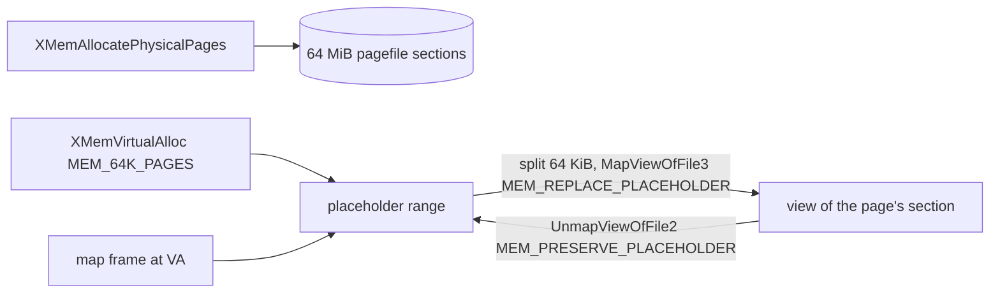

# Physical memory

The console lets a title own physical pages and map them into address space it reserved: `xmem.dll`
`XMemVirtualAlloc`, `XMemAllocatePhysicalPages`, `XMemMapPhysicalPages`, `XMemMapPhysicalPagesScatter` and
`XMemFreePhysicalPages`. The loader reproduces this with Windows placeholders and pagefile-backed sections, so a page
mapped at two addresses is one page and a remapped page keeps its contents. Code: `src/FiveStar.Loader/Shims/XMem*.cs`.

## Signatures

Source: **GDK** is the public GDK reference, **winnt.h** the Windows SDK header, **call sites** the game executable.

| Function | Signature | Source |
|---|---|---|
| `XMemVirtualAlloc` | `PVOID (PVOID address, SIZE_T size, DWORD allocationType, uint64 xmemFlags, DWORD protect)` | GDK overview: VirtualAlloc's parameters plus an XMem flags field; order and widths from 23 call sites |
| `XMemAllocatePhysicalPages` | `BOOL (DWORD flags, ULONG_PTR* count, ULONG_PTR* frames)`; `*count` returns the number allocated | call sites (the game frees and fails when `*count` comes back short) |
| `XMemFreePhysicalPages` | `BOOL (ULONG_PTR count, ULONG_PTR* frames)` | call sites |
| `XMemMapPhysicalPages` | `PVOID (PVOID address, ULONG_PTR count, PULONG_PTR frames)`; NULL on failure; a NULL array unmaps and keeps the reservation; mapped pages are replaced | GDK |
| `XMemMapPhysicalPagesScatter` | `BOOL (PVOID* addresses, ULONG_PTR count, PULONG_PTR frames)`; a NULL array unmaps all, a 0 entry unmaps one | GDK; the game breaks into the debugger on FALSE |
| `XMemGetWorkingSetStatistics` | `BOOL (DWORD workingSetFlags, XMEM_WORKING_SET_STATISTICS* statistics)` | GDK |

A physical page is 64 KiB (GDK). Entries of a frame array count 4 KiB frames: the game turns one into a page index
with bits 4..35 and stores indices in 21-bit fields, so the loader hands out multiples of 16, never 0, below 2^25.

## Flags seen in the executable

`allocationType` and `protect` bits are named in winnt.h: MEM_64K_PAGES is MEM_LARGE_PAGES | MEM_PHYSICAL
(0x20400000); PAGE_GRAPHICS_NOACCESS 0x800, _READONLY 0x1000, _READWRITE 0x2000, _EXECUTE_READ 0x8000, _COHERENT 0x20000 and
_NOCACHE 0x40000 are the GPU's view; PAGE_WRITECOMBINE is 0x400. `xmemFlags` and the page-allocation `flags` are not public.

| Site | allocationType | xmemFlags | protect | Then |
|---|---|---|---|---|
| 0x141E86400 | 0x42000 MEM_RESERVE \| MEM_RESERVE_PLACEHOLDER | 0x7 | 0x1 | splits it with `VirtualFree(MEM_RELEASE \| MEM_PRESERVE_PLACEHOLDER)` into five pieces |
| same | 0x20406000 MEM_RESERVE \| MEM_REPLACE_PLACEHOLDER \| MEM_64K_PAGES | 0x27 | 0x1004, 0x1404, 0x8404, 0x2404, 0x2004 | allocates pages (flags 0x280) and maps each piece |
| 0x141E6C110 | 0x20402000 MEM_RESERVE \| MEM_64K_PAGES | 0x21, 0x3, 0x23 | 0x4, 0x801, 0x2004 | pages with flags 0x380; the 0x21 range is filled by `XMemMapPhysicalPagesScatter` at 0x140F2CB60 |
| 0x141E1CFE0 | 0x20402000 | 0x21, 0x3 | 0x4, 0x801 | as 0x141E6C110 |
| 0x141D6E600, 0x145BA6C10 | 0x20403000 MEM_RESERVE \| MEM_COMMIT \| MEM_64K_PAGES | 0x181 | 0x4 | used directly |
| 0x142478640 | 0x20401000 MEM_COMMIT \| MEM_64K_PAGES, address 0 | 0x283 | 0x42404 | used directly |
| 0x14193E1A0, 0x141E1D168..0x141E1D4BD | 0x20003000 MEM_RESERVE \| MEM_COMMIT \| MEM_LARGE_PAGES | 0x283, 0x183 | 0x2004, 0x2404, 0x22004 | used directly |

## Mapping

- **Pages** (`XMemPageStore`): sections of 1024 pages (or a multiple, for a larger request) made with
  `CreateFileMapping2(SEC_COMMIT)` as pages are first needed. A request for one page takes a freed page first; a
  request for several takes fresh consecutive pages of one section (a group, `XMemPageGroup`), and which page backs
  which of its frames is decided at the frame's first mapping: the page at the mapped address's offset from the
  origin of the group's first mapping, the start of the game placeholder the reservation was split from. So the GPU
  pool the game maps from one allocation, later piece first (0x141E86400), lies in address order in one section,
  and the D3D12 shim places one buffer over it. The store keeps a read-write view of each whole section; freed pages
  are zeroed through it.
- **Reservations** (`XMemReservation`): MEM_64K_PAGES without MEM_COMMIT is a placeholder from
  `VirtualAlloc2(MEM_RESERVE_PLACEHOLDER)`, or the game's own placeholder piece when MEM_REPLACE_PLACEHOLDER is set.
  Mapping splits the 64 KiB slot off (`VirtualFree(MEM_RELEASE | MEM_PRESERVE_PLACEHOLDER)`) and replaces it with a
  view; a remap unmaps the old view first. Unmapping a whole reservation through `XMemMapPhysicalPages` merges it back
  into one placeholder (`MEM_COALESCE_PLACEHOLDERS`).
- **GPU aliases**: a GPU-only reservation (PAGE_NOACCESS plus PAGE_GRAPHICS_* bits) of the same size as the
  CPU-accessible mappable reservation made just before it is that range's GPU alias: the game maps pages only into
  the CPU range and addresses the GPU at the same offset in the alias ([gpu-resources.md](gpu-resources.md)).
  `TryLocate` and `CpuAddress` resolve alias addresses to the CPU range.
- **Other types**: MEM_RESERVE_PLACEHOLDER makes a placeholder for the game to split; everything else goes to
  `VirtualAlloc` (or `VirtualAlloc2` with MEM_REPLACE_PLACEHOLDER) with MEM_RESERVE/MEM_COMMIT and the low protection
  byte.
- **Protection**: a view is read-only when the reservation's CPU protection is PAGE_READONLY and read-write
  otherwise, including GPU-only ranges (0x801), which the D3D12 shim reaches through the CPU. Cache attributes cannot
  differ between views of a section and are dropped; the console also refuses aliases with differing cache attributes.
- **Threads**: allocating and freeing pages lock; mapping does not lock or allocate. Reservation lookup reads a sorted
  array that is replaced on each new reservation.

The game frees reservations with its own `VirtualFree` import, which the loader does not see; a new reservation drops
every table entry it overlaps.

## The streaming pool

A boot allocates pages three times: 11,360 and 2,960 pages with flags 0x280 (the GPU pool of 0x141E86400) and 99,776
pages with flags 0x380 (6.1 GiB) right before a reservation of exactly that size (flags 0x23), into which the pool is
mapped first, so its frames bind in address order. The game then maps pool pages again, one call per page
(`XMemMapPhysicalPages`, about 57,000 calls in the ten seconds after the pad pairs), into a second 3.5 GiB reservation
where its resources live. There a resource's pages are whichever pool pages the game picked: consecutive frames on
the console are not needed, since its GPU translates every 64 KiB page. A slot-133 buffer there whose pages are not
consecutive in the section is several desktop buffers ([d3d12x-shim.md](d3d12x-shim.md#game-memory-on-the-gpu)); no
binding of frames to section pages can make both reservations contiguous, and the desktop refuses tile mappings onto
these heaps.

DirectStorage writes into the streaming heap by page list: a request with option bit 0x200000 (0x144ffd6bc) has as
destination a pointer into the game's page table, one frame number per 64 KiB page (0x144ffd8c0), and the byte
offset into the first page in the 16-bit field at request offset 0x10. `PhysicalPageSink` copies the data into those
frames through the store (`XMemPhysicalMemory.WriteFrames`).

**CopyPageMappingsBatchX (queue slot 31).** The game also remaps pages through the queue:
(count, batches, pool, pool pages, flags), call at 0x140f2cc7f. VIctory named the method and the layouts. A batch is
(destination, range count, ranges), and a range is (kind, start page, count) in 64 KiB pages:

| Kind | Mapping |
|---|---|
| 0 | pool pages from start, in order |
| 1 | pool page start at every page |
| 2 | unmapped |
| 3 | unchanged |

On the console the remap is queue work, after the queue's earlier work. `QueuePageMappings` waits until the desktop
queue has finished everything submitted so far (its shim fence), then remaps on the CPU
(`XMemPhysicalMemory.CopyPageMappings`) before the call returns. Until then the slot was a stub, and the destinations
kept their old pages.

The address map that translated programs reach game memory through follows the page tables, as the console GPU's
do: every map, remap and unmap (this one, `XMemMapPhysicalPages` and the scatter form) points the page, where the GPU
addresses it (its GPU-only alias when it has one, else its CPU address), into views over the section that holds its
frame now, or at the null views ([shader-translation.md](shader-translation.md#resources)). Programs therefore read
and write the frame the CPU sees. That includes pages under a slot-133 buffer that had no mapped page when it was made
(a committed buffer of its own): once the game maps pages there, programs reach them while desktop views and copies
on the resource keep its committed memory.

GPU limit: desktop buffers placed over the pages when a slot-133 resource was created keep the pages of that moment,
and so do the desktop views, copies and indirect arguments made on them. A later remap is seen by the CPU, by the
address map and by resources created after it, not by those. Once the old frame is mapped again at another address,
GPU writes through such a buffer change the memory there: a copy into the buffer reaches the other address and not
the buffer's own (RTX 5070 and the loader tests). The loader reports both (`StaleGpuPages`, always on): a remap or
unmap under a buffer of the address table as `[gpu pages]` with the GPU and CPU addresses and both frames, and the old
frame mapped again with the address the buffer's writes now land at; the first 16 of each in full, then totals at
every power of two.

## Working set statistics

The structure is 0x78 bytes (callers zero that much). One caller (flags 0x20000001) takes qword 0 minus qword 1 and
compares it with 100 MiB, so the pair is total and used. The loader writes total = resident set + free physical
memory and used = resident set; everything else is zero. The other caller (flags 0x2000000A, reached only when
`XMemIsToolsMemAvailable` returns non-zero) reads qwords 2 and 3 and dwords +0x48 and +0x4C.

## GPU visibility

On the console a mapped page has the same address for the GPU and the CPU. The D3D12.X shim cannot keep that on PC
but can give the GPU the same memory:

- Open the store's whole view of each page section as a heap with `ID3D12Device3::OpenExistingHeapFromAddress`
  (`OpenExistingHeapFromFileMapping` rejects the pagefile sections). The view of a section over 1 GiB is refused
  (E_INVALIDARG for the 6 GiB pool), so such a section takes a heap per 1 GiB window, each through its own view
  (`SectionHeaps`, shared by slot-133 buffers and the address map); a buffer or view stays inside one window.
- Budget: these heaps live in the GPU's system-memory segment (DXGI non-local), whose budget is about half the
  machine's RAM whatever the card has: about 8 GB on a 16 GB machine, which the 2.2 GiB game heap and the 6.1 GiB
  pool exceed (E_OUTOFMEMORY, issue #13). A window opens only while it fits the budget less the process's use and
  768 MiB of headroom (and `--section-heap-budget <GB>`); the address map's requests leave 1 GiB of that to slot-133
  buffers. A section that does not fit whole is backed lazily in 64 MiB windows, opened by the first map or buffer
  request there. Pages without a heap read as zeros and wait: when a window opens (a buffer placed there), the address
  map points them at it. A buffer without a heap gets a committed buffer that is not shared with the game. Heaps are
  never released: GPU work in flight and descriptors may still reach them.
- `--evict-windows` (prototype, off by default; programs made on demand): on a 16 GB machine the budget is 6.7 GiB,
  less than the 6.1 GiB pool plus the 2.2 GiB game heap, so the pool's windows become a cache. The CPU cannot know
  which windows a frame reads (programs follow V#s and pointers through the address map), so the GPU says: a waiting
  page's map entry holds the null views and `0x80000000 | window id`, and `gpu_page` (FIVESTAR_WINDOW_FEEDBACK) sets
  that window's flag in the descriptor window. At the first submission of each present `WindowResidency` reads the
  flags, opens up to 8 asked-for windows that fit, and otherwise releases the open windows asked for least recently
  (not within 30 presents; never one a slot-133 buffer pins): their pages wait again at once, and their views and
  heap go 8 presents later, when the frame throttle has the GPU past them. A window opens one frame after it was
  first read, so that frame reads zeros. The game's own allocations open by the 64 MiB window around the first
  address the GPU is given (`OpenExistingHeapFromAddress1`, ID3D12Device13; whole without it); those windows hold
  addresses recorded into command lists, so they are not released.
- Translate a game address with `XMemPhysicalMemory.TryLocate` to (section, offset), then to the GPU address of a
  buffer placed over that heap (`CreatePlacedResource`) plus the offset. Contiguity ends at each 64 KiB page unless
  the frames are consecutive in one section.
- A reserved resource with `UpdateTileMappings` onto these heaps is refused (the runtime: no tile mappings on
  cross-adapter heaps), so scattered pages cannot be stitched into one GPU range this way.
- Limits: heaps opened from a file mapping are system-memory (CPU-visible) heaps read over PCIe; textures in them
  are restricted to row-major layouts, so tiled console textures need a copy into a default heap.

The game calls the device right after mapping (vtable +0x250 with the address and page count at 0x141E6C2BB,
+0x428 after the five pieces at 0x141E8684C); these are the hooks for registering the memory with the GPU.

## Unknown

- The meaning of `xmemFlags` and of the page-allocation flags (0x180, 0x280, 0x380); whether pages must be physically
  contiguous; mapping into 2 MiB (MEM_LARGE_PAGES) reservations, which take one frame per 32-page cluster and are
  not supported here.
- The working-set structure beyond its first two qwords, and the 0x20000000 flag bit.
