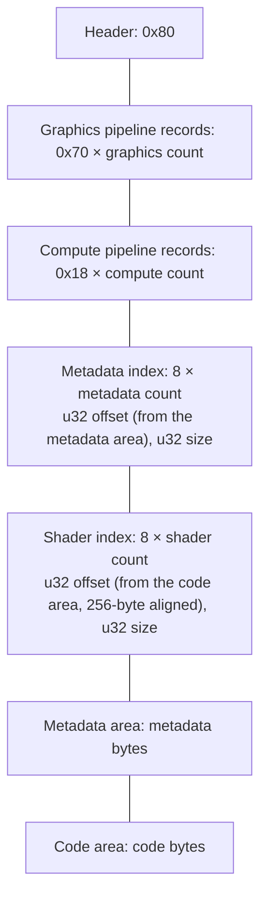
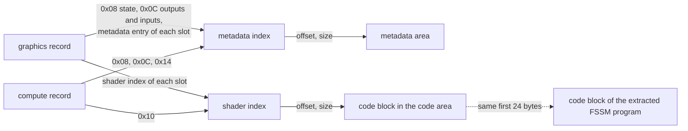

# Pipeline cache

Besides its SGD5 tables ([shader-containers.md](shader-containers.md)), `shaders.rpf` holds one more entry: the game's
cache of compiled pipelines. It names the shaders of every graphics and compute pipeline
the game builds, the output formats and vertex input layout of each graphics pipeline and the root-signature bindings
of each shader, and holds the driver's final machine code. The game loads it as its `.d3d12PipelineCache` and creates
pipelines from it through device slots 57 and 67 ([d3d12x-pipelines.md](d3d12x-pipelines.md)). Code:
`src/FiveStar.Shaders/Cache`.

The entry is an ordinary RPF9 chunk run ([archives.md](archives.md)): the first aligned zlib stream whose output starts
with `PS 00 09`, read until the size the header gives. In the reference dump it starts at archive offset 0x10579000
and is 275,540,780 bytes long (4205 chunks).

All integers are little-endian.

## Layout

The sections follow each other without padding:



How the records reach their data:



### Header

| Offset | Size | Field | Reference dump |
|---|---|---|---|
| 0x00 | 4 | `PS 00 09` | |
| 0x04 | 32 | ASCII, NUL-padded | `0x65F41EDD` |
| 0x24 | 36 | driver version, ASCII, NUL-padded | `930.048.020` |
| 0x48 | 8 | unknown | |
| 0x50 | 4 | graphics count | 25,471 |
| 0x54 | 4 | compute count | 2,693 |
| 0x58 | 4 | metadata count | 54,576 |
| 0x5C | 4 | shader count | 21,522 |
| 0x60 | 4 | metadata bytes | 31,120,020 |
| 0x64 | 4 | code bytes | 240,894,464 |
| 0x68 | 24 | zero | |

### Graphics pipeline record (0x70)

| Offset | Size | Field |
|---|---|---|
| 0x00 | 8 | hash, unique per record |
| 0x08 | 4 | metadata entry: fixed-function state |
| 0x0C | 4 | metadata entry: render-target formats and vertex input layout |
| 0x10 | 8 | the shader hash the game keys root signatures by (0x10..0x1F together are unique per record) |
| 0x18 | 8 | hash of the fixed-function state (*inferred*, d3d12x-pipelines.md) |
| 0x20 | 16 | 110 distinct values; hashes of the depth-stencil (0x20) and rasterizer (0x28) state (*inferred*) |
| 0x30 | 8 | 93 distinct values; hash of the blend state (*inferred*) |
| 0x38 | 7 × 8 | shader slots `{i32 shader index, i32 metadata entry}`, `-1, -1` when empty |

| Slot | Stage of its programs |
|---|---|
| 0 | pixel (FSSM stage 5) |
| 1 | vertex (stage 4) |
| 2 | mesh / NGG (stage 7) |
| 3, 4, 5 | never used |
| 6 | fetch shader (no metadata entry), two pipelines whose vertex shader is not in the SGD5 tables either |

Slot use in the reference dump: pixel + vertex 13,383, pixel + mesh 10,726, mesh only 1,336, vertex only 24, pixel +
vertex + slot 6 2.

### Compute pipeline record (0x18)

| Offset | Size | Field |
|---|---|---|
| 0x00 | 8 | hash |
| 0x08 | 4 | metadata entry: state (28 bytes, see below) |
| 0x0C | 4 | metadata entry: 20 bytes, a u32 hash then 3, 0, 0, 0 |
| 0x10 | 4 | shader index |
| 0x14 | 4 | metadata entry of the shader |

Each shader has exactly one metadata entry, whichever pipelines use it.

| Compute state | Size | Field |
|---|---|---|
| 0x00 | 4 | `0x4005CF00` |
| 0x04 | 4 | `0x6C090102` |
| 0x08 | 4 | 0 |
| 0x0C | 2 + 2 | numthreads x, y |
| 0x10 | 2 | numthreads z |
| 0x12 | 2 | flags: bit 4 wave32 |
| 0x18 | 4 | COMPUTE_PGM_RSRC2 of the cache's compile |

The numthreads equal the PSV0 values of the shader's container for all 2,682 compute pipelines with an extracted
program. Against the FSSM header of the program (2,684 pipelines): the wave32 flag and the RSRC2 user SGPR count
always agree, the LDS size in 2,614, the group-id enables in 1,051.

### Fixed-function state

The graphics record's 0x08 entry is a fixed run of hardware context register values (names from AMD's RDNA2 register
reference). It starts with the u32 version (0x4005D800, 0x4005D808, 0x4005D810), then a layout kind: 4 for vertex
pipelines (380 bytes before the tail), 6 for mesh pipelines (464). The mesh layout holds 0x54 more bytes of NGG
registers ahead of the pixel-shader block, so from 0x58 on its offsets are 0x54 higher. The low byte of 0x0C is the
number of dwords in a tail after the fixed part (not decoded). Code: `GraphicsStateParser`, `FixedFunctionDecoder`.

| Vertex layout | Register | Evidence |
|---|---|---|
| 0x2C | VGT_GS_OUT_PRIM_TYPE | 2 (triangles) everywhere except the two slot-6 pipelines (1) |
| 0x38, 0x3C | SPI_SHADER_PGM_RSRC1_VS, RSRC2_VS | non-zero exactly when slot 1 is used; the user SGPR count equals the FSSM header's in all 13,388 pipelines with programs |
| 0x4C, 0x50 | SPI_SHADER_PGM_RSRC1_PS, RSRC2_PS | as above for slot 0 (24,088) |
| 0x58 | SPI_PS_INPUT_ENA | equals the pixel shader's FSSM value in most pipelines |
| 0x68 | DB_SHADER_CONTROL | equals the FSSM value in 88% to 99.7% of each layout's pipelines |
| 0x70 | SPI_SHADER_COL_FORMAT | export formats, compacted over holes; 0 when no target is bound |
| 0x78 | CB_SHADER_MASK | the FSSM mask restricted to the bound targets |
| 0x9C | PA_CL_CLIP_CNTL | ZCLIP_NEAR/FAR_DISABLE on 960 pipelines, 939 of the 945 with programs are shadow-cascade passes |
| 0xA0 | PA_SU_SC_MODE_CNTL | front-face culling on 62 pipelines, 43 of them `*_BackFace` pixel shaders |
| 0xAC, 0xB0, 0xB4 | PA_SU_POLY_OFFSET_CLAMP, FRONT_SCALE, FRONT_OFFSET (floats) | non-zero on shadow and entity-mask passes |
| 0xB8 | DB_DEPTH_CONTROL | reverse-Z GEQUAL/GREATER in the main passes, LESS/LEQUAL in shadow and linear-depth passes |
| 0xBC | DB_STENCIL_CONTROL | stencil ops set when stencil writes are on (6 exceptions in 25,471) |
| 0xC0, 0xC4 | DB_STENCILREFMASK, DB_STENCILREFMASK_BF | |
| 0xCC | CB_TARGET_MASK | D3D write masks (0x88888888 alpha-only passes, 0 for colour-less passes) |
| 0xD0 | CB_BLEND0..7_CONTROL | 1,937 use SRC1 factors; all of those pixel shaders write SV_Target0 and SV_Target1 |
| 0xF4 | SX_PS_DOWNCONVERT | format class per written target |
| 0xF8, 0xFC | SX_BLEND_OPT_EPSILON, SX_BLEND_OPT_CONTROL | |
| 0x100 | SX_MRT0..7_BLEND_OPT | `06000600` (blend disabled) as often as CB_BLEND is disabled, per target |
| 0x120 | DB_EQAA | `00100000` except 94 UAV-only and conservative passes (16 samples, forced) |

In the mesh layout 0x60 and 0x64 are SPI_SHADER_PGM_RSRC1_GS and RSRC2_GS of the NGG stage (slot 2; the user SGPR
count equals the FSSM header's in all 12,062 pipelines).

Further checks on the reference dump: the colour exports equal the OSG1 SV_Target registers in 22,021 of 24,088
pipelines with a pixel shader (most others write targets the pipeline does not bind, and the driver drops those
exports); `uint` outputs always use 32-bit or UINT16 exports; pipelines without a pixel shader export nothing; no
pipeline whose pixel shader is named `*Opaque*` blends, while all `ptfx` and `Transparent` ones do.

`psocache --out` writes each graphics pipeline's `state` in D3D12 enum values: blend per target, render targets with
a DXGI format guess, depth-stencil, rasterizer, topology type, sample counts, and the raw registers. The pipeline's
actual render-target and depth formats are stored in its 0x0C entry, and the loader creates pipelines with those
([below](#pipeline-outputs-and-vertex-input-layout)); the table rates what the registers alone give.

| Field | Confidence |
|---|---|
| Blend factors, ops, enable, write mask; dual source | high |
| Depth enable/write/func, stencil enable, ops, funcs, masks | high |
| Cull mode, depth clip, fill mode (always solid) | high |
| Depth bias | medium: the registers are certain; slope = scale / 16 and bias = offset follow AMD's units |
| Render-target count | medium: one past the highest written, bound target; bound but unwritten targets are invisible |
| Render-target format | low: a family guess; UNORM vs SRGB, RGBA vs BGRA and float vs integer 32-bit are not stored |
| Topology type | medium: the rasterised primitive (triangles); a GS pipeline's input type is not stored |
| Sample count | medium: 1 everywhere; DB_EQAA shows MSAA only as forced counts |
| Front counter-clockwise | low: taken as the hardware's FACE bit (0 = CCW front), so almost every pipeline reads `true` |

## Shaders

A shader index entry is the shader's code block. It starts with the same 24 bytes as the code block of the FSSM
program of the same shader ([fssm.md](fssm.md)); the code after them is a second compile and differs (an extra
12-byte instruction after the prefix in most shaders) but keeps the user-data layout ([Bindings](#bindings)). The
24-byte prefix links a cache shader to its extracted programs: in the reference dump 21,502 of 21,522 shaders match,
25,448 of 25,471 graphics pipelines have a program in every slot (13,362 vertex + pixel, 10,726 mesh + pixel) and
2,684 of 2,693 compute pipelines do.

The code is RDNA (gfx10) machine code. On a sample of 25 shaders `llvm-mc --mcpu=gfx1013` and `gfx1030` decode the
same instructions; they differ only inside the 24-byte prefix, which is data.

A cached pixel shader copies s[n], n the user SGPR count of its RSRC2_PS, into m0 before the first `v_interp`: that
SGPR is PRIM_MASK in all 22,155 pipelines whose pixel shader interpolates.

The slot-6 shader is the driver's fetch shader (52 bytes), the subroutine a vertex shader enters with
`s_swappc_b64 s[4:5], s[4:5]`. It loads the V# of vertex buffer 0 from the table at s[0:1], indexes it with
v0 + s2 (vertex id plus base vertex), loads each attribute with `tbuffer_load_format` into v4 on and returns with
`s_setpc_b64 s[4:5]`. So a vertex shader's s[0:1] is the vertex-buffer table, s2 the base vertex and s[4:5] the
return address.

## Metadata

### Pipeline outputs and vertex input layout

The graphics record's 0x0C entry. Code: `PipelineTargetsParser`, `InputLayoutParser`.

| Offset | Size | Field |
|---|---|---|
| 0x00 | 4 | hash |
| 0x10 | 8 × 1 | RTVFormats (DXGI_FORMAT), zero past NumRenderTargets |
| 0x1C | 4 | SampleMask (`FFFFFFFF` everywhere) |
| 0x24 | 1 | DSVFormat (DXGI_FORMAT, 0 when none) |
| 0x25 | 1 | NumRenderTargets |
| 0x26 | 1 | low 4 bits PrimitiveTopologyType; bit 4 set in 408 pipelines |
| 0x28 | 1 | SampleDesc.Count (1 everywhere) |
| 0x38 | 4 | bytes from 0x4C to the end of the elements |
| 0x4C | 4 | element count (0 for mesh pipelines) |
| 0x50 | | elements |

An element is `u32 name length (with the NUL), name, u32 semantic index, u32 DXGI format, u32 input slot, u32 byte
offset, u32 classification, u32 step rate` (the order of `D3D12_INPUT_ELEMENT_DESC`), packed without alignment; the
entry is padded to 4 bytes. For every vertex pipeline whose vertex shader is extracted (13,388), the elements are the
non-system inputs of the shader's ISG1 signature (same names and indices), but in 61 of them (140 elements) not in
signature order: 52 (VS_Bink, VS_WithViewProjection, VS_blit, VS_2GBufBlit) list POSITION, COLOR, TEXCOORD where the
shader reads POSITION, TEXCOORD, COLOR; the corona, trail-map and VS_TransformSkinnedD ones put NORMAL before COLOR.
Elements are therefore matched to the signature by semantic, not by position.

Checks on the reference dump: NumRenderTargets equals the number of non-zero RTVFormats in every pipeline. Of the
43,938 targets below NumRenderTargets that the pixel shader writes, 29,444 have the format guessed from
SX_PS_DOWNCONVERT and SPI_SHADER_COL_FORMAT ([Fixed-function state](#fixed-function-state)); the others are mostly
formats the registers cannot tell apart (SRGB 5,430, B8G8R8A8_UNORM 2,353, A8_UNORM 2,022, R8_UNORM 1,658,
R11G11B10_FLOAT 922, R8G8_UNORM 882, 32-bit integer formats). The registers name 973 more written targets past
NumRenderTargets. Depth formats: D32_FLOAT_S8X24_UINT (20) 14,553, D16_UNORM (55) 2,731, D32_FLOAT (40) 139, 118 (the
console's D16_UNORM_S8_UINT, no desktop value) 969, none 7,079; stencil is on only with 20 and 118, and 39 pipelines
without a depth format have depth or stencil on. The topology type agrees with VGT_GS_OUT_PRIM_TYPE in all but one pipeline (a slot-6 one:
triangle here, lines in the register).

### Shader metadata

| Offset | Size | Field |
|---|---|---|
| 0x00 | 4 | version: 2 graphics, 0x403 compute |
| 0x04 | 4 | size up to the end of the hash entry |
| 0x08 | 4 | size of the shader's code block in dwords, minus 10 for version 2 |
| 0x0C | | rest of the header (0x10 bytes in all for version 2, 0x18 for 0x403) |
| header end | 32 × n | entries tagged 0x41 or 0x42 |
| | 4 + 16 | tag 0x43, 16-byte hash |

Code: `ShaderMetaParser`. A tag 0x41 entry tells where one binding of the root signature reaches the program:

| Tag 0x41 entry | Size | Field |
|---|---|---|
| +0x00 | 4 | 0x41 |
| +0x04 | 4 | bits 0..7 class (0 SRV, 1 sampler, 2 CBV, 3 UAV); bits 8..15 kind (below) |
| +0x08 | 4 | table entries: the descriptor's offset in the table, in dwords (a multiple of its size); else 0 |
| +0x0C | 4 | shader register |
| +0x10 | 4 | element stride: structured buffers their byte stride, typed buffers and textures 4, raw buffers 1, CBVs 0 |
| +0x14 | 1 | size in dwords: textures 8 (T#); buffers, CBVs and samplers 4; root descriptors 2 (two of 8,175: 4); root constants 4 |
| +0x15 | 1 | user SGPR: of the table address, the root descriptor's address (two SGPRs) or the root constants; 0 for static samplers |
| +0x16 | 1 | root parameter index; for static samplers the static sampler's index (0 to 24) |
| +0x17 | 1 | 0 |
| +0x18 | 8 | `FFFFFFFF 00000000` |

| Kind | Binding | Entries in the reference dump |
|---|---|---|
| 0 | root constants (b) | 14,493 |
| 1 | root descriptor (t) | 8,175 |
| 3 | descriptor table entry (t, b, u) | 364,152 |
| 4 | static sampler (s) | 35,029 |

A tag 0x42 entry declares a descriptor-table resource:

| Tag 0x42 entry | Size | Field |
|---|---|---|
| +0x00 | 4 | 0x42 |
| +0x08 | 4 | low byte 1 used, 2 not; byte 1 class (0 SRV, 1 UAV, 2 CBV, 3 sampler); high 16 bits the PSV0 resource kind |
| +0x0C | 4 | shader register |
| +0x10 | 4 | register space |
| +0x18 | 8 | `FFFFFFFF 00000000` |

Checks against the PSV0 bindings of the 21,502 matched shaders: every used 0x42 entry is one (353,978), of the unused
ones 798 of 35,478 are. The PSV0 bindings that are not samplers equal the used 0x42 entries plus the root constants and
root descriptors in 20,729 shaders; in 529 of the others PSV0 lists bindings the cache's compile dropped, in 244 the
cache maps root constants PSV0 does not list (such as b500). The PSV0 samplers equal the static samplers in 21,182.

### Bindings

The user SGPRs of a program hold the root parameters, packed in parameter order from s8 (vertex, pixel and mesh
shaders) or s4 (compute): a descriptor table or a root-constant parameter takes one SGPR, a root descriptor two.
Checked on every shader of the reference dump: each parameter has one SGPR, consecutive parameters are one or two
SGPRs apart as their kind says, parameter 0 is always at the base, and every mapped SGPR is below the stage's user
SGPR count. The vertex and pixel shader of a pipeline therefore read the same parameter from the same SGPR. s0 to s7
of graphics stages never hold a root parameter (vertex shaders: s[0:1] vertex-buffer table, s2 base vertex, s[4:5]
fetch-shader address; mesh shaders: system values).

Leonida's notes (GitHub issue #11) say the console compiler puts compute root parameters inline from s4 while each
fits whole, and the first that does not, with every later one, in a packed array behind a 40-bit pointer at s[0:1].
None of the game's 2,689 compute programs reads s0 to s3 before writing them, and their user SGPR counts run from 4
to 14 (12 in 1,029), so no program uses such an array and the shim provides none. Graphics stages reach 20 user
SGPRs (vertex and pixel), 17 (mesh) and 17 (geometry), below the 32 they have; whether they have a like rule is
unknown. `RootLayouts` counts the root signatures whose parameters would not fit (logged at exit).

A table entry's offset is in dwords. In the FSSM programs, of 235,182 entries whose table SGPR is the base of an SMEM
load, offset × 4 is the immediate of such a load for 190,094, the offset itself for 21,605; over all SMEM loads,
offset × 4 matches for 355,947 of 364,024 entries (cache code: 344,063). Pipeline 0 of the reference dump
([rendering.md](rendering.md)): pixel shader t13 at 0 and t0 at 16, vertex shader t7 at 8 and b0 at 24, all in the
table at s8 (root parameter 0), are the offsets 0x00, 0x40, 0x20 and 0x60 its programs load.

## Command

```
fivestar shader psocache <shaders.rpf | cache blob> [--programs <fssm folder>] [--out <dir>]
```

Prints the header, the slot patterns, input-layout and binding statistics and, with a program folder (default
`FIVESTAR_SHADER_DIR`), how many shaders and pipelines resolve to extracted programs. `--out` writes
`code/<shader index>.bin` (the raw code blocks) and `pipelines.json`: every graphics pipeline (fixed-function state,
output formats, input layout, slots with shader index and program names), every compute pipeline (numthreads,
shader) and every shader (program names, decoded 0x41 and 0x42 entries).
A blob cut short (such as the `bin` entry `archive carve` writes) reads up to its end; shaders past it are skipped.
`fivestar shader link` reads the VS+PS and MS+PS pairs of the same cache to link translated producers to their pixel
shaders ([shader-translation.md](shader-translation.md#stages), Linkage).

## Unknown

- Header 0x04 and 0x48, graphics record 0x10..0x37, compute record 0x0C.
- Compute state word 0x14 and the flags at 0x12 other than wave32.
- In the fixed-function state: the header words 0x08 to 0x28, the tail, the rest of the NGG
  block of the mesh layout and the words not in the table above; alpha-to-coverage, logic op and conservative
  rasterisation.
- In the 0x0C entry: the words between the fields above, bit 4 of the topology byte, the bytes after the sample count
  in 21 pipelines.
- Graphics record 0x20..0x37: hashes; neither half of 0x20 determines the render-target format class.
- The shader metadata flags (version 2 at 0x0C, 0x403 at 0x14, between them zero; low half 0x440 or 0x8440); why
  unused 0x42 entries are declared; the size byte of root constants (always 4, whatever the parameter holds).
- Why the two slot-6 pipelines set VGT_GS_OUT_PRIM_TYPE to lines.
- How a cache code block maps to the FSSM register configuration beyond PGM_RSRC1/2; it has no header of its own, so
  it is not a translator input.
- The programs of the 19 shaders other than the fetch shader without an SGD5 match.
