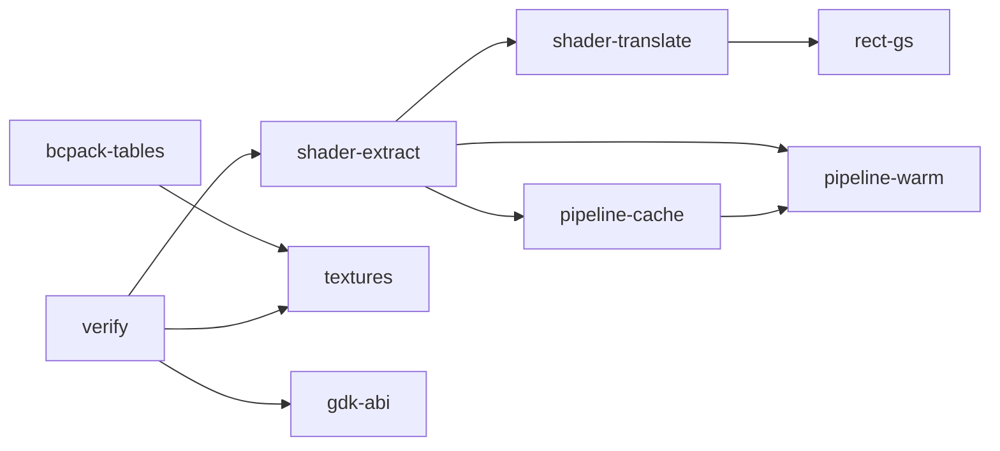

# Setup

`fivestar setup <dump folder>` prepares everything the port needs from your own dump. It runs a fixed list of steps
in dependency order and records each finished step, so a second run skips what is done and redoes only what changed.
An interrupted run continues where it stopped. `fivestar run` ([running.md](running.md)) runs the steps the game needs
with the same state before it starts the game.

```
fivestar setup <dump folder> [--work <dir>] [--only <step,...>] [--force] [--limit N] [--step K] [--jobs N]
                             [--translate-ahead] [--mesh-fallbacks] [--all-forms] [--warm-all] [--dxc <dxc.exe>]
                             [--gdk-lib <xgameruntime.lib>] [--loader <fivestar-loader.exe>] [--bcpack-tables <bcpack-tables.bin>]
fivestar setup <dump folder> --status
fivestar setup <dump folder> --clean-cache
```

The loader translates and compiles each program when the game first uses it
([d3d12x-pipelines.md](d3d12x-pipelines.md#programs-on-demand)), so a run selects every step but `shader-translate`,
`rect-gs` and `pipeline-warm`. `--translate-ahead` selects them too (about 2 hours and 36 dxc CPU-hours for every
program), as does naming them in `--only`.

## Steps



| Step | Does | Output in the work folder |
|---|---|---|
| `verify` | reads the title id and version from `MicrosoftGame.Config`; checks `shaders.rpf` and the texture page files exist. Another title fails; another version gives a warning | none |
| `bcpack-tables` | checks the BCPack table file given with `--bcpack-tables` (or `FIVESTAR_BCPACK_TABLES`) by size and SHA-256 and copies it into the work folder. The project does not ship the file ([textures.md](textures.md#bcpack-tables)); without it the step finishes with a note, and BC3, BC6H and BC7 textures are not exported | `loader/bcpack-tables.bin` |
| `shader-extract` | `fivestar shader extract` of `shaders.rpf` and the executable | `shaders/dxbc`, `shaders/fssm` |
| `shader-translate` | `fivestar shader translate` of every program, compiled with dxc through the shader cache; with `--mesh-fallbacks` only when a GPU of the machine has no mesh shaders, or when setup gets `--mesh-fallbacks`; with `--waves` of the GPUs of the machine, so only the wave forms they pick are compiled (`--all-forms` compiles every form, for another machine); with `--first-used` when the loader's journal exists, so the programs earlier boots used are done first | `shaders/hlsl` (HLSL, DXIL, `results.json`, `variants.json`), `shader-cache` |
| `rect-gs` | `fivestar shader rect-gs` of the translated vertex programs: the geometry shaders the loader draws rectangle lists with | `shaders/hlsl/rect-gs` |
| `pipeline-cache` | `fivestar shader psocache` of the console pipeline cache, matched to the programs | `pipelines` (`pipelines.json`, `code/`) |
| `textures` | `fivestar texture extract` of every page file, with the imported BCPack tables when present | `textures/<page file path>/*.dds` |
| `gdk-abi` | `fivestar platform gdk-abi` from the PC GDK's `xgameruntime.lib`, for `fivestar-loader --gdk-abi`. Without a GDK it finishes with a note | `loader/gdk-abi.txt` |
| `pipeline-warm` | `fivestar-loader --warm-pipelines --warm-used-only` of `shaders.rpf` with `--warm-step` = `--step`: builds the pipelines earlier boots used (the loader's `pipeline-cache/pipelines-used.bin`) with the desktop driver ([d3d12x-pipelines.md](d3d12x-pipelines.md#warm-up)), so the next boot loads them; without that file there is nothing to do, since the game builds its pipelines on first use. Its programs come from the same folders as `fivestar run`'s boot (the extracted programs, made on demand into `program-cache`; the translation only with `--translate-ahead`), so the pipelines are the ones the boot asks for, and a finished run stamps `journal-warm.txt` as `fivestar run --warm` does ([running.md](running.md#after-a-translator-update)). `--warm-all` also builds every pipeline of the console pipeline cache (about 9 hours). `fivestar run` does not wait for it | `pipeline-cache` |

`variants.json` lists every compiled program with its DXIL forms (native, wave32 variant or mesh superstep form, mesh fallback) and wave
floor, so the runtime picks the form for the GPU without reading HLSL (see
[shader-translation.md](shader-translation.md#wave-size), Variant selection). Mesh fallbacks are compiled for every
mesh program only when the machine has a GPU without mesh shaders (they double the mesh programs' dxc work and a
mesh-shader GPU never loads them); a program dxc rejects as a mesh shader gets its fallback either way. Whether
fallbacks are on is part of the step's inputs, so a new GPU redoes the step (from the cache).

A failed step stops the steps that depend on it; the others still run. `--only` runs the named steps (their
dependencies must be done); `--force` redoes them even when they are up to date.

## Work folder

The default is `%LOCALAPPDATA%\FiveStar\<titleid>-<version>\`, for example `%LOCALAPPDATA%\FiveStar\7952987A-1.0.2.1\`;
`--work <dir>` picks another. A full run needs about 16 GB for the shaders (about 610 KiB per program), 0.5 GB for the
console pipeline cache, about 4 GB for the built pipelines (`pipeline-warm`) and 0.9 to 2.2 times each page file for its textures (58 GB of page files). Before each step setup
compares its estimate (twice the page files for textures) with the free space of the drive and stops the step with a
message when it does not fit; on a re-run it counts only what is not done yet.

## State and resume

`state/<step>.json` records a finished step: a hash of its inputs, a hash of the tool build, when it finished, how
long it took and a summary. `state/<step>.running` exists while a step runs; it stays when the process ends early
or the step fails, and the step then shows as interrupted.

| Step | Inputs | Tool |
|---|---|---|
| `verify` | path, size and write time of the config, `shaders.rpf` and the page files | a version number in the code |
| `bcpack-tables` | the content of the given file, or of the imported copy | FiveStar.Formats |
| `shader-extract` | `shaders.rpf` and `game_scarlett_master.exe` (path, size, write time) | FiveStar.Shaders |
| `shader-translate` | `shaders/dxbc/_manifest.tsv` (it lists every container hash), the sample options, whether mesh fallbacks are on, the GPUs' wave sizes (or `--all-forms`) | the shader-cache identity (below) |
| `rect-gs` | `shaders/hlsl/variants.json` | the shader-cache identity, FiveStar.Shaders |
| `pipeline-cache` | `shaders.rpf` | FiveStar.Shaders, FiveStar.Formats |
| `textures` | every page file, the sample options, the imported BCPack tables | FiveStar.Formats |
| `gdk-abi` | the GDK library and the dump's modules, or none | FiveStar.Formats |
| `pipeline-warm` | `shaders.rpf`, the sample options, `--warm-all`, the size and time of `pipelines-used.bin` | the `fivestar-loader.exe` file |

A step's inputs also include the records of the steps it depends on, so a redone step redoes what follows it. A
step runs when it has no record, its record differs, its outputs are gone or it was interrupted. Within a step:

- `shader-translate` resumes through the shader cache: every finished translation and compile is kept, so a re-run
  only does the programs that were not reached.
- `textures` writes `state/textures/<page file>.done` with the file's fingerprint after each page file and skips files
  whose mark is current.
- `rect-gs` keeps every geometry shader already compiled.
- `shader-extract` and `pipeline-cache` take about a minute and start over.
- `pipeline-warm` skips every pipeline the cache already holds. Its outputs count as gone when the cache folder has
  no segment, which is also the case after a driver update (the loader deletes the segments the new driver refuses).

Every step prints `[n/9] <title>`, the reason it runs, its expected time and the overall time left. The expected time is
the last measured duration of the step, or before the first run an estimate: 3.2 s of one job per shader program
(about an hour for all programs on 24 jobs, 5.8 hours on 4), 100 MiB of page files per second for textures. The shader and texture steps print
progress, time left and finish time every 10 seconds.

`--limit N` and `--step K` make a sample: the first N of every K-th program, N textures per page file. A different
sample counts as different inputs.

## Requirements

`shader-translate` and `rect-gs` need dxc, found as for `fivestar shader translate`: `--dxc`/`FIVESTAR_DXC`, then the Windows SDK,
then `PATH`. The RDNA code is decoded in-process, so LLVM is not needed. When dxc is missing setup says so and how to
provide it before any step runs.

## Shader cache

The cache (`shader-cache/`, layout in [shader-translation.md](shader-translation.md#cache)) keys every entry by a
hash, so the hash does not tell which build made it. Each run of `fivestar shader translate --cache` (which setup
uses) therefore records the entries it reads or writes in `shader-cache/used/<identity>.txt`, one entry path per
line, appended as it goes. The identity hashes the translator identity (FiveStar.Shaders and the
translation options) and the dxc identity.

`--clean-cache` removes every entry the current identity's record does not list, the records of other identities and
left-over temporary files, then prints what it removed and kept. Entries a new build reuses (the DXIL of unchanged
HLSL) are in its record, so it runs only after `shader-translate` finished with the current build.

## Status

`--status` prints each step's condition (done, not run, interrupted, stale with the reason, or waiting for an
earlier step) with its last run, the size of each output folder, the free space and the shader cache split into the
current build and older builds. Pass the same `--limit`/`--step` as the run, or the sampled steps show as stale.
