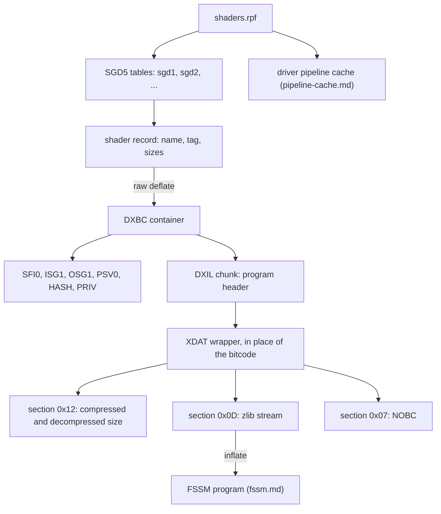

# Shader containers

The game ships its shaders in `shaders.rpf` (a few in the executable, [below](#executable)). Unlike the other
archives its payload is not encrypted: it holds SGD5 tables whose shader records each compress one DXBC container. The DXIL chunk of that container carries no LLVM
bitcode; an Xbox XDAT wrapper in its place holds the native RDNA program (FSSM, see [fssm.md](fssm.md)). The archive also holds the driver's pipeline cache
([pipeline-cache.md](pipeline-cache.md)). Code:
`src/FiveStar.Shaders/Containers`.



All integers are little-endian.

## SGD5 tables

A table starts on a 4 KB page whose first four bytes are `SGD5` and runs to the next such page (the last one to the
end of the file). Tables are named `sgd1`, `sgd2`, ... in file order. Inside a table, shader records are found by
scanning for this layout:

| Offset | Size | Field |
|---|---|---|
| 0 | 1 | name length including the NUL, at least 5 |
| 1 | n | name: 3 to 254 printable ASCII characters, e.g. `PS_Foo_1234abcd_Wrapped` or `effect:MS_VS_Bar_..._Wrapped` |
| 1 + n | 1 | NUL |
| 2 + n | 1 | tag, 0x30..0x4F (0x32, 0x3C, 0x40, 0x41, 0x42 occur; 0x41 marks mesh programs) |
| 3 + n | 4 | compressed size |
| 7 + n | 4 | constant 0x000DDCE7 |
| 11 + n | 4 | compressed size again |
| 15 + n | 4 | decompressed size |
| 19 + n | csize | raw deflate stream |

A candidate is a record when the length byte equals the name length + 1, both size fields agree, 0 < csize <
0x4000000, 0 < dsize < 0x10000000, and the stream inflates to exactly dsize bytes starting with `DXBC`. After a
record the scan continues after its data; after a candidate that is no record, at the next byte. A name of 47 to 78
characters has a length byte in the tag range, so bytes before a record can form a false candidate whose "tag" is the
record's length byte (`E0 'K,Q' 00 '3'PS_EarlyComposite_...`): continuing after that tag lost 12 programs of
`shaders.rpf`, among them five `PS_CascadeShadows_texture_fire`, `CS_ClearBothMasks` of the underwater mask and two
meshlet-culling programs.

A stored record has the same header up to the tag, then the u32 size of the DXBC container and the container itself,
uncompressed; it counts when the container's own total size (offset 0x18) equals that size. Its constant is written
as 0 in the manifest.

## Executable

`game_scarlett_master.exe` embeds 15 records of its own in the same format (region `exe`, the whole file scanned): the
clear shaders `VS_Clear` and `PS_Clear*` (10 stored, 2 compressed, hash suffix `f05fef9c`) and three debug-text
shaders `TextVSQuad`, `TextPS_Tex` and `TextPS_Sdf`, whose XDAT holds DXIL bitcode instead of a native program; those
three are left out. `VS_Clear` is the vertex program of the first draw of every frame (a slot-86 stream pipeline,
program key `7f2680d5...`), so without it that draw was skipped.

A record repeats an earlier one when both name and DXBC hash are equal; only the first copy is written.

**File names.** `<table>_<tag offset as 8 hex digits>_t<tag as 2 hex digits>_<name>`, where the tag offset is the
file offset of the tag byte and every name character outside `[A-Za-z0-9_.-]` becomes `~` (the name part is cut at
150 characters).

**`_manifest.tsv`.** One line per record, duplicates included, with a header line:

| Column | Content |
|---|---|
| region | table name |
| fileoff | file offset of the length byte (hex) |
| tag | tag byte (hex) |
| name | record name |
| csize, dsize | compressed and decompressed size |
| k | the constant field (hex) |
| dxbc_hash | the 16-byte DXBC hash as hex |
| chunks | chunk codes of the container, comma separated |

## DXBC container

| Offset | Size | Field |
|---|---|---|
| 0x00 | 4 | `DXBC` |
| 0x04 | 16 | content hash |
| 0x14 | 2 + 2 | version 1.0 |
| 0x18 | 4 | total size |
| 0x1C | 4 | chunk count |
| 0x20 | 4 × count | chunk offsets |

Each chunk: four-character code, u32 payload size, payload. The game containers hold `SFI0 ISG1 OSG1 PSV0 HASH DXIL
PRIV`.

### Signatures (ISG1, OSG1, PSG1)

u32 element count at 0, u32 offset of the element table at 4; 32-byte elements:

| Offset | Size | Field |
|---|---|---|
| 0 | 4 | stream |
| 4 | 4 | offset of the semantic name (NUL-terminated, from the chunk start) |
| 8 | 4 | semantic index |
| 12 | 4 | system value: 0 none, 1 SV_Position, 2 SV_ClipDistance, 3 SV_CullDistance, 4 SV_RenderTargetArrayIndex, 5 SV_ViewportArrayIndex, 6 SV_VertexID, 7 SV_PrimitiveID, 8 SV_InstanceID, 9 SV_IsFrontFace, 10 SV_SampleIndex, 64 SV_Target, 65 SV_Depth, 66 SV_Coverage |
| 16 | 4 | component type: 1 uint, 2 int, 3 float, 4..6 min16uint/min16int/min16float |
| 20 | 4 | register |
| 24 | 1 | component mask (bit 0 = x) |
| 25 | 1 | read/write mask |
| 28 | 4 | minimum precision |

### PSV0

u32 info size at 0, then the runtime info. Offsets below are from the start of the info (chunk offset 4).

| Offset | Size | Field | Used for |
|---|---|---|---|
| 0 | 16 | stage union | mesh: u32 groupshared bytes, u32 view-id bytes, u32 payload bytes, u16 max vertices @12, u16 max primitives @14; geometry: u32 input primitive (D3D_PRIMITIVE), u32 output topology (D3D_PRIMITIVE_TOPOLOGY), u32 stream mask; compute: u32 groupshared bytes |
| 16 / 20 | 4 + 4 | min / max wave lanes | |
| 24 | 1 | shader kind: 0 ps, 1 vs, 2 gs, 5 cs, 13 ms, ... | info size ≥ 36 |
| 25 | 1 | uses view id | |
| 26 | 2 | mesh: output topology (1 line, 2 triangle); geometry: max vertex count | |
| 28..30 | 3 × 1 | signature input / output / patch-constant-or-primitive element counts | |
| 36 / 40 / 44 | 3 × 4 | numthreads x, y, z | info size ≥ 48 |

### DXIL chunk and XDAT

The DXIL chunk starts with the usual program header; the XDAT wrapper sits where the bitcode would be.

| Chunk offset | Size | Field |
|---|---|---|
| 0x00 | 4 | program version (kind << 16, major << 4, minor) |
| 0x04 | 4 | size in dwords |
| 0x08 | 4 | `DXIL` |
| 0x0C | 4 | DXIL version |
| 0x10 | 4 | bitcode offset (from 0x08) |
| 0x14 | 4 | bitcode size |
| 0x18 | | XDAT wrapper |

| XDAT offset | Size | Field |
|---|---|---|
| 0x00 | 4 | `XDAT` |
| 0x04 | 4 | section count (3) |
| 0x08 | 4 | header size (0x24) |
| 0x0C | 12 × count | sections: u32 id, u32 offset (from the XDAT start), u32 size |

| Section | Content |
|---|---|
| 0x12 | 16 bytes: u64 compressed size, u64 decompressed size of the program |
| 0x0D | zlib stream of the FSSM program |
| 0x07 | `NOBC`: the DXIL bitcode was stripped |

The FSSM program is section 0x0D of the first DXIL chunk, inflated; it must start with `FSSM`.

## Commands

```
fivestar shader extract <shaders.rpf> <out> [--exe <game_scarlett_master.exe>]
```

Writes `<out>/dxbc/<stem>.dxbc` for every unique record (with `--exe` also the executable's), `<out>/dxbc/_manifest.tsv`,
and `<out>/fssm/<stem>.fssm` with the native program of each container. The dump gives 26,503 records of
`shaders.rpf` and 12 of the executable: 25,908 programs. The `shader-extract` setup step passes the executable. The translator finds a program's container by the same stem in the sibling
`dxbc` folder.

```
fivestar shader unwrap <in.dxbc> <out.dxbc>
```

Rewrites a container whose XDAT carries LLVM bitcode (a zlib section starting `BC 0xC0DE`) into a standard DXBC
container that DirectX tools read: the bitcode is placed behind a regular DXIL header, PRIV chunks are dropped and the
hash is zeroed. Containers with only `NOBC` are refused.

## Unknown

- The SGD5 header and the effect tables between the shader records.
- The meaning of the constant 0x000DDCE7 in every record.
- The contents of the PRIV chunk (8 to 560 bytes, starting `DC E2`).
