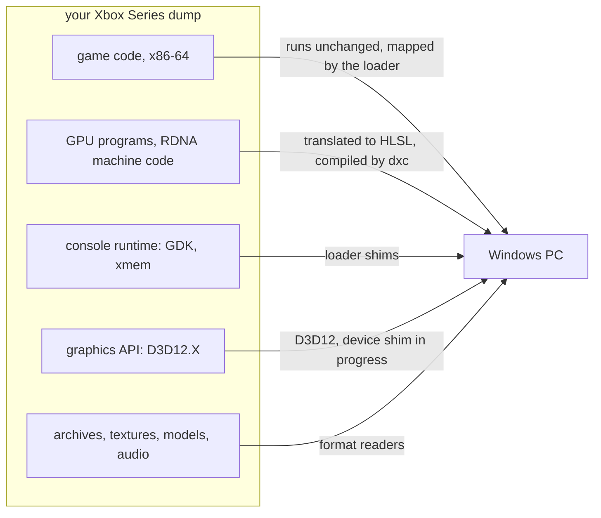

Five Star Recomp works toward running the Xbox Series version of **Grand Theft Auto VI** (1.0.2.1, title ID
`7952987A`) natively on Windows, from a copy you own.

The console's CPU is x86-64, so the game code itself runs on a PC unchanged. The project rebuilds what surrounds it:
GPU shaders, the console runtime, the graphics API and the data formats.

## Pages

| Page | Contents |
|---|---|
| [Status](Status.md) | what works today, with numbers |
| [Roadmap](Roadmap.md) | what is left, grouped by what blocks it |
| [Platforms and performance](Platforms-and-Performance.md) | Windows, Linux, Steam Deck, macOS, and how speed is kept |
| [Archives](Archives.md) | RPF9 archives and the PSO metadata inside them |
| [Textures and BCPack](Textures-and-BCPack.md) | ttpf texture pages and the BCPack codec |
| [Shader translation](Shader-Translation.md) | how native GPU programs become HLSL |
| [Console runtime](Console-Runtime.md) | the loader and the GDK runtime replacement |
| [Related projects](Related-Projects.md) | other work on the same game |

Format specifications that the code implements live in the repository's `docs/` folder. This wiki holds research,
findings and status.
