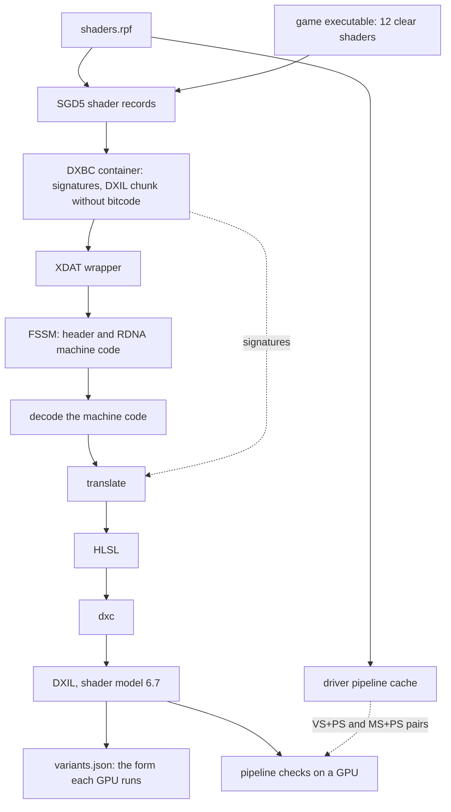

# Shader translation

The game ships its GPU programs only as native AMD RDNA (gfx10) machine code. The DXIL inside each shader record has
its bitcode removed, so the PC driver cannot compile it. The translator turns the machine code into HLSL, which
`dxc` compiles to DXIL for any PC GPU.

## Model

| Console concept | HLSL translation |
|---|---|
| A wave of 32 or 64 lanes | one HLSL invocation per lane |
| EXEC mask | a per-lane `active` flag |
| Branches | structured `if`/`else` and loops; a wave-uniform block dispatch loop (`switch` on the program counter) where the graph does not allow that, or with `--dispatch` |
| Lane masks | per-lane booleans; wave ballots where a mask is read as an integer |
| Resource descriptors | bindless heap indices written by the runtime where the descriptor holds its base address; the other fields (stride, format, swizzle) as the hardware lays them out |
| GPU addresses (root descriptors, pointers, descriptors a program builds) | looked up per 64 KiB page in an address map the runtime keeps of the game's GPU memory |
| Hardware input registers | decoded from the program header (stage, wave size, input layout) |
| Semantics | taken from the input and output signatures that survive in each record |

## Stages

| Stage | Programs | Notes |
|---|---|---|
| Pixel | 12,049 | helper lanes included in wave operations (Shader Model 6.7) |
| Vertex | 2,191 | the driver's fetch shader becomes vertex inputs |
| Compute | 2,684 | |
| Mesh (NGG) | 8,765 | two phases so output counts are set before any output write; 46 exceed PC's 32 KB output limit and run as compute plus a vertex-pulling vertex shader, a path every mesh program can take on GPUs without mesh shaders |
| Geometry | 195 | legacy geometry shader with on-chip output; the embedded copy shader runs as a function per emitted vertex |

## Ray tracing

64 programs walk AMD's own bounding-volume hierarchy with `image_bvh_intersect_ray`. The instruction is emulated in
HLSL over AMD's node layouts (box16, box32, triangle), following AMD's GPURT reference, and matches it bit-exactly in
tests. A PC port therefore has to supply BVHs in AMD's layout: the shipped `XboxBvhBuilder.dll` produces them for
static data; moving geometry needs its own builder.

## Wave size

23,226 programs are written for 64-lane waves. On 32-lane GPUs (NVIDIA) per-lane work, quad operations and
first-lane reads stay correct. What breaks is reading another lane by index:

| Programs | Count |
|---|---|
| wave64, index other lanes (break on 32-lane GPUs) | 1,226 |
| wave32, index other lanes (break if a driver runs them as wave64) | 1,877 |

Compute programs request their wave size. For the 203 that need 64 lanes, which NVIDIA does not offer, 181 also get
a variant that runs their thread group as the wave and loads on NVIDIA; 3 more only need 32 lanes; 19 have several
waves per group and need a GPU with 64-lane waves.

Pixel, vertex and mesh shaders cannot request a wave size, so the translation emulates the console wave on whatever
wave the GPU runs:

| GPU wave | Result |
|---|---|
| same as the console's | console results |
| wider (AMD running a wave32 program in wave64) | console results: each part of the wave acts as one console wave |
| narrower, pixel and vertex | console results unless the program reads a lane the narrower wave does not have |
| narrower, mesh | console results when an analysis shows the narrower wave never needs the rest of the console wave (6,217 of 8,765 programs); the others get a "superstep" form that exchanges every wave operation through groupshared memory (2,511, slower) |

Each translated program states the narrowest GPU wave on which it gives console results. Of the 1,982 lane-indexed
pixel, vertex and mesh programs, all compile; on 32-lane GPUs 462 of the 907 wave64 pixel programs give console
results, while 445 pixel and 1 vertex program read lanes such a GPU does not have; every mesh program that compiles natively runs correctly there, natively or in the superstep form. The [developer
documentation](https://github.com/ThatRecompDev/five-star-recomp/blob/main/docs/shader-translation.md#wave-size) has the
details and the limits.

## Limits

| Limit | Handling |
|---|---|
| Mesh output over 32 KB | compute plus vertex pulling |
| Group shared memory 28 KB | mesh outputs written directly instead of staged |
| Ordered pixel access (POPS) | rasterizer-ordered views |
| Very large programs | 3 programs take 25 to 80 minutes in `dxc` |
