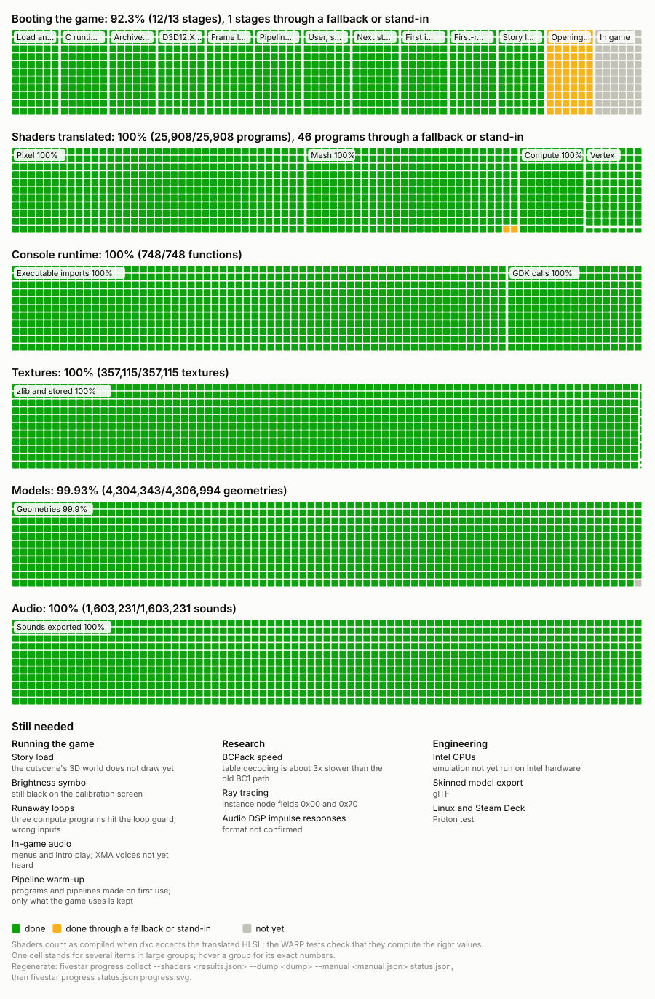

# Status

GTA VI does not run yet. Its main executable (`game_scarlett_master.exe`, built 13 November 2026) became available on
23 November 2026. Under the loader it now starts: it runs from its entry point through the C runtime start-up, its
memory set-up, opening its archives through DirectStorage, the whole D3D12.X device set-up, its GPU memory pools,
descriptor heaps, render targets and pipelines, and into its frame loop: it now presents frames continuously to its own
window through a swap chain at its own 30 frames per second. Its frame loop advances: it polls input, starts its save
system, and after a scripted button press pairs a gamepad with the user and streams its next stage. It now draws its
first real image: its UI layer and the intro video (Bink, decoded on the CPU and drawn with the game's own translated
shaders) in the right colours. It then shows the Rockstar logo, the intro art and every first-run screen (text size,
brightness, controls, legal, privacy policy and terms), which scripted input answers, saves its settings, loads story
mode and has shown the story intro's title card ("Vice City, two years ago"). Shaders are translated and compiled when
the game first uses them, so no preparation step is needed, and the first-run screens are answered by a script that
reacts to what is on screen (story load after about 57 s); later boots read the saved settings and skip those screens
(story load after about 39 s). The GPU hangs, the game's hang watchdog and the memory
blow-up of the story load are fixed, and so is the GPU work that corrupted game memory (a translator bug). The story
load now finishes and the opening cutscene plays its art, credit cards, dialogue and sound at a steady 30 frames a
second; its 3D world does not draw yet (see [Roadmap](Roadmap.md)). Programs are now compiled by our own DXIL backend in a
separate compile process: a cold boot has about 385 programs ready 90 s in, against 129 with dxc, and a warm boot skips
almost no draws. On 25 November 2026 the opening shot's 3D world reached the G-buffer for the first time: the street, an apartment
block with balconies, windows and a utility pole, and the towers behind it, drawn by the game's own mesh shaders. The
game builds descriptor addresses itself, heap-relative as on the console, and reads buffer descriptors through their
base addresses; the descriptor window now mirrors that layout (views and samplers each from 0, records keeping the
game's buffer addresses). Since the evening of 25 November the final composite fills the screen: the game copies
descriptor records into its heap itself, and a table bind now mirrors them past the root signature's range (the
composite reads record 41 of a 7-record table). The lit image it shows is still red-only: the lighting programs read
records up to 180 of their tables, and mirroring those is being tested. The overwrite of the game's
memory pools that ended boots about 100 s in is fixed (a particle pass wrote through a
misplaced buffer view), and every entry point the game calls now catches its own exceptions. With warm caches the
cutscene's G-buffer passes now mostly run (about 14,700 draws recorded against 4,700 skipped in a 15 s window), but
the world's indirect mesh draws leave the depth and G-buffer empty, so the 3D world is still not visible, and long
boots end in a GPU hang (a shader that never finishes; an unbounded loop in the wave32 mesh form is now bounded).
Driver memory grows with the number of live game textures (about 0.55 MB each); shared texture heaps are being
tried.

| Area | Result |
|---|---|
| Shaders extracted | 26,503 records from `shaders.rpf` and 12 from the executable (its clear shaders), 25,908 native GPU programs |
| Shaders translated | all 25,908 compile to DXIL (all stages); the 3 largest compute programs still take 25 to 80 minutes each in dxc |
| Structured control flow | the default; 14,059 programs fully structured, 8,765 mesh programs partly, 23 stay in the dispatch form; DXIL 39% smaller, dxc 16% faster; on 1,390 sampled real programs both forms give the same outputs on WARP (415 run, 278 are one text) |
| Wave size | compute programs that read lanes by number are pinned to their wave size; 181 of the 203 pinned to 64 lanes also get a wave32 variant that loads on NVIDIA, and 3 more are pinned to 32; the 1,982 pixel, vertex and mesh programs with the same dependence emulate the console wave and all compile: console results on any GPU wave at least as wide as theirs, and 496 of them also on narrower ones (462 of the 907 wave64 pixel programs on 32-lane GPUs); 6,217 of the 8,765 mesh programs need only 4-lane waves and 2,511 more get a superstep form that runs on any wave |
| Shader cache | a re-run with nothing changed takes 26 seconds instead of about 70 minutes |
| Driver pipelines | on an RTX 4090, 9,511 of 9,716 sampled pipelines build; the rest are wave64 compute programs on a wave32-only GPU and two out-of-memory compiles |
| Mesh fallback | all 8,765 mesh programs also build as compute plus vertex pulling, for GPUs without mesh shaders; on an AMD iGPU without them all 697 sampled fallback pairs load |
| Console pipeline cache | 25,471 graphics and 2,693 compute pipelines read from `shaders.rpf`, linked to our programs, with blend, depth and raster state decoded |
| Translator checks | 134 tests pass, most of them on D3D12 WARP, and 4 are skipped (they need a full 32 or 64-lane wave); ray intersection is bit-exact; the built-in RDNA decoder matches LLVM on all 44 million instructions of the corpus |
| Archives | about 68% of all archive bytes extract without the encrypted file table; file names are not known |
| Metadata (PSO) | 6,026 metadata files and about 39,700 paged resources parse completely |
| Textures | all 357,115 export exactly across all 57 texture files, including cube maps, arrays and volumes, with the BCPack tables the user supplies (all 108,605 BCPack pages: BC1, BC3, BC4, BC5, BC6H and BC7); without them 355,130 (99.44%) are readable; every texture's layout fits its stored span |
| Models | 4,304,343 of 4,306,994 geometries (99.94%) of 383,907 drawables decode across 7 archives: meshlets (including the large vehicle bodies whose meshlet starts wrap past 65,535), packed positions, normals, tangents, four texture coordinate sets, skin influences and inverse bind matrices; OBJ export |
| Videos | 515 Bink 2 videos extract from `movies.rpf` |
| Audio | all 1,603,231 sounds in `audio.rpf` export as Ogg Opus or WAV (Opus, XMA2, PCM); our XMA2 decoder matches FFmpeg on all 1,818 XMA2 streams (exact sample counts, at least 136 dB SNR) and can export them as PCM |
| Executable | 587 imports, all resolved: 34 by shims, 209 from the package's own libraries, 325 from Windows, 19 by Xbox-only stubs; the six Xbox libraries in the package load with all 825 of their imports resolved |
| Boot | from the entry point through C runtime start-up, memory set-up, DirectStorage archive opening, D3D12.X device set-up (queues, command lists, frame pacing), buffers at game-chosen GPU addresses, the descriptor heaps, render targets, the first present and into the frame loop; `--d3d12-debug` adds the D3D12 debug layer and DRED; a fault report gives the address, function, registers and last shim calls of any stop |
| Console runtime | task queues and async run for real; user, saves, package and store work offline; the game calls 161 GDK functions, all named from the PC GDK and all shimmed |
| Console system libraries | xmem physical pages alias like the console's (shared sections mapped into placeholders); XG texture layouts match 309,631 of 351,925 shipped textures; DirectStorage reads and inflates on CPU worker queues; the console's Opus decoder queue runs on the CPU, sample-identical to the audio exporter on a real sound bank |
| Graphics API (D3D12.X) | every D3D12.X object the game gets (device, queues, command lists, allocators, resources, heaps) wraps a desktop object: desktop-compatible methods forward through generated thunks, console-only ones are logged; command lists execute through the console's queue method; buffers can live in the game's own memory at the addresses it chose; the game's five pipeline-creation methods build pipelines from the translated shaders when the loader is given the shader folders; game textures and models draw through the game's own shaders on our renderer; command translation and present are not done |
| Setup | `fivestar setup` prepares a dump in one resumable command; a re-run with nothing changed takes under a second |
