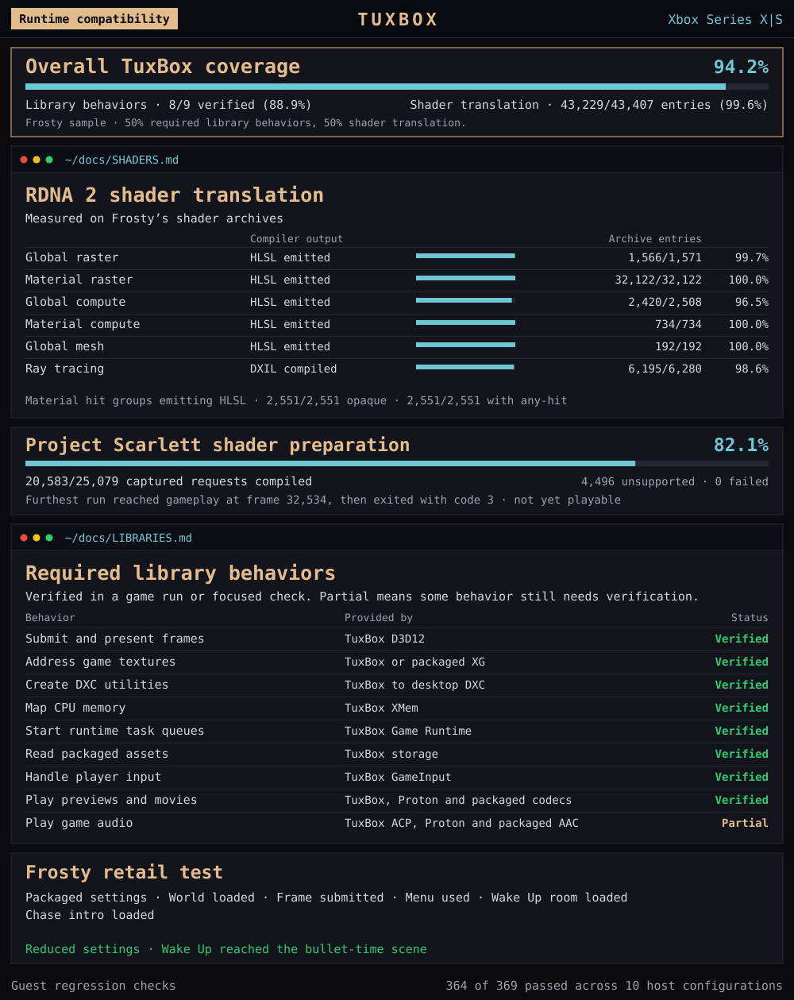

# TuxBox

TuxBox is an experimental compatibility layer that aims to run Xbox Series X|S games on Linux and Windows PCs. It is Linux-first: Windows has a native Direct3D 12 backend, and game support there is still in development.

## How it works

An Xbox Series game mostly calls the same APIs a Windows game does. Windows handles those itself, and Valve's Proton provides them on Linux. TuxBox supplies the part that is specific to the console:

- **Graphics:** the Xbox version of Direct3D 12, plus ray tracing and texture layouts.
- **Shaders:** a translator that turns the console's GPU code into shaders a PC graphics card can run.
- **Other libraries:** the memory, input, storage and audio calls a game actually uses.

We measure progress by what works in real games, not by how many functions exist. [Architecture](docs/ARCHITECTURE.md) · [Library coverage](docs/LIBRARIES.md)

## Status

TuxBox is early. No retail game is playable yet.

| Title | Where it gets to on Linux |
| --- | --- |
| **Lanes**, our own test game | Fully playable |
| **The Matrix Awakens** | Menu and the opening of the chase, with visual faults and crashes |
| **GTA VI** | The story intro; the first cutscene does not appear yet |

Games are tested on an NVIDIA GeForce RTX 4070 Ti SUPER; the built-in checks have also passed on other NVIDIA and AMD cards. You supply your own games and system files. [Progress](docs/PROGRESS.md) · [Test results](docs/RESULTS.md)

[](docs/progress.svg)

## Try Lanes

Install the [build tools](examples/lanes/README.md#build-requirements), then run from the project folder:

```sh
python -m pip install -r requirements.txt
python build.py lanes
python tuxbox.py run --app-id Lanes build/lanes
```

Press Left or Right to change lanes, or Space to take a turn in your current lane. R restarts and Escape quits.

## Documentation

- [Running games](docs/USAGE.md): shader preparation, logs, performance capture and offline launches
- Game setup: [The Matrix Awakens](docs/MATRIX_AWAKENS.md) · [GTA VI](docs/PROJECTSCARLETT.md)
- [Shader coverage](docs/SHADERS.md)
- [Source layout](docs/SOURCE_LAYOUT.md)
- [Credits and references](docs/REFERENCES.md)

## Contributing

Every change must pass `python tuxbox.py check`, which includes running Lanes on a real GPU. [How to contribute](CONTRIBUTING.md)

## License

Copyright © 2026 TuxBox contributors. TuxBox is licensed under the [Apache License 2.0](LICENSE). Third-party materials retain their own terms. [Third-party notices](docs/REFERENCES.md#shader-compiler-attribution)
