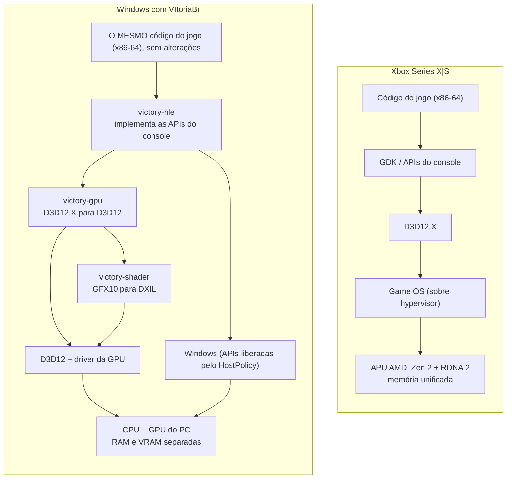
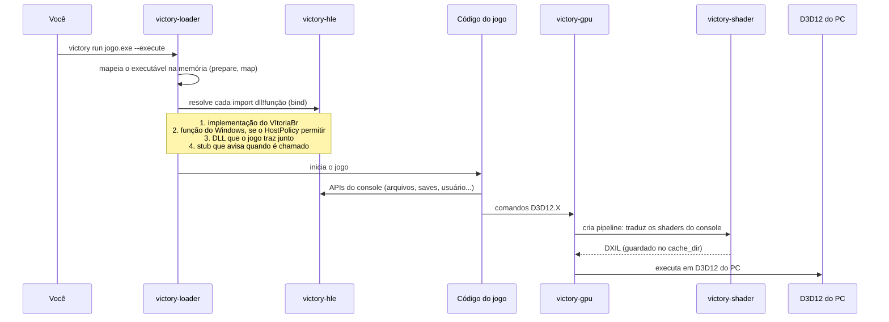
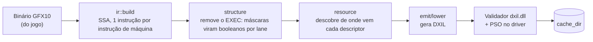
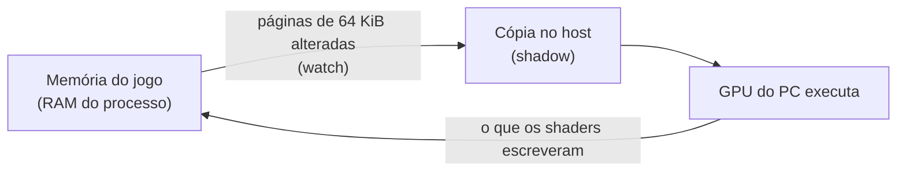

# Visão geral: como o VItoriaBr faz um jogo de Xbox rodar no PC

Este documento explica, em português e sem pressupor conhecimento de GPU, **por que um jogo de
Xbox Series X|S não roda no Windows** e **o que cada parte do VItoriaBr faz para contornar isso**.
Para os detalhes técnicos de cada peça, veja [architecture.md](architecture.md). O status atual e as
medições estão no [README](../README.md).

> Nada aqui contém dados de jogo. Veja a [política de assets](asset-policy.md).

---

## 1. O ponto de partida: o hardware é parecido, o software não

O Xbox Series X e um PC moderno usam a mesma arquitetura de CPU (x86-64, AMD Zen 2 no console). Por
isso o **código de CPU do jogo roda sem alterações** dentro do processo do VItoriaBr. Não é uma
emulação de CPU como em consoles antigos.

O que impede o jogo de rodar é todo o resto:

| Barreira | No Xbox | No PC | Quem resolve no VItoriaBr |
|---|---|---|---|
| Sistema e APIs do console | Game OS + GDK (`xgameruntime.dll`, saves, contas, armazenamento) | Não existem | `victory-loader` + `victory-hle` |
| API gráfica | D3D12.X, com comandos gravados direto pelo jogo | D3D12 comum | `victory-gpu` |
| Shaders | Já compilados para a GPU do console (ISA GFX10 / RDNA 2) | A GPU do PC espera DXIL | `victory-shader` |
| Memória | Unificada: endereço de GPU = endereço de CPU | RAM e VRAM separadas | `victory-gpu` (cópias, `shadow`, `memory`) |
| Formatos de dados | Texturas com layout próprio, BCPack descomprimido em hardware, áudio XMA | Sem suporte nativo | `victory-formats` |
| Tamanho de wave | 64 ou 32 lanes, por programa | NVIDIA: sempre 32 | `victory-shader` (seções "whole-wave"; parcial) |
| Ray tracing | Travessia em compute + uma instrução de hardware por nó | Sem essa instrução | `victory-shader` (instrução emulada em DXIL; em andamento) |

---

## 2. A pilha: Xbox original x VItoriaBr no PC



A ideia central: **o jogo continua achando que está num Xbox.** Toda chamada que ele faz ao
"console" cai numa implementação do VItoriaBr, que faz o equivalente no Windows.

---

## 3. O que acontece quando você roda `victory run ... --execute`



Pontos que vale entender:

- **Resolução de imports** (`victory-loader` + `victory-hle`): é o coração da compatibilidade. Se o
  jogo pede uma função que ninguém implementou, ele recebe um *stub* que registra o nome. Assim fica
  fácil saber o que falta (`victory census` mostra isso sem rodar o jogo).
- **Arquivos e saves**: o jogo monta caminhos de um "drive" do console. `victory-hle::modules::files`
  reescreve esses caminhos para pastas do PC; os saves ficam em `VICTORY_DATA_DIR`.
- **Online**: as áreas online respondem como um console offline.
- **Comandos de GPU**: no console, o jogo escreve pacotes direto na command list. O VItoriaBr mantém o
  limite dessas listas em zero, então **todo comando vira uma chamada de função** que ele intercepta e
  executa em D3D12.

---

## 4. Shaders: por que é a parte mais difícil

No PC, um jogo entrega shaders em DXIL e o driver compila para a GPU específica. No console, os
shaders já vêm **compilados em binário para a GPU AMD do Xbox**. O VItoriaBr precisa traduzir esse
binário de volta para DXIL, **na hora em que o jogo cria cada pipeline**:



Três coisas tornam isso difícil:

1. **EXEC e lanes.** A GPU AMD controla quais lanes (threads) estão ativas com uma máscara (EXEC). O
   DXIL não tem esse conceito, então o fluxo de controle precisa ser reconstruído (`structure`).
2. **Wave64 x wave32.** Muitos programas do console rodam em waves de 64 lanes. GPUs NVIDIA só têm 32.
   Reduções e somas de prefixo feitas em "seções whole-wave" são simuladas e reescritas com as
   operações de wave do DXIL (`emit/wave.rs`). Os compute shaders que exigem wave64 de verdade ainda
   são recusados pela NVIDIA, e são a maior parte dos PSOs que faltam (veja o README).
3. **Instruções sem equivalente.** Exemplo: o teste de raio contra nó de BVH (`image_bvh*_intersect_ray`)
   é uma instrução de hardware no console. O VItoriaBr a emula em DXIL e compara com uma referência em
   Rust (`crates/victory-shader/src/bvh.rs`). Veja [fork-ray-tracing.md](fork-ray-tracing.md).

---

## 5. Memória unificada: por que o mundo 3D ainda é lento

No console, CPU e GPU leem a mesma memória: **um endereço de GPU é um endereço de CPU**. No PC, a GPU
não consegue ler a memória do processo do jogo diretamente. Então o VItoriaBr mantém **cópias**:



- Cada buffer que um draw usa ganha uma cópia no host (`shadow.rs`). Antes de cada submissão, só as
  páginas de 64 KiB que o jogo alterou são recopiadas (`watch.rs`).
- O que os shaders escrevem volta para a memória do jogo depois da submissão.
- Shaders que andam por ponteiros crus (40 bits) usam um diretório com uma entrada por página de
  64 KiB (`memory.rs`).
- O **relay** (`VICTORY_RELAY=1/2`) usa uma thread separada para trazer os resultados de volta enquanto
  a próxima submissão é preparada.

Esse vai-e-volta é o que o console nunca precisa fazer, e é uma das razões de o mundo 3D ainda rodar a
poucos fps.

---

## 6. Mapa das crates

| Crate | Em uma frase | Roda/testa no Linux? |
|---|---|---|
| `victory-core` | configuração, guarda da política de assets, logs | sim |
| `victory-pe` | lê executáveis PE32+ | sim (testes com o próprio binário só no Windows) |
| `victory-loader` | carrega, mapeia, liga e inicia o jogo | não |
| `victory-hle` | implementa as APIs do console | não |
| `victory-gpu` | D3D12.X sobre D3D12 do PC | não |
| `victory-shader` | traduz shaders do console para DXIL | sim (validação e GPU só no Windows) |
| `victory-formats` | layouts de textura, BCPack, áudio | sim |
| `victory-pipeline` | cache endereçado por conteúdo | sim |
| `victory-game` | formatos e hooks específicos do título | sim |
| `apps/victory` | linha de comando | não |
| `xtask` | checagem da política de assets, git hooks | sim |

---

## 7. Como contribuir

**Sem Windows** (Linux ou macOS): as crates marcadas "sim" acima compilam e testam fora do Windows.
É o mesmo conjunto que o job `portable` do CI roda:

```sh
cargo test -p victory-core -p victory-pe -p victory-pipeline -p victory-shader \
           -p victory-formats -p victory-game -p xtask
```

É o caminho para mexer no tradutor de shaders (`victory-shader`), nos formatos e no cache. Os testes
que precisam do validador `dxil.dll` ou da GPU ficam de fora e rodam no job Windows.

**Com Windows**: siga o README (`cargo build --profile diag -p victory --features diagnostics`). Use
`VICTORY_D3D12_WARP=1` para testar o mundo 3D sem risco de TDR, e `victory translate --validate --pipelines`
para medir a cobertura de shaders.

Antes de qualquer commit: `cargo xtask policy` (ou instale os hooks com `cargo xtask install-hooks`).

---

## Glossário

| Termo | Significado |
|---|---|
| **APU** | CPU e GPU no mesmo chip, com a mesma memória (o caso do Xbox) |
| **GDK** | Kit de desenvolvimento da Microsoft para Xbox e PC |
| **D3D12.X** | Versão do Direct3D 12 específica do Xbox |
| **HLE** | *High-Level Emulation*: implementar as APIs do sistema em vez de emular o hardware |
| **GFX10 / RDNA 2** | Arquitetura e conjunto de instruções da GPU do Xbox Series |
| **DXIL** | Formato de shader que o Direct3D 12 do PC aceita |
| **PSO** | *Pipeline State Object*: shaders + estado, compilado pelo driver |
| **Wave / lane** | Grupo de threads que a GPU executa juntas (wave) e cada thread dele (lane) |
| **EXEC** | Máscara da GPU AMD que diz quais lanes estão ativas |
| **TDR** | Quando o Windows reinicia o driver de vídeo porque a GPU travou por mais de ~2 s |
| **WARP** | Implementação do D3D12 em software (lenta, mas não trava o driver) |
| **BVH** | Estrutura em árvore usada para acelerar ray tracing |
| **BCPack** | Compressão de texturas que o Xbox descomprime em hardware |
